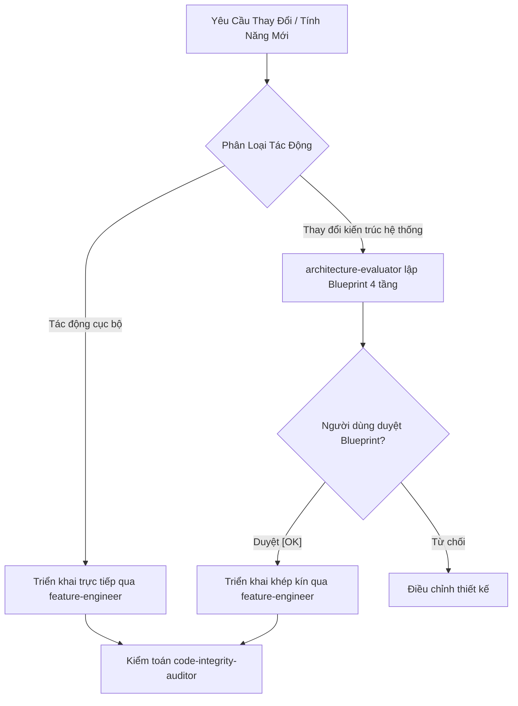

# Quy Chuẩn Kiến Trúc Hệ Thống (System Architecture & Impact Gate)

Tài liệu định nghĩa kiến trúc tổng thể, ranh giới 4 tầng bất biến và cổng kiểm soát thay đổi kiến trúc cho toàn bộ dự án LegendsTeamVN.BadmintonClub (.NET 10 / C# 13 Clean Architecture).

---

## 1. Cổng Đánh Giá Tác Động Kiến Trúc (Architectural Impact Gate)

> [!IMPORTANT]
> Mọi thay đổi mã nguồn phải được phân loại mức độ tác động trước khi viết code. Tuyệt đối không tự ý thay đổi luồng điều phối, hợp đồng abstractions hay cấu trúc phân tầng mà chưa được người dùng phê duyệt.



### Tiêu chí phân loại:
1. **Tác Động Cục Bộ (Local Changes):**
   - Thêm Query đọc dữ liệu đơn giản qua Repository đã có.
   - Thêm trường hiển thị vào Command/Query/DTO hiện hành.
   - Sửa lỗi logic cục bộ trong phương thức của Domain Entity.
   - $\rightarrow$ Triển khai trực tiếp qua `feature-engineer`, tuân thủ các quy tắc phân tầng.
2. **Thay Đổi Kiến Trúc Hệ Thống (Architectural Changes):**
   - Thêm Entity/Aggregate Root mới hoặc thay đổi quan hệ trong CSDL 3NF.
   - Thêm Command ảnh hưởng nhiều bảng, cần Database Transaction (Unit of Work).
   - Tích hợp dịch vụ bên ngoài mới (cổng thanh toán, SMS, Push Notification, Cloud Storage).
   - Thay đổi cơ chế phân quyền, JWT Token, hoặc Redis Distributed Lock.
   - $\rightarrow$ **BẮT BUỘC** ủy thác [`architecture-evaluator`](.agents/agents/architecture-evaluator.md) lập Blueprint 4 tầng kèm sơ đồ Mermaid trình người dùng phê duyệt trước khi viết code.

---

## 2. Ranh Giới 4 Tầng Clean Architecture Bất Biến

```text
┌─────────────────────────────────────────────────────────────┐
│                     Presentation Layer                      │
│        (Minimal API Endpoints [EndpointGroupBase],          │
│            Filters [.RequireGroupPermission], Hubs)         │
└──────────────────────────────┬──────────────────────────────┘
                               │ phụ thuộc vào (ISender)
                               ▼
┌─────────────────────────────────────────────────────────────┐
│                      Application Layer                      │
│      (CQRS Commands/Queries, sealed Handlers & Validators,  │
│                   Result<T>, Abstractions)                  │
└──────────────────────────────┬──────────────────────────────┘
                               │ phụ thuộc vào
                               ▼
┌─────────────────────────────────────────────────────────────┐
│                        Domain Layer                         │
│        (Rich Entities [private set], Domain Events,         │
│          Exceptions, Value Objects) [Zero External Deps]    │
└──────────────────────────────▲──────────────────────────────┘
                               │ triển khai (Implements)
              ┌────────────────┴────────────────┐
              │                                 │
┌─────────────┴──────────────┐   ┌──────────────┴─────────────┐
│      Persistence Layer     │   │    Infrastructure Layer    │
│ (EF Core 10, Npgsql,       │   │ (Redis Caching/Locks,      │
│  Configurations, Repos)    │   │  VietQR, SePay, SignalR)   │
└────────────────────────────┘   └────────────────────────────┘
```

### Ranh giới cụ thể:
1. **Tầng Domain (`src/LegendsTeamVN.BadmintonClub.Domain/`): Zero Dependencies:**
   - Hoàn toàn độc lập với mọi thư viện hạ tầng và framework. Không phụ thuộc EF Core, ASP.NET Core, hay bên thứ ba.
   - Entities được đóng gói: toàn bộ properties là `private set;` hoặc `protected set;`. Constructor không tham số `protected`.
   - Mọi thay đổi trạng thái và bảo vệ bất biến nằm trong method của Entity.
   - Domain Events là `sealed class` có hậu tố `DomainEvent`.
2. **Tầng Application (`src/LegendsTeamVN.BadmintonClub.Application/`): Pure Orchestration:**
   - Định nghĩa CQRS Commands, Queries, Handlers, Validators (FluentValidation), và Service Interfaces.
   - Handlers chỉ điều phối luồng: Nạp Entity $\rightarrow$ Kiểm tra null $\rightarrow$ Gọi method nghiệp vụ của Entity $\rightarrow$ Lưu thay đổi $\rightarrow$ Trả về `Result<T>`.
   - Handlers và Validators bắt buộc có từ khóa `sealed`.
   - Tuyệt đối cấm viết logic tính toán chi phí, quy tắc CLB hoặc raw SQL trong Handler.
3. **Tầng Persistence (`src/LegendsTeamVN.BadmintonClub.Persistence/`): Lưu Trữ & EF Core:**
   - Triển khai Repositories và Unit of Work từ Application.
   - Cấu hình EntityTypeConfiguration cho từng Entity, ánh xạ chính xác với schema 22 bảng CSDL 3NF trong [`docs/04_THIET_KE_CO_SO_DU_LIEU_3NF.md`](docs/04_THIET_KE_CO_SO_DU_LIEU_3NF.md).
   - Presentation không được phụ thuộc trực tiếp vào Persistence (NetArchTest kiểm tra tự động).
4. **Tầng Infrastructure (`src/LegendsTeamVN.BadmintonClub.Infrastructure/`): Dịch Vụ Ngoại Vi:**
   - Triển khai Redis Distributed Lock (`IDistributedLockService`), SignalR Hubs, SePay client, VietQR generator, Firebase FCM.
5. **Tầng Presentation (`src/LegendsTeamVN.BadmintonClub.Presentation/`): Minimal APIs:**
   - Endpoints kế thừa `EndpointGroupBase`, kết thúc bằng hậu tố `Endpoint`.
   - Chỉ inject `ISender`. Cấm inject `DbContext` hay `IRepository`.
   - Tuyến đường CLB phải gắn guard `.RequireGroupPermission(GroupPermissions.*)`.
   - Kết quả phản hồi bắt buộc chuẩn hóa qua `result.Match(...)`.

---

## 3. Triệt Tiêu Kế Thừa Cũ & Định Danh Duy Nhất (Zero Legacy & Canonical ID)
- Không tạo các lớp tương thích ngược (deprecated shims, backwards-compatibility fallbacks, overload cũ).
- Không viết các nhánh fallback kiểm tra nhiều tên alias cho API keys, configuration keys hay schema constants.
- Mỗi khái niệm chỉ có MỘT tên chuẩn duy nhất (Single Canonical Identifier) khớp với CSDL 3NF và đặc tả hệ thống.
