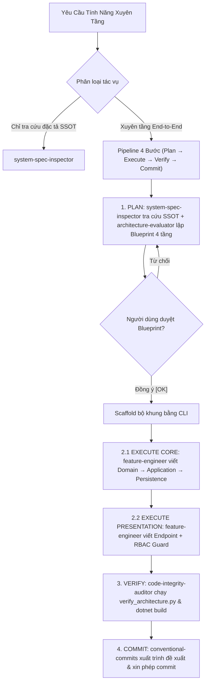

# Feature Lifecycle — Cross-Layer Clean Architecture Orchestrator

## Goal (Single Responsibility)
Skill điều phối cấp cao (**meta-orchestrator**) chuyên quản lý vòng đời tính năng **xuyên 4 tầng** Clean Architecture:
- `Domain`: Rich Entities, Domain Events, Invariants, Exceptions.
- `Application`: CQRS Commands/Queries, sealed Handlers, sealed Validators, Result<T>.
- `Persistence & Infrastructure`: EF Core Configurations, Repositories, Redis Distributed Locks, Transactions.
- `Presentation`: ASP.NET Core Minimal APIs (`EndpointGroupBase`), GroupPermissions RBAC, `result.Match()`.

---

## Pipeline Xuyên 4 Tầng



---

## Ma Trận Phân Công Subagents Xuyên Tầng

| Giai Đoạn | Subagent Đảm Nhiệm | Trách Nhiệm Cốt Lõi |
|---|---|---|
| **Tra cứu đặc tả SSOT (FR/UC/CSDL 3NF)** | [`system-spec-inspector`](.agents/agents/system-spec-inspector.md) | Trích xuất FR01-FR23, UC01-UC20, 22 bảng CSDL 3NF, GroupPermissions từ [`docs/`](docs/). |
| **Đánh giá kiến trúc & lập Blueprint** | [`architecture-evaluator`](.agents/agents/architecture-evaluator.md) | Thẩm định Architectural Impact Gate, lập sơ đồ Mermaid 4 tầng trình người dùng duyệt. |
| **Triển khai mã nguồn 4 tầng** | [`feature-engineer`](.agents/agents/feature-engineer.md) | Viết trọn vẹn Domain $\rightarrow$ Application $\rightarrow$ Persistence $\rightarrow$ Presentation. |
| **Kiểm toán ranh giới, NetArchTest, build** | [`code-integrity-auditor`](.agents/agents/code-integrity-auditor.md) | Chạy `verify_architecture.py` (37/37 tests) và `dotnet build` (tối đa 2 vòng verify-fix). |

---

## Bộ Công Cụ CLI Black-Box

> [!IMPORTANT]
> **Sử Dụng Scripts Dạng Black-Box:** Không cần đọc mã nguồn Python vào context. Chạy trực tiếp từ CLI:

1. **Khởi Tạo Bộ Khung CQRS Slice Mới:**
   ```powershell
   python .agents/skills/feature-lifecycle/scripts/scaffold_cqrs_slice.py --type {command|query} --name "<FeatureName>" --module "<Module>"
   ```
   *(Ví dụ: `--type command --name LockSession --module Sessions`).*

2. **Tra Cứu Nhanh Yêu Cầu Chức Năng (FR01 - FR23) & Ca Sử Dụng (UC01 - UC20):**
   ```powershell
   python .agents/skills/feature-lifecycle/scripts/trace_system_spec.py --fr {FR01..FR23}
   python .agents/skills/feature-lifecycle/scripts/trace_system_spec.py --uc {UC01..UC20}
   python .agents/skills/feature-lifecycle/scripts/trace_system_spec.py --search "<từ_khóa>"
   ```

3. **Kiểm Tra Kiến Trúc NetArchTest (Bắt Buộc 37/37 Tests Passed):**
   ```powershell
   python .agents/skills/verify-architecture/scripts/verify_architecture.py
   ```

4. **Kiểm Tra Tính Hợp Lệ Của Thông Điệp Commit:**
   ```powershell
   python .agents/skills/conventional-commits/scripts/git_commit_helper.py --validate "<thông_điệp_commit>"
   ```
