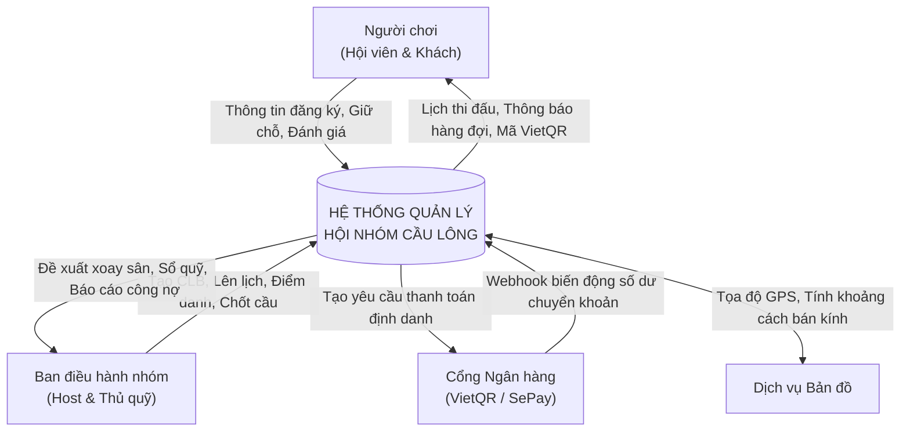

# CHƯƠNG III: PHÂN TÍCH HỆ THỐNG & ĐẶC TẢ CA SỬ DỤNG (USE CASES)

---

## 1. PHÂN TÍCH CHỨC NĂNG HỆ THỐNG

### 1.1. Bảng Phân Rã Chức Năng (Function Hierarchy)

Hệ thống được tổ chức thành 5 phân hệ nghiệp vụ cốt lõi bao gồm 23 chức năng chi tiết:

| Phân hệ chức năng | Mã chức năng con | Tên chức năng | Tác nhân chính | FR tương ứng |
| :--- | :---: | :--- | :--- | :---: |
| **Quản trị Tài khoản & Đa nhóm (F1)** | F1.1 | Đăng ký tài khoản | Người dùng mới | FR01 |
| | F1.2 | Đăng nhập & Quản lý phiên làm việc | Toàn bộ người dùng | FR02 |
| | F1.3 | Quản trị đa nhóm & Chuyển đổi nhóm | Toàn bộ người dùng | FR03, FR04 |
| | F1.4 | Quản lý hồ sơ cá nhân & Trình độ | Toàn bộ người dùng | FR05 |
| **Khám phá, Giữ chỗ & Kết nối (F2)** | F2.1 | Khám phá & Tra cứu nhóm theo vị trí | Khách vãng lai, Thành viên | FR06, FR07 |
| | F2.2 | Đăng ký giữ chỗ có kiểm soát sĩ số | Khách vãng lai, Thành viên | FR08 |
| | F2.3 | Tự động hàng đợi thông minh | Hệ thống tự động | FR09, FR10 |
| | F2.4 | Phát tín hiệu tìm người giao lưu lân cận | Ban điều hành nhóm (Host) | FR11 |
| | F2.5 | Tiếp nhận & Đăng ký slot giao lưu | Người chơi lân cận | FR12 |
| **Vận hành Buổi chơi & Sân đấu (F3)** | F3.1 | Cấu hình nhóm & Khởi tạo buổi chơi | Ban điều hành nhóm (Host) | FR13 |
| | F3.2 | Điểm danh thành viên tại sân | Ban điều hành nhóm | FR14 |
| | F3.3 | Điều phối xoay tua sân tự động | Hệ thống tự động | FR15 |
| | F3.4 | Can thiệp điều phối thủ công tại sân | Ban điều hành nhóm (Host) | FR16 |
| | F3.5 | Theo dõi lịch thi đấu cá nhân realtime | Thành viên, Khách | FR17 |
| **Hạch toán Vật tư & Sổ quỹ mở (F4)** | F4.1 | Ghi nhận vật tư tiêu hao (Cầu bóc mới)| Ban điều hành nhóm | FR18 |
| | F4.2 | Hạch toán chi phí đa hệ số tự động | Hệ thống tự động | FR19 |
| | F4.3 | Khởi tạo mã VietQR thanh toán | Hệ thống tự động | FR20 |
| | F4.4 | Đối soát Webhook & Tự động xác nhận thanh toán | Hệ thống tự động | FR21 |
| | F4.5 | Quản trị Sổ quỹ mở minh bạch | Thành viên (Xem), Host (Quản trị) | FR22 |
| **Đánh giá Tín nhiệm & Tương tác (F5)**| F5.1 | Đánh giá & Tính điểm uy tín thành viên| Hệ thống tự động, Người chơi | FR23 |
| | F5.2 | Đánh giá & Tính điểm chất lượng nhóm | Hệ thống tự động, Người chơi | FR23 |

---

## 2. PHÂN TÍCH DỮ LIỆU & SƠ ĐỒ LUỒNG DỮ LIỆU (DFD)

### 2.1. Sơ đồ Luồng Dữ liệu Mức Ngữ cảnh (Context Diagram)
Hệ thống tương tác với 4 tác nhân ngoài chính:
1. **Người chơi (Hội viên cố định & Khách vãng lai)**: Cung cấp thông tin đăng ký, yêu cầu giữ chỗ, thanh toán chuyển khoản, đánh giá uy tín; nhận thông báo đôn hàng đợi, lịch thi đấu sân và mã QR thanh toán.
2. **Ban điều hành nhóm (Host & Thủ quỹ)**: Cung cấp thông tin nhóm, lịch sinh hoạt, thông số buổi chơi, điểm danh tại sân, số quả cầu bóc mới; nhận danh sách giữ chỗ, đề xuất xoay sân và báo cáo quỹ.
3. **Cổng thông tin ngân hàng (SePay / VietQR)**: Tiếp nhận yêu cầu sinh mã VietQR và gửi tín hiệu Webhook biến động số dư.
4. **Dịch vụ Bản đồ & GPS**: Cung cấp tọa độ và tính toán khoảng cách bán kính tìm kiếm.

---

## 3. ĐẶC TẢ CHI TIẾT 20 CA SỬ DỤNG (USE CASE SPECIFICATION)

### UC01: Đăng ký tài khoản định danh
- **FR đáp ứng**: FR01 (F1.1) | **Tác nhân**: Người dùng mới.
- **Tiền điều kiện**: Ứng dụng đã cài đặt và có kết nối Internet.
- **Luồng chính**: Người dùng nhập Số điện thoại/Email, Mật khẩu, Họ tên, Giới tính ➔ Hệ thống kiểm tra trùng lặp ➔ Băm mật khẩu (BCrypt) ➔ Tạo bản ghi `app_user` ➔ Cấp Access Token/Refresh Token.
- **Hậu điều kiện**: Tài khoản mới được tạo; người dùng đăng nhập thành công vào trang chủ.

### UC02: Đăng nhập & Quản lý phiên làm việc
- **FR đáp ứng**: FR02 (F1.2) | **Tác nhân**: Toàn bộ người dùng.
- **Tiền điều kiện**: Đã có tài khoản trên hệ thống.
- **Luồng chính**: Nhập Identifier và Password ➔ Hệ thống xác thực mật khẩu băm ➔ Cấp JWT Access Token (kèm danh sách CLB đã tham gia) ➔ Lưu Device Token (`user_device`) để nhận thông báo đẩy.
- **Hậu điều kiện**: Phiên làm việc được kích hoạt an toàn.

### UC03: Quản lý hồ sơ cá nhân & Trình độ
- **FR đáp ứng**: FR05 (F1.4) | **Tác nhân**: Toàn bộ người dùng.
- **Tiền điều kiện**: Đã đăng nhập.
- **Luồng chính**: Người dùng xem hồ sơ ➔ Chỉnh sửa Avatar, Họ tên, Trình độ tự đánh giá (1-6: NB, Y, TBY, TB, TBK, K) và bật/tắt sẵn sàng tham gia giao lưu (`isOpenForGuest`) ➔ Hệ thống lưu và đồng bộ cho các thuật toán ghép sân.
- **Hậu điều kiện**: Hồ sơ cá nhân được cập nhật.

---

### UC04: Khởi tạo & Cấu hình hội nhóm
- **FR đáp ứng**: FR13 (F3.1a, F3.1b, F3.1c) | **Tác nhân**: Ban điều hành nhóm (Người tạo nhóm).
- **Tiền điều kiện**: Người dùng đã đăng nhập vào hệ thống.
- **Mô tả**: Người dùng khởi tạo một hội nhóm cầu lông mới, thiết lập thông tin sân bãi, lịch sinh hoạt định kỳ, tài khoản ngân hàng và biểu phí đa hệ số.
- **Luồng chính (Main Flow)**:
  1. Người dùng chọn "Tạo câu lạc bộ mới" trên ứng dụng di động.
  2. Điền thông tin: Tên CLB, Mô tả, Sân cố định, Địa chỉ, Tọa độ GPS, Khoảng trình độ (Min/Max Skill), Lịch sinh hoạt định kỳ trong tuần.
  3. Cung cấp tùy chọn cấu hình tài chính: STK ngân hàng và Biểu phí (nếu để trống hệ thống áp dụng cấu hình mặc định).
  4. Bấm "Hoàn tất tạo nhóm".
  5. Hệ thống mở Transaction: Tạo `club_group`, sinh mã nhóm ngắn `code` (ví dụ `CLB-LEGENDS7`), sinh 5 vai trò chuẩn (`group_role`), thêm người tạo làm Host với 100% quyền hạn trong `group_member`, lưu các khung giờ `group_schedule`, lưu `group_fee_rule` và `group_bank_account`.
  6. Commit Transaction và trả về mã CLB.
  7. Tự động chuyển ngữ cảnh làm việc của người dùng sang CLB vừa tạo.
- **Hậu điều kiện**: Nhóm mới được tạo thành công, người tạo được cấp vai trò Host tối cao.

---

### UC05: Chuyển đổi ngữ cảnh nhóm (Switch Context)
- **FR đáp ứng**: FR03, FR04 (F1.3) | **Tác nhân**: Toàn bộ người dùng.
- **Tiền điều kiện**: Người dùng đang tham gia ít nhất 1 hội nhóm.
- **Luồng chính**: Người dùng chọn nhóm muốn làm việc trên thanh trượt/Server-Rail ➔ Ứng dụng thiết lập Header HTTP ngữ cảnh `X-Group-Id = <clubId>` (hoặc truyền qua Route parameter) ➔ Giữ nguyên 1 JWT Access Token toàn cục duy nhất ➔ Hệ thống thẩm tra quyền hạn động qua `GroupPermissionHandler` và Redis Cache (`group:perm:{userId}:{groupId}`) ➔ Ứng dụng cập nhật giao diện và dữ liệu theo nhóm vừa chọn tức thì mà không cần xin cấp lại Token.
- **Hậu điều kiện**: Ngữ cảnh làm việc được đồng bộ chính xác theo vai trò tại nhóm vừa chọn.

### UC06: Tìm kiếm & Gửi yêu cầu gia nhập nhóm
- **FR đáp ứng**: FR06, FR07 (F2.1) | **Tác nhân**: Khách vãng lai, Hội viên.
- **Tiền điều kiện**: Bật GPS trên thiết bị.
- **Luồng chính**: Quét radar tìm các CLB quanh bán kính (km) theo công thức Haversine ➔ Xem chi tiết địa chỉ sân, lịch chơi và trình độ mục tiêu ➔ Bấm "Xin gia nhập", viết lời giới thiệu ➔ Hệ thống tạo bản ghi `join_request` ở trạng thái `PENDING`.
- **Hậu điều kiện**: Đơn xin gia nhập được gửi tới Host chờ duyệt.

### UC07: Phê duyệt yêu cầu gia nhập nhóm
- **FR đáp ứng**: FR13 (F3.1) | **Tác nhân**: Trưởng nhóm (Host), Phó nhóm.
- **Tiền điều kiện**: Có đơn gia nhập ở trạng thái `PENDING`.
- **Luồng chính**: Host xem hồ sơ và trình độ của ứng viên ➔ Chọn "Chấp thuận" hoặc "Từ chối":
  - *Chấp thuận*: `join_request.Approve(hostId)` ➔ Tạo bản ghi `group_member` mới với vai trò Thành viên mặc định (`is_default = true`), trạng thái `ACTIVE`.
  - *Từ chối*: `join_request.Reject(hostId)`.
- **Hậu điều kiện**: Ứng viên chính thức trở thành thành viên hoặc yêu cầu bị hủy bỏ.

---

### UC08: Khởi tạo buổi sinh hoạt (Mở buổi chơi)
- **FR đáp ứng**: FR13 (F3.1) | **Tác nhân**: Trưởng nhóm (Host).
- **Tiền điều kiện**: Có quyền `OPERATIONS.SESSION.CREATE`.
- **Luồng chính**: Host nhập: Tiêu đề buổi chơi, Thời gian bắt đầu/kết thúc, Địa điểm cụm sân, Số lượng sân, Định mức người/sân (mặc định 6 người/sân), Sĩ số trần tối đa (`courtCount * targetPerCourt`), Tiền thuê sân, Hạn chốt giữ chỗ ➔ Hệ thống tạo bản ghi `badminton_session` với trạng thái `OPEN`.
- **Hậu điều kiện**: Buổi chơi mở cho thành viên vào đăng ký giữ chỗ.

### UC09: Đăng ký giữ chỗ có kiểm soát sĩ số & Hàng đợi
- **FR đáp ứng**: FR08, FR09, FR10 (F2.2, F2.3) | **Tác nhân**: Thành viên, Khách, Hệ thống.
- **Tiền điều kiện**: Buổi sinh hoạt đang ở trạng thái `OPEN` và chưa quá hạn chốt giữ chỗ.
- **Luồng chính**:
  1. Người chơi bấm "Tham gia" giữ chỗ.
  2. Hệ thống kích hoạt **Redis Distributed Lock** theo mã buổi chơi (`session_{id}_lock`) để chống tranh chấp đồng thời.
  3. Kiểm tra số lượng người đã `CONFIRMED`:
     - *Chưa đạt trần*: Ghi nhận bản ghi `session_booking` với trạng thái `CONFIRMED`, `queue_order = 0`.
     - *Đã đạt trần*: Tự động gán trạng thái `WAITING`, tính `queue_order = max(queue_order) + 1` đưa vào hàng đợi.
  4. Giải phóng Redis Lock.
  5. *Trường hợp báo vắng*: Người đã có vé `CONFIRMED` bấm "Báo vắng" trước giờ khóa sổ ➔ Hệ thống chuyển trạng thái sang `ABSENT` ➔ Tự động đôn người chơi có `queue_order = 1` trong hàng đợi lên `CONFIRMED` ➔ Bắn thông báo đẩy (FCM) báo tin vui cho người chơi được đôn vé.
- **Hậu điều kiện**: Sĩ số buổi chơi tuyệt đối không vượt quá trần quy định.

---

### UC10: Phát tín hiệu tìm người giao lưu lân cận (Radar Host)
- **FR đáp ứng**: FR11 (F2.4) | **Tác nhân**: Trưởng nhóm (Host).
- **Tiền điều kiện**: Buổi chơi chuẩn bị diễn ra nhưng bị thiếu người (nguy cơ lẻ sân).
- **Luồng chính**: Host chọn số suất cần tuyển, trình độ tối thiểu, chi phí chia sẻ/suất và bán kính quét GPS (mặc định 5km) ➔ Hệ thống tạo bản ghi `guest_recruitment` (`ACTIVE`) ➔ Phát thông báo đẩy đến các tay vợt đang bật `isOpenForGuest = true` trong bán kính sân.
- **Hậu điều kiện**: Tín hiệu tìm kèo được lan tỏa tức thì.

### UC11: Tiếp nhận & Đăng ký slot giao lưu lân cận
- **FR đáp ứng**: FR12 (F2.5) | **Tác nhân**: Khách vãng lai lân cận.
- **Tiền điều kiện**: Nhận thông báo tìm người và nằm trong bán kính quét.
- **Luồng chính**: Người chơi xem chi tiết buổi chơi, sân đấu, chi phí ➔ Bấm "Xác nhận tham gia" ➔ Hệ thống tạo `session_booking` liên kết với `id_recruitment` ➔ Giảm số suất cần tuyển; nếu hết suất chuyển trạng thái tin tuyển sang `FILLED`.
- **Hậu điều kiện**: Lấp đầy vị trí trống, triệt tiêu nguy cơ lẻ sân.

---

### UC12: Điểm danh thành viên tại sân
- **FR đáp ứng**: FR14 (F3.2) | **Tác nhân**: Trưởng nhóm (Host), Thủ quỹ.
- **Tiền điều kiện**: Người gọi có quyền điểm danh tại nhóm sở hữu buổi. Cho phép thao tác từ 1 giờ trước giờ bắt đầu đến trước giờ kết thúc; buổi ở trạng thái OPEN, LOCKED hoặc PLAYING.
- **Luồng chính**: Host mở danh sách những người đã đăng ký ➔ Bấm "Điểm danh" cho những người thực tế đã có mặt tại sân ➔ Chuyển trạng thái booking sang `CHECKED_IN` ➔ Chỉ những người này mới được nạp vào hàng đợi xoay tua.
- **Hậu điều kiện**: Xác lập danh sách người sẵn sàng thi đấu thực tế.
- **Luồng bổ sung**: Host/Thủ quỹ thêm nhanh tài khoản chưa đăng ký nếu còn sức chứa; đánh dấu NO_SHOW thủ công để giải phóng suất. Không tự đánh dấu NO_SHOW sau 15 phút và không tự đôn hàng chờ khi điểm danh vắng.
- **Hoàn tất điểm danh**: Ghi nhận người/thời điểm hoàn tất lượt đầu; không tự khóa buổi hay bắt đầu trận. Người chưa đến giữ CONFIRMED và giữ suất; vẫn được điểm danh bổ sung. Khi đóng cả buổi, cần xác nhận trước khi đổi những người còn CONFIRMED thành NO_SHOW. Hợp đồng API và các giới hạn xem [UC12-BE.md](Detail%20Design/UC12-BE.md).

---

### UC13: Điều phối xoay tua sân tự động (Match Rotation Engine)
- **FR đáp ứng**: FR15 (F3.3) | **Tác nhân**: Hệ thống tự động, Host.
- **Quyền thao tác**: `OPERATIONS.MATCH.MANAGE` trong nhóm sở hữu buổi; mặc định Host/Phó nhóm, không tự cấp cho Thủ quỹ. JWT UC13 phải còn hạn.
- **Tiền điều kiện khởi tạo**: Đã complete UC12, buổi đã đến giờ và chưa kết thúc, có sân trống và ít nhất 4 người đã CHECKED_IN khả dụng.
- **Luồng phụ 1a — Khởi tạo lượt đầu sau UC12**:
  1. Host mở Bàn điều khiển, xem sân trống và người Ready; bấm **Bắt đầu điều phối**.
  2. Hệ thống ghi nhận khởi tạo, OPEN chuyển LOCKED; đề xuất tối đa `min(sân trống, floor(người khả dụng / 4))` trận theo số sân. Mỗi trận đúng bốn người, hai người mỗi đội; một người không được phân trùng sân.
  3. Lưu đề xuất dưới dạng `session_match.WAITING`. Host xem/xác nhận hoặc chuyển sang UC14 khi có chức năng đó.
  4. Host bấm **Bắt đầu trận** trên từng sân. BE kiểm tra lại, ghi giờ bắt đầu, chuyển trận PLAYING; trận đầu chuyển buổi PLAYING. Complete UC12 không tự bắt đầu điều phối/trận.
- **Luồng chính — Các lượt tiếp theo**:
  1. Host bấm **Kết thúc trận**. BE khóa buổi, ghi FINISHED/TimeEnd, giải phóng sân và bốn người.
  2. Lấy ứng viên CHECKED_IN không thuộc WAITING/PLAYING và đã nghỉ ít nhất 5 phút sau FINISHED gần nhất cùng buổi; chưa chơi thì xét ngay. Ưu tiên chưa chơi theo check-in, sau đó nghỉ lâu nhất; hòa dùng check-in và UserId. SKIPPED không tạo nghỉ bắt buộc.
  3. Chọn bốn người ưu tiên rồi xét ba cách chia cặp, lấy chênh lệch tổng SkillLevel nhỏ nhất. Đây là ưu tiên công bằng, không bảo đảm tuyệt đối không ngồi ngoài hai trận với mọi sĩ số/số sân.
  4. Tạo đề xuất WAITING cho các sân trống đủ người; giữ đề xuất hợp lệ hiện có. Host xác nhận bắt đầu từng trận.
     Nếu chưa đủ người nghỉ xong, lưu mốc đủ bốn người và để sân trống; scheduler nhịp 5 giây tự thử xếp khi tới hạn. Nghỉ cố định chung, Host không cấu hình; scheduler không tự start trận.
  5. Start lưu trận, bốn thông báo MATCH và outbox trong cùng transaction; worker phát SignalR/FCM sau commit, có retry/dead-letter. Đồng hồ FE tính từ timeStart.
- **Ngoại lệ**: Dưới bốn người thì giữ sân trống, finish vẫn thành công. Người đến muộn được điểm danh bổ sung ở LOCKED/PLAYING theo UC12 và tự xét lấp sân trống. NO_SHOW hủy đề xuất mất người rồi thử xếp lại trong cùng transaction; người đang chơi không được đánh vắng. Người mới không thay đội hình hợp lệ đã đề xuất. Sau EndTime không tạo/start trận mới, vẫn kết thúc được trận đang chơi.
- **Hậu điều kiện**: Không trùng sân/người trong các trận hoạt động; finish và đề xuất tiếp theo lưu nguyên tử; gửi lặp start/finish không tạo thêm trận/lời mời hoặc đổi lại timestamp. Booking vẫn CHECKED_IN khi chơi/nghỉ.
- **Bàn giao BE**: [UC13-BE.md](Detail%20Design/UC13-BE.md). UC14 chỉnh đội hình và màn hình cá nhân UC15 chưa triển khai trong đợt UC13.

### UC14: Can thiệp điều phối trận đấu thủ công
- **FR đáp ứng**: FR16 (F3.4) | **Tác nhân**: Trưởng nhóm (Host).
- **Tiền điều kiện**: Hệ thống đã đưa ra đề xuất 4 người cho sân trống nhưng Host chưa bấm bắt đầu.
- **Luồng chính**: Host dùng thao tác kéo thả trên ứng dụng để hoán đổi người chơi hoặc đổi bạn cùng chơi/đối thủ theo yêu cầu riêng ➔ Đánh dấu cờ `is_manual_swapped = true` ➔ Bấm bắt đầu trận.
- **Hậu điều kiện**: Cặp đấu được cập nhật theo ý muốn của Host.

**Hợp đồng BE đã duyệt, triển khai theo từng đợt (20/10/2026):** xem [UC14-BE.md](Detail%20Design/UC14-BE.md). UC14 BE A–G đã hoàn tất trên sandbox: chỉnh/reset/pause/resume/confirm kèm version, guard start cũ, tranh chấp hai writer, rollback và SignalR hai instance đều được kiểm chứng. Lời mời tới đúng 4 người cuối, retry không tạo thêm bản ghi. Flutter chưa triển khai; DB đích chưa nâng cấp.

- Host được nhận diện bằng tên role Host hoặc IsHostRole theo cơ chế hiện có, kèm MatchManage trong CLB sở hữu buổi. Không thay quyền UC13.
- No-op không chụp gợi ý gốc, tăng version hoặc phát event. Chỉ thay đổi thực sự đầu tiên mới chụp baseline; các lần chỉnh/reset sau giữ nguyên baseline.
- Khôi phục phải kiểm tra lại người chơi còn hợp lệ, không pause/cooldown hoặc ở sân khác; xung đột trả 409, không khôi phục một phần.
- Tạm nghỉ tới khi Host bật lại; có người thay hợp lệ thì thay, không chỉ định người thay thì SKIPPED proposal và xét lại. Chưa bắt đầu trận mới được chỉnh/pause người trong đội hình.
- Trận chỉ bắt đầu khi đủ 4 người hợp lệ, mỗi đội 2 người; start lấy giờ server và mời đúng đội hình cuối. Phần Flutter kéo thả không nằm trong đợt BE.

### UC15: Theo dõi lịch thi đấu cá nhân theo thời gian thực
- **FR đáp ứng**: FR17 (F3.5) | **Tác nhân**: Hội viên, Khách tại sân.
- **Tiền điều kiện**: Người chơi đã được điểm danh `CHECKED_IN`.
- **Luồng chính**: Người chơi mở màn hình Live Match trên điện thoại ➔ Xem vị trí sân đang đấu, ai là bạn cùng chơi, ai là đối thủ ở lượt kế tiếp và thời gian nghỉ dự kiến mà không cần hỏi Host.
- **Hậu điều kiện**: Người chơi chủ động chuẩn bị vào sân đúng giờ.

---

### UC16: Chốt sổ buổi chơi & Phân bổ chi phí đa hệ số
- **FR đáp ứng**: FR18, FR19 (F4.1, F4.2) | **Tác nhân**: Host, Thủ quỹ.
- **Tiền điều kiện**: Buổi sinh hoạt kết thúc khung giờ thuê sân.
- **Luồng chính**:
  1. Host nhập: Số quả cầu lông bóc mới thực tế trong buổi (`shuttlecock_used`) và các phụ phí phát sinh (`extra_expense` như tiền nước, tiền thảm phát sinh).
  2. Chuyển trạng thái buổi chơi sang `CALCULATED`.
  3. Hệ thống nạp biểu phí của nhóm (`group_fee_rule`) và tự động tính toán theo công thức đa hệ số:
     - Tính tổng chi phí buổi: `Tổng_chi_phí = Tiền_thuê_sân + (Số_cầu * Đơn_giá_cầu) + Phụ_phí`.
     - Phân bổ theo loại người chơi: Hội viên tháng (đã đóng trọn gói), Hội viên ngày, Khách vãng lai.
     - Áp dụng chính sách ưu đãi giảm trừ cho người chơi Nữ: Hội viên ngày (`female_discount_daily`), Khách vãng lai (`female_discount_guest`).
     - Áp dụng quy tắc làm tròn tiền lẻ (`round_rule`, ví dụ làm tròn lên 1.000đ).
  4. Hệ thống tự động sinh các bản ghi Khoản thu buổi chơi (`session_fee`) cho từng người tham gia ở trạng thái `UNPAID`.
  5. Đồng thời sinh mã định danh chuyển khoản duy nhất (`payment_code`, ví dụ: `BC12627_A8F1`).
- **Hậu điều kiện**: Bảng chi phí của từng người chơi được ban hành.

---

### UC17: Thanh toán khoản thu cá nhân qua mã VietQR
- **FR đáp ứng**: FR20 (F4.3) | **Tác nhân**: Người chơi.
- **Tiền điều kiện**: Buổi chơi đã chốt sổ; khoản thu cá nhân đang ở trạng thái `UNPAID`.
- **Luồng chính**: Người chơi mở chi tiết khoản thu ➔ Màn hình hiển thị mã VietQR động chuẩn ngân hàng NAPAS đã **nhúng sẵn số tiền chính xác** và **nội dung chuyển khoản định danh (`payment_code`)** ➔ Người chơi dùng ứng dụng ngân hàng bất kỳ quét mã và xác nhận chuyển tiền.
- **Hậu điều kiện**: Giao dịch chuyển tiền được thực hiện thành công.

### UC18: Đối soát & Tự động gạch nợ qua Webhook ngân hàng
- **FR đáp ứng**: FR21 (F4.4) | **Tác nhân**: Cổng thanh toán ngân hàng (SePay), Hệ thống.
- **Tiền điều kiện**: Người chơi đã chuyển khoản; bản ghi `session_fee` đang ở trạng thái `UNPAID`.
- **Luồng chính**:
  1. Ngân hàng nhận tiền ➔ Cổng thanh toán bắn Webhook HTTP POST về máy chủ Backend.
  2. Middleware kiểm tra chữ ký bí mật `webhook_secret_key` của tài khoản nhóm.
  3. Hệ thống phân tích nội dung chuyển khoản để trích xuất `payment_code` và số tiền nhận được.
  4. Khớp lệnh chính xác: Cập nhật bản ghi `session_fee` sang trạng thái `PAID`, gán `paid_at = now()`.
  5. Tạo bản ghi giao dịch ngân hàng đối soát `bank_transaction` (`MATCHED`).
  6. Tự động kết chuyển một dòng thu tiền vào Sổ quỹ mở của nhóm (`group_ledger`).
  7. Bắn thông báo đẩy (FCM) xác nhận thanh toán thành công đến điện thoại của người chơi.
- **Hậu điều kiện**: Tự động xác nhận thanh toán 100%, thủ quỹ không cần kiểm tra sao kê thủ công.

---

### UC19: Quản trị & Theo dõi Sổ quỹ mở minh bạch
- **FR đáp ứng**: FR22 (F4.5) | **Tác nhân**: Toàn thể hội viên (Xem), Thủ quỹ/Host (Quản trị).
- **Tiền điều kiện**: Là thành viên của nhóm đang chọn.
- **Luồng chính**:
  - *Hội viên*: Xem toàn bộ lịch sử thu tiền buổi chơi, thu quỹ tháng, chi tiền sân, chi mua cầu và số dư khả dụng của quỹ nhóm theo thời gian thực.
  - *Thủ quỹ*: Tạo phiếu chi mua cầu số lượng lớn, chi liên hoan, hoặc ghi nhận thu tiền mặt cho người chơi không chuyển khoản.
- **Hậu điều kiện**: Mọi biến động dòng tiền được công khai minh bạch.

### UC20: Đánh giá tín nhiệm & Tính điểm uy tín hai chiều
- **FR đáp ứng**: FR23 (F5.1, F5.2) | **Tác nhân**: Hệ thống tự động, Người chơi.
- **Tiền điều kiện**: Buổi sinh hoạt kết thúc và quá trình thanh toán hoàn tất.
- **Luồng chính**:
  1. *Hệ thống tự động tính điểm*: Người chơi đi đúng giờ, không hủy hẹn sát giờ, thanh toán ngay được cộng điểm uy tín cá nhân (`reputation_score`); người hủy hẹn sát giờ hoặc trễ hẹn bị trừ điểm.
  2. *Đánh giá hội nhóm*: Người chơi chấm điểm CLB (1-5 sao) về tính minh bạch sổ quỹ, mật độ người/sân và văn hóa chơi ➔ Hệ thống cập nhật điểm chất lượng nhóm `group_quality_score`.
- **Hậu điều kiện**: Điểm tín nhiệm hai chiều được hiển thị công khai trên hồ sơ cá nhân và hồ sơ nhóm.
