# CHƯƠNG IV.1: THIẾT KẾ CƠ SỞ DỮ LIỆU CHUẨN HÓA (3NF DATABASE SCHEMA)

---

## 1. TỔNG QUAN MÔ HÌNH DỮ LIỆU

Hệ thống cơ sở dữ liệu được xây dựng trên hệ quản trị **PostgreSQL**, được thiết kế theo đúng nguyên tắc **Chuẩn hóa bậc 3 (3NF - Third Normal Form)** nhằm loại bỏ hoàn toàn sự dư thừa dữ liệu, đảm bảo tính nhất quán và toàn vẹn tham chiếu.

### 1.1. Danh mục 22 Bảng Thực thể CSDL & Ánh xạ C# Entity

| STT | Thực thể Nghiệp vụ | Bảng CSDL PostgreSQL | Class C# Entity trong Domain | Phân hệ Nghiệp vụ |
| :---: | :--- | :--- | :--- | :--- |
| **1** | Người dùng hệ thống | `app_user` | `AppUser` | Người dùng & Định danh |
| **2** | Thiết bị người dùng | `user_device` | `UserDevice` | Thông báo đẩy (FCM) |
| **3** | Thông báo đẩy | `notification` | `Notification` | Thông báo & Tương tác |
| **4** | Đánh giá thành viên | `member_review` | `MemberReview` | Đánh giá & Tín nhiệm |
| **5** | Đánh giá hội nhóm | `group_review` | `GroupReview` | Đánh giá & Tín nhiệm |
| **6** | Hội nhóm cầu lông | `club_group` | `ClubGroup` | Quản trị Hội nhóm |
| **7** | Quyền hạn nhóm | `group_permission` | `GroupPermission` | Phân quyền Đa nhóm động |
| **8** | Vai trò nhóm | `group_role` | `GroupRole` | Phân quyền Đa nhóm động |
| **9** | Phân quyền vai trò | `role_permission` | `RolePermission` | Phân quyền Đa nhóm động |
| **10** | Thành viên hội nhóm | `group_member` | `GroupMember` | Thành viên & Hội viên |
| **11** | Lịch sinh hoạt định kỳ | `group_schedule` | `GroupSchedule` | Lịch sinh hoạt nhóm |
| **12** | Tài khoản ngân hàng nhóm | `group_bank_account` | `GroupBankAccount` | Thanh toán & Đối soát |
| **13** | Quy tắc chia tiền & Biểu phí | `group_fee_rule` | `GroupFeeRule` | Tài chính & Biểu phí |
| **14** | Yêu cầu gia nhập nhóm | `join_request` | `JoinRequest` | Tuyển quân & Gia nhập |
| **15** | Buổi sinh hoạt cầu lông | `badminton_session` | `BadmintonSession` | Vận hành Buổi chơi |
| **16** | Biểu quyết giữ chỗ | `session_booking` | `SessionBooking` | Đặt chỗ & Hàng đợi |
| **17** | Yêu cầu tìm khách giao lưu | `guest_recruitment` | `GuestRecruitment` | Kết nối Radar GPS |
| **18** | Trận đấu xoay tua | `session_match` | `SessionMatch` | Điều phối tại sân |
| **19** | Người chơi trận đấu | `match_player` | `MatchPlayer` | Điều phối tại sân |
| **20** | Khoản thu buổi sinh hoạt | `session_fee` | `SessionFee` | Tài chính & VietQR |
| **21** | Giao dịch ngân hàng đối soát | `bank_transaction` | `BankTransaction` | Webhook & Đối soát |
| **22** | Sổ quỹ nhóm | `group_ledger` | `GroupLedger` | Sổ quỹ mở minh bạch |

---

## 2. SƠ ĐỒ QUAN HỆ THỰC THỂ (ERD DIAGRAM)

```mermaid
erDiagram
    app_user ||--o{ user_device : "sở hữu"
    app_user ||--o{ notification : "nhận"
    app_user ||--o{ member_review : "đánh giá / được đánh giá"
    app_user ||--o{ group_review : "đánh giá CLB"
    app_user ||--o{ group_member : "tham gia CLB"
    app_user ||--o{ join_request : "nộp / duyệt đơn"
    app_user ||--o{ session_booking : "giữ chỗ"
    app_user ||--o{ match_player : "thi đấu"
    app_user ||--o{ session_fee : "nộp tiền"
    app_user ||--o{ group_ledger : "thực hiện thu chi"

    club_group ||--o{ group_role : "định nghĩa"
    club_group ||--o{ group_member : "quản lý"
    club_group ||--o{ group_schedule : "thiết lập"
    club_group ||--o{ group_bank_account : "sở hữu"
    club_group ||--o{ group_fee_rule : "áp dụng"
    club_group ||--o{ join_request : "tiếp nhận"
    club_group ||--o{ badminton_session : "tổ chức"
    club_group ||--o{ group_review : "nhận review"
    club_group ||--o{ group_ledger : "ghi nhận quỹ"

    group_role ||--o{ role_permission : "có quyền"
    group_permission ||--o{ role_permission : "được gán"
    group_role ||--o{ group_member : "chỉ định cho"

    badminton_session ||--o{ session_booking : "có người giữ chỗ"
    badminton_session ||--o{ guest_recruitment : "tìm khách bù chỗ"
    badminton_session ||--o{ session_match : "diễn ra các trận"
    badminton_session ||--o{ session_fee : "phát sinh khoản thu"
    badminton_session ||--o{ group_ledger : "kết chuyển thu chi"

    session_match ||--o{ match_player : "gồm 4 người chơi"
    session_fee ||--o| bank_transaction : "đối soát tự động"
```

---

## 3. ĐẶC TẢ CHI TIẾT 22 BẢNG CƠ SỞ DỮ LIỆU

### 3.1. Bảng `app_user` (Người dùng)
Lưu trữ thông tin tài khoản và hồ sơ thể thao cá nhân.

| Tên Cột | Kiểu Dữ Liệu | Ràng Buộc | Giá Trị Mặc Định | Mô Tả Nghiệp Vụ |
| :--- | :--- | :--- | :--- | :--- |
| `id_user` | UUID | PK, NOT NULL | `gen_random_uuid()` | Khóa chính người dùng |
| `phone_number` | VARCHAR(20) | UNIQUE, NULL | - | Số điện thoại đăng nhập |
| `email_address` | VARCHAR(255) | UNIQUE, NULL | - | Email đăng nhập |
| `password_hash` | VARCHAR(500) | NULL | - | Mật khẩu đã băm (BCrypt) |
| `full_name` | VARCHAR(150) | NOT NULL | - | Họ và tên người dùng |
| `gender` | SMALLINT | NOT NULL | 0 | Giới tính: 0=Nam, 1=Nữ |
| `avatar_url` | VARCHAR(1000)| NULL | - | Ảnh đại diện |
| `skill_level` | SMALLINT | NOT NULL | 1 | Trình độ: 1=NB, 2=Y, 3=TBY, 4=TB, 5=TBK, 6=K |
| `last_lat` | DECIMAL(10,7)| NULL | - | Vĩ độ GPS gần nhất |
| `last_lng` | DECIMAL(10,7)| NULL | - | Kinh độ GPS gần nhất |
| `is_open_for_guest`| BOOLEAN | NOT NULL | `true` | Cờ sẵn sàng nhận kèo giao lưu quanh đây |
| `reputation_score` | DECIMAL(5,2)| NOT NULL | 100.00 | Điểm uy tín cá nhân (khởi tạo 100đ) |
| `is_active` | BOOLEAN | NOT NULL | `true` | Trạng thái hoạt động tài khoản |
| `created_at` | TIMESTAMP | NOT NULL | `now()` | Thời điểm tạo tài khoản |
| `updated_at` | TIMESTAMP | NULL | - | Thời điểm cập nhật hồ sơ |

---

### 3.2. Bảng `user_device` (Thiết bị Người dùng)
Lưu Device Token phục vụ bắn thông báo đẩy Firebase Cloud Messaging (FCM).

| Tên Cột | Kiểu Dữ Liệu | Ràng Buộc | Giá Trị Mặc Định | Mô Tả Nghiệp Vụ |
| :--- | :--- | :--- | :--- | :--- |
| `id_device` | UUID | PK, NOT NULL | `gen_random_uuid()` | Khóa chính thiết bị |
| `id_user` | UUID | FK, NOT NULL | - | Khóa ngoại tham chiếu `app_user.id_user` |
| `device_token` | VARCHAR(500) | NOT NULL | - | Token định danh thiết bị từ FCM |
| `platform` | VARCHAR(20) | NULL | - | Nền tảng: `ANDROID`, `IOS` |
| `is_active` | BOOLEAN | NOT NULL | `true` | Chuyển về `false` khi người dùng đăng xuất |
| `updated_at` | TIMESTAMP | NOT NULL | `now()` | Thời điểm cập nhật token |

---

### 3.3. Bảng `notification` (Thông Báo)
Lưu lịch sử thông báo đẩy gửi tới người dùng.

| Tên Cột | Kiểu Dữ Liệu | Ràng Buộc | Giá Trị Mặc Định | Mô Tả Nghiệp Vụ |
| :--- | :--- | :--- | :--- | :--- |
| `id_notification`| UUID | PK, NOT NULL | `gen_random_uuid()` | Khóa chính thông báo |
| `id_user` | UUID | FK, NOT NULL | - | Khóa ngoại người nhận `app_user.id_user` |
| `title` | VARCHAR(255) | NOT NULL | - | Tiêu đề thông báo |
| `content` | TEXT | NOT NULL | - | Nội dung chi tiết thông báo |
| `type` | VARCHAR(50) | NOT NULL | - | Loại: `SESSION`, `QUEUE`, `PAYMENT`, `MATCH`, `GUEST_RECRUIT` |
| `reference_type` | VARCHAR(50) | NULL | - | Loại đối tượng: `SESSION`, `CLUB`, `FEE` |
| `reference_id` | UUID | NULL | - | Mã đối tượng tham chiếu |
| `is_read` | BOOLEAN | NOT NULL | `false` | Đã đọc / Chưa đọc |
| `created_at` | TIMESTAMP | NOT NULL | `now()` | Thời điểm gửi thông báo |

---

### 3.4. Bảng `member_review` (Đánh Giá Thành Viên)
Lưu nhận xét và chấm điểm phong cách thi đấu giữa các người chơi.

| Tên Cột | Kiểu Dữ Liệu | Ràng Buộc | Mô Tả Nghiệp Vụ |
| :--- | :--- | :--- | :--- |
| `id_review` | UUID | PK, NOT NULL | Khóa chính đánh giá |
| `reviewer_id` | UUID | FK, NOT NULL | Người đánh giá (Tham chiếu `app_user`) |
| `reviewee_id` | UUID | FK, NOT NULL | Người được đánh giá (Tham chiếu `app_user`, khác reviewer) |
| `rating` | INT | NOT NULL | Điểm số từ 1 đến 5 sao |
| `criteria` | VARCHAR(100) | NULL | Tiêu chí: Đúng giờ, Tinh thần thể thao, Trình độ |
| `comment` | TEXT | NULL | Lời nhận xét chi tiết |
| `created_at` | TIMESTAMP | NOT NULL | Thời điểm đánh giá |

---

### 3.5. Bảng `group_review` (Đánh Giá Hội Nhóm)
Lưu đánh giá mức độ uy tín của câu lạc bộ từ người tham gia sinh hoạt.

| Tên Cột | Kiểu Dữ Liệu | Ràng Buộc | Mô Tả Nghiệp Vụ |
| :--- | :--- | :--- | :--- |
| `id_group_review`| UUID | PK, NOT NULL | Khóa chính review nhóm |
| `id_user` | UUID | FK, NOT NULL | Người đánh giá (`app_user.id_user`) |
| `id_group` | UUID | FK, NOT NULL | Nhóm được đánh giá (`club_group.id_group`) |
| `rating` | INT | NOT NULL | Điểm đánh giá (1 đến 5 sao) |
| `criteria` | VARCHAR(100) | NULL | Tiêu chí: Sân bãi tốt, Xếp sân công bằng, Minh bạch thu chi |
| `comment` | TEXT | NULL | Nhận xét chi tiết |
| `created_at` | TIMESTAMP | NOT NULL | Thời điểm đánh giá |

---

### 3.6. Bảng `club_group` (Hội Nhóm Cầu Lông)
Lưu trữ thông tin hồ sơ và định vị câu lạc bộ.

| Tên Cột | Kiểu Dữ Liệu | Ràng Buộc | Giá Trị Mặc Định | Mô Tả Nghiệp Vụ |
| :--- | :--- | :--- | :--- | :--- |
| `id_group` | UUID | PK, NOT NULL | `gen_random_uuid()` | Khóa chính hội nhóm |
| `group_name` | VARCHAR(255) | NOT NULL | - | Tên câu lạc bộ |
| `code` | VARCHAR(50) | UNIQUE, NULL | - | Mã mời nhóm ngắn (`CLB-XXXXXX`) |
| `description` | TEXT | NULL | - | Mô tả tôn chỉ, văn hóa nhóm |
| `avatar_url` | VARCHAR(1000)| NULL | - | Logo / Avatar nhóm |
| `fixed_venue_name`| VARCHAR(255)| NULL | - | Tên cụm sân cố định |
| `fixed_address` | VARCHAR(500)| NULL | - | Địa chỉ cụ thể cụm sân |
| `lat` | DECIMAL(10,7)| NULL | - | Vĩ độ GPS sân |
| `lng` | DECIMAL(10,7)| NULL | - | Kinh độ GPS sân |
| `min_skill_level` | SMALLINT | NOT NULL | 1 (NB) | Trình độ sàn mục tiêu |
| `max_skill_level` | SMALLINT | NOT NULL | 6 (K) | Trình độ trần mục tiêu (`>= min`) |
| `group_quality_score`| DECIMAL(5,2)| NOT NULL | 5.00 | Điểm chất lượng trung bình nhóm (thang 5.0) |
| `is_recruiting` | BOOLEAN | NOT NULL | `true` | Cờ mở tuyển thêm thành viên |
| `is_active` | BOOLEAN | NOT NULL | `true` | Trạng thái hoạt động |
| `created_at` | TIMESTAMP | NOT NULL | `now()` | Thời điểm tạo nhóm |

---

### 3.7. Bảng `group_permission` (Danh Mục Quyền Hạn Nhóm)
Lưu trữ 18 quyền hạn hệ thống thuộc 3 nhóm module.

| Tên Cột | Kiểu Dữ Liệu | Ràng Buộc | Mô Tả Nghiệp Vụ |
| :--- | :--- | :--- | :--- |
| `id_permission` | UUID | PK, NOT NULL | Khóa chính quyền hạn |
| `permission_code`| VARCHAR(100) | UNIQUE, NOT NULL | Mã định danh quyền (VD: `FINANCE.LEDGER.MANAGE`) |
| `permission_name`| VARCHAR(255) | NOT NULL | Tên quyền hiển thị |
| `module_group` | VARCHAR(50) | NOT NULL | `OPERATIONS`, `FINANCE`, `MEMBER` |
| `description` | TEXT | NULL | Mô tả hành động được phép |

---

### 3.8. Bảng `group_role` (Vai Trò Nhóm)
Lưu trữ danh mục vai trò nội bộ của từng câu lạc bộ.

| Tên Cột | Kiểu Dữ Liệu | Ràng Buộc | Giá Trị Mặc Định | Mô Tả Nghiệp Vụ |
| :--- | :--- | :--- | :--- | :--- |
| `id_role` | UUID | PK, NOT NULL | `gen_random_uuid()` | Khóa chính vai trò |
| `id_group` | UUID | FK, NOT NULL | - | Khóa ngoại tham chiếu `club_group.id_group` |
| `role_name` | VARCHAR(100) | NOT NULL | - | Tên vai trò (Host, Phó nhóm, Thủ quỹ, Thành viên, Khách) |
| `description` | VARCHAR(500) | NULL | - | Mô tả trách nhiệm |
| `is_default` | BOOLEAN | NOT NULL | `false` | Cờ vai trò mặc định khi được duyệt vào nhóm |
| `created_at` | TIMESTAMP | NOT NULL | `now()` | Thời điểm tạo vai trò |

---

### 3.9. Bảng `role_permission` (Phân Quyền Vai Trò)
Bảng liên kết N-N giữa `group_role` và `group_permission`.

| Tên Cột | Kiểu Dữ Liệu | Ràng Buộc | Mô Tả Nghiệp Vụ |
| :--- | :--- | :--- | :--- |
| `id_role_permission`| UUID | PK, NOT NULL | Khóa chính liên kết |
| `id_role` | UUID | FK, NOT NULL | Tham chiếu `group_role.id_role` |
| `id_permission` | UUID | FK, NOT NULL | Tham chiếu `group_permission.id_permission` |

---

### 3.10. Bảng `group_member` (Thành Viên Nhóm)
Lưu danh sách người tham gia câu lạc bộ kèm vai trò nội bộ.

| Tên Cột | Kiểu Dữ Liệu | Ràng Buộc | Giá Trị Mặc Định | Mô Tả Nghiệp Vụ |
| :--- | :--- | :--- | :--- | :--- |
| `id_member` | UUID | PK, NOT NULL | `gen_random_uuid()` | Khóa chính thành viên |
| `id_group` | UUID | FK, NOT NULL | - | Tham chiếu `club_group.id_group` |
| `id_user` | UUID | FK, NOT NULL | - | Tham chiếu `app_user.id_user` |
| `id_role` | UUID | FK, NOT NULL | - | Tham chiếu `group_role.id_role` |
| `member_type` | VARCHAR(20) | NOT NULL | `'MONTHLY'` | Loại hội viên: `MONTHLY`, `DAILY` |
| `monthly_expiry_date`| DATE | NULL | - | Hạn gói tháng |
| `status` | VARCHAR(20) | NOT NULL | `'ACTIVE'` | Trạng thái: `ACTIVE`, `LEAVED`, `BANNED` |
| `nickname` | VARCHAR(100) | NULL | - | Biệt danh trong nội bộ CLB |
| `joined_at` | TIMESTAMP | NOT NULL | `now()` | Ngày tham gia |

*Ràng buộc*: Cặp `(id_group, id_user)` là duy nhất.

---

### 3.11. Bảng `group_schedule` (Lịch Sinh Hoạt Định Kỳ)
Lưu các khung giờ sinh hoạt cố định lặp lại hàng tuần của nhóm.

| Tên Cột | Kiểu Dữ Liệu | Ràng Buộc | Giá Trị Mặc Định | Mô Tả Nghiệp Vụ |
| :--- | :--- | :--- | :--- | :--- |
| `id_schedule` | UUID | PK, NOT NULL | `gen_random_uuid()` | Khóa chính lịch sinh hoạt |
| `id_group` | UUID | FK, NOT NULL | - | Tham chiếu `club_group.id_group` |
| `day_of_week` | INT | NOT NULL | - | Thứ trong tuần: 1=Thứ 2 ... 7=Chủ nhật |
| `start_time` | TIME | NOT NULL | - | Giờ bắt đầu sinh hoạt |
| `end_time` | TIME | NOT NULL | - | Giờ kết thúc sinh hoạt (`> start_time`) |
| `is_active` | BOOLEAN | NOT NULL | `true` | Trạng thái áp dụng |

---

### 3.12. Bảng `group_bank_account` (Tài Khoản Ngân Hàng Nhóm)
Lưu thông tin tài khoản thụ hưởng của nhóm để nhận tiền và đối soát Webhook.

| Tên Cột | Kiểu Dữ Liệu | Ràng Buộc | Giá Trị Mặc Định | Mô Tả Nghiệp Vụ |
| :--- | :--- | :--- | :--- | :--- |
| `id_bank_account`| UUID | PK, NOT NULL | `gen_random_uuid()` | Khóa chính tài khoản ngân hàng |
| `id_group` | UUID | FK, NOT NULL | - | Tham chiếu `club_group.id_group` |
| `bank_name` | VARCHAR(100) | NOT NULL | - | Tên ngân hàng nhận (VD: `MBBank`) |
| `account_number` | VARCHAR(50) | NOT NULL | - | Số tài khoản ngân hàng |
| `account_holder` | VARCHAR(150) | NOT NULL | - | Tên chủ tài khoản (in hoa không dấu) |
| `webhook_secret_key`| VARCHAR(255)| NULL | - | Khóa bí mật ký số Webhook từ SePay |
| `is_active` | BOOLEAN | NOT NULL | `true` | Trạng thái kích hoạt (mỗi CLB chỉ có 1 TK active) |

---

### 3.13. Bảng `group_fee_rule` (Quy Tắc Phân Bổ Chi Phí Đa Hệ Số)
Lưu cấu hình tính phí và ưu đãi tài chính của nhóm.

| Tên Cột | Kiểu Dữ Liệu | Ràng Buộc | Giá Trị Mặc Định | Mô Tả Nghiệp Vụ |
| :--- | :--- | :--- | :--- | :--- |
| `id_fee_rule` | UUID | PK, NOT NULL | `gen_random_uuid()` | Khóa chính biểu phí |
| `id_group` | UUID | FK, NOT NULL | - | Tham chiếu `club_group.id_group` |
| `fee_mode` | VARCHAR(20) | NOT NULL | `'DYNAMIC'` | Chế độ: `DYNAMIC` (chia theo thực tế), `FIXED` |
| `monthly_fee` | DECIMAL(18,2)| NOT NULL | `0` | Tiền quỹ tháng cho hội viên cố định |
| `daily_member_fee`| DECIMAL(18,2)| NOT NULL | `0` | Tiền buổi cho hội viên ngày |
| `guest_fee` | DECIMAL(18,2)| NOT NULL | `0` | Tiền buổi cho khách vãng lai |
| `female_discount_monthly`| DECIMAL(18,2)| NOT NULL | `0` | Giảm trừ tháng cho Nữ |
| `female_discount_daily` | DECIMAL(18,2)| NOT NULL | `0` | Giảm trừ buổi cho Nữ |
| `round_rule` | INT | NOT NULL | `1000` | Làm tròn tiền (VD: 1.000đ, 5.000đ) |
| `applied_at` | TIMESTAMP | NOT NULL | `now()` | Thời điểm áp dụng |

---

### 3.14. Bảng `join_request` (Yêu Cầu Gia Nhập Nhóm)
Lưu các đơn xin gia nhập câu lạc bộ từ người chơi.

| Tên Cột | Kiểu Dữ Liệu | Ràng Buộc | Giá Trị Mặc Định | Mô Tả Nghiệp Vụ |
| :--- | :--- | :--- | :--- | :--- |
| `id_request` | UUID | PK, NOT NULL | `gen_random_uuid()` | Khóa chính đơn gia nhập |
| `id_group` | UUID | FK, NOT NULL | - | Tham chiếu `club_group.id_group` |
| `id_user` | UUID | FK, NOT NULL | - | Người nộp đơn (`app_user.id_user`) |
| `approved_by` | UUID | FK, NULL | - | Người duyệt đơn (`app_user.id_user`) |
| `introduction` | TEXT | NULL | - | Lời giới thiệu bản thân & trình độ |
| `status` | VARCHAR(20) | NOT NULL | `'PENDING'` | Trạng thái: `PENDING`, `APPROVED`, `REJECTED` |
| `created_at` | TIMESTAMP | NOT NULL | `now()` | Thời điểm nộp đơn |
| `reviewed_at` | TIMESTAMP | NULL | - | Thời điểm duyệt đơn |

*Ràng buộc*: Mỗi người dùng chỉ được có tối đa 1 đơn `PENDING` tại cùng một nhóm.

---

### 3.15. Bảng `badminton_session` (Buổi Sinh Hoạt Cầu Lông)
Lưu thông tin các buổi chơi (kèo đấu) do câu lạc bộ tổ chức.

| Tên Cột | Kiểu Dữ Liệu | Ràng Buộc | Giá Trị Mặc Định | Mô Tả Nghiệp Vụ |
| :--- | :--- | :--- | :--- | :--- |
| `id_session` | UUID | PK, NOT NULL | `gen_random_uuid()` | Khóa chính buổi sinh hoạt |
| `id_group` | UUID | FK, NOT NULL | - | Tham chiếu `club_group.id_group` |
| `title` | VARCHAR(255) | NOT NULL | - | Tiêu đề buổi chơi |
| `start_time` | TIMESTAMP | NOT NULL | - | Giờ bắt đầu thuê sân |
| `end_time` | TIMESTAMP | NOT NULL | - | Giờ kết thúc thuê sân (`> start_time`) |
| `court_location` | VARCHAR(255) | NOT NULL | - | Địa điểm sân tổ chức |
| `court_count` | INT | NOT NULL | 2 | Số lượng sân thuê đồng thời |
| `target_player_per_court`| INT | NOT NULL | 6 | Định mức người tối ưu/sân (thường 6-8) |
| `max_players` | INT | NOT NULL | - | Sĩ số trần tiếp nhận (`courtCount * target`) |
| `deadline_booking`| TIMESTAMP | NOT NULL | - | Hạn chốt giữ chỗ (trước `start_time`) |
| `attendance_completed_at` | TIMESTAMP WITH TIME ZONE | NULL | - | Thời điểm hoàn tất lượt điểm danh đầu tiên; không đồng nghĩa khóa buổi |
| `attendance_completed_by` | UUID | NULL | - | ID người hoàn tất điểm danh; dấu vết thực hiện, không khai báo FK trong migration hiện tại |
| `rotation_started_at` | TIMESTAMP WITH TIME ZONE | NULL | - | Thời điểm Host chủ động khởi tạo điều phối UC13 |
| `rotation_started_by` | UUID | NULL | - | ID người khởi tạo điều phối |
| `rotation_version` | BIGINT | NOT NULL | 0 | Phiên bản snapshot tăng khi điều phối thay đổi, dùng bỏ event cũ/trùng |
| `next_proposal_check_at` | TIMESTAMP WITH TIME ZONE | NULL | - | Mốc scheduler xét lại sau nghỉ cố định 5 phút; partial index khi khác null và chưa xóa |
| `shuttlecock_used`| INT | NOT NULL | 0 | Số quả cầu lông bóc mới thực tế |
| `court_rental_cost`| DECIMAL(18,2)| NOT NULL | 0 | Chi phí thuê sân cố định |
| `extra_expense` | DECIMAL(18,2)| NOT NULL | 0 | Phụ phí phát sinh (tiền nước, thảm) |
| `status` | VARCHAR(20) | NOT NULL | `'OPEN'` | `OPEN`, `LOCKED`, `PLAYING`, `CALCULATED`, `COMPLETED` |

---

### 3.16. Bảng `session_booking` (Biểu Quyết Giữ Chỗ)
Lưu danh sách người đăng ký tham gia buổi chơi và hàng đợi.

| Tên Cột | Kiểu Dữ Liệu | Ràng Buộc | Giá Trị Mặc Định | Mô Tả Nghiệp Vụ |
| :--- | :--- | :--- | :--- | :--- |
| `id_booking` | UUID | PK, NOT NULL | `gen_random_uuid()` | Khóa chính giữ chỗ |
| `id_session` | UUID | FK, NOT NULL | - | Tham chiếu `badminton_session.id_session` |
| `id_user` | UUID | FK, NOT NULL | - | Người đăng ký (`app_user.id_user`) |
| `id_recruitment` | UUID | FK, NULL | - | Mã tin tuyển khách nếu vào từ luồng Radar GPS |
| `status` | VARCHAR(20) | NOT NULL | - | `CONFIRMED`, `WAITING`, `ABSENT`, `CHECKED_IN`, `NO_SHOW`; ABSENT là hủy đăng ký, NO_SHOW là xác nhận không đến sân |
| `queue_order` | INT | NOT NULL | 0 | Thứ tự hàng đợi (0: chính thức, 1, 2...: hàng đợi) |
| `booked_at` | TIMESTAMP | NOT NULL | `now()` | Thời điểm bấm giữ chỗ |
| `checkin_at` | TIMESTAMP | NULL | - | Thời điểm điểm danh có mặt tại sân |
| `attendance_marked_at` | TIMESTAMP WITH TIME ZONE | NULL | - | Thời điểm cập nhật điểm danh gần nhất |
| `attendance_marked_by` | UUID | NULL | - | ID người cập nhật điểm danh; dấu vết thực hiện, không khai báo FK trong migration hiện tại |

*Ràng buộc*: Cặp `(id_session, id_user)` là duy nhất.

---

### 3.17. Bảng `guest_recruitment` (Yêu Cầu Tìm Giao Lưu Lân Cận)
Lưu các thông báo phát radar tìm khách vãng lai bù chỗ trống giờ chót.

| Tên Cột | Kiểu Dữ Liệu | Ràng Buộc | Giá Trị Mặc Định | Mô Tả Nghiệp Vụ |
| :--- | :--- | :--- | :--- | :--- |
| `id_recruitment` | UUID | PK, NOT NULL | `gen_random_uuid()` | Khóa chính tin tuyển |
| `id_session` | UUID | FK, NOT NULL | - | Tham chiếu `badminton_session.id_session` |
| `slots_needed` | INT | NOT NULL | - | Số lượng suất cần tuyển thêm |
| `min_skill_level`| SMALLINT | NULL | - | Trình độ tối thiểu yêu cầu (1-6) |
| `shared_cost` | DECIMAL(18,2)| NOT NULL | - | Chi phí chia sẻ trọn gói / suất |
| `scan_radius_km` | DECIMAL(5,2)| NOT NULL | 5.0 | Bán kính quét radar GPS (km) |
| `status` | VARCHAR(20) | NOT NULL | `'ACTIVE'` | Trạng thái: `ACTIVE`, `FILLED`, `EXPIRED` |
| `broadcast_at` | TIMESTAMP | NOT NULL | `now()` | Thời điểm phát tín hiệu |

---

### 3.18. Bảng `session_match` (Trận Đấu Xoay Tua)
Lưu thông tin các trận đấu diễn ra trên từng sân của buổi chơi.

| Tên Cột | Kiểu Dữ Liệu | Ràng Buộc | Giá Trị Mặc Định | Mô Tả Nghiệp Vụ |
| :--- | :--- | :--- | :--- | :--- |
| `id_match` | UUID | PK, NOT NULL | `gen_random_uuid()` | Khóa chính trận đấu |
| `id_session` | UUID | FK, NOT NULL | - | Tham chiếu `badminton_session.id_session` |
| `court_number` | INT | NOT NULL | - | Số thứ tự sân thi đấu (1..court_count) |
| `round_number` | INT | NOT NULL | - | Lượt đấu thứ N trên sân đó |
| `time_start` | TIMESTAMP WITH TIME ZONE | NULL | - | Giờ bắt đầu thực tế; đề xuất WAITING chưa có giá trị |
| `time_end` | TIMESTAMP WITH TIME ZONE | NULL | - | Giờ kết thúc trận hoặc hủy đề xuất; trận FINISHED không kết thúc trước time_start |
| `status` | VARCHAR(20) | NOT NULL | `'WAITING'` | Trạng thái: `WAITING`, `PLAYING`, `FINISHED`, `SKIPPED` |

UC13 có unique index `ux_session_match_active_court` trên `(id_session, court_number)` với điều kiện trạng thái WAITING/PLAYING và chưa xóa. Phân trùng người giữa các trận được ngăn bởi khóa dòng session và kiểm tra Domain trong cùng transaction. Số lượt tăng theo từng sân; proposal luôn đúng bốn người, mỗi đội hai người.

---

### 3.19. Bảng `match_player` (Người Chơi Trận Đấu)
Lưu danh sách 4 người chơi tham gia trong mỗi trận đấu đôi.

| Tên Cột | Kiểu Dữ Liệu | Ràng Buộc | Giá Trị Mặc Định | Mô Tả Nghiệp Vụ |
| :--- | :--- | :--- | :--- | :--- |
| `id_match_player`| UUID | PK, NOT NULL | `gen_random_uuid()` | Khóa chính chi tiết người chơi |
| `id_match` | UUID | FK, NOT NULL | - | Tham chiếu `session_match.id_match` |
| `id_user` | UUID | FK, NOT NULL | - | Người chơi (`app_user.id_user`) |
| `side_team` | VARCHAR(10) | NOT NULL | - | Đội thi đấu: `TEAM_A`, `TEAM_B` (mỗi bên 2 người) |
| `checkin_court_at`| TIMESTAMP WITH TIME ZONE | NULL | - | Chỉ ghi khi trận thực sự bắt đầu; chưa ghi khi mới được đề xuất |
| `is_manual_swapped`| BOOLEAN | NOT NULL | `false` | Cờ ghi nhận Host hoán đổi cặp đấu thủ công |

*Ràng buộc*: Cặp `(id_match, id_user)` là duy nhất; trận đôi hợp lệ có đúng 4 người chơi khi bắt đầu. Ready/Resting/Proposed/Playing là trạng thái điều phối suy ra; booking vẫn CHECKED_IN khi chơi/nghỉ.

---

### 3.20. Bảng `session_fee` (Khoản Thu Buổi Sinh Hoạt)
Lưu hóa đơn thu tiền cá nhân của từng người chơi sau khi chốt sổ.

| Tên Cột | Kiểu Dữ Liệu | Ràng Buộc | Giá Trị Mặc Định | Mô Tả Nghiệp Vụ |
| :--- | :--- | :--- | :--- | :--- |
| `id_fee` | UUID | PK, NOT NULL | `gen_random_uuid()` | Khóa chính khoản thu |
| `id_session` | UUID | FK, NOT NULL | - | Tham chiếu `badminton_session.id_session` |
| `id_user` | UUID | FK, NOT NULL | - | Người nộp tiền (`app_user.id_user`) |
| `amount` | DECIMAL(18,2)| NOT NULL | - | Số tiền phải nộp sau khi áp dụng công thức |
| `price_type` | VARCHAR(30) | NOT NULL | - | Loại giá: `MONTHLY_MEMBER`, `DAILY_MEMBER`, `GUEST` |
| `discount_applied`| DECIMAL(18,2)| NOT NULL | 0 | Mức giảm trừ áp dụng (VD: giảm giá Nữ) |
| `payment_code` | VARCHAR(50) | UNIQUE, NOT NULL | - | Mã chuyển khoản định danh duy nhất (VD: `BC12627_A8F1`) |
| `qr_code_payload`| TEXT | NOT NULL | - | Chuỗi dữ liệu VietQR chuẩn NAPAS |
| `payment_method` | VARCHAR(30) | NULL | - | Phương thức: `BANK_TRANSFER`, `CASH` |
| `cash_collected_by`| UUID | FK, NULL | - | Người thu tiền mặt nếu không chuyển khoản |
| `payment_status` | VARCHAR(20) | NOT NULL | `'UNPAID'` | Trạng thái: `UNPAID`, `PAID`, `EXEMPT` (Miễn phí) |
| `paid_at` | TIMESTAMP | NULL | - | Thời điểm thanh toán thành công |

*Ràng buộc*: Cặp `(id_session, id_user)` là duy nhất; `payment_code` là duy nhất toàn hệ thống.

---

### 3.21. Bảng `bank_transaction` (Giao Dịch Ngân Hàng Đối Soát)
Lưu log giao dịch Webhook từ cổng thanh toán SePay.

| Tên Cột | Kiểu Dữ Liệu | Ràng Buộc | Giá Trị Mặc Định | Mô Tả Nghiệp Vụ |
| :--- | :--- | :--- | :--- | :--- |
| `id_transaction` | UUID | PK, NOT NULL | `gen_random_uuid()` | Khóa chính giao dịch ngân hàng |
| `id_fee` | UUID | FK, NULL | - | Tham chiếu `session_fee.id_fee` |
| `recipient_account`| VARCHAR(50)| NOT NULL | - | Số tài khoản ngân hàng thụ hưởng |
| `reference_code` | VARCHAR(100) | UNIQUE, NOT NULL | - | Mã tham chiếu sao kê ngân hàng |
| `amount_received`| DECIMAL(18,2)| NOT NULL | - | Số tiền thực nhận được |
| `transfer_content`| TEXT | NOT NULL | - | Nội dung chuyển khoản thực tế từ khách |
| `transaction_time`| TIMESTAMP | NOT NULL | - | Thời gian giao dịch phía ngân hàng |
| `reconciliation_status`| VARCHAR(30)| NOT NULL | `'MATCHED'` | Trạng thái: `MATCHED` (Khớp tự động), `MANUAL_CHECK` |

---

### 3.22. Bảng `group_ledger` (Sổ Quỹ Nhóm Minh Bạch)
Lưu vết toàn bộ dòng tiền thu chi của câu lạc bộ.

| Tên Cột | Kiểu Dữ Liệu | Ràng Buộc | Giá Trị Mặc Định | Mô Tả Nghiệp Vụ |
| :--- | :--- | :--- | :--- | :--- |
| `id_ledger` | UUID | PK, NOT NULL | `gen_random_uuid()` | Khóa chính giao dịch quỹ |
| `id_group` | UUID | FK, NOT NULL | - | Tham chiếu `club_group.id_group` |
| `id_session` | UUID | FK, NULL | - | Tham chiếu buổi chơi nếu kết chuyển từ buổi |
| `actor_id` | UUID | FK, NOT NULL | - | Người lập phiếu / Người nộp tiền (`app_user`) |
| `transaction_type`| VARCHAR(20) | NOT NULL | - | Loại: `INFLOW` (Tiền vào), `OUTFLOW` (Tiền ra) |
| `category` | VARCHAR(50) | NOT NULL | - | `SESSION_FEE`, `COURT_RENT`, `SHUTTLE_EXPENSE`, `MONTHLY_FUND`, `OTHER` |
| `amount` | DECIMAL(18,2)| NOT NULL | - | Số tiền giao dịch (`> 0`) |
| `description` | TEXT | NOT NULL | - | Nội dung ghi chú thu chi |
| `created_at` | TIMESTAMP | NOT NULL | `now()` | Thời điểm ghi sổ quỹ |

---

### 3.23. Bảng kỹ thuật `rotation_outbox` (UC13)

Entity tương ứng là `OutboxMessage`, truy cập qua `IOutboxRepository`/`OutboxRepository` dùng chung. Tên bảng vật lý giữ nguyên để tương thích migration. Mỗi worker claim theo tập `kind` được hỗ trợ; worker rotation không lấy message của UC khác. Thông báo người dùng được lưu qua `INotificationRepository` riêng, cùng transaction với outbox khi bắt đầu trận.

Bổ sung ngoài 22 bảng nghiệp vụ ban đầu để giao nhận SignalR/FCM sau commit, không phải bảng thanh toán hoặc hàng đợi đăng ký.

| Cột | Kiểu / nullable | Ý nghĩa |
|---|---|---|
| `id` | UUID, PK | ID công việc gửi |
| `kind` | VARCHAR(40), NOT NULL | RotationChanged, InvitationRealtime hoặc InvitationPush |
| `destination_id` | UUID, NOT NULL | ID session hoặc UserId người nhận theo kind |
| `payload` | JSONB, NOT NULL | Event ID, session/version/giờ sự kiện, match/sân/người nhận; không chứa JWT hoặc device token |
| `created_at`, `next_attempt_at` | TIMESTAMP WITH TIME ZONE, NOT NULL | Thời điểm tạo và lần gửi tiếp theo |
| `delivered_at` | TIMESTAMP WITH TIME ZONE, NULL | Hoàn tất công việc, kể cả bỏ qua lời mời trận đã kết thúc |
| `lease_id`, `lease_until` | UUID / TIMESTAMP WITH TIME ZONE, NULL | Quyền sở hữu và hạn xử lý của worker |
| `attempts` | INT, NOT NULL | Số lần lỗi; từ 10 trở lên là dead-letter |
| `last_error` | VARCHAR(2000), NULL | Loại lỗi gần nhất, không lưu token |

Có thêm các cột audit/soft-delete theo AggregateRoot hiện tại. Index trên `(next_attempt_at, created_at)` cho bản ghi chưa delivered, attempts < 10. Worker claim bằng SKIP LOCKED; network chạy ngoài transaction claim. Xem hợp đồng và vận hành tại [UC13-BE.md](Detail%20Design/UC13-BE.md).
