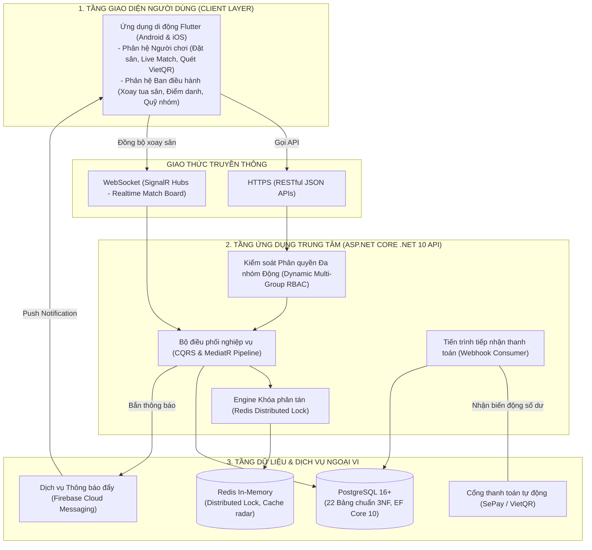
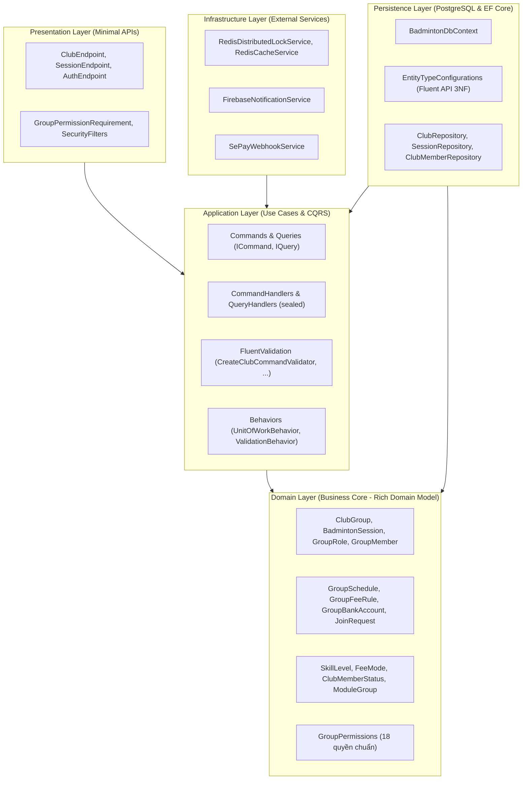

# CHƯƠNG IV.2 & IV.3: KIẾN TRÚC HỆ THỐNG & KIẾN TRÚC MÃ NGUỒN

---

## 1. KIẾN TRÚC TỔNG THỂ HỆ THỐNG (SYSTEM ARCHITECTURE)

Hệ thống được thiết kế theo mô hình **Client-Server phân tán đa tầng (N-Tier Distributed Architecture)**, trong đó toàn bộ giao diện tương tác người dùng được tách rời hoàn toàn khỏi logic nghiệp vụ và dữ liệu trung tâm.



---

## 2. CÁC CƠ CHẾ KỸ THUẬT CỐT LÕI

### 2.1. Phân quyền Theo Ngữ Cảnh Đa Nhóm Động (Dynamic Contextual Multi-Group RBAC)
- **Bài toán**: Một người dùng sở hữu 1 tài khoản toàn cục duy nhất (`app_user`) nhưng có thể tham gia nhiều hội nhóm (`club_group`) với các vai trò và quyền hạn hoàn toàn độc lập (ví dụ: là Host ở CLB A, là Thủ quỹ ở CLB B, nhưng chỉ là Thành viên thông thường ở CLB C).
- **Giải pháp**:
  - **Tài khoản toàn cục (Global Identity)**: Người dùng chỉ cần đăng nhập một lần, nhận JWT mang định danh toàn cục (`userId`).
  - **Thẩm tra quyền động theo ngữ cảnh (Contextual Evaluation)**:
    - Khi gửi request tới Endpoint của một CLB (`/api/v1/clubs/{id}/...` hoặc mang Header `X-Group-Id`), tầng Presentation trích xuất cặp `(UserId, GroupId)`.
    - `GroupPermissionHandler` thẩm tra động tư cách thành viên trong `group_member` để xác định vai trò (`GroupRole`) và tập quyền hạn (`RolePermission`) của người dùng tại đúng nhóm đó.
  - **Tối ưu hiệu năng bộ nhớ đệm (Redis Caching)**:
    - Quyền hạn được cache theo cặp `group:perm:{userId}:{groupId}` với thời gian sống 10 phút, tự động bị xóa (Invalidate) khi Ban Quản Trị thay đổi vai trò của người dùng.
  - **Không sử dụng Global Query Filter áp cứng**: Việc lọc dữ liệu theo nhóm được quản lý tường minh ở cấp Use Case / Repository (`Where(x => x.GroupId == groupId)`), giúp người dùng tự do truy vấn danh sách mọi nhóm mình tham gia, tìm kiếm nhóm công khai, và xem lịch sử thi đấu cá nhân xuyên suốt.
  - **Clean Context-Based Authorization qua Header (Chuẩn chính thức)**: Bỏ hoàn toàn API `switch-context`. Ứng dụng Frontend đăng nhập nhận 1 JWT toàn cục duy nhất, khi thao tác trong CLB chỉ cần đính kèm Header HTTP `X-Group-Id: <clubId>` hoặc gọi qua route parameter. `GroupPermissionHandler` tự động thẩm tra quyền động theo cặp `(UserId, GroupId)` và cache Redis TTL 10 phút.
  - Phân quyền tại Endpoint sử dụng cú pháp chuẩn:
    ```csharp
    group.MapPost("{id:guid}/roles", CreateClubRole)
        .RequireGroupPermission(GroupPermissions.Member.RoleManage);
    ```

### 2.2. Khóa phân tán chống vượt trần sĩ số (Redis Distributed Lock)
- **Bài toán**: Khi một buổi chơi sắp đóng sổ hoặc chỉ còn 1 slot cuối cùng, nhiều người dùng có thể cùng bấm "Tham gia" tại cùng một phần nghìn giây (Race Condition).
- **Giải pháp**:
  - Ứng dụng Redis Distributed Lock với khóa định danh phân tách theo từng phiên chơi: `session_{sessionId}_lock`.
  - Thao tác kiểm tra sĩ số và tạo bản ghi `session_booking` được đóng gói trong một Transaction có khóa.
  - Đảm bảo số lượng người chơi có vé chính thức (`status = CONFIRMED`) luôn luôn `<= max_players`. Bất kỳ yêu cầu nào đến sau đều được tự động chuyển sang hàng đợi (`WAITING`) với số thứ tự tăng dần.

### 2.3. Tự động hóa đối soát thanh toán (VietQR & Webhook SePay)
- Khi chốt buổi chơi, hệ thống sinh mã thanh toán định danh duy nhất (ví dụ: `BC12627_A8F1`).
- Chuỗi mã VietQR nhúng sẵn số tài khoản của nhóm, số tiền chính xác và mã chuyển khoản.
- Người chơi quét mã và chuyển khoản ➔ Cổng thanh toán SePay gửi Webhook HTTP POST về máy chủ Backend ➔ Hệ thống trích xuất mã định danh, khớp đúng số tiền, tự động cập nhật `session_fee` sang `PAID`, ghi một dòng thu vào Sổ quỹ mở `group_ledger`, và gửi thông báo FCM xác nhận về điện thoại người chơi.

---

## 3. KIẾN TRÚC MÃ NGUỒN CLEAN ARCHITECTURE 4 TẦNG

Mã nguồn Backend tuân thủ nghiêm ngặt nguyên lý **Clean Architecture** của Robert C. Martin với Quy tắc phụ thuộc bất biến: *"Các tầng bên trong hoàn toàn không biết gì về sự tồn tại của các tầng bên ngoài."*

```
[Presentation] ---> [Application] ---> [Domain] <--- [Persistence]
                          |                       |
                          +---> [Infrastructure] -+
```



### 3.1. Tầng Domain (`LegendsTeamVN.BadmintonClub.Domain`)
- **Trách nhiệm**: Trái tim nghiệp vụ thuần khiết theo mô hình **Rich Domain Model**.
- **Quy tắc tuyệt đối**:
  - Không phụ thuộc vào bất kỳ tầng nào khác.
  - Không tham chiếu EF Core, ASP.NET Core, hay các thư viện I/O bên ngoài.
  - **CẤM Anemic Domain Model**: Các Entity kế thừa `AggregateRoot<TKey>` hoặc `Entity<TKey>`. Mọi thuộc tính có setter là `private set;`. Toàn bộ quy tắc nghiệp vụ, chuyển đổi trạng thái và bảo vệ tính toàn vẹn (Invariants) phải nằm trong phương thức của chính Entity (ví dụ: `club.InitializeHostRole(...)`, `joinRequest.Approve(...)`, `role.CanBeDeleted(...)`).

### 3.2. Tầng Application (`LegendsTeamVN.BadmintonClub.Application`)
- **Trách nhiệm**: Bộ điều phối thuần túy (Pure Orchestrator) hiện thực các ca sử dụng theo mô hình **CQRS** và thư viện **MediatR**.
- **Quy tắc tuyệt đối**:
  - Không gọi trực tiếp `DbContext` hay thực thi SQL thô. Mọi truy cập dữ liệu phải qua Repository Interface (`IClubRepository`, `ISessionRepository`).
  - Không viết logic nghiệp vụ tính toán trong Handler: Handler chỉ nạp Entity từ Repository ➔ gọi hàm nghiệp vụ trên Entity ➔ lưu lại Repository.
  - Mọi Command/Query đều trả về kiểu `Result<T>` hoặc `Result` từ `LegendsTeamVN.Core.Utilities.Results`.
  - Mọi Command nhận dữ liệu từ người dùng đều có Validator kế thừa `AbstractValidator<TCommand>`.
  - Toàn bộ Command được bao bọc tự động bởi `UnitOfWorkBehavior` để quản lý Transaction tự động (Commit khi thành công, Rollback khi có exception).

### 3.3. Tầng Presentation (`LegendsTeamVN.BadmintonClub.Presentation`)
- **Trách nhiệm**: Tiếp nhận HTTP Request từ ứng dụng di động qua **ASP.NET Core Minimal APIs**.
- **Quy tắc tuyệt đối**:
  - Tất cả Endpoint kế thừa `EndpointGroupBase`, kết thúc bằng hậu tố `Endpoint`.
  - Không inject `DbContext` hay Repository vào Endpoint; chỉ tiếp nhận Request, chuyển thành Command/Query, gửi qua `ISender.Send(...)`.
  - Xử lý kết quả trả về bằng hàm mở rộng: `result.Match(onSuccess: data => Results.Ok(data), onFailure: error => Results.BadRequest(error))`.
  - Tự động chuẩn hóa lỗi theo chuẩn quốc tế **RFC 7807 ProblemDetails**.

### 3.4. Tầng Persistence & Infrastructure
- `Persistence`: Cung cấp `BadmintonDbContext`, Fluent API Configurations (`IEntityTypeConfiguration<T>`), và triển khai Repositories kết nối PostgreSQL.
- `Infrastructure`: Cung cấp dịch vụ ngoại vi (Redis Cache, Khóa phân tán Redis Lock, Firebase Cloud Messaging, Webhook SePay).
