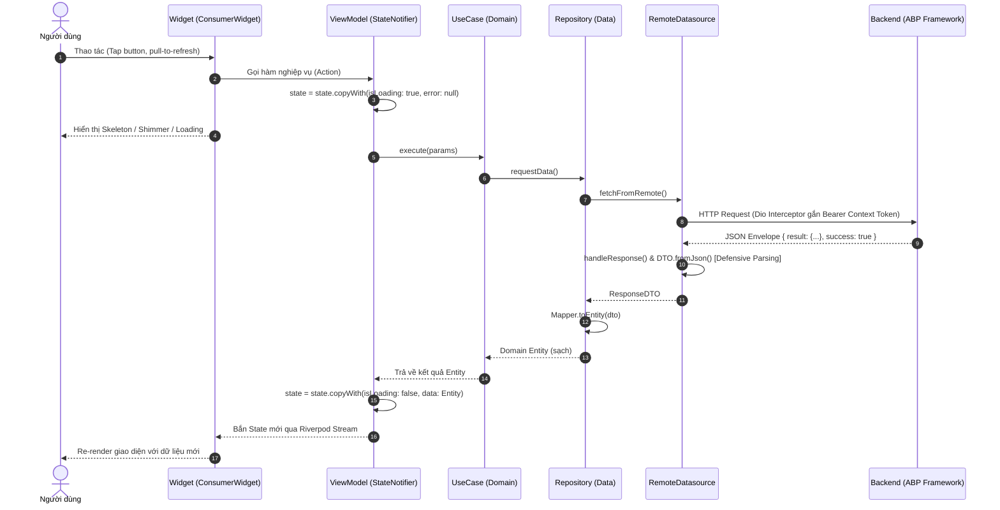
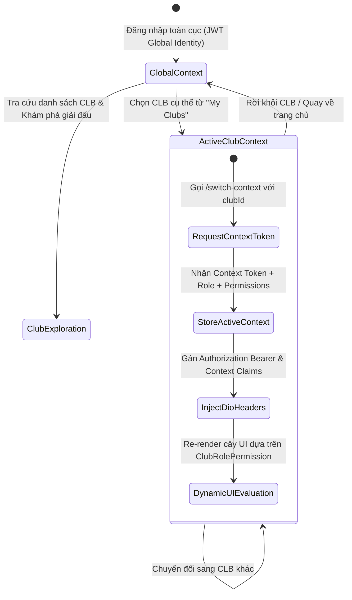
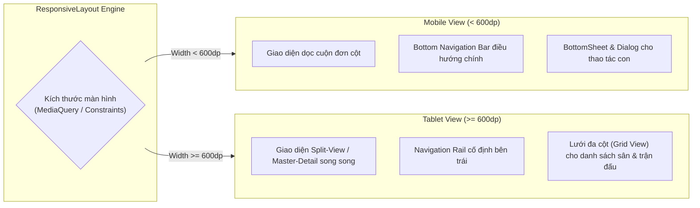

# KIẾN TRÚC & THIẾT KẾ ỨNG DỤNG DI ĐỘNG FLUTTER (CLIENT ARCHITECTURE)

> **Hệ sinh thái:** Nền tảng Quản lý Câu lạc bộ Cầu lông Phong trào (KLTN2026-2027)  
> **Nền tảng:** Flutter 3.x (Dart 3.x)  
> **Mô hình kiến trúc:** Clean Architecture 3 Tầng (Clean Architecture + Riverpod Unidirectional Data Flow)  

---

## 1. TỔNG QUAN KIẾN TRÚC CLIENT (CLIENT SYSTEM TOPOLOGY)

Ứng dụng di động Flutter đóng vai trò là giao diện trung tâm cho các tác nhân người dùng (Player, Club Member, Host, System Admin). Hệ thống được thiết kế theo nguyên lý **Phân tách mối quan tâm (Separation of Concerns)** và **Độc lập phụ thuộc (Dependency Inversion Principle)**, đảm bảo logic nghiệp vụ không bị ràng buộc vào framework UI hay giao thức truyền thông.

```mermaid
graph TD
    subgraph UI ["1. PRESENTATION LAYER (lib/ui/)"]
        Widgets["Screens & Widgets (ConsumerWidget)<br/>ResponsiveLayout (Mobile / Tablet)"]
        VM["ViewModels (StateNotifier&lt;State&gt;)"]
        State["Immutable States (copyWith, Equatable)"]
        Widgets -->|Đọc State & Dispatch Action| VM
        VM -->|Phát sinh State mới| State
    end

    subgraph Domain ["2. DOMAIN LAYER - PURE DART (lib/domain/)"]
        UC["Use Cases (Single Responsibility)"]
        Entities["Entities (Core Domain Models)"]
        RepoContracts["Repository Interfaces (Abstract)"]
        Exceptions["AppException (Error Hierarchy)"]
        VM -->|Thực thi UseCase| UC
        UC -->|Truy xuất dữ liệu| RepoContracts
        UC -->|Vận hành quy tắc| Entities
    end

    subgraph Data ["3. DATA LAYER (lib/data/)"]
        RepoImpl["Repository Implementations"]
        Mappers["Data Mappers (DTO &lt;-&gt; Entity)"]
        Datasources["Remote Datasources (BaseRemoteDatasource)"]
        DTOs["DTOs (Defensive Parsing)"]
        LocalData["Secure Storage & Cache (JWT, Biometrics)"]
        RepoContracts <|.. RepoImpl
        RepoImpl --> Mappers
        RepoImpl --> Datasources
        RepoImpl --> LocalData
        Datasources --> DTOs
    end

    subgraph External ["4. EXTERNAL PROTOCOLS & BACKEND"]
        ABP["ASP.NET Core ABP Backend (REST APIs)"]
        SignalR["SignalR Realtime Hub (Live Matches)"]
        FCM["Firebase Cloud Messaging (FCM Push)"]
        Datasources -->|HTTPS / REST| ABP
        Datasources -->|WSS| SignalR
        LocalData -.->|Push Notifications| FCM
    end
```

---

## 2. NGUYÊN TẮC LUỒNG DỮ LIỆU ĐƠN HƯỚNG (UNIDIRECTIONAL DATA FLOW)

Mọi biến động dữ liệu và tương tác của người dùng trên ứng dụng đều tuân theo chu trình luồng một chiều khép kín, triệt tiêu hoàn toàn hiện tượng phân tán trạng thái hoặc race-condition cục bộ:



---

## 3. CƠ CHẾ QUẢN LÝ NGỮ CẢNH ĐA NHÓM ĐỘNG (CONTEXT-AWARE MULTI-CLUB RBAC)

Khác với các ứng dụng thông thường chỉ quản lý một đối tượng cố định, hệ thống vận hành theo cơ chế **Đa Nhóm Linh Hoạt**: Một người dùng tham gia đồng thời $N$ câu lạc bộ với $N$ vai trò độc lập:

### 3.1. Vòng đời chuyển đổi ngữ cảnh (Context Switching Lifecycle)



### 3.2. Mô hình thẩm định quyền giao diện (Dynamic UI Permission Guard)

Giao diện không phụ thuộc vào chuỗi tên vai trò mà sử dụng **Cây quyền năng động (Dynamic Permission Tree)** thông qua `ClubRolePermission`:

- **Nhóm Vận hành (Operations):**
  - Quản lý lịch: `OPERATIONS.SCHEDULE.MANAGE`
  - Quản lý buổi chơi: `OPERATIONS.SESSION.VIEW`, `OPERATIONS.SESSION.CREATE`, `OPERATIONS.SESSION.UPDATE`, `OPERATIONS.SESSION.DELETE`
  - Điểm danh & Xếp slot: `OPERATIONS.BOOKING.MANAGE`
  - Đăng tin tuyển khách: `OPERATIONS.RECRUIT.MANAGE`
- **Nhóm Tài chính (Finance):**
  - Xem & lập sổ quỹ: `FINANCE.LEDGER.VIEW`, `FINANCE.LEDGER.MANAGE`
  - Theo dõi thu phí & Quyết toán: `FINANCE.FEE.VIEW`, `FINANCE.FEE.MANAGE`
  - Cấu hình ngân hàng nhận tiền: `FINANCE.BANK.MANAGE`
- **Nhóm Thành viên (Member):**
  - Xem & duyệt thành viên: `MEMBER.VIEW`, `MEMBER.JOIN_REQUEST.MANAGE`
  - Phân quyền & gán vai trò: `MEMBER.ROLE.MANAGE`

---

## 4. CHIẾN LƯỢC KIÊN CỐ DỮ LIỆU & GIAO THỨC TRUYỀN THÔNG (RESILIENCE & DEFENSIVE PARSING)

### 4.1. Bóc tách phong bì ABP Framework (Envelope Unpacking)
Backend ABP bọc mọi phản hồi trong cấu trúc chuẩn:
- **Object đơn:** `{ "result": { ... }, "success": true, "error": null }`
- **Danh sách phân trang:** `{ "result": { "items": [ ... ], "totalCount": 100 }, "success": true }`

Lớp trừu tượng `BaseRemoteDatasource` đóng vai trò là tầng chắn kiên cố (Shield):
1. **Kiểm tra an toàn bảo mật:** Chặn các phản hồi HTML bất thường (như lỗi Reverse Proxy 502/504 hoặc Captcha Cloudflare).
2. **Trích xuất thông minh:** Tự động phát hiện và bóc tách trường `result` hoặc `items`.
3. **Bọc lỗi tập trung:** Mọi exception mạng, timeout hoặc HTTP status (`400`, `401`, `403`, `500`) được chuyển đổi thành cây phân nhánh `AppException` trước khi vượt qua ranh giới tầng Data.

### 4.2. Chiến lược Defensive Parsing trong DTO
Nguyên tắc: **Không bao giờ tin tưởng kiểu dữ liệu tuyệt đối từ Backend.** DTO áp dụng chiến lược chuyển đổi an toàn (Type Coercion & Promotion):
- **Số nguyên (`int`):** Chuyển đổi an toàn từ `int`, `double`, `String` sang `int`; fallback về `0` khi gặp `null` hoặc chuỗi không hợp lệ.
- **Số thực (`double`):** Xử lý an toàn các giá trị tiền tệ và điểm số, hỗ trợ parse từ `int` và `String`, fallback về `0.0`.
- **Cờ logic (`bool`):** Hỗ trợ nhận diện các biến thể boolean: `true`/`false`, `1`/`0`, `'true'`/`'false'`.
- **Thời gian (`DateTime`):** Sử dụng `DateTime.tryParse()` thay vì `DateTime.parse()`.

### 4.3. Quản lý phiên, Khóa hàng đợi Interceptor & Sinh trắc học
1. **Lưu trữ bảo mật:** Sử dụng `FlutterSecureStorage` lưu trữ `AuthToken` (`accessToken`, `refreshToken`), cách ly khỏi bộ nhớ cache tạm thời.
2. **Hàng đợi làm mới Token (Dio 401 Queue Lock):** Khi gặp lỗi `401 Unauthorized`, `AppAuthInterceptor` khóa tạm thời các request song song khác, tự động gửi refresh token. Nếu thành công, cập nhật storage và tự động phát lại các request bị tạm giữ. Nếu thất bại, xóa phiên và điều hướng an toàn về màn hình đăng nhập.
3. **Sinh trắc học (`local_auth`):** Tích hợp xác thực vân tay / khuôn mặt làm tầng bảo vệ thứ hai cho các hành vi tài chính (chuyển tiền quỹ, quyết toán phiên chơi).

---

## 5. THIẾT KẾ ĐÁP ỨNG TOÀN DIỆN (RESPONSIVE ENGINE: MOBILE & TABLET)

Để đáp ứng cả hai kịch bản sử dụng: **Người chơi thao tác nhanh 1 tay trên sân** (Mobile) và **Ban điều hành quản lý lịch sân, sơ đồ bàn đấu, sổ quỹ trên không gian lớn** (Tablet), ứng dụng áp dụng động cơ Responsive Layout theo các khuôn mẫu (Archetypes):



---

## 6. CÁC KHUÔN MẪU TÍNH NĂNG CHUẨN (FEATURE ARCHETYPES)

Thay vì thiết kế rời rạc từng màn hình, ứng dụng phân loại toàn bộ chức năng vào 4 khuôn mẫu chuẩn hóa (Archetypes):

### 6.1. Archetype 1: Danh Sách & Phân Trang (List / Paging / Radar)
- **Đặc trưng:** Tải danh sách, tìm kiếm, lọc theo thuộc tính/bán kính vị trí, hỗ trợ kéo để làm mới (`RefreshIndicator`) và phân trang vô hạn (`PagingState`).
- **Ứng dụng:** Khám phá CLB (`ExploreClubs`), Danh sách buổi chơi (`Sessions`), Lịch đặt sân (`Venues / Courts`).

### 6.2. Archetype 2: Chi Tiết & Tương Tác Theo Quyền (Master-Detail / RBAC Action)
- **Đặc trưng:** Hiển thị thông tin thực thể chi tiết, tích hợp tab con (Lịch sinh hoạt, Thành viên, Sổ quỹ, Xếp hạng), hiển thị nút hành động động theo ngữ cảnh `ActiveClubContext`.
- **Ứng dụng:** Quản lý CLB (`ClubManagementScreen`), Chi tiết buổi chơi (`SessionDetailScreen`).

### 6.3. Archetype 3: Biểu Mẫu Nhập Liệu & Đột Biến (Form / Mutation / Validation)
- **Đặc trưng:** Thu thập thông tin, kiểm tra tính hợp lệ bằng validator tập trung (`AppValidator`), gửi request Mutation (POST/PUT/DELETE), phản hồi trạng thái loading/thành công/lỗi qua SnackBar/Dialog đa ngôn ngữ.
- **Ứng dụng:** Đăng ký / Đăng nhập, Tạo buổi chơi mới, Cấu hình tài khoản ngân hàng, Chỉnh sửa hồ sơ.

### 6.4. Archetype 4: Tích Hợp Ngoại Vi & Thời Gian Thực (Hardware / Realtime)
- **Đặc trưng:** Tương tác với cảm biến phần cứng (GPS, Camera quét QR, Sinh trắc học Biometrics) và luồng dữ liệu thời gian thực (SignalR, FCM).
- **Ứng dụng:** Quét QR điểm danh buổi chơi, Nhận biến động xác nhận thanh toán VietQR/SePay, Bảng điểm trực tiếp trận đấu (Live Match Board).
