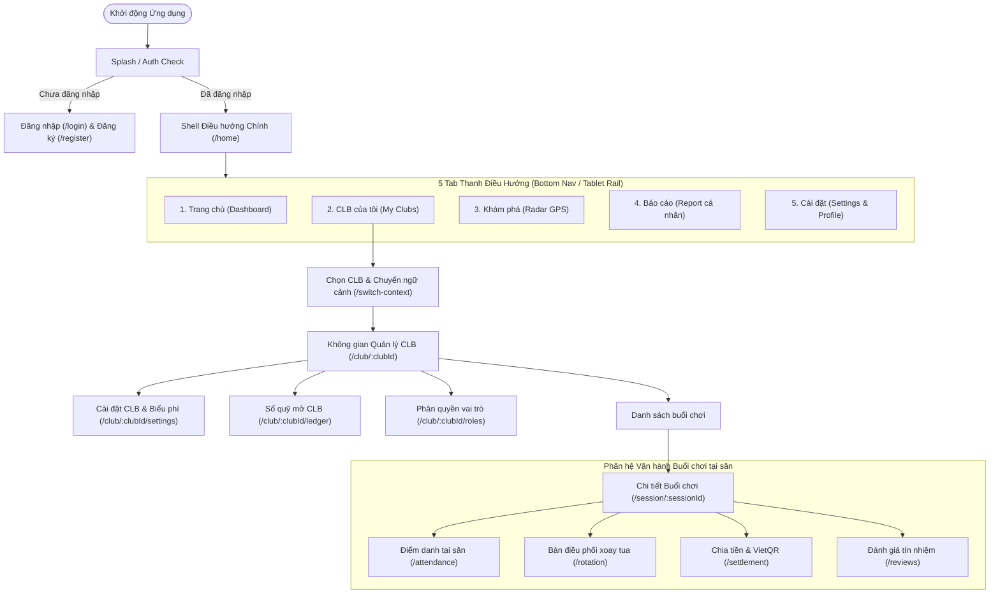

# TÀI LIỆU ĐẶC TẢ THIẾT KẾ GIAO DIỆN (UI/UX SPECIFICATION)
## DỰ ÁN: NỀN TẢNG QUẢN LÝ CÂU LẠC BỘ CẦU LÔNG PHONG TRÀO (KLTN2026-2027)

> **Đối tượng bàn giao:** Đội ngũ Phát triển (Developers) & Đảm bảo Chất lượng (QA / QC)  
> **Nền tảng:** Flutter 3.x (Dart 3.x) — Android & iOS, hỗ trợ Mobile (< 600dp) và Tablet (>= 600dp)  
> **Mã nguồn Stylesheet:** `lib/app/theme/` (`app_colors.dart`, `app_typography.dart`, `app_spacing.dart`, `app_radius.dart`, `app_shadows.dart`)  
> **Mã nguồn Điều hướng:** `lib/app/consts/app_router.dart`  

---

## 1. TỔNG QUAN & QUY CHUẨN CHUNG (STYLE GUIDE)

### 1.1. Bảng màu chuẩn (Color Tokens & Accessibility)
Tất cả component UI bắt buộc sử dụng token qua `context.colors.*` (`AppThemeColors`). Nghiêm cấm hardcode mã màu hex ngoài `app_colors.dart`. Tỷ lệ tương phản văn bản đạt chuẩn **WCAG AA (>= 4.5:1)**.

| Token | Tên Token (`AppColors`) | Mã Hex | Ý nghĩa & Vùng áp dụng |
| :--- | :--- | :--- | :--- |
| **Brand Primary** | `primary` `primaryDark` `primaryContainer` | `#3CC18E` `#2EA578` `#E8F9F3` | Màu chủ đạo: Nút chính (CTA), viền sân đang đấu, thanh tiến độ giữ chỗ. Container mờ cho tag và badge. |
| **Secondary Accent** | `secondary` `accent` | `#0EA5E9` `#FFA61E` | Xanh dương: Radar GPS, tag khách vãng lai. Vàng cam: Đánh giá sao, huy hiệu tín nhiệm. |
| **Semantic Success** | `success` `successContainer` | `#10B981` `#ECFDF5` | Đã thanh toán (`PAID`), Check-in có mặt (`CHECKED_IN`), Sân đang đấu (`PLAYING`). |
| **Semantic Warning** | `warning` `warningContainer` | `#F59E0B` `#FFFBEB` | Hàng đợi chờ (`WAITING`), Đề xuất sân chờ duyệt, Buổi chơi chưa chốt phí. |
| **Semantic Error** | `error` `errorContainer` | `#EF4444` `#FEF2F2` | Báo vắng (`NO_SHOW`), Thao tác hủy slot, Giao dịch nợ quá hạn. |
| **Neutral Surface** | `surface` `background` `cardBorder` | `#FFFFFF` `#F8FAFC` `#E2E8F0` | Nền màn hình, nền thẻ Card, đường viền phân cách. |

---

### 1.2. Hệ thống Chữ (Typography Scale)
Tuân thủ thang đo tại `app_typography.dart`:

| Kiểu Typo | Size (sp) | Weight | LineHeight | Áp dụng trên màn hình |
| :--- | :--- | :--- | :--- | :--- |
| `displayLarge` | 32 | Bold (700) | 1.25 | Số tiền quyết toán VietQR, số bàn thắng lớn. |
| `headlineMedium` | 20 | Semi-bold (600) | 1.35 | Tiêu đề tổng chi phí, tên buổi sinh hoạt lớn. |
| `titleMedium` | 16 | Bold (700) | 1.4 | Tên thành viên, số sân đấu (`SÂN SỐ 1`), tiêu đề Dialog. |
| `titleSmall` | 15 | Bold (700) | 1.4 | Tiêu đề khối danh sách, tên đội thi đấu (Đội 1 vs Đội 2). |
| `bodyMedium` | 14 | Regular (400) | 1.5 | Nội dung mô tả, văn bản hướng dẫn, input field text. |
| `bodySmall` | 13 | Regular (400) | 1.45 | Thông tin phụ, địa chỉ sân, thời gian check-in. |
| `labelLarge` | 14 | Bold (700) | 1.4 | Văn bản trên nút bấm chính/phụ (Button label). |
| `labelSmall` | 11 | Bold (700) | 1.3 | Tag trạng thái (`ĐÃ THANH TOÁN`, `ĐANG THI ĐẤU`), tag bậc L1–L6. |

---

### 1.3. Lưới Khoảng Cách (8-Point Grid) & Bo Góc (Radius)
- **Khoảng cách (`AppSpacing`):**
  - `xs = 4dp`, `sm = 8dp`: Khoảng cách icon và text, khoảng cách chip trạng thái.
  - `md = 12dp`, `base = 16dp`: Padding nội dung thẻ Card, khoảng cách giữa các phần tử form.
  - `xl = 24dp`, `xxl = 32dp`: Margin giữa các section lớn, padding màn hình.
- **Bo góc (`AppRadius`):**
  - `tag = 6dp`: Badge trình độ, chip trạng thái.
  - `button = 10dp`: Nút bấm hành động (`ElevatedButton`, `OutlinedButton`).
  - `card = 16dp`: Thẻ sân đấu, thẻ buổi sinh hoạt.
  - `dialog = 16dp`: Cửa sổ Modal xác nhận.
- **Quy chuẩn công thái học sân đấu:**
  - **Touch target tối thiểu:** $48 \times 48\text{ dp}$ cho nút chính, $44 \times 64\text{ dp}$ cho chip tương tác nhanh (check-in, báo vắng).
  - **Tactile feedback:** Gọi `HapticFeedback.lightImpact()` hoặc `mediumImpact()` khi xác nhận hành vi nhạy cảm hoặc thay đổi trạng thái trận đấu.

---

### 1.4. Động cơ Thích ứng Responsive (`ResponsiveLayout`)
- **Mobile (< 600dp):** Bố cục cuộn 1 cột dọc, Bottom Navigation Bar 5 tab, BottomSheet trượt từ đáy, thẻ sân hiển thị theo danh sách dọc.
- **Tablet (>= 600dp):**
  - Giới hạn độ rộng tối đa `ConstrainedBox(maxWidth: 800 - 1000)` căn giữa màn hình chống kéo giãn giao diện.
  - Màn hình Bàn điều phối xoay tua sân (`SessionRotationScreen`): Tự động dàn trang dạng lưới 2 cột (`Wrap` / `Grid`) để Host theo dõi đồng thời 2-4 sân đấu.

---

## 2. SƠ ĐỒ ĐIỀU HƯỚNG TỔNG THỂ (SITEMAP & WIREFLOW)

---

## 3. ĐẶC TẢ CHI TIẾT TỪNG MÀN HÌNH (SCREEN SPECIFICATIONS)

---

### 3.1. Màn hình Chi tiết Buổi sinh hoạt & Đặt chỗ (`/session/:sessionId`)
*Ánh xạ CSDL: `badminton_session`, `session_booking`, `guest_recruitment`*

#### Bố cục 4 Trạng thái Giao diện:
1. **Mặc định (Default State):**
   - Banner tổng quan: Tiêu đề buổi, cụm sân, thời gian, định mức người/sân, hạn chốt giữ chỗ.
   - Thanh tiến độ slot: `confirmedCount / maxPlayers` (Xanh khi còn chỗ, Vàng khi đầy).
   - Tab đôi: Danh sách vé chính thức (`CONFIRMED`) và Danh sách hàng đợi (`WAITING` kèm thứ tự `#queueOrder`).
   - Nút cố định đáy màn hình (Bottom Thumb Zone): "Tham Gia Giữ Chỗ" (khi chưa đặt) hoặc "Hủy Giữ Chỗ / Báo Vắng" (khi đã có slot).
2. **Đang tải (Loading State):**
   - Hiển thị `AppShimmer.card(height: 140)` cho banner và `AppShimmer.line()` lặp lại 6 dòng danh sách người chơi.
3. **Trống (Empty State):**
   - Khi chưa có người đăng ký: Icon `Icons.person_outline_rounded`, tiêu đề "Chưa có người chơi chính thức", phụ đề "Hãy là người đầu tiên đăng ký giữ chỗ cho buổi sinh hoạt này!".
4. **Báo lỗi (Error State):**
   - Khi mất mạng hoặc server lỗi: Banner đỏ kèm nút "Thử lại", SnackBar thông báo nguyên nhân lỗi.

#### Bảng Annotation Chi tiết:
| Phần tử UI | Loại Control | Logic Hiển thị & Ràng buộc | Hành vi khi tương tác (User Action) |
| :--- | :--- | :--- | :--- |
| **Nút "Tham gia giữ chỗ"** | `AppButtonCommon` (Primary) | Hiển thị khi người dùng chưa đăng ký và buổi đang `OPEN`. | Kiểm tra sĩ số: Nếu chưa đầy ghi nhận `CONFIRMED`; nếu đã đầy đưa vào `WAITING` và hiển thị pop-up vị trí chờ. |
| **Nút "Báo vắng / Hủy chỗ"** | `OutlinedButton` (Error) | Hiển thị khi người dùng đã có vé `CONFIRMED` hoặc `WAITING`. | Bật `AppConfirmDialog`: Cảnh báo hủy trước giờ khóa sổ sẽ nhường slot cho hàng đợi. Xác nhận $\rightarrow$ Gọi API hủy $\rightarrow$ Tự động đôn vé hàng chờ. |
| **Nút "Phát Radar tìm khách"** | `ElevatedButton` (Secondary) | Chỉ hiển thị với Host/Phó nhóm khi buổi chơi còn trống slot. | Mở `GuestRecruitmentModal`: Nhập số suất cần tuyển, chi phí chia sẻ, bán kính GPS $\rightarrow$ Phát sóng FCM Push. |
| **Nút "Bàn điều phối / Điểm danh"** | `ElevatedButton` (Primary) | Chỉ hiển thị với Host, Phó nhóm, Thủ quỹ. | Điều hướng sang `/session/:sessionId/attendance` hoặc `/rotation`. |

---

### 3.2. Màn hình Điểm danh tại sân (`/session/:sessionId/attendance`)
*Ánh xạ CSDL: `session_booking`, `badminton_session`, `app_user`*

#### Bố cục 4 Trạng thái Giao diện:
1. **Mặc định (Default State):**
   - Thanh thống kê 3 ô: Có mặt (Xanh lá), Chưa đến (Vàng), Báo vắng (Đỏ).
   - Nút chuyển nhanh "Bàn điều phối xoay tua sân" (kích hoạt khi `canStartRotation = true`).
   - Danh sách thẻ người chơi: Avatar, Họ tên, Trình độ L1–L6, Giờ vào sân, Chip đôi "Có mặt" / "Vắng".
   - FAB góc phải dưới: "Thêm khách vãng lai".
2. **Đang tải (Loading State):**
   - Shimmer khung tóm tắt sĩ số và 4 thẻ checklist người chơi.
3. **Trống (Empty State):**
   - Icon `Icons.group_off_rounded`, thông báo "Không có thành viên nào đăng ký buổi chơi này".
4. **Báo lỗi (Error State):**
   - Thẻ báo lỗi trung tâm với nút "Làm mới điểm danh".

#### Bảng Annotation Chi tiết:
| Phần tử UI | Loại Control | Logic Hiển thị & Ràng buộc | Hành vi khi tương tác (User Action) |
| :--- | :--- | :--- | :--- |
| **Chip "Có mặt"** | `InkWell` Chip ($\ge 44\text{dp}$) | Nền xanh lá nhạt khi chưa chọn, xanh lá đậm khi `CHECKED_IN`. | Chạm $\rightarrow$ `HapticFeedback.lightImpact()` $\rightarrow$ Đổi trạng thái `CHECKED_IN`, cập nhật `checkinAt = now()`. |
| **Chip "Vắng"** | `InkWell` Chip ($\ge 44\text{dp}$) | Nền đỏ nhạt khi chưa chọn, đỏ đậm khi `NO_SHOW`. | Chạm $\rightarrow$ Mở `AppConfirmDialog`: "Xác nhận đánh dấu vắng? Suất chơi sẽ bị hủy khỏi hàng đợi xoay tua." Xác nhận $\rightarrow$ Đổi `NO_SHOW`. |
| **Nút "Khóa điểm danh"** | `TextButton.icon` | Ẩn khi `isCompleted = true`. | Mở `AppConfirmDialog` $\rightarrow$ Xác nhận $\rightarrow$ Khóa lượt điểm danh ban đầu, nạp người có mặt vào thuật toán xoay sân. |
| **Nút "Thêm khách vãng lai"** | `FloatingActionButton` | Luôn hiển thị cho Ban điều hành. | Mở Dialog: Nhập Họ tên (bắt buộc) và SĐT $\rightarrow$ Lưu bản ghi booking mới với trạng thái `CHECKED_IN` ngay lập tức. |

---

### 3.3. Màn hình Bàn điều phối xoay tua sân (`/session/:sessionId/rotation`)
*Ánh xạ CSDL: `session_match`, `match_player`, `badminton_session`*

#### Bố cục 4 Trạng thái Giao diện:
1. **Mặc định (Default State):**
   - Banner giải thuật: Thông báo hệ thống xoay tua tự động đang chạy (nghỉ tối thiểu 5 phút).
   - Danh sách sân:
     - Mobile: Danh sách cuộn dọc các thẻ sân (`SÂN SỐ 1`, `SÂN SỐ 2`).
     - Tablet (>= 600dp): Lưới 2 cột song song (`Wrap`), quan sát toàn bộ các sân cùng lúc.
     - Mỗi sân gồm: Đội 1 (2 người) vs Đội 2 (2 người), điểm trình độ tổng, Badge trạng thái.
   - Hàng đợi nghỉ: Danh sách các tay vợt đang nghỉ kèm đồng hồ đếm ngược 5 phút.
   - Thanh điều hướng đáy: Nút "Xem Điểm Danh" và "Chia Tiền Buổi Chơi".
2. **Đang tải (Loading State):**
   - Shimmer 2 khung sân đấu lớn và hàng đợi người nghỉ.
3. **Trống (Empty State):**
   - Khi chưa khởi tạo điều phối: Banner hướng dẫn Host bấm nút "Khởi tạo điều phối lượt đầu".
4. **Báo lỗi (Error State):**
   - Thông báo lỗi thuật toán (ví dụ: Không đủ 4 người chơi đã check-in để xếp sân).

#### Bảng Annotation Chi tiết:
| Phần tử UI | Loại Control | Logic Hiển thị & Ràng buộc | Hành vi khi tương tác (User Action) |
| :--- | :--- | :--- | :--- |
| **Nút "Bắt đầu trận"** | `ElevatedButton` (Primary, $\ge 48\text{dp}$) | Chỉ hiển thị trên sân đang có trạng thái `WAITING` (Đề xuất sẵn sàng). | Chạm $\rightarrow$ `HapticFeedback.mediumImpact()` $\rightarrow$ Đổi trạng thái trận sang `PLAYING`, ghi nhận `timeStart = now()`, phát SignalR/FCM báo 4 người vào sân. |
| **Nút "Kết thúc trận"** | `ElevatedButton` (Success, $\ge 48\text{dp}$) | Chỉ hiển thị trên sân đang `PLAYING`. | Chạm $\rightarrow$ Mở `AppConfirmDialog`: "Xác nhận kết thúc trận sân N?" $\rightarrow$ Chuyển `FINISHED`, giải phóng sân, tự động kích hoạt đếm ngược 5 phút nghỉ cho 4 người. |
| **Hàng đợi nghỉ 5 phút** | `Wrap` Chips | Hiển thị người đang nghỉ, đổi màu Xám $\rightarrow$ Xanh khi đủ 5 phút. | Người đủ 5 phút nghỉ sẽ tự động được thuật toán ưu tiên bốc vào trận đề xuất tiếp theo. |

---

### 3.4. Màn hình Quyết toán, VietQR & Sổ quỹ mở (`/session/:sessionId/settlement`, `/club/:clubId/ledger`)
*Ánh xạ CSDL: `session_fee`, `bank_transaction`, `group_ledger`*

#### Bố cục 4 Trạng thái Giao diện:
1. **Mặc định (Default State):**
   - Tổng quan chi phí: Tổng tiền buổi chơi, Số tiền đã thu, Tiền sân, Tiền cầu, Phụ phí nước uống.
   - Nút "Cập nhật số quả cầu bóc mới & phụ phí" (Dành cho Host/Thủ quỹ).
   - Danh sách chia tiền từng người: Tên, Vai trò, Giảm giá Nữ, Số tiền phải đóng, Badge `ĐÃ THANH TOÁN` / `CHƯA THANH TOÁN`.
   - Nút hành động trên từng thẻ: "Mã VietQR" (Mở popup QR cá nhân) và "Xác nhận tiền mặt" (Thủ quỹ xác nhận thanh toán tiền mặt).
2. **Đang tải (Loading State):**
   - Shimmer khung tổng tiền và 4 dòng bảng chi phí hội viên.
3. **Trống (Empty State):**
   - "Chưa có danh sách quyết toán. Vui lòng nhập số quả cầu tiêu hao để ban hành bảng thu."
4. **Báo lỗi (Error State):**
   - Thông báo lỗi kết nối đối soát Webhook SePay.

#### Bảng Annotation Chi tiết:
| Phần tử UI | Loại Control | Logic Hiển thị & Ràng buộc | Hành vi khi tương tác (User Action) |
| :--- | :--- | :--- | :--- |
| **Nút "Mã VietQR"** | `OutlinedButton` | Hiển thị cho người chưa thanh toán có `vietQrUrl`. | Mở Popup VietQR: Kích thước QR $200 \times 200\text{ dp}$, nhúng sẵn tiền và mã `paymentCode` duy nhất. Hội viên quét bằng app ngân hàng bất kỳ. |
| **Nút "Xác nhận tiền mặt"** | `ElevatedButton` (Success) | Chỉ hiển thị cho Host/Thủ quỹ khi hội viên trả tiền mặt. | Chạm $\rightarrow$ Mở `AppConfirmDialog`: "Xác nhận đã nhận đủ X đồng từ Y?" $\rightarrow$ Chuyển trạng thái sang `PAID`, kết chuyển 1 dòng thu vào Sổ quỹ mở. |
| **Dialog nhập tiêu hao** | `AlertDialog` Form | Host/Thủ quỹ nhập số cầu bóc mới $\ge 0$ và tiền nước $\ge 0$. | Bấm "Tính lại đa hệ số" $\rightarrow$ Hệ thống tự động tính lại số tiền từng người theo biểu phí nhóm và làm tròn tiền. |

---

### 3.5. Màn hình Đánh giá & Tín nhiệm Buổi chơi (`/session/:sessionId/reviews`)
*Ánh xạ CSDL: `member_review`, `group_review`*

#### Bố cục 4 Trạng thái Giao diện:
1. **Mặc định (Default State):**
   - Thẻ điểm tín nhiệm trung bình buổi chơi (thang 5.0 sao).
   - Danh sách nhận xét của các tay vợt: Avatar, Tên, Ngày giờ, Số sao, Tag nổi bật, Lời bình luận.
   - FAB "Viết đánh giá" góc phải dưới.
2. **Đang tải (Loading State):**
   - Shimmer thẻ sao lớn và 3 thẻ nhận xét.
3. **Trống (Empty State):**
   - "Chưa có đánh giá nào cho buổi sinh hoạt này. Hãy chia sẻ cảm nhận của bạn!".
4. **Báo lỗi (Error State):**
   - Banner cảnh báo lỗi tải danh sách đánh giá.

#### Bảng Annotation Chi tiết:
| Phần tử UI | Loại Control | Logic Hiển thị & Ràng buộc | Hành vi khi tương tác (User Action) |
| :--- | :--- | :--- | :--- |
| **Thanh đánh giá sao** | 5 Star Rating Bar | Chọn từ 1 đến 5 sao. | Chạm sao $\rightarrow$ `HapticFeedback.lightImpact()` cập nhật mức độ hài lòng. |
| **Ô nhận xét** | `TextField` (đa dòng) | Bắt buộc nhập (Validation: không được để trống). | Nếu để trống bấm Gửi $\rightarrow$ Hiển thị SnackBar: "Vui lòng nhập nội dung nhận xét trước khi gửi!". |
| **Tag đặc điểm** | `FilterChip` đa chọn | Gợi ý: "Xoay sân công bằng", "Đúng giờ", "Minh bạch tài chính", "Vui vẻ nhiệt tình". | Chạm để bật/tắt tag $\rightarrow$ Lưu vào mảng `tags` của đánh giá. |

---

## 4. TIÊU CHUẨN KIỂM THỬ & BÀN GIAO CHO QA (ACCEPTANCE CRITERIA)

| Hạng mục kiểm tra | Tiêu chí nghiệm thu (Pass Criteria) | Công cụ / Lệnh kiểm tra |
| :--- | :--- | :--- |
| **Kiến trúc Clean Architecture** | Tầng UI không import trực tiếp Data DTO hay Dio client. Tuân thủ mô hình 3 tầng phân định ranh giới. | `python .agents/skills/verify-architecture/scripts/verify_architecture.py` đạt 100% compliant. |
| **Phân tích Tĩnh (Static Analysis)** | 0 lỗi biên dịch, 0 cảnh báo lint (`flutter_lints`). | `flutter analyze` báo cáo `No issues found!`. |
| **Kiểm thử Tự động (Tests)** | 100% unit tests và widget tests pass, bao gồm cả bộ UI Kit component test. | `flutter test` đạt 100% tests passed. |
| **Công thái học & Phản hồi xúc giác** | Mọi nút chính có touch target $\ge 48\text{dp}$. Các thao tác nhạy cảm (báo vắng, kết thúc trận, xác nhận thanh toán tiền mặt) bắt buộc có Modal xác nhận 2 bước và rung Haptic. | Kiểm thử thực tế trên thiết bị vật lý / Emulator. |
| **Đa ngôn ngữ & Zero Emoji** | 100% chuỗi hiển thị đọc qua `context.l10n` hoặc message nghiệp vụ tiếng Việt có dấu chuẩn ngữ pháp. Tuyệt đối không có emoji trong UI hay mã nguồn. | Rà soát tự động qua verify script. |
| **Độ mượt mà Responsive** | Giao diện tự động co giãn không tràn màn hình (`RenderFlex overflowed`) từ màn hình nhỏ (360dp) đến tablet (1024dp). | Chạy kiểm thử trên widget test đa độ phân giải. |
