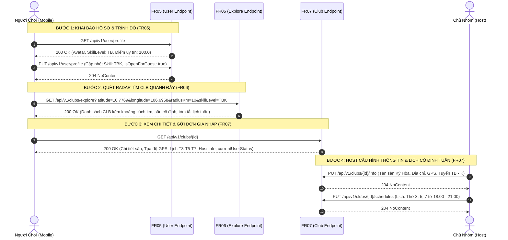
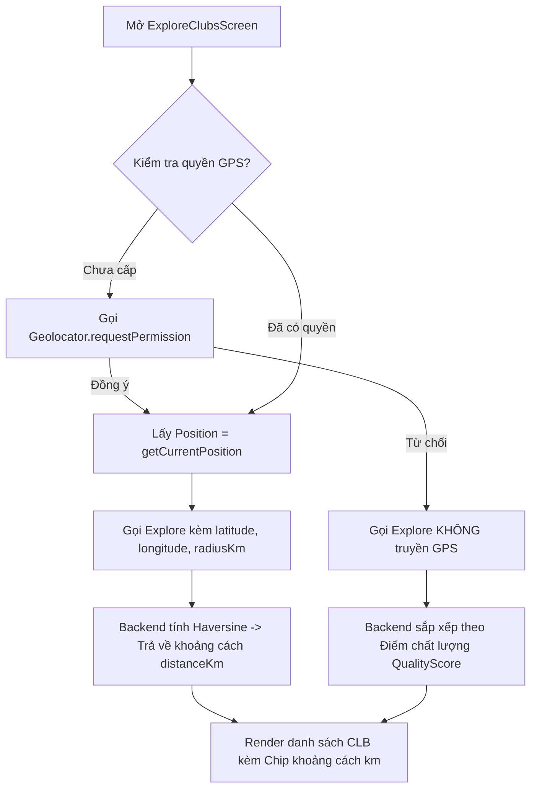
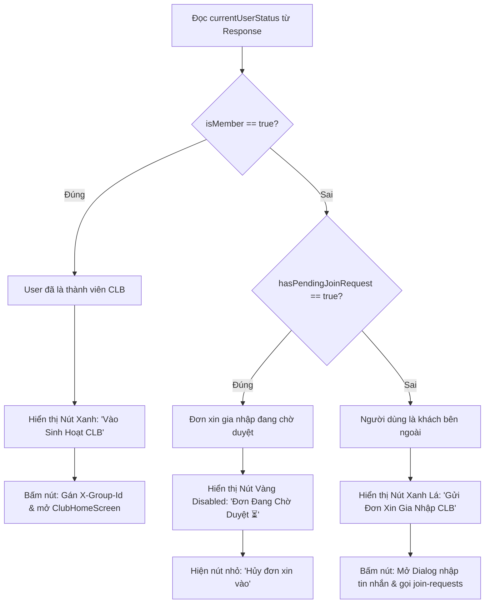
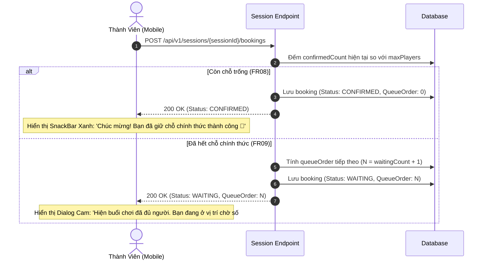
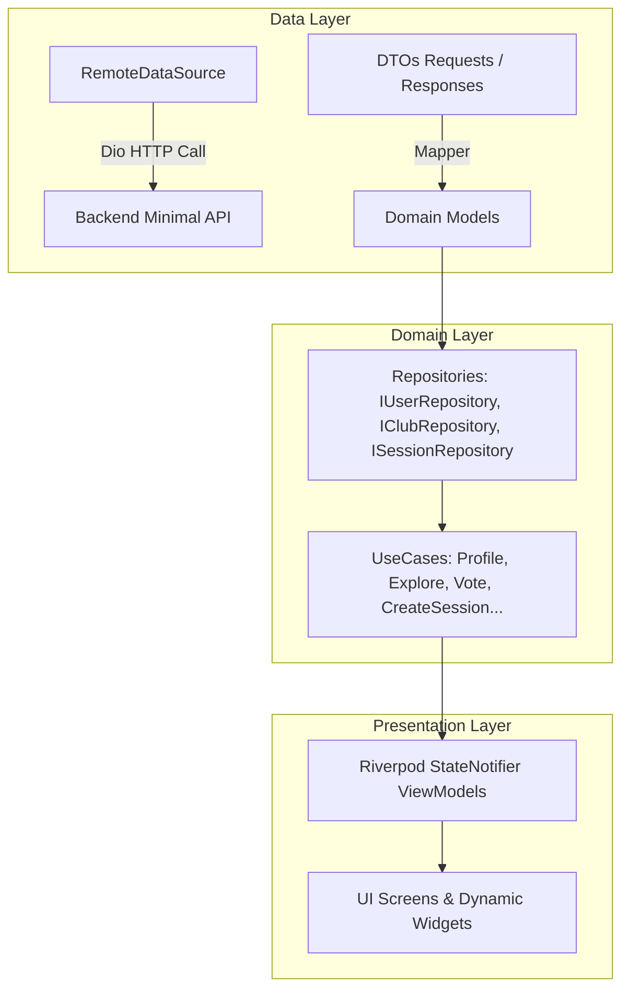

# 📖 Tài Liệu Đặc Tả Toàn Diện API & Kế Hoạch Tích Hợp Mobile (API Specification & Mobile Integration Plan)

> **Dự án**: Hệ thống Quản lý Nhóm Cầu lông Phong trào (**LegendsTeamVN.BadmintonClub**)  
> **Phiên bản tài liệu**: 2.1 (Cập nhật chuẩn hóa CQRS, Swagger Tags & Đặc tả chi tiết từng FR)  
> **Ngày cập nhật**: 14/10/2026  
> **Đối tượng sử dụng**: Đội ngũ Backend (.NET Core Minimal APIs) & Đội ngũ Mobile (Flutter App)

---

## 📌 1. Thông Tin Mạng & Quy Ước Kết Nối Toàn Hệ Thống

### 1.1. Bảng cấu hình địa chỉ IP (Base URL)
Được cấu hình sẵn tại [app_config.dart](lib/app/consts/app_config.dart):

| Môi trường | Base URL | Ghi chú |
| :--- | :--- | :--- |
| **Localhost (Swagger UI)** | `http://localhost:54796/swagger` | Dùng test trực tiếp trên trình duyệt Web |
| **Backend Local API Port** | `http://localhost:54796/api/v1` | Cổng HTTP thực thi của API Service |
| **Android Emulator** | `http://10.0.2.2:54796/api/v1` | Máy ảo Android map `10.0.2.2` tới host máy tính |
| **iOS Simulator** | `http://localhost:54796/api/v1` | Máy ảo iOS dùng chung loopback network với macOS |
| **Thiết bị thật qua Wi-Fi LAN** | `http://192.168.1.24:54796/api/v1` | Thiết bị cắm cáp / Wi-Fi cùng dải mạng nội bộ |

---

### 1.2. Chuẩn Xác Thực & Định Danh Đa Nhóm (Multi-Group RBAC Context)
Hệ thống cho phép **một người dùng tham gia nhiều Câu lạc bộ cùng lúc**, mỗi CLB có thể giữ một vai trò hoàn toàn độc lập (Ví dụ: Là Host ở CLB A, nhưng chỉ là Thành viên bình thường ở CLB B).

```mermaid
graph TD
    A[Mobile Client Request] --> B{API có yêu cầu ngữ cảnh nhóm?}
    B -- Không (Public / Toàn cục / Cá nhân) --> C[Chỉ cần Header Authorization: Bearer TOKEN]
    B -- Có (Thao tác trong CLB / Buổi chơi) --> D[Server tự trích xuất Group ID]
    D --> E[Route Parameter: {id:guid} hoặc {clubId:guid}]
    D --> F[Hoặc Header: X-Group-Id: GUID]
    E --> G[GroupPermissionHandler kiểm tra quyền hạn]
    F --> G
    G -- Hợp lệ --> H[Thực thi Handler & Trả về dữ liệu]
    G -- Không có quyền --> I[Trả về 403 Forbidden]
```

1. **Header Xác Thực Bắt Buộc**:
   ```http
   Authorization: Bearer <ACCESS_TOKEN>
   ```
2. **Header Ngữ Cảnh Nhóm (Áp dụng cho các API Host / Vận hành nhóm)**:
   ```http
   X-Group-Id: <CLUB_GUID>
   ```
   *(Áp dụng khi endpoint không truyền `{clubId}` trên URL, ví dụ: cập nhật buổi chơi `PUT /api/v1/sessions/{sessionId}`, đăng tin tuyển khách `POST /api/v1/sessions/{sessionId}/recruitments`, cập nhật thông tin CLB `PUT /api/v1/clubs/{id}/info`)*.
3. **Cơ chế Ngữ Cảnh Nhóm (Clean Context-Based Authorization - FR04)**:
   - Hệ thống bỏ hoàn toàn API `switch-context` cấp lại Token.
   - Khi người dùng chọn CLB trên giao diện, Mobile chỉ cần gán Header HTTP `X-Group-Id: <CLUB_GUID>` hoặc gọi endpoint mang route param `{clubId}`, `{groupId}`, `{sessionId}`.
   - Backend thẩm tra quyền hạn động qua Redis Cache (`group:perm:{userId}:{groupId}`) tức thì 0ms.

---

### 1.3. Định Dạng Chuẩn Lỗi RFC 7807 (ProblemDetails)
Toàn bộ các phản hồi lỗi từ server đều trả về theo chuẩn **RFC 7807**. Phía Mobile bắt trường `detail` hoặc danh sách `errors` để thông báo cho người dùng:

```json
{
  "type": "https://tools.ietf.org/html/rfc7231#section-6.5.1",
  "title": "Bad Request",
  "status": 400,
  "detail": "Buổi chơi hiện không mở đăng ký giữ chỗ.",
  "errors": {
    "Status": ["Buổi chơi hiện không mở đăng ký giữ chỗ."]
  }
}
```

---

## 📑 2. Danh Mục Các Module Chức Năng (Phân theo từng FR)

> 🌟 **DÀNH CHO ĐỘI NGŨ MOBILE**: Xem toàn bộ các API mới triển khai được viết riêng tập trung tại:  
> 👉 [**PHẦN ĐẶC TẢ ĐỘC LẬP: PHÂN HỆ HỒ SƠ CÁ NHÂN & TÌM KIẾM CLB QUANH ĐÂY (FR05 - FR06 - FR07)**](#-phần-đặc-tả-độc-lập-phân-hệ-hồ-sơ-cá-nhân--tìm-kiếm-clb-quanh-đây-fr05---fr06---fr07)  
> 📄 Hoặc đọc file độc lập ngắn gọn: [PHAN_HE_1_HO_SO_VA_TIM_KIEM_CLB_FR05_FR06_FR07.md](docs/PHAN_HE_1_HO_SO_VA_TIM_KIEM_CLB_FR05_FR06_FR07.md)
> 🏸 Hướng dẫn FE Phân hệ Quản lý Nhóm & CLB (19 APIs): [HUONG_DAN_FE_PHAN_HE_QUAN_LY_NHOM_CLB.md](docs/HUONG_DAN_FE_PHAN_HE_QUAN_LY_NHOM_CLB.md)

1. [🌟 **PHÂN HỆ MỚI: HỒ SƠ & TÌM KIẾM CLB (FR05 - FR06 - FR07)**](#-phần-đặc-tả-độc-lập-phân-hệ-hồ-sơ-cá-nhân--tìm-kiếm-clb-quanh-đây-fr05---fr06---fr07) *(5 APIs - MỚI HOÀN THIỆN)*
2. [Module 1: Xác Thực & Đăng Nhập (Auth)](#-module-1-xác-thực--đăng-nhập-auth) *(5 APIs)*
3. [Module 3: Quản Trị Người Dùng & Vai Trò Toàn Cục (Users & Roles - Admin)](#-module-3-quản-trị-người-dùng--vai-trò-hệ-thống-users--roles) *(16 APIs)*
4. [Module 4: Quản Trị Đa Nhóm, Gia Nhập & Chuyển Đổi Ngữ Cảnh (FR03, FR04)](#-module-4-quản-trị-đa-nhóm-gia-nhập--chuyển-đổi-ngữ-cảnh-fr03-fr04) *(15 APIs)*
5. [Module 7: Quản Lý Buổi Sinh Hoạt (FR13 - Sessions)](#-module-7-quản-lý-buổi-sinh-hoạt-fr13---sessions) *(6 APIs)*
6. [Module 8: Đăng Ký Giữ Chỗ & Hàng Đợi (FR08, FR09, FR10 - Bookings)](#-module-8-biểu-quyết-giữ-chỗ--hàng-đợi-fr08-fr09-fr10---bookings) *(4 APIs)*
7. [Module 9: Khách Vãng Lai & Buổi Giao Lưu (FR11, FR12 - Recruitments)](#-module-9-khách-vãng-lai--tuyển-kèo-giao-lưu-fr11-fr12---recruitments) *(6 APIs)*
8. [Kế Hoạch Triển Khai Cho Mobile Làm Thông API (Mobile Integration Master Plan)](#-kế-hoạch-triển-khai-cho-mobile-làm-thông-api-chi-tiết-rõ-ràng)
9. [Bảng Tra Cứu Toàn Bộ Mã Quyền Hạn (`GroupPermissions`)](#-bảng-tra-cứu-toàn-bộ-mã-quyền-hạn-grouppermissions)

---

## 🌟 PHẦN ĐẶC TẢ ĐỘC LẬP: PHÂN HỆ HỒ SƠ CÁ NHÂN & TÌM KIẾM CLB QUANH ĐÂY (FR05 - FR06 - FR07)

> **Mục đích**: Viết riêng toàn bộ nghiệp vụ, luồng xử lý và dữ liệu của nhóm chức năng mới: Hồ sơ cá nhân & Trình độ (`FR05`), Tìm kiếm CLB quanh vị trí GPS (`FR06`), và Xem thông tin chi tiết CLB & Lịch định kỳ tuần (`FR07`).  
> **Tài liệu độc lập dành cho Mobile**: [PHAN_HE_1_HO_SO_VA_TIM_KIEM_CLB_FR05_FR06_FR07.md](docs/PHAN_HE_1_HO_SO_VA_TIM_KIEM_CLB_FR05_FR06_FR07.md) | [HUONG_DAN_FE_PHAN_HE_QUAN_LY_NHOM_CLB.md](docs/HUONG_DAN_FE_PHAN_HE_QUAN_LY_NHOM_CLB.md)

### 📌 Bảng Tổng Hợp 5 API Phân Hệ Mới

| FR | Method | Endpoint | Swagger Group / Tag | Quyền Hạn | Mô Tả Nghiệp Vụ |
| :--- | :--- | :--- | :--- | :--- | :--- |
| **FR05** | `GET` | `/api/v1/user/profile` | `FR05 - Quản lý hồ sơ cá nhân & Trình độ` | `Bearer Token` | Xem hồ sơ cá nhân, trình độ tự đánh giá (`SkillLevel`) và điểm uy tín |
| **FR05** | `PUT` | `/api/v1/user/profile` | `FR05 - Quản lý hồ sơ cá nhân & Trình độ` | `Bearer Token` | Cập nhật họ tên, giới tính, avatar, trình độ (`SkillLevel`), mở nhận khách |
| **FR06** | `GET` | `/api/v1/clubs/explore` | `FR06 - Khám phá nhóm theo vị trí` | `Bearer Token` | Quét radar tìm CLB quanh vị trí GPS trong bán kính `radiusKm` (Haversine) |
| **FR07** | `GET` | `/api/v1/clubs/{id}` | `FR07 - Thông tin chi tiết & Lịch sinh hoạt nhóm` | `Bearer Token` | Xem chi tiết CLB đầy đủ: sân cố định, lịch định kỳ tuần, Host, sĩ số, trạng thái cá nhân |
| **FR07** | `PUT` | `/api/v1/clubs/{id}/info` | `FR07 - Thông tin chi tiết & Lịch sinh hoạt nhóm` | `MEMBER.INFO.UPDATE` | Host cấu hình sân sinh hoạt cố định, địa chỉ, GPS, tiêu chuẩn tuyển chọn |
| **FR07** | `PUT` | `/api/v1/clubs/{id}/schedules` | `FR07 - Thông tin chi tiết & Lịch sinh hoạt nhóm` | `OPERATIONS.SCHEDULE.MANAGE` | Host thiết lập các khung giờ sinh hoạt cố định lặp lại hàng tuần của nhóm |
| **FR19** | `GET` | `/api/v1/clubs/{id}/fee-rule` | `FR19 - Hạch toán biểu phí và Quỹ nhóm` | `Bearer Token` | Xem cấu hình biểu phí và mức ưu đãi của câu lạc bộ |
| **FR19** | `PUT` | `/api/v1/clubs/{id}/fee-rule` | `FR19 - Hạch toán biểu phí và Quỹ nhóm` | `FINANCE.BANK.MANAGE` | Host/Thủ quỹ cập nhật biểu phí (tháng, ngày, khách, ưu đãi Nữ) |

---

### 🗺️ Sơ Đồ Luồng Tương Tác Nghiệp Vụ (User Journey)



---

### 🔍 Hướng Dẫn Chi Tiết Cách Dùng Thông Tin Từng API Vào Luồng Chức Năng Mobile

---

#### 1. `GET /api/v1/user/profile` (FR05 - Xem Hồ Sơ & Trình Độ Cá Nhân)

- **Màn hình kích hoạt**: Tab "Hồ sơ / Tài khoản" (`ProfileScreen`) khi khởi tạo (`initState`), hoặc khi mở màn hình "Chỉnh sửa hồ sơ" (`EditProfileScreen`).
- **Headers Bắt Buộc**: `Authorization: Bearer <ACCESS_TOKEN>`
- **Response `200 OK`**:
  ```json
  {
    "id": "3fa85f64-5717-4562-b3fc-2c963f66afa6",
    "fullName": "Nguyễn Văn A",
    "userName": "nguyenvana",
    "email": "nguyenvana@gmail.com",
    "phoneNumber": "0987654321",
    "gender": 1,
    "avatarUrl": "https://example.com/avatar.jpg",
    "skillLevel": "TB",
    "skillLevelName": "Trung bình",
    "isOpenForGuest": true,
    "reputationScore": 100.0
  }
  ```

##### 📊 Bảng Ánh Xạ Dữ Liệu Lên Giao Diện Mobile (UI Binding Table):
| Trường Dữ Liệu | Kiểu Dữ Liệu | Widget Mobile Sử Dụng | Cách Dùng & Logic Nghiệp Vụ |
| :--- | :--- | :--- | :--- |
| `fullName` | `string` | `Text(fullName, style: textHeader1)` | Hiển thị họ tên lớn ở đầu trang; fill vào `nameController.text` khi bấm sửa. |
| `avatarUrl` | `string?` | `CircleAvatar(backgroundImage: ...)` | Hiển thị ảnh đại diện người chơi; nếu `null` hiển thị chữ cái đầu tiên của họ tên. |
| `gender` | `short` | `RadioListTile` / `Chip` | `0`: Khác, `1`: Nam, `2`: Nữ; render icon giới tính tương ứng (♂ / ♀). |
| `skillLevel` | `string` | `SkillBadge(level: skillLevel)` | Mã trình độ (`NB`..`G`); render huy hiệu trình độ với màu tương ứng (ví dụ: `TB` màu xanh dương). |
| `skillLevelName` | `string` | `Text(skillLevelName)` | Tên tiếng Việt thân thiện (ví dụ: *"Trung bình"*). |
| `isOpenForGuest` | `bool` | `SwitchListTile(value: ...)` | Toggle switch *"Sẵn sàng nhận kèo giao lưu"*. Khi người dùng bật, hồ sơ sẽ xuất hiện trên radar tìm khách vãng lai. |
| `reputationScore` | `double` | `Chip(avatar: Icon(Icons.star), ...)` | Điểm uy tín tín nhiệm (mặc định 100.0 điểm). Nếu < 80 đổi sang màu vàng cảnh báo. |

##### 🔄 Luồng Dữ Liệu Kế Tiếp (Next Steps Flow):
1. **Lưu State Toàn Cục**: Phía Mobile lưu `skillLevel` vào `currentUserSkillLevelProvider`.
2. **Tự Động Gợi Ý CLB (FR06)**: Khi người dùng chuyển sang Tab "Khám phá", Mobile tự động truyền `skillLevel={profile.skillLevel}` vào API `/api/v1/clubs/explore` để ưu tiên các CLB vừa tầm trình độ.
3. **Mở Màn Hình Sửa Hồ Sơ**: Khi bấm nút "Chỉnh sửa", truyền đối tượng `UserProfileResponseDto` sang `EditProfileScreen` để khởi tạo giá trị ban đầu cho các Controller mà không cần gọi API lần 2.

---

#### 2. `PUT /api/v1/user/profile` (FR05 - Cập Nhật Avatar, Thông Tin & Trình Độ)

- **Màn hình kích hoạt**: Màn hình "Chỉnh sửa hồ sơ" (`EditProfileScreen`) khi người dùng nhấn nút **"Lưu thay đổi"**.
- **Headers**: `Authorization: Bearer <ACCESS_TOKEN>`, `Content-Type: application/json`
- **Request Body JSON**:
  ```json
  {
    "fullName": "Nguyễn Văn A",
    "gender": 1,
    "avatarUrl": "https://example.com/avatar_new.jpg",
    "skillLevel": "TBK",
    "isOpenForGuest": true
  }
  ```

##### 🛡️ Kiểm Tra Dữ Liệu Phía Mobile Trước Khi Gửi (Client Validation):
- `fullName`: Không được để trống, độ dài từ 1 đến 100 ký tự.
- `gender`: Giá trị thuộc tập `[0, 1, 2]`.
- `skillLevel`: Bắt buộc chọn từ Dropdown (1 trong 7 mã: `NB, Y, TBY, TB, TBK, K, G`).
- `avatarUrl`: Nếu người dùng vừa chọn ảnh mới từ thư viện máy -> Gọi API Upload ảnh trước để lấy URL -> gán URL vào trường này.

##### 🔄 Luồng Xử Lý Sau Khi Lưu Thành Công (`204 NoContent`):
1. Mobile hiển thị `SnackBar` xanh lá thông báo: *"Cập nhật hồ sơ và trình độ thành công! 🎉"*.
2. Gọi `ref.invalidate(userProfileViewModelProvider)` để trigger lại `GET /api/v1/user/profile`, đồng bộ hóa dữ liệu mới toàn ứng dụng.
3. Gọi `Navigator.pop(context)` quay về màn hình `ProfileScreen`, toàn bộ Tên, Badge trình độ và Switch trạng thái được vẽ lại tức thì.

---

#### 3. `GET /api/v1/clubs/explore` (FR06 - Quét Radar Tìm CLB Quanh Vị Trí GPS)

- **Màn hình kích hoạt**: Tab "Khám phá câu lạc bộ" (`ExploreClubsScreen`) khi mở màn hình, khi trượt thanh Slider đổi bán kính quét, hoặc khi gõ từ khóa tìm kiếm.
- **Headers**: `Authorization: Bearer <ACCESS_TOKEN>`
- **Query Parameters**: `latitude`, `longitude`, `radiusKm`, `skillLevel`, `isRecruiting`, `searchTerm`.

##### 🛰️ Quy Trình Lấy Tọa Độ GPS & Xử Lý Fallback Trên Mobile:


##### 📊 Bảng Ánh Xạ Dữ Liệu Vào Thẻ CLB (`ClubCardWidget`):
| Trường Dữ Liệu | Kiểu Dữ Liệu | Widget Mobile Sử Dụng | Cách Dùng & Logic Nghiệp Vụ |
| :--- | :--- | :--- | :--- |
| `id` | `Guid` | `onTap: () => context.push('/clubs/$id')` | **Khóa chính**: Bắt sự kiện người dùng bấm vào Card để điều hướng sang `ClubDetailScreen(clubId: id)`. |
| `groupName` | `string` | `Text(groupName, style: textTitle)` | Tên câu lạc bộ cầu lông. |
| `avatarUrl` | `string?` | `ClipRRect(child: Image.network(...))` | Ảnh đại diện/logo CLB; nếu null render ảnh sân cầu lông mặc định. |
| `distanceKm` | `double?` | `Chip(label: Text('📍 ${distanceKm.toStringAsFixed(1)} km'))` | Cự ly thực tế tính theo giải thuật Haversine. Nếu `null` (do user tắt GPS) thì ẩn Chip này đi. |
| `fixedVenueName` & `fixedAddress` | `string?` | `Text(fixedVenueName)` & `Text(fixedAddress)` | Tên sân và địa chỉ cụ thể nơi nhóm sinh hoạt cố định. |
| `schedulesSummary` | `string?` | `Row(children: [Icon(Icons.calendar_today), Text(schedulesSummary)])` | Chuỗi tóm tắt lịch cố định tuần (ví dụ: *"T3, T5, T7 (18:00 - 21:00)"*). |
| `minSkillLevel` - `maxSkillLevel` | `string?` | `Text('Trình độ: $minSkillLevel - $maxSkillLevel')` | Khoảng trình độ của CLB. So sánh với `profile.skillLevel` của người dùng: Nếu người dùng yếu hơn `minSkillLevel`, hiển thị icon cảnh báo nhẹ: *"Trình độ buổi chơi có thể cao hơn so với bạn"*. |
| `isRecruiting` | `bool` | `Badge(label: Text(isRecruiting ? 'Đang tuyển' : 'Đã đủ người'))` | `true` = Badge xanh lá; `false` = Badge xám. |
| `memberCount` | `int` | `Text('👥 $memberCount thành viên')` | Tổng số thành viên hiện tại của CLB. |

---

#### 4. `GET /api/v1/clubs/{id}` (FR07 - Xem Chi Tiết Câu Lạc Bộ Đầy Đủ)

- **Màn hình kích hoạt**: Màn hình "Chi tiết Câu lạc bộ" (`ClubDetailScreen`) khi người dùng bấm vào một Card CLB từ màn hình Explore, hoặc từ danh sách CLB của tôi.
- **Headers**: `Authorization: Bearer <ACCESS_TOKEN>`
- **Response `200 OK`**:
  ```json
  {
    "id": "b86fa2e7-03b6-4299-923c-a93108ce8968",
    "groupName": "CLB Cầu Lông Chiến Binh Quận 10",
    "code": "CLB-CBQ10",
    "description": "Nhóm sinh hoạt phong trào vui vẻ, đề cao tinh thần giao lưu học hỏi.",
    "avatarUrl": "https://example.com/club1.jpg",
    "fixedVenueName": "Sân Cầu Lông Kỳ Hòa",
    "fixedAddress": "238 Đường 3/2, Phường 12, Quận 10, TP.HCM",
    "lat": 10.7769,
    "lng": 106.6958,
    "minSkillLevel": "TB",
    "maxSkillLevel": "K",
    "qualityScore": 4.8,
    "isRecruiting": true,
    "memberCount": 24,
    "host": {
      "userId": "1a2b3c4d-5e6f-7a8b-9c0d-1e2f3a4b5c6d",
      "fullName": "Trần Trưởng Nhóm",
      "avatarUrl": "https://example.com/host.jpg",
      "phoneNumber": "0909123456"
    },
    "schedules": [
      {
        "id": "f1e2d3c4-...",
        "dayOfWeek": 2,
        "dayName": "Thứ ba",
        "startTime": "18:00",
        "endTime": "21:00",
        "isActive": true
      }
    ],
    "currentUserStatus": {
      "isMember": false,
      "roleName": null,
      "hasPendingJoinRequest": true,
      "pendingRequestId": "7e3a2b1c-..."
    }
  }
  ```

##### 🚦 Logic Rẽ Nhánh Nút Thao Tác Đáy Màn Hình (`Bottom Action Bar`):
Đối tượng **`currentUserStatus`** là thông tin sống còn để Mobile quyết định giao diện tương tác:



##### 🎯 Cách Sử Dụng Các Trường Thông Tin Khác Trong Màn Hình:
- **`code`**: Hiển thị kèm `IconButton(Icons.copy)` cho phép sao chép mã nhóm chia sẻ qua Zalo/Facebook.
- **`lat`, `lng`**: Nút *"Chỉ đường tới sân"* -> Gọi `url_launcher` mở ứng dụng Google Maps trực tiếp:
  ```dart
  final url = 'https://www.google.com/maps/search/?api=1&query=${club.lat},${club.lng}';
  if (await canLaunchUrl(Uri.parse(url))) await launchUrl(Uri.parse(url));
  ```
- **`host.phoneNumber`**: Nút *"Gọi điện cho Trưởng nhóm"* -> Gọi `url_launcher`:
  ```dart
  launchUrl(Uri.parse('tel:${club.host.phoneNumber}'));
  ```
- **`schedules`**: Render danh sách `Card` thể hiện các ngày cố định tuần: Icon bóng cầu, Tên thứ (`dayName`), Khung giờ sinh hoạt (`startTime` - `endTime`).
- **Phân Quyền Nút Quản Trị Trên AppBar**:
  - Nếu `currentUserStatus.isMember == true` VÀ trong Token có quyền `MEMBER.INFO.UPDATE`: Hiển thị icon ⚙️ "Cài đặt nhóm" (mở màn hình `ClubSettingsScreen`).
  - Nếu có quyền `OPERATIONS.SCHEDULE.MANAGE`: Hiển thị icon 📅 "Sửa lịch tuần" (mở `ManageClubSchedulesScreen`).

---

#### 5. `PUT /api/v1/clubs/{id}/info` (FR07 - Host Cấu Hình Sân Bãi & Tiêu Chuẩn)

- **Màn hình kích hoạt**: Màn hình "Cài đặt thông tin nhóm" (`ClubSettingsScreen`), chỉ hiển thị với Host/Admin có quyền `MEMBER.INFO.UPDATE`.
- **Headers**: `Authorization: Bearer <TOKEN>`, `X-Group-Id: <CLUB_ID>`, `Content-Type: application/json`
- **Request Body JSON**:
  ```json
  {
    "groupName": "CLB Cầu Lông Chiến Binh Quận 10",
    "description": "Nhóm sinh hoạt phong trào vui vẻ, đề cao tinh thần giao lưu học hỏi.",
    "avatarUrl": "https://example.com/club_avatar.jpg",
    "fixedVenueName": "Sân Cầu Lông Kỳ Hòa",
    "fixedAddress": "238 Đường 3/2, Phường 12, Quận 10, TP.HCM",
    "lat": 10.7769,
    "lng": 106.6958,
    "minSkillLevel": "TB",
    "maxSkillLevel": "K",
    "isRecruiting": true
  }
  ```

##### 🗺️ Tích Hợp Bản Đồ Chọn Tọa Độ Sân:
1. Trên giao diện Mobile, cạnh ô nhập `lat` và `lng` có nút **"Chọn vị trí trên bản đồ"**.
2. Mở màn hình Google Maps / OpenStreetMap cho Host kéo ghim thả vào vị trí sân cầu lông.
3. Khi Host bấm "Xác nhận vị trí", tự động gán tọa độ vào `lat` và `lng` của Form.
4. Khi bấm "Lưu cấu hình" -> Gọi API -> Nhận `204 NoContent`.
5. Mobile gọi `ref.invalidate(clubDetailViewModelProvider(id))` và `Navigator.pop(context)`. Người ngoài quét radar Explore lập tức thấy vị trí sân mới.

---

#### 6. `PUT /api/v1/clubs/{id}/schedules` (FR07 - Host Thiết Lập Lịch Sinh Hoạt Tuần)

- **Màn hình kích hoạt**: Màn hình "Quản lý lịch định kỳ" (`ManageClubSchedulesScreen`), chỉ dành cho Host/Admin có quyền `OPERATIONS.SCHEDULE.MANAGE`.
- **Headers**: `Authorization: Bearer <TOKEN>`, `X-Group-Id: <CLUB_ID>`, `Content-Type: application/json`
- **Request Body JSON**:
  ```json
  {
    "schedules": [
      { "dayOfWeek": 2, "startTime": "18:00", "endTime": "21:00" },
      { "dayOfWeek": 4, "startTime": "18:00", "endTime": "21:00" },
      { "dayOfWeek": 6, "startTime": "18:00", "endTime": "21:00" }
    ]
  }
  ```

##### ⏰ Thiết Kế Widget Chọn Lịch Trên Mobile:
1. Danh sách 7 ngày trong tuần với Checkbox tương ứng (T2, T3, T4, T5, T6, T7, CN).
2. Khi tích chọn ngày nào (ví dụ: T3), hiển thị 2 ô `TimePicker`: Giờ bắt đầu (`18:00`) và Giờ kết thúc (`21:00`).
3. Client validate: Giờ kết thúc phải sau giờ bắt đầu.
4. Khi bấm **"Lưu lịch tuần"** -> Gửi mảng `schedules` lên backend -> Nhận `204 NoContent`.
5. Gọi `ref.invalidate(clubDetailViewModelProvider(id))` để màn hình chi tiết CLB cập nhật danh sách lịch mới ngay lập tức.

---

#### 7. `GET /api/v1/clubs/{id}/fee-rule` (FR19 - Xem Cấu Hình Biểu Phí & Ưu Đãi)

- **Mục đích**: Lấy thông tin cấu hình quy tắc tính phí hiện tại của câu lạc bộ.
- **Headers**: `Authorization: Bearer <TOKEN>`, `Content-Type: application/json`
- **Response `200 OK`**:
  ```json
  {
    "id": "e4414bc9-a5f1-432a-bc9a-0e9603ef8902",
    "clubId": "b86fa2e7-03b6-4299-923c-a93108ce8968",
    "feeMode": "DYNAMIC",
    "monthlyFee": 350000.00,
    "dailyMemberFee": 40000.00,
    "guestFee": 50000.00,
    "femaleDiscountMonthly": 0.00,
    "femaleDiscountDaily": 5000.00,
    "femaleDiscountGuest": 10000.00,
    "roundRule": 1000,
    "appliedAt": "2026-10-26T17:00:00Z"
  }
  ```

---

#### 8. `PUT /api/v1/clubs/{id}/fee-rule` (FR19 - Host/Thủ Quỹ Cập Nhật Biểu Phí & Ưu Đãi)

- **Màn hình kích hoạt**: Màn hình "Cấu hình biểu phí & Ưu đãi" (`ClubFeeRuleSettingsScreen`), dành cho Host/Thủ quỹ có quyền `FINANCE.BANK.MANAGE`.
- **Headers**: `Authorization: Bearer <TOKEN>`, `X-Group-Id: <CLUB_ID>`, `Content-Type: application/json`
- **Request Body JSON**:
  ```json
  {
    "feeMode": 0,
    "monthlyFee": 350000.00,
    "dailyMemberFee": 40000.00,
    "guestFee": 50000.00,
    "femaleDiscountMonthly": 0.00,
    "femaleDiscountDaily": 5000.00,
    "femaleDiscountGuest": 10000.00,
    "roundRule": 1000
  }
  ```
  *(Ghi chú: `feeMode`: `0` = DYNAMIC, `1` = FIXED).*
- **Response `200 OK`**: Trả về `ClubFeeRuleResponse` đã cập nhật thành công.

---

### 🏸 Bảng Tra Cứu Toàn Bộ Mã Trình Độ Chuẩn Hóa (`SkillLevel`)

| Mã Chuẩn | Tên Tiếng Việt | Mô Tả Kỹ Thuật Phong Trào | Màu Gợi Ý UI Flutter |
| :---: | :--- | :--- | :---: |
| **`NB`** | **Newbie** | Mới bắt đầu tập chơi, chưa vững luật và kỹ thuật cơ bản | `#9E9E9E` (Grey) |
| **`Y`** | **Yếu** | Đã biết luật thi đấu, giao cầu và đập cầu cơ bản, di chuyển còn chậm | `#8BC34A` (Light Green) |
| **`TBY`** | **Trung bình yếu** | Đánh giải trí đều đặn, điều cầu ổn định nhưng chưa có chiến thuật sâu | `#4CAF50` (Green) |
| **`TB`** | **Trung bình** | Bậc phổ biến nhất; phông cầu sâu, bỏ nhỏ và đập cầu đạt độ ổn định | `#03A9F4` (Light Blue) |
| **`TBK`** | **Trung bình khá** | Đánh đôi chiến thuật tốt, phản xạ nhanh, tham gia các giải cọ xát | `#3F51B5` (Indigo) |
| **`K`** | **Khá** | Kỹ thuật toàn diện, thể lực dồi dào, thường có huy chương phong trào | `#FF9800` (Orange) |
| **`G`** | **Giỏi / Bán chuyên** | Đẳng cấp cao, cựu VĐV năng khiếu hoặc thi đấu bán chuyên | `#E91E63` (Pink/Red) |


---

### 📱 Hướng Dẫn Tích Hợp Nhanh Cho Mobile Flutter

> 💡 **Chi tiết mã nguồn mẫu đầy đủ**: Toàn bộ Enums, DTOs (`UserProfileResponseDto`, `ExploreClubResponseDto`, `ClubDetailResponseDto`...), RemoteDataSource implementations và Riverpod ViewModels đã được viết sẵn từng dòng tại:  
> 👉 [**Tài liệu kỹ thuật độc lập Phân hệ 1 cho Mobile**](docs/PHAN_HE_1_HO_SO_VA_TIM_KIEM_CLB_FR05_FR06_FR07.md#5-hướng-dẫn-triển-khai-code-mobile-flutter)

1. **Hồ sơ cá nhân & Trình độ (FR05)**:
   - Thêm vào [user_remote_datasource.dart](file:///c:/code/base_fe/KLTN2026-2027/KLTN2026-2027/lib/data/datasource/remote/abstract/user_remote_datasource.dart): `getUserProfile()` và `updateUserProfile(UpdateUserProfileRequestDto request)`.
   - Hiển thị trên `ProfileScreen`: Badge trình độ, điểm tín nhiệm ⭐ `100.0` và Toggle switch *"Sẵn sàng nhận kèo giao lưu"*.
2. **Khám phá CLB quanh vị trí GPS (FR06)**:
   - Thêm vào [club_remote_datasource.dart](file:///c:/code/base_fe/KLTN2026-2027/KLTN2026-2027/lib/data/datasource/remote/abstract/club_remote_datasource.dart): `exploreClubs({latitude, longitude, radiusKm, skillLevel, isRecruiting, searchTerm})`.
   - Màn hình `ExploreClubsScreen`: Yêu cầu quyền GPS `Geolocator`, truyền tọa độ để nhận danh sách sắp xếp theo cự ly gần nhất `distanceKm ASC`.
3. **Chi tiết CLB & Lịch cố định tuần (FR07)**:
   - Thêm vào [club_remote_datasource.dart](file:///c:/code/base_fe/KLTN2026-2027/KLTN2026-2027/lib/data/datasource/remote/abstract/club_remote_datasource.dart): `getClubDetail(id)`, `updateClubInfo(clubId, request)`, `updateClubSchedules(clubId, request)`.
   - Hiển thị trên `ClubDetailScreen`: Sân cố định, chỉ đường Google Maps, các khung giờ lặp lại hàng tuần (T3-T5-T7), và Action Button thông minh theo `currentUserStatus` (`isMember`, `hasPendingJoinRequest`).

---


## 🔐 Module 1: Xác Thực & Đăng Nhập (Auth)
Prefix: `/api/v1/auth`  
Swagger Group: `Auth`

| Method | Endpoint | Yêu cầu Auth | Swagger Tag | Mô Tả Nghiệp Vụ |
| :--- | :--- | :--- | :--- | :--- |
| `POST` | `/api/v1/auth/register` | Public | `Auth` | Đăng ký tài khoản người dùng mới |
| `POST` | `/api/v1/auth/external-register` | Public | `Auth` | Đăng ký / đăng nhập nhanh qua Google hoặc Apple |
| `POST` | `/api/v1/auth/login` | Public | `Auth` | Đăng nhập hệ thống (trả về JWT Access Token, cấp Refresh Token) |
| `POST` | `/api/v1/auth/refresh` | Cookie / Bearer | `Auth` | Tự động cấp mới Access Token khi token cũ hết hạn (401) |
| `POST` | `/api/v1/auth/logout` | Bearer Token | `Auth` | Đăng xuất, hủy phiên làm việc và thu hồi Refresh Token |

---

### 🔍 Hướng Dẫn Từng API Module 1 Vào Luồng Mobile

#### 1.1. `POST /api/v1/auth/login` (Đăng Nhập)

- **Màn hình kích hoạt**: `LoginScreen` khi người dùng nhấn nút **"Đăng nhập"**.
- **Headers**: `Content-Type: application/json`
- **Request Body JSON**:
  ```json
  {
    "emailOrUserName": "nguyenvana@gmail.com",
    "password": "Password@123"
  }
  ```
- **Response `200 OK`**:
  ```json
  {
    "accessToken": "eyJhbGciOiJIUzI1NiIsInR5cCI6IkpXVCJ9...",
    "userId": "3fa85f64-5717-4562-b3fc-2c963f66afa6",
    "userName": "nguyenvana",
    "email": "nguyenvana@gmail.com",
    "roles": ["User"]
  }
  ```

##### 📊 Bảng Ánh Xạ Dữ Liệu & Cách Dùng Phía Mobile:
| Trường Dữ Liệu | Kiểu Dữ Liệu | Nơi Lưu / Widget Sử Dụng | Cách Dùng & Logic Nghiệp Vụ |
| :--- | :--- | :--- | :--- |
| `accessToken` | `string` | `SecureStorageService.saveAuthToken()` | Lưu vào bộ nhớ an toàn (Keystore/Keychain). Đưa vào Header `Authorization: Bearer <token>` cho mọi request sau đó. |
| `userId` | `Guid` | `currentUserProfileProvider.userId` | Định danh tài khoản người dùng hiện tại, dùng để so khớp người tạo buổi chơi, người gửi đơn xin vào nhóm, kiểm tra chủ sở hữu vé. |
| `userName` | `string` | `Text('@$userName')` | Tên tài khoản, hiển thị ở Sidebar Menu và Profile. |
| `email` | `string` | `Text(email)` | Email đăng ký, hiển thị trong màn hình Tài khoản. |
| `roles` | `string[]` | `authRoleProvider` | Quyền toàn cục hệ thống (`User`, `Admin`). Nếu chứa `Admin`, mở thêm tab "Quản trị viên" trên Drawer. |

##### 🔄 Luồng Nghiệp Vụ Kế Tiếp (Next Steps Flow):
1. **Lưu Token**: Gán `accessToken` vào `Dio` client header: `dio.options.headers['Authorization'] = 'Bearer $token'`.
2. **Khởi Tạo Ngữ Cảnh CLB (FR03 & FR04)**: Gọi ngay `GET /api/v1/clubs/my-clubs`:
   - Nếu danh sách trả về **rỗng** (user mới chưa tham gia nhóm nào): Điều hướng sang màn hình Khám phá (`ExploreClubsScreen`) để user quét tìm CLB quanh đây.
   - Nếu danh sách **có ít nhất 1 CLB**: Lấy CLB đầu tiên hoặc CLB đã chọn gần nhất (`activeClubId`), thiết lập Header HTTP mặc định `X-Group-Id: selectedClub.clubId` và mở thẳng `ClubHomeScreen` (không gọi API switch-context).
3. **Xử Lý Lỗi (Error Handling)**:
   - `400 Bad Request`: Sai tài khoản hoặc mật khẩu -> Hiển thị thông báo đỏ dưới ô nhập hoặc SnackBar: *"Tài khoản hoặc mật khẩu không chính xác."*
   - Tài khoản bị khóa (`isLocked == true`): Hiển thị Dialog cảnh báo: *"Tài khoản của bạn đã bị tạm khóa. Vui lòng liên hệ ban quản trị để được hỗ trợ."*

---

#### 1.2. `POST /api/v1/auth/register` (Đăng Ký Tài Khoản)

- **Màn hình kích hoạt**: `RegisterScreen` khi nhấn nút **"Đăng ký tài khoản"**.
- **Request Body JSON**:
  ```json
  {
    "email": "nguyenvana@gmail.com",
    "userName": "nguyenvana",
    "password": "Password@123",
    "confirmPassword": "Password@123",
    "fullName": "Nguyễn Văn A",
    "phoneNumber": "0987654321"
  }
  ```
- **Kiểm Tra Dữ Liệu Tại Mobile (Client Validation)**:
  - `email`: Đúng định dạng regex email (`r'^[\w-\.]+@([\w-]+\.)+[\w-]{2,4}$'`).
  - `userName`: Không chứa dấu cách, độ dài từ 4 đến 30 ký tự.
  - `password`: Tối thiểu 8 ký tự, có ít nhất 1 chữ hoa, 1 chữ số, 1 ký tự đặc biệt.
  - `confirmPassword`: Phải trùng khớp 100% với `password`.
  - `fullName`: Không được để trống.
  - `phoneNumber`: Đúng định dạng số điện thoại Việt Nam (10 chữ số, bắt đầu bằng 0).
- **Luồng Sau Khi Thành Công (`201 Created`)**:
  - Tự động lưu `accessToken` và `userId` trả về từ Response.
  - Điều hướng người dùng sang màn hình **"Thiết lập hồ sơ ban đầu"** (`EditProfileScreen`) để chọn ngay Trình độ đánh cầu (`SkillLevel`) và ảnh đại diện (FR05).

---

#### 1.3. `POST /api/v1/auth/refresh` (Tự Động Làm Mới Phiên Làm Việc)

- **Cơ chế hoạt động**: Không gắn vào UI cụ thể. Chạy ngầm trong `QueuedInterceptor` của thư viện `Dio`.
- **Luồng xử lý lỗi 401**:
  ```mermaid
  sequenceDiagram
      autonumber
      participant App as Mobile Request
      participant Interceptor as Dio Interceptor
      participant Server as Backend API
      
      App->>Server: Gửi request với Access Token hết hạn
      Server-->>Interceptor: 401 Unauthorized
      Note over Interceptor: Tạm dừng toàn bộ các request khác đang chờ
      Interceptor->>Server: POST /api/v1/auth/refresh (Cookie / Header refreshToken)
      alt Cấp mới thành công (200 OK)
          Server-->>Interceptor: Trả về accessToken mới
          Note over Interceptor: Cập nhật accessToken mới vào SecureStorage
          Interceptor->>Server: Tự động Retry lại request gốc ban đầu
          Server-->>App: Trả về dữ liệu thành công!
      else Refresh Token cũng hết hạn (400 / 401)
          Server-->>Interceptor: Thất bại
          Note over Interceptor: Xóa toàn bộ SecureStorage
          Interceptor->>App: Điều hướng cưỡng bức về LoginScreen
      end
  ```

---

#### 1.4. `POST /api/v1/auth/logout` (Đăng Xuất)

- **Màn hình kích hoạt**: Màn hình "Cài đặt tài khoản" (`SettingsScreen`) -> Nút đỏ **"Đăng xuất"**.
- **Headers**: `Authorization: Bearer <ACCESS_TOKEN>`
- **Xử lý phía Mobile**:
  1. Gọi `POST /api/v1/auth/logout` để server thu hồi refresh token cookie.
  2. Bất kể API trả về kết quả gì, client luôn xóa sạch:
     - `SecureStorageService.clear()` (xóa token, user_id, active_club_id).
     - Invalidate toàn bộ các Riverpod Provider: `ref.invalidate(authTokenProvider)`, `ref.invalidate(clubContextViewModelProvider)`.
  3. Điều hướng người dùng: `Navigator.pushNamedAndRemoveUntil(context, '/login', (route) => false)`.

---

## 👥 Module 3: Quản Trị Người Dùng & Vai Trò Hệ Thống (Users & Roles - Admin)
Prefix: `/api/v1/user` & `/api/v1/roles`  
Swagger Group: `Users` & `Roles`

> Module này dành cho tài khoản Admin quản lý toàn hệ thống, cấp quyền người dùng, đặt lại mật khẩu và khóa tài khoản vi phạm. Phía ứng dụng di động hiển thị trong phân hệ dành cho Admin (nếu tài khoản có role `Admin`).

| Method | Endpoint | Quyền Hạn Yêu Cầu | Swagger Group | Mô Tả |
| :--- | :--- | :--- | :--- | :--- |
| `GET` | `/api/v1/user/me` | Bearer Token | `Users` | Lấy thông tin tài khoản, roles & cây quyền toàn cục của mình |
| `GET` | `/api/v1/user/permissions` | Bearer Token | `Users` | Lấy danh sách cây quyền của tài khoản hiện tại |
| `GET` | `/api/v1/user/all-permissions` | `Users.Read` | `Users` | Lấy toàn bộ danh mục cây quyền hệ thống |
| `GET` | `/api/v1/user` | `Users.Read` | `Users` | Lấy danh sách người dùng toàn hệ thống (phân trang & tìm kiếm) |
| `GET` | `/api/v1/user/{id}` | `Users.Read` | `Users` | Xem chi tiết người dùng theo ID |
| `POST` | `/api/v1/user` | `Users.Create` | `Users` | Tạo mới tài khoản người dùng từ trang quản trị |
| `PUT` | `/api/v1/user/{id}` | `Users.Update` | `Users` | Cập nhật thông tin email, username, phone |
| `DELETE`| `/api/v1/user/{id}` | `Users.Delete` | `Users` | Xóa tài khoản người dùng |
| `PUT` | `/api/v1/user/{id}/lock` | `Users.Lock` | `Users` | Khóa hoặc mở khóa tài khoản vi phạm |
| `PUT` | `/api/v1/user/{id}/roles` | `Users.AssignRoles`| `Users` | Gán danh sách vai trò hệ thống cho người dùng |
| `POST` | `/api/v1/user/{id}/reset-password` | `Users.ResetPassword`| `Users` | Đặt lại mật khẩu tài khoản |
| `GET` | `/api/v1/roles` | `Roles.Read` | `Roles` | Lấy danh sách toàn bộ vai trò hệ thống kèm quyền hạn |
| `POST` | `/api/v1/roles` | `Roles.Create` | `Roles` | Tạo mới một vai trò hệ thống |
| `PUT` | `/api/v1/roles/{id}` | `Roles.Update` | `Roles` | Đổi tên hoặc mô tả vai trò hệ thống |
| `DELETE`| `/api/v1/roles/{id}` | `Roles.Delete` | `Roles` | Xóa một vai trò hệ thống |
| `PUT` | `/api/v1/roles/{id}/permissions` | `Roles.AssignPermissions`| `Roles` | Gán danh sách quyền hệ thống cho vai trò |

---

## 🏸 Module 4: Quản Trị Đa Nhóm, Gia Nhập & Chuyển Đổi Ngữ Cảnh (FR03, FR04)
Prefix: `/api/v1/clubs`  
Swagger Group: `Clubs` & `FR03 - Quản lý CLB & Thành viên`

> **Nghiệp vụ cốt lõi**:
> - **FR03**: Một người dùng tham gia đồng thời nhiều CLB với vai trò độc lập (ví dụ: CLB A là Host, CLB B là Thành viên).
> - **FR04**: Chuyển đổi ngữ cảnh làm việc giữa các CLB trên Mobile (Server-Rail / Drawer), đồng bộ Access Token chứa đúng claim `tenantId` và danh sách quyền hạn thực tế tức thì.
> - **Gia nhập CLB**: Người dùng xin vào qua duyệt đơn (`join-requests`) hoặc vào ngay bằng mã Code nhóm (`join`).
> - **Quản trị thành viên**: Bổ nhiệm vai trò (Host, Phó nhóm, Thủ quỹ, Thành viên), xem danh sách và kick/rời nhóm.

### 📌 Bảng Danh Mục Đầy Đủ Các API Module 4

| Method | Endpoint | Quyền Hạn Yêu Cầu | Swagger Group | Mô Tả Nghiệp Vụ |
| :--- | :--- | :--- | :--- | :--- |
| `POST` | `/api/v1/clubs` | Bearer Token | `Clubs` | Tạo CLB mới (Người tạo tự động nhận vai trò Host sở hữu 100% quyền hạn) |
| *Header* | `X-Group-Id: <id>` | Bearer Token | `Security` | **FR04**: Header ngữ cảnh nhóm, thay thế API switch-context cũ |
| `GET` | `/api/v1/clubs/my-clubs` | Bearer Token | `FR03` | **FR03**: Lấy danh sách CLB user đang tham gia kèm vai trò độc lập |
| `POST` | `/api/v1/clubs/join` | Bearer Token | `FR03` | **FR03**: Tham gia CLB trực tiếp tức thì bằng mã Code nhóm |
| `POST` | `/api/v1/clubs/{id}/join-requests` | Bearer Token | `FR03` | **FR03**: Gửi đơn xin gia nhập CLB kèm lời giới thiệu bản thân |
| `GET` | `/api/v1/clubs/{id}/join-requests` | `MEMBER.JOIN_REQUEST.MANAGE` | `FR03` | **FR03**: Host xem danh sách các đơn xin gia nhập đang chờ duyệt |
| `PUT` | `/api/v1/clubs/{id}/join-requests/{requestId}/approve` | `MEMBER.JOIN_REQUEST.MANAGE` | `FR03` | **FR03**: Host duyệt đơn xin gia nhập, người gửi trở thành thành viên |
| `PUT` | `/api/v1/clubs/{id}/join-requests/{requestId}/reject` | `MEMBER.JOIN_REQUEST.MANAGE` | `FR03` | **FR03**: Host từ chối đơn xin gia nhập |
| `GET` | `/api/v1/clubs/{id}/members` | `MEMBER.VIEW` | `FR03` | **FR03**: Xem danh sách thành viên và chức vụ trong CLB |
| `PUT` | `/api/v1/clubs/{id}/members/{userId}/role` | `MEMBER.ROLE.MANAGE` | `FR03` | **FR03**: Bổ nhiệm / thay đổi vai trò của thành viên trong nhóm |
| `DELETE`| `/api/v1/clubs/{id}/members/{userId}` | Bearer Token | `FR03` | **FR03**: Thành viên tự rời nhóm hoặc Host kick thành viên khỏi CLB |
| `GET` | `/api/v1/clubs/{id}/roles` | `MEMBER.VIEW` | `FR03` | Xem danh mục các vai trò nội bộ của CLB |
| `POST` | `/api/v1/clubs/{id}/roles` | `MEMBER.ROLE.MANAGE` | `FR03` | Tạo vai trò tùy chỉnh mới trong CLB |
| `PUT` | `/api/v1/clubs/{id}/roles/{roleId}/permissions` | `MEMBER.ROLE.MANAGE` | `FR03` | Cập nhật cây quyền cho vai trò trong CLB |
| `DELETE`| `/api/v1/clubs/{id}/roles/{roleId}` | `MEMBER.ROLE.MANAGE` | `FR03` | Xóa vai trò tùy chỉnh khỏi CLB |

---

### 🔍 Hướng Dẫn Từng API Module 4 Vào Luồng Mobile

#### 4.1. `POST /api/v1/clubs` (Tạo Câu Lạc Bộ Mới - FR03 & FR13)
> [!NOTE]
> Xem hướng dẫn chi tiết toàn trình và code mẫu Flutter tại: [`docs/HUONG_DAN_FE_LUONG_TAO_CLB.md`](HUONG_DAN_FE_LUONG_TAO_CLB.md).

- **Màn hình kích hoạt**: BottomSheet "Tham gia hoặc tạo CLB" -> Chọn **"Tạo câu lạc bộ mới"** (`_showCreateClubDialog` hoặc `CreateClubScreen`).
- **Headers**: `Authorization: Bearer <ACCESS_TOKEN>`
- **Request Body JSON (Hỗ trợ 2 chế độ)**:

  **Chế độ A: Tạo nhanh (Quick Mode)**:
  ```json
  {
    "name": "CLB Cầu Lông Legends Quận 7",
    "description": "Sinh hoạt tối thứ 3 - 5 - 7 hàng tuần sân Kim Cương",
    "avatarUrl": "https://example.com/club_avatar.png"
  }
  ```

  **Chế độ B: Tạo đầy đủ kèm sân & lịch tuần (Full Mode)**:
  ```json
  {
    "name": "CLB Cầu Lông Legends Quận 7",
    "description": "Sinh hoạt tối thứ 3 - 5 - 7 hàng tuần sân Kim Cương",
    "avatarUrl": "https://example.com/club_avatar.png",
    "fixedVenueName": "Sân Cầu Lông Kim Cương",
    "fixedAddress": "123 Nguyễn Thị Thập, Tân Phú, Quận 7, TP.HCM",
    "lat": 10.7328,
    "lng": 106.7154,
    "minSkillLevel": "NB",
    "maxSkillLevel": "K",
    "schedules": [
      {
        "dayOfWeek": 2,
        "startTime": "18:00:00",
        "endTime": "20:00:00"
      },
      {
        "dayOfWeek": 4,
        "startTime": "18:00:00",
        "endTime": "20:00:00"
      }
    ]
  }
  ```

- **Quy tắc Validation**:
  - `name`: Bắt buộc, chuỗi không được để trống, tối đa 255 ký tự.
  - `description`: Tùy chọn, tối đa 500 ký tự.
  - `schedules[].dayOfWeek`: `0..6` (`0 = Chủ nhật, 1 = Thứ 2, ..., 6 = Thứ 7`). Lưu ý: Không dùng dải 1..7.
  - `schedules[].startTime` < `schedules[].endTime` (`"HH:mm:ss"` hoặc `"HH:mm"`).
  - `minSkillLevel <= maxSkillLevel` (thang: NB, Y, TBY, TB, TBK, K).
- **Cơ chế Backend tự động xử lý**:
  1. Sinh mã code ngắn `CLB-XXXXXX`.
  2. Sinh 5 vai trò chuẩn: Host (18/18 quyền), Phó nhóm, Thủ quỹ, Thành viên (mặc định), Khách vãng lai.
  3. Bổ nhiệm người tạo làm Host tối cao với `status: ACTIVE`, `memberType: MONTHLY`.
  4. Nếu có `schedules`: Tự động tạo trước các buổi chơi (`BadmintonSession`) trong 14 ngày tới.
  5. Cấu hình quy tắc phí mặc định (`group_fee_rule`: Dynamic mode, làm tròn 1.000 VNĐ).
- **Response `201 Created`**: Trả về chuỗi `Guid` ID của câu lạc bộ vừa tạo (ví dụ: `"b86fa2e7-03b6-4299-923c-a93108ce8968"`).
- **Luồng Mobile Kế Tiếp (Context-based `X-Group-Id`)**:
  1. Hiển thị thông báo thành công: *"Chúc mừng! Bạn đã tạo CLB thành công và trở thành Chủ nhóm (Host)"*.
  2. Gọi `await ref.read(myClubsViewModelProvider.notifier).loadMyClubs()` để nạp danh sách CLB mới kèm quyền hạn Host.
  3. Thiết lập biến ngữ cảnh hoạt động `activeClubId = newClubId`.
  4. Gán header HTTP mặc định cho Dio: `X-Group-Id: <newClubId>`.
  5. Mở màn hình chính của CLB (`ClubHomeScreen`).

---

#### 4.2. `GET /api/v1/clubs/my-clubs` (FR03 - Danh Sách CLB Của Tôi)

- **Màn hình kích hoạt**: Tab "Câu lạc bộ của tôi" (`MyClubsPage`), Sidebar Discord Server Rail (`DiscordServerRail`), hoặc AppBar Club Switcher.
- **Headers**: `Authorization: Bearer <ACCESS_TOKEN>`
- **Response `200 OK`**:
  ```json
  [
    {
      "groupId": "b86fa2e7-03b6-4299-923c-a93108ce8968",
      "groupName": "CLB Cầu Lông Legends Quận 7",
      "code": "CLB-A1B2C3",
      "description": "Sân Kim Cương",
      "avatarUrl": "https://example.com/avatar1.png",
      "roleId": "e1586a65-1d02-4fc5-9118-28308bc25752",
      "roleName": "Chủ phòng (Host)",
      "status": "ACTIVE",
      "joinedAt": "2026-10-12T07:00:00Z"
    }
  ]
  ```

##### 📊 Bảng Ánh Xạ Dữ Liệu Lên Giao Diện Mobile:
| Trường Dữ Liệu | Kiểu Dữ Liệu | Widget Mobile Sử Dụng | Cách Dùng & Hiển Thị |
| :--- | :--- | :--- | :--- |
| `groupId` | `Guid` | `ServerIcon(onTap: () => switchClub(groupId))` | Khóa chính của nhóm. Khi bấm vào icon CLB trên thanh Rail bên trái, truyền `groupId` vào hàm `switchClub`. |
| `groupName` | `string` | `Text(groupName, style: titleStyle)` | Tên câu lạc bộ. Hiển thị trên thanh Header hoặc Danh sách nhóm. |
| `avatarUrl` | `string?` | `CircleAvatar(backgroundImage: ...)` | Icon đại diện của server CLB trên thanh dọc kiểu Discord. |
| `roleName` | `string` | `Chip(label: Text(roleName))` | Huy hiệu chức vụ độc lập trong nhóm này (*"Chủ phòng (Host)"*, *"Thủ quỹ"*, *"Thành viên"*). Giúp người dùng phân biệt vai trò ở từng nhóm. |
| `code` | `string` | `Text('Mã: $code')` | Mã nhóm định danh duy nhất (dùng chia sẻ cho bạn bè). |
| `status` | `string` | `Badge` trạng thái | `"ACTIVE"`: Trạng thái bình thường; `"SUSPENDED"`: Hiển thị icon cảnh báo cam (bị tạm đình chỉ sinh hoạt). |

---

#### 4.3. Header `X-Group-Id` (FR04 - Chuyển Đổi Ngữ Cảnh Hoạt Động Của Nhóm)

> [!NOTE]
> **Đã bỏ API `POST /api/v1/clubs/{id}/switch-context`**. Toàn bộ hệ thống chuyển sang kiến trúc **Clean Context-Based Authorization** qua Header `X-Group-Id`.

- **Màn hình kích hoạt**: Bấm vào icon CLB trên thanh Discord Rail, chọn nhóm từ Dropdown trên AppBar, hoặc bấm nút **"Vào sinh hoạt CLB"** từ màn hình chi tiết CLB (`ClubDetailScreen`).
- **Cơ chế**:
  1. Lấy danh sách CLB và mảng quyền hạn của từng CLB từ `GET /api/v1/clubs/my-clubs`.
  2. Khi người dùng chọn CLB nào, Frontend chỉ cần gán Header HTTP:
     ```http
     X-Group-Id: <CLUB_GUID>
     ```
  3. Giữ nguyên 1 JWT Access Token toàn cục, không cần gọi API cấp lại token.
  4. Backend thẩm tra quyền hạn động qua `GroupPermissionHandler` và Redis Cache (`group:perm:{userId}:{groupId}`) với TTL 10 phút.
  5. Chi tiết hướng dẫn: Xem [`HUONG_DAN_FE_XAC_THUC_VA_NGU_CANH_X_GROUP_ID.md`](HUONG_DAN_FE_XAC_THUC_VA_NGU_CANH_X_GROUP_ID.md).

---

#### 4.4. `POST /api/v1/clubs/join` (FR03 - Tham Gia CLB Trực Tiếp Bằng Mã Code)

- **Màn hình kích hoạt**: BottomSheet -> Chọn **"Tham gia bằng mã Code"** (`_showJoinClubDialog`).
- **Request Body JSON**:
  ```json
  {
    "clubCode": "CLB-CBQ10",
    "nickname": "Dũng Smash"
  }
  ```
- **Client Validation**: Mã Code gồm ký tự chữ hoa và số, tối thiểu 4 ký tự.
- **Response `200 OK`**: Cấp quyền gia nhập thành công.
- **Luồng Mobile Kế Tiếp**:
  - Hiển thị SnackBar xanh: *"Bạn đã tham gia CLB thành công! 🏸"*.
  - Gọi `loadMyClubs()` -> Nhóm mới lập tức xuất hiện trên thanh Server Rail.
  - Tự động `switchClub` sang nhóm mới gia nhập.

---

#### 4.5. `POST /api/v1/clubs/{id}/join-requests` (FR03 - Gửi Đơn Xin Gia Nhập CLB)

- **Màn hình kích hoạt**: Màn hình "Chi tiết CLB" (`ClubDetailScreen`) khi `currentUserStatus.isMember == false` và `hasPendingJoinRequest == false`. Bấm nút xanh lá **"Gửi đơn xin gia nhập"**.
- **Request Body JSON**:
  ```json
  {
    "introduction": "Chào Host, em chơi trình độ TBK được 2 năm, rất mong được sinh hoạt đều đặn cùng CLB!"
  }
  ```
- **Response `200 OK`**: Trả về `Guid` của `JoinRequest`.
- **Luồng Mobile Kế Tiếp**:
  1. Hiển thị Dialog chúc mừng: *"Đã gửi đơn xin gia nhập thành công. Vui lòng chờ Ban quản trị CLB xét duyệt!"*.
  2. Cập nhật State cục bộ: `currentUserStatus.hasPendingJoinRequest = true`.
  3. Nút dưới đáy màn hình lập tức đổi sang nút màu vàng bị vô hiệu hóa: **"Đơn đang chờ duyệt ⏳"**.

---

#### 4.6. `GET /api/v1/clubs/{id}/join-requests` (FR03 - Host Xem Đơn Chờ Duyệt)

- **Màn hình kích hoạt**: Màn hình "Quản lý đơn gia nhập" (`PendingJoinRequestsScreen`), chỉ hiển thị với Host/Admin có quyền `MEMBER.JOIN_REQUEST.MANAGE`.
- **Headers**: `Authorization: Bearer <TOKEN>`, `X-Group-Id: <clubId>`
- **Response `200 OK`**:
  ```json
  [
    {
      "id": "7e3a2b1c-03b6-4299-923c-a93108ce8968",
      "groupId": "b86fa2e7-03b6-4299-923c-a93108ce8968",
      "userId": "1a2b3c4d-5e6f-7a8b-9c0d-1e2f3a4b5c6d",
      "fullName": "Lê Văn C",
      "email": "levanc@gmail.com",
      "phoneNumber": "0912345678",
      "avatarUrl": "https://example.com/avatar_c.jpg",
      "introduction": "Em trình độ TBK mong muốn tham gia sinh hoạt cố định.",
      "status": 0,
      "createdAt": "2026-10-14T08:30:00Z"
    }
  ]
  ```

##### 📊 Bảng Ánh Xạ Dữ Liệu Lên Danh Sách Chờ Duyệt (`JoinRequestCard`):
| Trường Dữ Liệu | Widget Mobile Sử Dụng | Cách Dùng & Logic |
| :--- | :--- | :--- |
| `avatarUrl` & `fullName` | `ListTile(leading: CircleAvatar, title: Text)` | Ảnh đại diện và họ tên người xin gia nhập. |
| `phoneNumber` | `Text('SĐT: $phoneNumber')` | Số điện thoại để Host liên hệ phỏng vấn hoặc kiểm tra nếu cần. |
| `introduction` | `Container(child: Text('"$introduction"'))` | Lời nhắn tự giới thiệu trình độ và nguyện vọng của người chơi. |
| `createdAt` | `Text(timeago.format(createdAt))` | Thời điểm gửi đơn (ví dụ: *"2 giờ trước"*). |
| Nút "Duyệt" (Xanh) | `ElevatedButton(onPressed: () => approve(id))` | Gọi `PUT /api/v1/clubs/{clubId}/join-requests/{id}/approve`. |
| Nút "Từ chối" (Đỏ) | `OutlinedButton(onPressed: () => reject(id))` | Gọi `PUT /api/v1/clubs/{clubId}/join-requests/{id}/reject`. |

---

#### 4.7. `PUT /api/v1/clubs/{id}/join-requests/{requestId}/approve` (FR03 - Host Duyệt Thành Viên)

- **Màn hình kích hoạt**: Bấm nút **"Duyệt"** trên thẻ đơn xin gia nhập.
- **Response `204 NoContent`**.
- **Luồng Mobile Kế Tiếp**:
  - Hiển thị SnackBar: *"Đã duyệt thành viên thành công! 👏"*.
  - Xóa item khỏi danh sách chờ trên UI: `state = state.where((item) => item.id != requestId).toList()`.
  - Giảm số lượng Badge thông báo trên Tab "Duyệt đơn" đi 1.
  - Invalidate danh sách thành viên CLB: `ref.invalidate(clubMembersViewModelProvider(clubId))`.

---

#### 4.8. `GET /api/v1/clubs/{id}/members` (FR03 - Xem Danh Sách Thành Viên CLB)

- **Màn hình kích hoạt**: Màn hình "Danh sách thành viên" (`ClubMembersScreen`).
- **Headers**: `Authorization: Bearer <TOKEN>`, `X-Group-Id: <clubId>`
- **Response `200 OK`**:
  ```json
  [
    {
      "id": "e9a8b7c6-...",
      "clubId": "b86fa2e7-03b6-4299-923c-a93108ce8968",
      "userId": "1a2b3c4d-5e6f-7a8b-9c0d-1e2f3a4b5c6d",
      "userName": "nguyenvana",
      "email": "nguyenvana@gmail.com",
      "roleId": "e1586a65-1d02-4fc5-9118-28308bc25752",
      "roleName": "Chủ phòng (Host)",
      "status": "ACTIVE",
      "nickname": "A Sát Thủ",
      "joinedAt": "2026-10-10T08:00:00Z"
    }
  ]
  ```

##### 📊 Bảng Ánh Xạ Dữ Liệu & Menu Thao Tác Thành Viên:
| Trường Dữ Liệu | Widget Mobile Sử Dụng | Cách Dùng & Logic Nghiệp Vụ |
| :--- | :--- | :--- |
| `userName` / `nickname` | `Text(nickname ?? userName)` | Tên hiển thị trong nhóm. |
| `roleName` | `Chip(label: Text(roleName))` | Tag vai trò: `"Host"` (Màu đỏ/cam), `"Thủ quỹ"` (Màu tím), `"Thành viên"` (Màu xám/xanh). |
| Menu thao tác 3 chấm `⋮` | `PopupMenuButton` | **Chỉ hiển thị nếu người dùng hiện tại có quyền `MEMBER.ROLE.MANAGE`**: <br>- "Đổi vai trò" -> Mở Dialog `UpdateMemberRoleDialog`. <br>- "Xóa khỏi nhóm (Kick)" -> Mở Dialog xác nhận kick. |

---

#### 4.9. `PUT /api/v1/clubs/{id}/members/{userId}/role` (FR03 - Bổ Nhiệm Vai Trò Thành Viên)

- **Màn hình kích hoạt**: Dialog "Phân công vai trò" (`UpdateMemberRoleDialog`).
- **Request Body JSON**:
  ```json
  {
    "roleId": "e1586a65-1d02-4fc5-9118-28308bc25752"
  }
  ```
- **Luồng Mobile Kế Tiếp**:
  - Gửi request lên server -> Nhận `204 NoContent`.
  - Hiển thị SnackBar: *"Đã cập nhật vai trò thành viên thành công!"*.
  - Gọi `ref.invalidate(clubMembersViewModelProvider(clubId))` để cập nhật lại danh sách với vai trò mới.

---

#### 4.10. `DELETE /api/v1/clubs/{id}/members/{userId}` (FR03 - Rời Nhóm Hoặc Kick Thành Viên)

- **Trường hợp 1 (Thành viên tự rời nhóm)**:
  - Nút "Rời khỏi câu lạc bộ" ở cuối màn hình Cài đặt CLB.
  - Hiển thị Alert Dialog: *"Bạn có chắc chắn muốn rời khỏi CLB này? Mọi quyền lợi và lịch hoạt động của bạn sẽ bị hủy."*
  - Nếu xác nhận: Gọi API với `userId = currentUserId`.
  - Thành công: Tự động xóa CLB khỏi danh sách của tôi, chuyển context sang CLB khác hoặc màn hình Home.
- **Trường hợp 2 (Host kick thành viên)**:
  - Chọn "Xóa khỏi nhóm" từ Menu 3 chấm của thành viên đó (yêu cầu quyền `MEMBER.REMOVE`).
  - Alert Dialog: *"Bạn có chắc chắn muốn mời thành viên [Tên] rời khỏi CLB?"*
  - Thành công: Invalidate lại danh sách thành viên.

---

## 🏸 Module 7: Quản Lý Buổi Sinh Hoạt (FR13 - Sessions)
Prefix: `/api/v1/sessions`  
Swagger Group: `FR13 - Khởi tạo buổi chơi`

> **Nghiệp vụ cốt lõi**:
> - Khởi tạo buổi chơi định kỳ hoặc đột xuất cho CLB (`POST /api/v1/sessions/club/{clubId}`).
> - Tự động tính toán sĩ số tối đa (`maxPlayers = courtCount * targetPlayerPerCourt`) và thời hạn biểu quyết (`deadlineBooking = startTime - 2h`).
> - Theo dõi danh sách lịch sinh hoạt (Sắp diễn ra / Đã qua) và chi tiết người tham gia.
> - Quản lý vòng đời trạng thái buổi chơi: `OPEN` (Mở vé) -> `LOCKED` (Khóa sổ) -> `PLAYING` (Đang thi đấu) -> `COMPLETED` (Hoàn thành) -> `CANCELLED` (Hủy).

### 📌 Bảng Danh Mục API Module 7

| Method | Endpoint | Quyền Hạn Yêu Cầu | Swagger Group | Mô Tả Nghiệp Vụ |
| :--- | :--- | :--- | :--- | :--- |
| `POST` | `/api/v1/sessions/club/{clubId}` | `OPERATIONS.SESSION.CREATE` | `FR13` | Host tạo buổi sinh hoạt mới cho CLB |
| `GET` | `/api/v1/sessions/club/{clubId}` | Đã tham gia CLB | `FR13` | Xem danh sách lịch sinh hoạt của CLB |
| `GET` | `/api/v1/sessions/{sessionId}` | Đã đăng nhập | `FR13` | Xem chi tiết buổi chơi: sĩ số, danh sách vé, hàng đợi, chi phí |
| `PUT` | `/api/v1/sessions/{sessionId}` | `OPERATIONS.SESSION.UPDATE` | `FR13` | Host chỉnh sửa thông tin buổi chơi (đổi sân, giờ, số sân) |
| `PATCH`| `/api/v1/sessions/{sessionId}/status` | `OPERATIONS.SESSION.UPDATE` | `FR13` | Host chuyển đổi trạng thái buổi chơi (`LOCKED`, `PLAYING`, `COMPLETED`) |
| `DELETE`| `/api/v1/sessions/{sessionId}` | `OPERATIONS.SESSION.DELETE` | `FR13` | Host hủy bỏ buổi sinh hoạt |

---

### 🔍 Hướng Dẫn Từng API Module 7 Vào Luồng Mobile

#### 7.1. `POST /api/v1/sessions/club/{clubId}` (Tạo Buổi Chơi Mới)

- **Màn hình kích hoạt**: Màn hình "Tạo buổi chơi" (`CreateSessionScreen`), mở từ nút FloatingActionButton (+) trên Tab Lịch sinh hoạt.
- **Headers**: `Authorization: Bearer <TOKEN>`, `X-Group-Id: <clubId>`
- **Request Body JSON**:
  ```json
  {
    "title": "Kèo tối thứ 4 sân Kỳ Hòa",
    "startTime": "2026-10-21T18:00:00Z",
    "endTime": "2026-10-21T21:00:00Z",
    "courtLocation": "Sân Cầu Lông Kỳ Hòa, 238 Đường 3/2, Quận 10",
    "courtCount": 2,
    "targetPlayerPerCourt": 6,
    "maxPlayers": 12,
    "deadlineBooking": "2026-10-21T16:00:00Z",
    "courtRentalCost": 360000
  }
  ```

##### 🛠️ Tự Động Điền Dữ Liệu Thông Minh Phía Mobile:
1. `courtLocation`: Tự động lấy từ `fixedVenueName` + `fixedAddress` của CLB (đã nạp từ FR07) để Host không cần nhập lại.
2. `courtCount`: Mặc định = `2`. Khi Host thay đổi số sân hoặc số người/sân (`targetPlayerPerCourt`), Mobile tự động tính gợi ý: `maxPlayers = courtCount * targetPlayerPerCourt`.
3. `deadlineBooking`: Khi Host chọn `startTime`, Mobile tự động set `deadlineBooking = startTime.subtract(const Duration(hours: 2))`.
4. Khi Host bấm **"Tạo Buổi Chơi"**:
   - Nhận `201 Created` kèm `{"sessionId": "..."}`.
   - SnackBar: *"Khởi tạo buổi chơi thành công! 🎉"*.
   - Invalidate: `ref.invalidate(clubSessionsViewModelProvider(clubId))`.
   - Điều hướng: `context.push('/sessions/$sessionId')` mở ngay màn hình chi tiết buổi chơi.

---

#### 7.2. `GET /api/v1/sessions/club/{clubId}` (Danh Sách Buổi Chơi Của CLB)

- **Màn hình kích hoạt**: Tab "Lịch hoạt động" (`ClubSessionsTab`), kích hoạt trong `initState` hoặc khi kéo xuống làm mới (Pull-to-Refresh).
- **Headers**: `Authorization: Bearer <ACCESS_TOKEN>`
- **Response `200 OK`**:
  ```json
  [
    {
      "id": "b480bfe6-43c1-4bf7-9755-e87f2ff8e763",
      "groupId": "b86fa2e7-03b6-4299-923c-a93108ce8968",
      "clubName": "CLB Cầu Lông Legends Quận 7",
      "title": "Kèo tối thứ 4 sân Kỳ Hòa",
      "startTime": "2026-10-21T18:00:00Z",
      "endTime": "2026-10-21T21:00:00Z",
      "courtLocation": "Sân Cầu Lông Kỳ Hòa",
      "courtCount": 2,
      "targetPlayerPerCourt": 6,
      "maxPlayers": 12,
      "deadlineBooking": "2026-10-21T16:00:00Z",
      "courtRentalCost": 360000.0,
      "status": "OPEN",
      "confirmedCount": 8,
      "waitingCount": 2,
      "isBookedByCurrentUser": true,
      "currentUserBookingStatus": "CONFIRMED",
      "currentUserQueueOrder": 0
    }
  ]
  ```

##### 📊 Bảng Ánh Xạ Dữ Liệu Lên Thẻ Buổi Chơi (`SessionCard`):
| Trường Dữ Liệu | Widget Mobile Sử Dụng | Cách Dùng & Hiển Thị |
| :--- | :--- | :--- |
| `id` | `InkWell(onTap: () => openSession(id))` | Bấm vào Card để mở màn hình chi tiết `SessionDetailScreen`. |
| `title` | `Text(title, style: titleStyle)` | Tên hoặc chủ đề buổi chơi. |
| `startTime` & `endTime` | `Row([Icon(Icons.access_time), Text('18:00 - 21:00 | Thứ 4, 21/10')])` | Thời gian diễn ra buổi chơi (được format thân thiện bằng `intl`). |
| `courtLocation` | `Text('📍 $courtLocation')` | Địa chỉ sân thi đấu. |
| `status` | `Chip` trạng thái | - `"OPEN"`: Chip Xanh lá *"Đang nhận đăng ký"* <br>- `"LOCKED"`: Chip Vàng *"Đã khóa sổ"* <br>- `"PLAYING"`: Chip Đỏ *"Đang thi đấu"* <br>- `"COMPLETED"`: Chip Xám *"Đã hoàn thành"*. |
| `confirmedCount` / `maxPlayers` | `LinearProgressIndicator` | Thanh tiến độ biểu diễn sĩ số (ví dụ: `8/12`). Nếu `confirmedCount >= maxPlayers`, đổi màu cam và hiển thị tag *"Đã kín vé - Đang mở hàng đợi"*. |
| `isBookedByCurrentUser` & `currentUserBookingStatus` | `Badge` vé cá nhân | - Nếu `CONFIRMED`: Badge xanh lá *"🎟️ Bạn đã có vé chính thức"* <br>- Nếu `WAITING`: Badge cam *"⏳ Bạn đang chờ #queueOrder"* <br>- Nếu `false`: Nút bấm *"Biểu quyết tham gia ngay"*. |

---

#### 7.3. `GET /api/v1/sessions/{sessionId}` (Chi Tiết Toàn Diện Buổi Chơi)

- **Màn hình kích hoạt**: `SessionDetailScreen`.
- **Response `200 OK`**:
  ```json
  {
    "session": {
      "id": "b480bfe6-43c1-4bf7-9755-e87f2ff8e763",
      "groupId": "b86fa2e7-03b6-4299-923c-a93108ce8968",
      "clubName": "CLB Cầu Lông Legends Quận 7",
      "title": "Kèo tối thứ 4 sân Kỳ Hòa",
      "startTime": "2026-10-21T18:00:00Z",
      "endTime": "2026-10-21T21:00:00Z",
      "courtLocation": "Sân Cầu Lông Kỳ Hòa",
      "courtCount": 2,
      "targetPlayerPerCourt": 6,
      "maxPlayers": 12,
      "deadlineBooking": "2026-10-21T16:00:00Z",
      "courtRentalCost": 360000.0,
      "status": "OPEN",
      "confirmedCount": 2,
      "waitingCount": 1,
      "isBookedByCurrentUser": true,
      "currentUserBookingStatus": "CONFIRMED",
      "currentUserQueueOrder": 0
    },
    "confirmedPlayers": [
      {
        "bookingId": "9d13e33b-...",
        "sessionId": "b480bfe6-...",
        "userId": "1a2b3c4d-...",
        "fullName": "Nguyễn Văn A",
        "avatarUrl": "https://example.com/a.jpg",
        "phoneNumber": "0987654321",
        "skillLevel": "TB",
        "status": "CONFIRMED",
        "queueOrder": 0,
        "bookedAt": "2026-10-14T08:00:00Z",
        "checkinAt": null,
        "recruitmentId": null
      }
    ],
    "waitingQueue": [
      {
        "bookingId": "c5f1e884-...",
        "sessionId": "b480bfe6-...",
        "userId": "2b3c4d5e-...",
        "fullName": "Trần Thị B",
        "avatarUrl": "https://example.com/b.jpg",
        "phoneNumber": "0912345678",
        "skillLevel": "TBK",
        "status": "WAITING",
        "queueOrder": 1,
        "bookedAt": "2026-10-14T09:30:00Z"
      }
    ],
    "activeRecruitment": {
      "id": "e2c3b889-...",
      "sessionId": "b480bfe6-...",
      "slotsNeeded": 3,
      "slotsRemaining": 2,
      "minSkillLevel": "TB",
      "sharedCost": 50000.0,
      "status": "OPEN"
    }
  }
  ```

##### 🚦 Bảng Điều Khiển Nút Hành Động Đáy Màn Hình (`Bottom Action Bar`):
| Trạng Thái Cá Nhân | Giao Diện Hiển Thị Phía Mobile | Hành Động Khi Người Dùng Bấm |
| :--- | :--- | :--- |
| Chưa đăng ký (`isBookedByCurrentUser == false`) | Nút Xanh Lớn: **"Biểu Quyết Tham Gia (Vote YES) 🏸"** | Gọi `POST /api/v1/sessions/{sessionId}/bookings`. |
| Đã có vé chính thức (`currentUserBookingStatus == CONFIRMED`) | Hàng 2 Nút: <br>1. Card Xanh: *"🎟️ Vé chính thức #X"* <br>2. Nút Đỏ: **"Báo vắng / Hủy vé"** | Bấm Báo vắng -> Mở dialog xác nhận -> Gọi `DELETE /api/v1/sessions/{sessionId}/bookings/me`. |
| Đang ở hàng đợi (`currentUserBookingStatus == WAITING`) | Hàng 2 Nút: <br>1. Card Cam: *"⏳ Đang chờ vị trí #queueOrder"* <br>2. Nút Xám: **"Hủy hàng đợi"** | Bấm Hủy -> Gọi `DELETE /api/v1/sessions/{sessionId}/bookings/me`. |
| Buổi chơi đã khóa sổ (`session.status == LOCKED / COMPLETED`) | Nút Disabled Xám: **"Buổi chơi đã khóa sổ biểu quyết"** | Không cho phép bấm. |

---

#### 7.4. `PATCH /api/v1/sessions/{sessionId}/status` (Host Chuyển Trạng Thái Buổi Chơi)

- **Màn hình kích hoạt**: Nút "Quản lý trạng thái" trên AppBar của `SessionDetailScreen` (chỉ hiển thị với Host/Admin có quyền `OPERATIONS.SESSION.UPDATE`).
- **Query Parameter**: `status`: `OPEN` (0), `LOCKED` (1), `PLAYING` (2), `COMPLETED` (3), `CANCELLED` (4).
- **Vận hành thực tế trên sân**:
  1. **Tới hạn chót (16:00)**: Host chuyển sang `LOCKED` để chốt danh sách đi mua cầu và chia sân.
  2. **Vào giờ đánh (18:00)**: Host chuyển sang `PLAYING` để bắt đầu chia cặp đấu (Matchmaking).
  3. **Hết giờ (21:00)**: Host chuyển sang `COMPLETED` để chốt tiền sân/cầu và đối soát gạch nợ hội phí.

---

## 🎟️ Module 8: Đăng Ký Giữ Chỗ & Hàng Đợi Tự Động (FR08, FR09, FR10 - Bookings)
Prefix: `/api/v1/sessions`  
Swagger Group: `FR08-FR10 - Đăng ký giữ chỗ & Hàng đợi`

> **Nghiệp vụ cốt lõi**:
> - **FR08**: Thành viên CLB biểu quyết tham gia buổi chơi (Vote YES). Nếu sĩ số chưa vượt quá `maxPlayers`, hệ thống cấp vé chính thức tức thì (`CONFIRMED`, `queueOrder = 0`).
> - **FR09**: Khi số người xác nhận đã đạt trần `maxPlayers`, mọi lượt Vote tiếp theo tự động được xếp vào Hàng đợi chờ (`WAITING`, `queueOrder = 1..N`) theo nguyên tắc người đến trước xếp trước (FIFO).
> - **FR10**: Bất kỳ thành viên nào đã giữ vé chính thức bấm "Báo vắng" (`DELETE /bookings/me`), hệ thống **tự động đôn người đang chờ ở vị trí số #1 lên vé chính thức** và tự động giảm thứ tự của toàn bộ người chờ còn lại.

### 📌 Bảng Danh Mục API Module 8

| Method | Endpoint | Yêu Cầu Auth | Swagger Group | Mô Tả Nghiệp Vụ |
| :--- | :--- | :--- | :--- | :--- |
| `POST` | `/api/v1/sessions/{sessionId}/bookings` | Đã đăng nhập (Member) | `FR08-FR10` | Đăng ký giữ chỗ (Vote YES - Cấp vé chính thức hoặc tự vào hàng đợi) |
| `DELETE`| `/api/v1/sessions/{sessionId}/bookings/me`| Người đã có vé / Đang chờ | `FR08-FR10` | Hủy giữ chỗ / Báo vắng (Tự động đôn người chờ đầu hàng đợi lên chính thức) |
| `GET` | `/api/v1/sessions/{sessionId}/bookings` | Đã đăng nhập | `FR08-FR10` | Lấy danh sách toàn bộ người đã vote & danh sách hàng đợi |
| `GET` | `/api/v1/sessions/{sessionId}/bookings/me`| Đã đăng nhập | `FR08-FR10` | Kiểm tra trạng thái vé biểu quyết của chính mình |

---

### 🔍 Hướng Dẫn Từng API Module 8 Vào Luồng Mobile

#### 8.1. `POST /api/v1/sessions/{sessionId}/bookings` (Đăng Ký Giữ Chỗ - FR08 & FR09)

- **Màn hình kích hoạt**: Nhấn nút **"Biểu Quyết Tham Gia (Vote YES)"** trên `SessionDetailScreen`.
- **Headers**: `Authorization: Bearer <ACCESS_TOKEN>`
- **Luồng Xử Lý Phân Nhánh Tại Server & Hiển Thị Mobile**:



- **Xử lý State phía Mobile sau khi gọi API**:
  1. Nhận response `SessionBookingResponse`.
  2. Gọi `ref.invalidate(sessionDetailViewModelProvider(sessionId))` để tải lại danh sách mới nhất.
  3. Cập nhật giao diện: Danh sách người tham gia vẽ lại lập tức, tên người dùng xuất hiện trong Tab "Vé chính thức" hoặc Tab "Hàng đợi".

---

#### 8.2. `DELETE /api/v1/sessions/{sessionId}/bookings/me` (Báo Vắng & Tự Động Đôn Hàng - FR10)

- **Màn hình kích hoạt**: Nhấn nút **"Báo vắng / Hủy vé"** trên `SessionDetailScreen`.
- **Headers**: `Authorization: Bearer <ACCESS_TOKEN>`
- **Hộp Thoại Cảnh Báo Bắt Buộc (Confirmation Dialog)**:
  > **Tiêu đề**: ⚠️ Xác Nhận Báo Vắng  
  > **Nội dung**: *"Nếu bạn đang giữ chỗ chính thức, slot này sẽ tự động được nhường cho người tiếp theo đang chờ trong hàng đợi (FR10). Bạn có chắc chắn muốn hủy giữ chỗ?"*  
  > **Nút bấm**: [Quay lại] | [Xác nhận báo vắng] (Màu đỏ)
- **Response `204 NoContent`**.
- **Giải Thuật Đôn Tự Động & Phản Ứng Giao Diện Realtime**:
  - Khi Server nhận lệnh hủy:
    1. Đổi trạng thái vé của người báo vắng thành `ABSENT`.
    2. Người chờ đầu hàng đợi (`queueOrder == 1`) được thăng hạng thành `CONFIRMED` (`queueOrder = 0`).
    3. Mọi người chờ còn lại tự động giảm số thứ tự đi 1 bậc (#2 thành #1, #3 thành #2).
  - Phía Mobile:
    - Hiển thị SnackBar: *"Bạn đã báo vắng thành công!"*.
    - Invalidate ViewModel: `ref.invalidate(sessionDetailViewModelProvider(sessionId))`.
    - Giao diện vẽ lại ngay tức khắc: Nút đáy màn hình đổi về nút xanh *"Biểu Quyết Tham Gia"*. Người chờ số #1 biến mất khỏi hàng đợi và xuất hiện ngay trong danh sách chính thức.

---

## 📢 Module 9: Tuyển Khách Vãng Lai & Kèo Giao Lưu (FR11, FR12 - Recruitments)
Prefix: `/api/v1/sessions`  
Swagger Group: `FR11 - Phát tín hiệu tìm khách giao lưu` & `FR12 - Khách vãng lai đăng ký tham gia`

> **Nghiệp vụ cốt lõi**:
> - **FR11 (Host tuyển khách)**: Khi buổi chơi đã gần tới giờ nhưng chưa đủ người (`confirmedCount < maxPlayers`), Host phát tín hiệu tuyển khách vãng lai, định rõ số slot cần tuyển, chi phí chia sẻ sân/cầu và bán kính quét radar.
> - **FR12 (Khách nhận slot)**: Người chơi tự do ở gần đó quét radar tìm thấy kèo giao lưu, xem cự ly km và bấm nhận suất chơi trực tiếp (`join`). Hệ thống cấp vé chính thức ngay tức thì và tự động đóng bài đăng khi đủ quân.

### 📌 Bảng Danh Mục API Module 9

| Method | Endpoint | Quyền Hạn | Swagger Group | Mô Tả Nghiệp Vụ |
| :--- | :--- | :--- | :--- | :--- |
| `POST` | `/api/v1/sessions/{sessionId}/recruitments` | `OPERATIONS.RECRUIT.MANAGE` | `FR11` | Host phát tín hiệu tuyển khách giao lưu lân cận khi thiếu người |
| `GET` | `/api/v1/sessions/{sessionId}/recruitments` | Đã đăng nhập | `FR11` | Xem bài đăng tuyển khách của buổi chơi |
| `DELETE`| `/api/v1/sessions/{sessionId}/recruitments` | `OPERATIONS.RECRUIT.MANAGE` | `FR11` | Host đóng / hủy bài đăng tuyển khách giao lưu |
| `GET` | `/api/v1/sessions/recruitments/explore` | Đã đăng nhập | `FR12` | Khách vãng lai quét radar tìm các kèo giao lưu quanh tọa độ GPS |
| `POST` | `/api/v1/sessions/recruitments/{recruitmentId}/join` | Đã đăng nhập | `FR12` | Khách vãng lai nhận trực tiếp suất chơi giao lưu còn trống |
| `DELETE`| `/api/v1/sessions/recruitments/{recruitmentId}/cancel`| Khách đã nhận suất | `FR12` | Khách vãng lai hủy suất giao lưu đã đăng ký |

---

### 🔍 Hướng Dẫn Từng API Module 9 Vào Luồng Mobile

#### 9.1. `POST /api/v1/sessions/{sessionId}/recruitments` (Host Đăng Tin Tuyển Khách - FR11)

- **Màn hình kích hoạt**: Tab "Tuyển khách" trên `SessionDetailScreen` -> Bấm nút **"Phát Tín Hiệu Tìm Khách"** (chỉ hiển thị nếu Host có quyền `OPERATIONS.RECRUIT.MANAGE`).
- **Request Body JSON**:
  ```json
  {
    "slotsNeeded": 3,
    "minSkillLevel": "TB",
    "sharedCost": 50000.0,
    "scanRadiusKm": 5.0
  }
  ```
- **Gợi Ý Giá Trị Mặc Định Trên Form Mobile**:
  - `slotsNeeded`: Gợi ý tự động = `session.maxPlayers - session.confirmedCount`.
  - `sharedCost`: Gợi ý tự động = `session.courtRentalCost / session.maxPlayers` (làm tròn chẵn).
  - `minSkillLevel`: Lấy theo `minSkillLevel` của CLB.
- **Response `201 Created`**: Trả về `recruitmentId`.
- **Luồng Mobile Kế Tiếp**:
  - SnackBar: *"Đã phát tín hiệu tuyển khách thành công! Người chơi trong bán kính 5km sẽ nhìn thấy kèo này 📢"*.
  - Invalidate `sessionDetailViewModelProvider(sessionId)`. Thẻ thông báo tuyển khách màu tím xuất hiện nổi bật trên đầu màn hình chi tiết buổi chơi.

---

#### 9.2. `GET /api/v1/sessions/recruitments/explore` (Khách Quét Tìm Kèo Giao Lưu - FR12)

- **Màn hình kích hoạt**: Tab "Kèo giao lưu lân cận" (`ExploreRecruitmentsPage`).
- **Query Parameters**:
  - `latitude`, `longitude`: Tọa độ vị trí hiện tại lấy từ GPS thiết bị.
  - `radiusKm`: Bán kính quét (mặc định 5km, có thanh trượt Slider từ 1km - 20km).
  - `minSkillLevel`: Lọc theo trình độ mong muốn.
- **Response `200 OK`**:
  ```json
  [
    {
      "id": "e2c3b889-43c1-4bf7-9755-e87f2ff8e763",
      "sessionId": "b480bfe6-43c1-4bf7-9755-e87f2ff8e763",
      "clubName": "CLB Cầu Lông Legends Quận 7",
      "courtLocation": "Sân Cầu Lông Kỳ Hòa, Quận 10",
      "startTime": "2026-10-21T18:00:00Z",
      "endTime": "2026-10-21T21:00:00Z",
      "slotsNeeded": 3,
      "slotsRemaining": 2,
      "minSkillLevel": "TB",
      "sharedCost": 50000.0,
      "scanRadiusKm": 5.0,
      "status": "OPEN",
      "broadcastAt": "2026-10-14T09:00:00Z",
      "distanceKm": 2.4
    }
  ]
  ```

##### 📊 Bảng Ánh Xạ Dữ Liệu Vào Thẻ Kèo Giao Lưu (`RecruitmentCard`):
| Trường Dữ Liệu | Widget Mobile Sử Dụng | Cách Dùng & Hiển Thị |
| :--- | :--- | :--- |
| `distanceKm` | `Chip(label: Text('📍 ${distanceKm} km'))` | Cự ly thực tế từ vị trí người chơi tới sân cầu lông. |
| `clubName` & `courtLocation` | `Text(clubName)` & `Text(courtLocation)` | Tên nhóm đăng tuyển và địa chỉ sân tổ chức. |
| `startTime` - `endTime` | `Text('18:00 - 21:00 | Hôm nay')` | Giờ sinh hoạt của kèo. |
| `slotsRemaining` | `Badge(label: Text('Còn $slotsRemaining slot'))` | Số lượng vé khách vãng lai còn trống. |
| `sharedCost` | `Text('${formatCurrency(sharedCost)} / người')` | Chi phí dự kiến chia sẻ (ví dụ: *"50,000 đ / người"*). |
| Nút "Nhận Suất Ngay" | `ElevatedButton(onPressed: () => joinRecruitment(id))` | Bấm để gọi API nhận chỗ trực tiếp. |

---

#### 9.3. `POST /api/v1/sessions/recruitments/{recruitmentId}/join` (Khách Nhận Suất Chơi - FR12)

- **Màn hình kích hoạt**: Bấm nút **"Nhận Suất Chơi Ngay"** trên thẻ kèo giao lưu.
- **Headers**: `Authorization: Bearer <ACCESS_TOKEN>`
- **Response `200 OK`**: Cấp vé thành công.
- **Luồng Mobile Kế Tiếp**:
  1. Server tự động tạo vé `CONFIRMED` cho khách vãng lai, giảm `slotsRemaining` đi 1. Nếu hết slot, bài tuyển tự động đổi thành `FILLED`.
  2. Mobile hiển thị Dialog chúc mừng: *"Bạn đã nhận suất chơi giao lưu thành công! Hãy đến sân đúng giờ nhé 🏸"*.
  3. Điều hướng khách thẳng vào màn hình chi tiết buổi chơi `SessionDetailScreen(sessionId: response.sessionId)` để xem địa chỉ sân và danh sách đồng đội.

---

#### 9.4. `DELETE /api/v1/sessions/recruitments/{recruitmentId}/cancel` (Khách Hủy Suất Giao Lưu - FR12)

- **Màn hình kích hoạt**: Nút "Hủy suất giao lưu" trên thẻ vé của khách.
- **Response `204 NoContent`**.
- **Luồng Mobile Kế Tiếp**:
  - Trả lại slot trống (`slotsRemaining = slotsRemaining + 1`).
  - Đổi trạng thái vé của khách thành `CANCELLED`.
  - Invalidate danh sách kèo và điều hướng về trang chủ.


## 🚀 Kế Hoạch Triển Khai Cho Mobile Làm Thông API Chi Tiết Rõ Ràng

Kế hoạch này được thiết kế theo đúng kiến trúc kỹ thuật hiện tại của dự án Mobile Flutter tại `c:\code\base_fe\KLTN2026-2027\KLTN2026-2027`:
- **State Management**: **Flutter Riverpod** (`StateNotifierProvider`, `StateNotifier`).
- **Networking**: **Dio** mở rộng từ `BaseRemoteDatasource`.
- **Kiến trúc phân tầng (Clean Architecture)**: `DataSources` -> `Repositories` -> `UseCases` -> `ViewModels (VM)` -> `Screens / Widgets`.



---

### 🗺️ Lộ Trình Triển Khai Cho Đội Ngũ Mobile

1. **Giai đoạn 1: Khai báo Enums & DTOs**:
   - `SkillLevel` (`NB, Y, TBY, TB, TBK, K, G`).
   - `UserProfileResponseDto`, `UpdateUserProfileRequestDto`.
   - `ExploreClubResponseDto`, `ClubDetailResponseDto`, `UpdateClubInfoRequestDto`, `UpdateClubSchedulesRequestDto`.
   - `SessionDto`, `SessionBookingDto`, `GuestRecruitmentDto`.
2. **Giai đoạn 2: Remote DataSource**:
   - `UserRemoteDataSource`: `getUserProfile()`, `updateUserProfile()`.
   - `ClubRemoteDataSource`: `exploreClubs()`, `getClubDetail()`, `updateClubInfo()`, `updateClubSchedules()`.
   - `SessionRemoteDataSource`: `createSession()`, `getClubSessions()`, `getSessionDetail()`, `voteBooking()`, `cancelBooking()`, `exploreRecruitments()`, `joinRecruitment()`.
3. **Giai đoạn 3: Domain UseCases**:
   - `GetUserProfileUseCase`, `UpdateUserProfileUseCase`.
   - `ExploreClubsUseCase`, `GetClubDetailUseCase`, `UpdateClubInfoUseCase`, `UpdateClubSchedulesUseCase`.
   - `VoteBookingUseCase`, `CancelBookingUseCase`, `ExploreRecruitmentsUseCase`, `JoinRecruitmentUseCase`.
4. **Giai đoạn 4: Riverpod ViewModels**:
   - `UserProfileViewModel`: Tải & cập nhật hồ sơ cá nhân.
   - `ExploreClubsViewModel`: Quét radar GPS tìm CLB gần đây.
   - `ClubDetailViewModel`: Xem thông tin chi tiết CLB, lịch chơi cố định, gửi đơn xin gia nhập.
   - `SessionDetailViewModel`: Đăng ký giữ chỗ, hàng đợi realtime, báo vắng.
5. **Giai đoạn 5: UI Screens**:
   - Màn hình Hồ sơ cá nhân (`ProfileScreen` & `EditProfileScreen`).
   - Màn hình Khám phá CLB quanh đây (`ExploreClubsScreen`).
   - Màn hình Chi tiết CLB (`ClubDetailScreen`).
   - Màn hình Chi tiết buổi chơi (`SessionDetailScreen`).
6. **Giai đoạn 6: Nghiệm thu E2E thông luồng toàn diện**:
   - Test cập nhật trình độ -> Vote buổi chơi -> Nhận đúng slot.
   - Test bật GPS -> Quét ra CLB gần nhất -> Xem đúng lịch sinh hoạt cố định tuần.

---

## 📌 Bảng Tra Cứu Toàn Bộ Mã Quyền Hạn (`GroupPermissions`)

Bảng mã quyền hạn chuẩn hóa theo hệ thống phân quyền đa nhóm (Multi-Group RBAC) tại [GroupPermissions.cs](src/LegendsTeamVN.BadmintonClub.Domain/Constants/GroupPermissions.cs):

| Phân Nhóm | Mã Quyền (`Code`) | Tên Quyền | Phạm Vi Áp Dụng |
| :--- | :--- | :--- | :--- |
| **OPERATIONS** | `OPERATIONS.SCHEDULE.MANAGE` | Quản lý lịch sinh hoạt cố định (FR07) | Thiết lập khung giờ cố định tuần của CLB |
| **OPERATIONS** | `OPERATIONS.SESSION.VIEW` | Xem buổi sinh hoạt | Xem lịch, danh sách thành viên tham gia |
| **OPERATIONS** | `OPERATIONS.SESSION.CREATE` | Tạo buổi sinh hoạt mới (FR13) | Host / Quản trị viên lên lịch buổi chơi |
| **OPERATIONS** | `OPERATIONS.SESSION.UPDATE` | Cập nhật buổi sinh hoạt (FR13) | Đổi sân, đổi giờ, khóa sổ buổi chơi |
| **OPERATIONS** | `OPERATIONS.SESSION.DELETE` | Hủy / xóa buổi sinh hoạt (FR13) | Hủy buổi chơi cầu lông |
| **OPERATIONS** | `OPERATIONS.BOOKING.MANAGE` | Quản lý đặt chỗ & điểm danh | Check-in có mặt thành viên tại sân |
| **OPERATIONS** | `OPERATIONS.MATCH.MANAGE` | Quản lý trận đấu & ghép sân | Sắp xếp cặp đấu, xoay vòng sân |
| **OPERATIONS** | `OPERATIONS.RECRUIT.MANAGE` | Đăng tin tuyển khách vãng lai (FR11) | Host mở bài đăng tìm người giao lưu lân cận |
| **FINANCE** | `FINANCE.LEDGER.VIEW` | Xem sổ quỹ thu chi nhóm | Xem báo cáo tài chính CLB |
| **FINANCE** | `FINANCE.LEDGER.MANAGE` | Lập / sửa phiếu thu chi | Thủ quỹ tạo phiếu thu/chi |
| **FINANCE** | `FINANCE.FEE.VIEW` | Xem danh sách thu hội phí | Xem tình trạng đóng tiền tháng / buổi |
| **FINANCE** | `FINANCE.FEE.MANAGE` | Thu phí & đối soát ngân hàng | Xác nhận thanh toán, gạch nợ hội viên |
| **FINANCE** | `FINANCE.BANK.MANAGE` | Quản lý tài khoản ngân hàng & đơn giá | Cấu hình tài khoản VietQR và tiền sân/cầu |
| **MEMBER** | `MEMBER.VIEW` | Xem danh sách thành viên | Danh sách hội viên trong nhóm |
| **MEMBER** | `MEMBER.JOIN_REQUEST.MANAGE` | Duyệt / từ chối đơn gia nhập | Ban quản trị duyệt thành viên mới |
| **MEMBER** | `MEMBER.ROLE.MANAGE` | Quản lý vai trò & phân quyền | Tạo vai trò mới, bổ nhiệm chức vụ |
| **MEMBER** | `MEMBER.REMOVE` | Xóa thành viên khỏi nhóm | Host / Quản trị viên kick thành viên |
| **MEMBER** | `MEMBER.INFO.UPDATE` | Cập nhật thông tin nhóm (FR07) | Đổi tên, avatar, sân cố định, GPS, nội quy |

---
*(Tài liệu này là đặc tả kỹ thuật chính thức phiên bản 2.1 của dự án LegendsTeamVN.BadmintonClub).*
