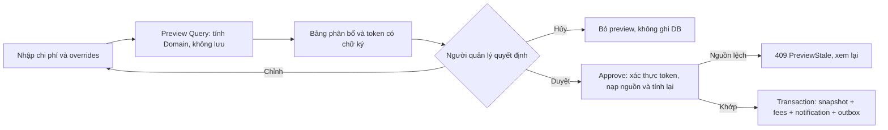
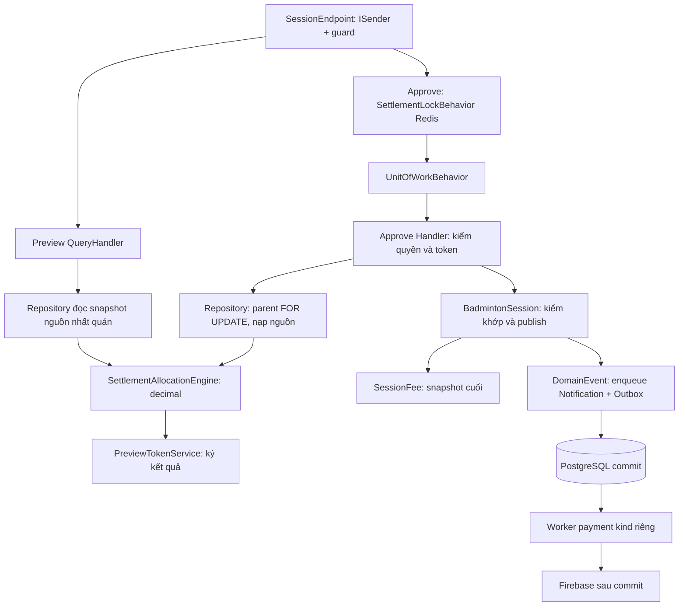

# Kế hoạch UC16 — Chốt sổ buổi chơi và phân bổ chi phí BE

Ngày lập: 29/10/2026. Trạng thái: **ĐỢT 1 ĐANG TRIỂN KHAI DOMAIN/TESTS — baseline Đợt 0 giữ nguyên**.

Phạm vi: FR18, FR19 và phần phát hành khoản thu, mã thanh toán, thông báo cần thiết của UC16. Chỉ lập kế hoạch BE. Luồng preview/điều chỉnh/approve dùng UC16 người dùng cung cấp; chính sách tính tiền dùng rule hiện hữu theo chỉ dẫn mới nhất. Không tự bổ sung công thức mà nguồn chưa quy định; các khoảng trống đã được người dùng chốt theo G01–G04 trong mục 4.3.

Tại thời điểm khảo sát, `git status --short` không có thay đổi. Chỉ đọc mã/tài liệu và tạo tài liệu kế hoạch này; chưa sửa mã nguồn, chưa chạy build, test, migration, seeder hoặc gọi dịch vụ thanh toán. Các cách kiểm chứng bên dưới sẽ thực hiện trong đợt triển khai; lượt này chỉ hoàn thiện kế hoạch.

Áp dụng skill `.agents/skills/feature-lifecycle/SKILL.md` ở bước PLAN; đã giao tra cứu độc lập cho `system-spec-inspector` và đánh giá cho `architecture-evaluator`. Khi triển khai mới chuyển sang `feature-engineer`, rồi `code-integrity-auditor` với skill `verify-architecture`. Không tự commit; commit cần đề xuất thông điệp và danh sách file để người dùng duyệt theo quy tắc dự án.

Cập nhật theo quyết định mới nhất của người dùng: phương án B, preview không lưu DB; chính sách tính phí bám `.agents/rules/financial-and-concurrency.md`, `.agents/rules/system-spec-reference.md` và UC16/schema trong docs. Miễn sân và cầu định kỳ cho hội viên tháng; ưu đãi Nữ bằng khoản giảm cố định hiện hữu. Bỏ đề xuất thêm trọng số tỷ lệ và xác nhận đóng tháng theo từng buổi. G01–G04 và gói kỹ thuật đã được người dùng chốt theo đề xuất. Chưa triển khai code hoặc chạy migration; chưa cho phép thao tác dữ liệu production.

Các đường dẫn trong tài liệu tính từ repository KLTN2026. Danh mục file hiện hữu nằm ở mục 1.2 và phụ lục A, file mới nằm ở mục 1.3; tên file mới là thiết kế đề xuất, không phải file đã tồn tại.

## 1. File đã đọc và phạm vi tác động

### 1.1. Nguồn đặc tả và quy tắc

| File | Hiện đang làm gì / liên quan UC16 |
|---|---|
| `AGENTS.md` | Quy định Clean Architecture, Rich Domain, delegation, kiểm chứng và duyệt commit. |
| `.agents/rules/system-architecture.md` | Yêu cầu Architectural Impact Gate trước thay đổi nhiều bảng, phân quyền, thanh toán. |
| `.agents/rules/core-architecture.md` | Quy tắc Domain, CQRS, repositories và EF. |
| `.agents/rules/tenant-rbac-and-security.md` | Phân quyền theo nhóm và guard endpoint. |
| `.agents/rules/financial-and-concurrency.md` | Công thức tổng phí, decimal, Redis settlement lock, cú pháp chuyển khoản. |
| `.agents/rules/system-spec-reference.md` | Bản đồ FR/UC/schema và trạng thái chuẩn. |
| `.agents/skills/feature-lifecycle/SKILL.md` | Điều phối Plan → Execute → Verify → Commit. |
| `.agents/skills/verify-architecture/SKILL.md` | Quy trình kiểm tra kiến trúc khi hoàn thành code. |
| `.agents/agents/system-spec-inspector.md` | Agent chỉ đọc, đối chiếu yêu cầu và schema. |
| `.agents/agents/architecture-evaluator.md` | Agent thiết kế blueprint và đánh giá tác động. |
| `docs/02_KHAO_SAT_VA_YEU_CAU.md:83` | FR18 ghi nhận vật tư; FR19 chia đa hệ số. |
| `docs/03_PHAN_TICH_HE_THONG_UC.md:209` | UC16 cũ tạo phí ngay sau tính, chưa tách duyệt như yêu cầu mới. |
| `docs/04_THIET_KE_CO_SO_DU_LIEU_3NF.md` | Các bảng fee rule, session, booking, fee, ngân hàng và thông báo; giới tính 0=Nam, 1=Nữ. |
| `docs/DANH_SACH_VA_TIEN_DO_CAC_FR.md:240` | Tiến độ FR18/19 đã lệch với mã hiện tại; nói miễn cả sân/cầu cho tháng. |
| `docs/API_DOCUMENTATION.md:391` | Hợp đồng GET/PUT fee-rule hiện hữu và quyền BankManage. |
| `docs/Detail Design/UC12-BE.md:186` | Quy tắc đóng điểm danh, xử lý CONFIRMED chưa đến và khóa thao tác. |
| `docs/08_DAC_TA_THIET_KE_GIAO_DIEN_UI_UX.md:210` | Biểu mẫu phí FE cũ; dùng để ghi nhận việc FE cần bổ sung. |

Khi triển khai, cập nhật các tài liệu FR/UC/schema/API/tiến độ nêu trên cho đúng quyết định được duyệt. Không đổi toàn bộ tài liệu UI; các phần FE được ghi vào báo cáo bàn giao.

### 1.2. File nghiệp vụ và hợp đồng hiện hữu dự kiến sửa hoặc thay thế

Các tiền tố dùng trong bảng để giảm độ dài: `D = src/LegendsTeamVN.BadmintonClub.Domain`, `A = src/LegendsTeamVN.BadmintonClub.Application`, `P = src/LegendsTeamVN.BadmintonClub.Persistence`, `I = src/LegendsTeamVN.BadmintonClub.Infrastructure`, `W = src/LegendsTeamVN.BadmintonClub.Presentation`. Ghép tiền tố với đường dẫn cột đầu để có đường dẫn repo đầy đủ.

| File | Hiện đang làm gì | Thay đổi dự kiến |
|---|---|---|
| `D/Entities/BadmintonSession.cs` | Giữ chi phí, trạng thái, điểm danh và điều phối. | Lưu đơn giá, snapshot chính sách, approval marker/id/hash; kiểm điều kiện quyết toán và chống bypass status. |
| `D/Entities/SessionFee.cs` | Khoản thu, mã thanh toán, trạng thái và số tiền. | Factory/bất biến phát hành; lưu breakdown, phân loại và override cuối; không tính lại phí đã phát hành. |
| `D/Repositories/ISessionRepository.cs` | Hợp đồng nạp session và kiểm quyền quản trị. | Đọc dữ liệu quyết toán có snapshot; kiểm quyền đọc tài chính theo nhóm thật. |
| `P/Repositories/SessionRepository.cs` | Load booking/user/fee, kiểm FeeManage. | Nạp dữ liệu chuẩn, lock parent và kiểm quyền tài chính đọc. |
| `A/Features/Sessions/Settlement/CalculateSessionSettlementCommand.cs` | Command tính và ghi phí ngay. | Thay bằng Query tính preview không ghi DB; bỏ hợp đồng một bước cũ. |
| `A/Features/Sessions/Settlement/CalculateSessionSettlementCommandHandler.cs` | Chứa công thức int/double, ghi phí và sinh QR. | Thay bằng orchestration preview; chuyển công thức về Domain. |
| `A/Features/Sessions/Settlement/GetSessionSettlementQuery.cs` | Query đọc bảng phí. | Đọc chi phí ban đầu hoặc snapshot đã phát hành. |
| `A/Features/Sessions/Settlement/GetSessionSettlementQueryHandler.cs` | Chỉ gọi helper, thiếu kiểm quyền đọc. | Kiểm quyền theo session.GroupId rồi đọc dữ liệu đã lưu. |
| `A/Features/Sessions/Settlement/SessionSettlementHelper.cs` | Tính lại tổng với cầu 25.000đ, suy loại theo role. | Thay bằng mapper thuần; không tự tính lại nghiệp vụ. |
| `A/Features/Sessions/Settlement/MarkMemberPaidCommand.cs` | Lệnh xác nhận tiền mặt thuộc bước thu tiền. | Rà soát hợp đồng ảnh hưởng, chỉ đổi nếu cần ràng buộc khoản thu đã phát hành. |
| `A/Features/Sessions/Settlement/MarkMemberPaidCommandHandler.cs` | Gạch PAID trực tiếp cho khoản thu tìm thấy. | Chặn thu nháp/EXEMPT nếu bị ảnh hưởng; không mở rộng thành UC18. |
| `A/DTOs/Sessions/Requests/CalculateSettlementRequest.cs` | Input số cầu, đơn giá, phụ phí, tiền sân tùy chọn. | Thay bằng request preview có chi phí và danh sách override. |
| `A/DTOs/Sessions/Responses/SessionSettlementResponse.cs` | Tiền kiểu int, status PENDING, IsSettled gộp trạng thái. | Decimal, chi tiết thành phần, PreviewToken khi xem trước và payment status chuẩn khi phát hành. |
| `A/Features/Sessions/UpdateStatus/UpdateSessionStatusCommandHandler.cs` | Điều phối đóng điểm danh qua ChangeOperationalStatus. | Ngăn gán CALCULATED/COMPLETED để né quy trình tài chính. |
| `P/Configurations/BadmintonSessionConfiguration.cs` | Mapping chi phí và trạng thái session. | Bổ sung đơn giá, snapshot rule và dữ liệu phê duyệt trên bảng hiện hữu. |
| `P/Configurations/SessionFeeConfiguration.cs` | Unique payment_code và session/user; amount decimal(18,2). | Giữ unique; thêm cột snapshot thành phần và ngoại lệ đã duyệt. |
| `A/DependencyInjection/Extensions/ServiceCollectionExtensions.cs` | Đăng ký MediatR, clock và dịch vụ nghiệp vụ. | Đăng ký orchestration/behavior UC16 đúng thứ tự. |
| `P/DependencyInjection/Extensions/ServiceCollectionExtensions.cs` | Bind repositories và DbContext/UoW. | Chỉ sửa nếu cần bind read repository mới; ưu tiên mở rộng ISessionRepository hiện hữu. |
| `I/DependencyInjection/Extensions/ServiceCollectionExtensions.cs` | Redis, Firebase và background workers. | Redis lock, worker thông báo phí, options UC16. |
| `I/LegendsTeamVN.BadmintonClub.Infrastructure.csproj` | Package Firebase và Redis SignalR. | Thêm dependency Redis trực tiếp nếu implementation lock cần. |
| `W/Endpoints/SessionEndpoint.cs` | Route settlement đang lồng thêm api/v1/sessions. | Route canonical, preview/approve, guard đọc/ghi. |
| `src/BuildingBlocks/LegendsTeamVN.Core.Application/DependencyInjection/Extensions/ServiceCollectionExtensions.cs` | Validation → UoW → QueryCaching. | Chỉ sửa nếu cần điểm đăng ký behavior ngoài UoW; behavior chỉ tác động command UC16. |
| `tests/LegendsTeamVN.BadmintonClub.UnitTests/SessionClosingTests.cs` | Kiểm quy tắc đóng buổi và NO_SHOW. | Cập nhật kỳ vọng chuyển trạng thái cần phát hành, giữ kiểm tra điểm danh/trận đấu. |
| `tests/LegendsTeamVN.BadmintonClub.UnitTests/AttendanceTests.cs` | Có setup buổi đã đóng qua UpdateStatus. | Dựng fixture bằng constructor status để kiểm attendance sau khi Domain chặn bypass publish. |
| `tests/LegendsTeamVN.BadmintonClub.UnitTests/ManualRotationTests.cs` | Kiểm điều phối thủ công và đóng buổi đang hoạt động. | Cập nhật fixture/luồng đóng theo publish; giữ kiểm tra proposals/recruitment. |
| `tests/LegendsTeamVN.BadmintonClub.UnitTests/RecruitmentCapacityTests.cs` | Kiểm sức chứa và hết hạn tuyển khi buổi đóng. | Dựng trạng thái đóng qua fixture đúng Domain, không thêm shim. |
| `tests/LegendsTeamVN.BadmintonClub.UnitTests/RotationTests.cs` | Kiểm chuyển trạng thái và dừng xoay tua khi đóng. | Kiểm invariant cần publish trước đóng và giữ kiểm dừng điều phối. |
| `src/Hosts/LegendsTeamVN.BadmintonClub.Migrator/Migrations/BadmintonDbContextModelSnapshot.cs` | Snapshot model, unique fee đã tồn tại. | EF sinh lại sau migration mới; không chỉnh migration cũ. |

Các file chỉ đối chiếu, không dự kiến sửa, được liệt kê đầy đủ ở phụ lục A. File mới và test mới được liệt kê tại mục 1.3. Nếu triển khai phát hiện phải mở rộng ngoài danh mục này, báo lại ảnh hưởng trước khi mở rộng các mục nhạy cảm.

### 1.3. Các file tạo mới theo phương án B

Danh sách dưới đây là file dự kiến tạo sau khi kế hoạch được duyệt; hiện chưa tạo file mã nguồn nào. Các tiền tố D/A/P/I đã định nghĩa ở mục 1.2. Phương án B không tạo entity hoặc bảng draft; record/value object chỉ dùng tính toán trong bộ nhớ.

| File mới | Trách nhiệm |
|---|---|
| `D/Services/SettlementAllocationEngine.cs` | Công thức decimal, phân bổ deterministic và record kết quả `SettlementAllocation` đặt cùng file trong Domain; không map EF. |
| `D/Events/SettlementPublishedDomainEvent.cs` | Sự kiện sealed phát hành. |
| `A/Features/Sessions/Settlement/GetSettlementFormQuery.cs` | Query mở form không ghi. |
| `A/Features/Sessions/Settlement/GetSettlementFormQueryHandler.cs` | Kiểm quyền và nạp dữ liệu ban đầu. |
| `A/Features/Sessions/Settlement/PreviewSettlementQuery.cs` | Preview input/overrides. |
| `A/Features/Sessions/Settlement/PreviewSettlementQueryHandler.cs` | Nạp nguồn, gọi Domain, ký token. |
| `A/Features/Sessions/Settlement/PreviewSettlementQueryValidator.cs` | Validate chi phí/overrides. |
| `A/Features/Sessions/Settlement/ApproveSettlementCommand.cs` | Token và input đã xem trước. |
| `A/Features/Sessions/Settlement/ApproveSettlementCommandHandler.cs` | Kiểm token/nguồn và điều phối publish. |
| `A/Features/Sessions/Settlement/ApproveSettlementCommandValidator.cs` | Validate token và input. |
| `A/Features/Sessions/Settlement/SessionSettlementMapper.cs` | Mapping snapshot thuần thay helper cũ. |
| `A/Features/Sessions/Settlement/Events/SettlementPublishedDomainEventHandler.cs` | Enqueue notification/outbox trong UoW. |
| `A/Features/Sessions/Settlement/SettlementLockBehavior.cs` | Lock chỉ command approve, bao ngoài UoW. |
| `A/Abstractions/ISettlementLock.cs` | Abstraction khóa. |
| `A/Abstractions/ISettlementPreviewTokenService.cs` | Hợp đồng ký/xác thực preview, không đưa crypto vào Domain. |
| `A/DependencyInjection/Options/SettlementOptions.cs` | WritesEnabled, DispatchEnabled và cấu hình token canonical. |
| `A/DTOs/Sessions/Requests/PreviewSettlementRequest.cs` | Chi phí, overrides và xác nhận NO_SHOW. |
| `A/DTOs/Sessions/Requests/ApproveSettlementRequest.cs` | Cùng input và token. |
| `A/DTOs/Sessions/Responses/SettlementPreviewResponse.cs` | Breakdown, token và thời hạn. |
| `I/Services/SettlementPreviewTokenService.cs` | HMAC, canonical digest, kiểm chữ ký và thời hạn. |
| `I/Services/RedisSettlementLock.cs` | Ownership token và lease an toàn. |
| `I/Services/SettlementNotificationWorker.cs` | Worker kind payment riêng. |
| `src/Hosts/LegendsTeamVN.BadmintonClub.Migrator/Migrations/<timestamp>_AddSettlementPublicationSnapshot.cs` | Thêm cột snapshot/approval/policy; không thêm bảng draft. |
| `src/Hosts/LegendsTeamVN.BadmintonClub.Migrator/Migrations/<timestamp>_AddSettlementPublicationSnapshot.Designer.cs` | Metadata EF sinh. |
| `tests/LegendsTeamVN.BadmintonClub.UnitTests/Domain/Sessions/SettlementAllocationTests.cs` | Kiểm công thức và bất biến. |
| `tests/LegendsTeamVN.BadmintonClub.Application.Tests/Features/Sessions/SettlementWorkflowTests.cs` | Preview không ghi, overrides, quyền và approve. |
| `tests/LegendsTeamVN.BadmintonClub.Application.Tests/Features/Sessions/SettlementTransactionTests.cs` | PostgreSQL/Redis thật, cạnh tranh và rollback. |
| `tests/LegendsTeamVN.BadmintonClub.Infrastructure.Tests/SettlementPreviewTokenTests.cs` | Tampering/expiry/canonicalization/cross-actor và policy version. |
| `tests/LegendsTeamVN.BadmintonClub.Infrastructure.Tests/SettlementDeliveryTests.cs` | Outbox/FCM retries. |
| `docs/Detail Design/UC16-BE.md` | Báo cáo BE và hợp đồng FE cần thực hiện. |

Tên cột snapshot cụ thể và precision được khóa ở review schema đợt 2, dựa trên các trường 4.2; không tạo bảng audit/draft ngầm. Cấu hình secret được cấp qua môi trường, không sửa/chèn secret vào appsettings repo. Dependency token dùng crypto chuẩn .NET, không cần thêm nền tảng xác thực mới.

## 2. Hành vi hiện tại so với mong muốn

| Tình huống | Mã hiện tại | Hành vi đích theo B |
|---|---|---|
| Mở chốt sổ | Helper tính lại tổng bằng giá cầu cứng. | GET dữ liệu ban đầu hoặc snapshot đã phát hành; không tạo dữ liệu. |
| Bấm tính | Ghi phí và CALCULATED ngay. | POST preview chạy Query: trả bảng và token xác nhận; không ghi DB/Redis preview. |
| Đầu vào | Chưa kiểm đủ EndTime, lấy cả CONFIRMED. | Hết giờ UTC, không trận PLAYING, chỉ người CHECKED_IN không bị xóa; rỗng thì báo lỗi. |
| Công thức | int/double, suy loại theo RoleName, Nữ==2. | Domain decimal, MemberType/expiry, giới tính chuẩn 0/1 và chính sách đã duyệt. |
| Ngoại lệ | Chưa có. | Client gửi overrides số tiền cuối/lý do vào preview; BE tính và ký toàn bộ bảng mới. |
| Duyệt | Chưa có thao tác riêng. | Client gửi lại input/overrides/token; BE kiểm chữ ký, nguồn và tính lại, khớp mới publish. |
| Nguồn thay đổi | Có thể tính lại khác bảng đã xem. | 409 PreviewStale; yêu cầu preview và xem lại trước khi duyệt. |
| Hủy | Tính đã tạo phí. | Bỏ preview ở client; không API hủy, không dữ liệu DB phải dọn. |
| Lưu kết quả | Không lưu đơn giá; tính lại xóa/tạo fee. | Chỉ khi approve mới lưu chi phí, đơn giá, breakdown, override/audit cuối và các fee bất biến. |
| Mã/QR | Mã rút gọn và fallback ngân hàng giả. | FeeId/code ổn định; QR đầy đủ để UC17 theo P08. |
| Quyền | GET chỉ auth toàn cục. | FeeManage cho preview/approve; FeeView cho bảng đã phát hành; kiểm nhóm thật trong handler. |
| Đồng thời | Thiếu settlement lock. | Redis bao UoW + parent DB lock + unique + PublishPreviewId/hash. |
| Thông báo | Chưa enqueue khi tính phí. | Notification/outbox cùng transaction approve; push sau commit. |
| Route | Prefix api/v1/sessions lặp trong EndpointGroupBase. | Prefix canonical một lần; bỏ hợp đồng tính-phát hành cũ. |

## 3. Các hướng làm và tradeoff

| Hướng | Độ phức tạp | Rủi ro / phạm vi ảnh hưởng | Kết luận |
|---|---|---|---|
| A. Vá calculate một bước | Thấp | Không đáp ứng xem trước, điều chỉnh và hủy trước phát hành. | Loại. |
| B. Preview không lưu, approve kiểm token và tính lại | Trung bình | Cần khóa ký và fingerprint chính xác; mất preview khi client mất trạng thái; vẫn cần cột snapshot kết quả cuối. | **Người dùng đã chọn.** |
| C. Draft lưu DB và version | Cao hơn | Thêm hai entity/bảng, repository và trạng thái draft; hỗ trợ tiếp tục qua phiên. | Không triển khai. |

**Lựa chọn — giải thích trong 3 dòng:**

1. Chọn B theo quyết định của người dùng: không tạo entity/bảng draft và không lưu dữ liệu khi xem trước.
2. Token có chữ ký ràng buộc bảng đã xem; approve nạp nguồn, tính lại bằng Domain và từ chối khi dữ liệu lệch.
3. Chỉ kết quả cuối được lưu trên BadmintonSession/SessionFee hiện hữu, giữ audit phát hành và giảm phạm vi schema so với C.

## 4. Blueprint BE và các quyết định đã duyệt

Phân loại: **THAY ĐỔI KIẾN TRÚC HỆ THỐNG** vì thay đổi CQRS, giao dịch phát hành nhiều bảng, khóa phân tán, token xác nhận và hợp đồng tài chính. Không thêm aggregate draft.

### 4.1. Thiết kế phân tầng

Domain không phụ thuộc Redis/EF/HTTP/crypto. Handler chỉ điều phối; Domain engine tính, entity kiểm điều kiện và phát hành. Token service ở Infrastructure triển khai abstraction Application. Preview là IQuery dù HTTP POST vì có request body; không đi qua UnitOfWorkBehavior dành cho ICommand. Query này không được cache theo cơ chế query cache chung.

### 4.2. Preview không lưu và snapshot phát hành [PAYMENTS] [PROD DATA]

- Không tạo `SessionSettlement`, `SessionSettlementLine`, `SettlementStatus`, bảng draft, repository draft hoặc DB state DRAFT/CANCELLED. Record kết quả `SettlementAllocation` được khai báo cùng file `Services/SettlementAllocationEngine.cs` trong Domain, không tạo file ValueObjects riêng. Record này không phải entity và không được map thành bảng; Domain không dùng DTO của Application.
- GET tải danh sách thực tế/chi phí; POST preview nhận toàn bộ chi phí và overrides `{UserId, FinalAmount, Reason}`. Client giữ input/overrides/token; thay đổi bất kỳ input nào đều phải preview lại.
- Token có payload version rõ ràng, PreviewId ngẫu nhiên, ActorId, GroupId, SessionId, thời hạn đã chốt 15 phút, digest canonical của input/overrides, nguồn và kết quả phân bổ. Ràng buộc cả ConfirmRemainingNoShows để thao tác đóng điểm danh cũng được xem trước. Không đưa secret/ngân hàng nhạy cảm vào token.
- Token dùng HMAC-SHA256 với secret riêng `Settlement:PreviewSigningKey` do môi trường cấp; không hardcode, không log, không dùng JWT secret thay thế. Canonicalization cố định culture, thứ tự UserId, biểu diễn decimal, UTC và policy version. Token sửa nội dung/chữ ký phải bị từ chối bằng so sánh constant-time; không tin final fees từ client.
- Fingerprint nguồn gồm session/time/status, roster CHECKED_IN và các CONFIRMED cần chốt NO_SHOW, dữ liệu giới tính/member type/expiry, fee rule và policy version. Không dùng amount/status thanh toán hiện tại để tính lại khoản đã phát hành. Preview đọc nguồn trong snapshot nhất quán. Approve khóa nguồn như mục 4.8 trước khi đọc/so fingerprint; không chỉ khóa session rồi giả định rule/member không đổi. Kiểm nguồn trước mọi thay đổi NO_SHOW/chi phí/trạng thái.
- Approve nhận lại đúng input/overrides/token, kiểm quyền mới nhất và chữ ký/actor/session. Sau khóa session, kiểm published marker trước: retry hợp lệ trả snapshot cũ; chỉ lần phát hành đầu mới kiểm thời hạn và nguồn rồi Domain tính lại, so với digest kết quả. Lệch nguồn trả 409 PreviewStale; token hết hạn trả 409 PreviewExpired; không tự duyệt bảng mới chưa xem.
- Chỉ khi approve thành công mới ghi BadmintonSession: đơn giá cầu, chi phí thực tế, snapshot FeeMode/các mức phí/discount/RoundRule đã dùng, tổng giải trình, PublishedAt/By, PublishedPreviewId và PublishedRequestHash. Các field nullable cho dữ liệu cũ; không backfill bằng công thức mới.
- SessionFee hiện hữu bổ sung các cột snapshot: loại hội viên/giới tính/discount áp dụng, phần sân/cầu/phụ phí và phần chi phí tháng đã bao, tiền trước/sau làm tròn, override cuối/lý do/người duyệt/thời điểm. Cột tiền decimal; unique session/user và payment_code giữ nguyên. Chỉ lưu kết quả và lý do cuối, không lịch sử mọi lần preview.
- Khi publish, gọi hành vi đóng buổi phù hợp rồi CALCULATED; không dùng status đơn lẻ làm bằng chứng đã phát hành. Generic status API không được bỏ qua UC16. COMPLETED không đồng nghĩa đã thu đủ.
- Retry sau commit: chữ ký hợp lệ, Actor/Session/InputHash/PreviewId trùng dữ liệu đã phát hành thì trả cùng fees/codes, kể cả token đã hết hạn sau lần commit đầu. PreviewId/hash khác trả 409 AlreadyPublished. Quyền hiện tại vẫn phải kiểm lại; không phát hành thêm.
- Session cũ có fees nhưng không có approval marker: giữ nguyên, đọc dữ liệu cũ rõ ràng và chặn publish mới. Không xóa-tạo lại fee/đổi mã/đổi PAID.
- Hủy trước duyệt chỉ bỏ trạng thái ở client. Không có request publish thì không ghi chi phí hoặc khoản thu; mất phiên client phải nhập/preview lại. Không thêm Redis cache lưu preview trá hình.

### 4.3. Chính sách theo rule và các quyết định đã chốt

Người dùng đã yêu cầu dùng rule hiện hữu. Các chính sách ở R01–R06 dưới đây là cơ sở kế hoạch, không tiếp tục hỏi chọn lại trọng số/miễn tháng như bản trước. Việc chốt chính sách không đồng nghĩa cho phép chạy production.

| ID / nhãn | Chính sách chuẩn từ nguồn | Áp dụng trong UC16 |
|---|---|---|
| R01 [PAYMENTS] | Tổng = tiền sân + số cầu × đơn giá cầu + phụ phí. | Tính bằng decimal ở Domain; snapshot đơn giá/tổng; không hardcode giá cầu. |
| R02 [PAYMENTS] | MONTHLY đã đóng trọn gói: sân và cầu định kỳ do quỹ tháng bao; phí buổi = 0/EXEMPT, trừ phụ phí đặc biệt. | Bỏ phương án chỉ miễn sân và vẫn thu cầu. Phụ phí thông thường không tự làm phát sinh phí buổi tháng; xử lý phụ phí đặc biệt theo G03. Không tự ghi giao dịch quỹ hoặc coi số dư quỹ đã được trừ. |
| R03 [PAYMENTS] | DAILY dùng DailyMemberFee hoặc chia thực tế; Nữ trừ FemaleDiscountDaily. | Dùng loại hội viên chuẩn và mức discount của CLB trong cả mode có áp dụng loại này; không thay bằng tỷ lệ Nam/Nữ. |
| R04 [PAYMENTS] | GUEST dùng GuestFee/giá khách theo policy CLB; Nữ trừ FemaleDiscountGuest. | Giảm tiền đúng loại, không lấy FemaleDiscountDaily dùng chung. Chi tiết DYNAMIC cho khách theo G02, không cộng hai lần giá vé và chi phí. |
| R05 [PAYMENTS] | Có DYNAMIC/FIXED và RoundRule trong schema; UC16/rule tham chiếu mô tả làm tròn lên. | Dùng cấu hình hiện hữu; làm tròn lên theo bước RoundRule (1.000/5.000...), không cố định mọi CLB thành 1.000. Rule tài chính nói “gần nhất/theo cấu hình” chưa đồng nhất; ghi rõ lựa chọn lên theo UC16 trong báo cáo. |
| R06 [PAYMENTS] | Có trạng thái EXEMPT cho miễn thu. | Khoản =0 dùng EXEMPT, khoản >0 dùng UNPAID; không đổi EXEMPT thành PENDING. |

Nguồn: `.agents/rules/financial-and-concurrency.md` mục 2; `.agents/rules/system-spec-reference.md` mục 2.4; `docs/03_PHAN_TICH_HE_THONG_UC.md` UC16; `docs/04_THIET_KE_CO_SO_DU_LIEU_3NF.md` bảng group_fee_rule. Không có skill riêng quy định công thức khác. `feature-lifecycle` điều phối thực hiện, `core-architecture` đặt logic tính tiền ở Domain.

**Các đề xuất đã bỏ khỏi phạm vi:** không thêm MaleWeight/FemaleWeight hoặc cột trọng số; không đổi hợp đồng API fee-rule vì mục đích này; không tự thêm bước Host xác nhận “đã đóng tháng cho buổi này”; không xây luồng thu/gia hạn tháng trong UC16; không quy định ngày hết hạn null là miễn phí vĩnh viễn.

**Ghi nhận phê duyệt:** người dùng đã trả lời “chốt theo m đề xuất” cho bốn quyết định G01–G04 và toàn bộ gói kỹ thuật đã trình. Đây là quyết định chính thức thay các hướng đề xuất còn mở trong bản trước; không cần hỏi lại các lựa chọn này khi triển khai đúng phạm vi.

| ID / nhãn | Quyết định đã chốt | Hành vi bắt buộc |
|---|---|---|
| G01 [PAYMENTS] | Xác định quyền lợi tháng bằng MemberType/MonthlyExpiryDate, mốc StartTime. | MONTHLY có expiry >= StartTime được miễn phí định kỳ; expiry < StartTime tính DAILY_MEMBER nhưng không tự đổi membership trong DB. MONTHLY có expiry null báo thiếu dữ liệu, chặn preview/approve lần đầu trước mọi ghi. Không coi null là miễn vô hạn, không thêm xác nhận từng buổi, không triển khai thu/gia hạn tháng. CLB quản lý quyền lợi bên ngoài UC16; đây không phải bằng chứng đã nhận giao dịch tiền tháng. |
| G02 [PAYMENTS] | DYNAMIC chia gốc trên toàn bộ CHECKED_IN; phần miễn/giảm không dồn sang người khác. | Chia đều độc lập C/S/E bằng largest remainder; monthly được quỹ tháng bao phần định kỳ, daily/guest đóng phần thực tế rồi trừ discount Nữ đúng loại. DailyMemberFee và GuestFee chỉ dùng ở FIXED; không cộng giá vé vào DYNAMIC. Chênh lệch ưu đãi hiển thị riêng, không tự ghi ledger. |
| G03 [PAYMENTS] | DYNAMIC dùng phụ phí thường trong tổng thực tế; vé FIXED là giá cuối buổi thường. | FIXED không cộng thêm ExtraExpense vào giá vé lần nữa. Monthly phí thường=0. Phát sinh đặc biệt của từng người dùng override số tiền cuối và lý do; không thêm field/loại phụ phí/màn hình cấu hình mới. |
| G04 [PAYMENTS] | Mã theo mẫu CLB {SessionIdShort} {UserIdShort}; mỗi đoạn 12 ký tự hexadecimal viết hoa. | Lấy 12 ký tự đầu của GUID dạng N, bỏ dấu gạch; mã không chứa amount và ổn định sau phát hành. Giữ unique DB; trùng mã thì rollback toàn bộ approve, trả conflict rõ ràng, không phát hành thiếu hoặc tự gắn hậu tố. Không đổi sang mẫu FeeId. |

**Giới hạn dữ liệu G01:** membership hiện hữu có MONTHLY/expiry null cần được CLB kiểm tra và chuẩn hóa trước khi chốt buổi liên quan. Việc duyệt G01 không cho phép agent tự backfill ngày hết hạn, xác nhận đã trả tiền hoặc sửa dữ liệu thật. Preview báo danh sách người thiếu dữ liệu cụ thể để xử lý; không tự chuyển họ sang DAILY để né lỗi.

| ID / nhãn | Gói kỹ thuật đã duyệt | Phạm vi thực hiện |
|---|---|---|
| P05 [PAYMENTS] | Điều chỉnh ngoại lệ | FinalAmount decimal không âm, tối đa precision; lý do bắt buộc; không RoundRule lại override, không dồn phần giảm sang người khác. Largest remainder và RoundRule theo rule đã chốt. |
| P08 [PAYMENTS] | Ranh giới QR | UC16 sinh feeId/mã; QR đầy đủ để UC17. QrCodePayload chưa sinh để rỗng và báo chưa sẵn sàng; không dùng ngân hàng giả. |
| A01 [AUTH] | Quyền truy cập | FeeManage cho form/preview/approve, FeeView cho toàn bảng nhóm; người chơi xem khoản riêng qua UC17. Không tự cấp quyền hàng loạt. |
| A02 [AUTH] | Quyền nhóm thật | Kiểm actor/membership/group/role hiện hành theo session.GroupId; không dựa duy nhất global-admin bypass. |
| D01 [PROD DATA] | Cấu trúc snapshot | Cho phép thiết kế/viết migration thêm cột vào BadmintonSession/SessionFee hiện hữu khi triển khai; không thêm bảng draft/cột trọng số, không backfill/recompute fees cũ. |
| D02 [PROD DATA] | Cổng production riêng | Vẫn chưa cho phép chạy migration, seeder, chuẩn hóa membership hoặc bật worker trên production. Chỉ chuẩn bị SQL/runbook để duyệt thao tác thật sau. |
| C01 [PAYMENTS] | Route/hợp đồng | Bỏ prefix lặp và luồng một bước; FE ghi báo cáo, không thêm alias. |
| N01 [PAYMENTS] | Notification/outbox | Cùng transaction; FCM sau commit, retry không tạo lại fee, EventId ổn định cho khử trùng. |
| T01 [AUTH] [PAYMENTS] | Token | HMAC key riêng từ môi trường, hạn 15 phút; ràng buộc actor/session/input/source/result; không dùng JWT secret thay thế. |
| L01 [PAYMENTS] | Khóa approve | Redis wait tối đa 3 giây/lease tối đa 5 giây kết hợp DB locks đến cuối transaction như 4.8; không renewal trong phạm vi này. |

### 4.4. Công thức đã chốt và giải trình [PAYMENTS]

Phân loại người chơi tại StartTime theo G01 trước khi tính; chỉ người CHECKED_IN không bị xóa được đưa vào tập n người. Không có membership phù hợp là GUEST theo hợp đồng hiện có; không suy loại bằng tên RoleName. Trường hợp MONTHLY/expiry null trả lỗi thiếu dữ liệu, không phát hành. Loại MemberType không hợp lệ phải báo lỗi, không fallback alias.

1. `C=CourtRentalCost`, `S=ShuttlecockUsed*ShuttlecockPrice`, `E=ExtraExpense`, `TotalCost=C+S+E`. Tất cả decimal, không âm, trong miền precision đã định.
2. Phân bổ đều từng C/S/E trên toàn bộ n người bằng largest remainder tại 4.8.3: có CourtShare_i, ShuttleShare_i, ExtraShare_i, tổng từng component khớp chi phí gốc. Đặt `ActualShare_i=CourtShare_i+ShuttleShare_i+ExtraShare_i`. n=0 báo lỗi trước chia.
3. MONTHLY hợp lệ: `BaseAmount_i=0`, `Raw_i=0`, `MonthlyFundCovered_i=ActualShare_i` cho buổi thông thường. Phần chi phí được quỹ tháng bao là giải trình; UC16 không tạo giao dịch quỹ. FemaleDiscountMonthly không trừ vào phí buổi vì thuộc thu tháng.
4. DAILY_MEMBER/GUEST ở DYNAMIC: `BaseAmount_i=ActualShare_i`. Không dùng DailyMemberFee/GuestFee làm phụ thu.
5. DAILY_MEMBER ở FIXED: `BaseAmount_i=DailyMemberFee`; GUEST ở FIXED: `BaseAmount_i=GuestFee`. Vé là giá cuối buổi thường, không cộng ExtraExpense lần nữa; actual component shares vẫn lưu để giải trình chi phí và chênh giá vé.
6. `ConfiguredDiscount_i` bằng FemaleDiscountDaily cho DAILY_MEMBER Nữ, FemaleDiscountGuest cho GUEST Nữ, các trường hợp khác bằng 0. `Discount_i=min(BaseAmount_i, ConfiguredDiscount_i)`; `Raw_i=max(0, BaseAmount_i-Discount_i)`. MONTHLY giữ Raw_i=0.
7. `CalculatedAmount_i=Ceiling(Raw_i/RoundRule)*RoundRule`, với RoundRule>0 từ rule CLB. `FinalAmount_i=OverrideAmount_i` nếu có, ngược lại bằng CalculatedAmount_i. Override là số cuối, có lý do, không âm; không làm tròn lại. Phụ phí đặc biệt (kể cả monthly) được phản ánh qua override theo G03, không cộng ngầm thêm một lần.
8. `RoundingDelta_i=CalculatedAmount_i-Raw_i`; `AdjustmentDelta_i=FinalAmount_i-CalculatedAmount_i`. `TotalReceivable=ΣFinalAmount_i`, `MonthlyFundCovered=ΣMonthlyFundCovered_i`.
9. `PolicyDelta=ΣRaw_i+MonthlyFundCovered-TotalCost`; bất biến giải trình: `TotalReceivable+MonthlyFundCovered-TotalCost=PolicyDelta+ΣRoundingDelta_i+ΣAdjustmentDelta_i`. DYNAMIC có ưu đãi Nữ thì PolicyDelta có thể âm; FIXED có thể thu dư/thiếu. Không dồn chênh lệch sang người khác và không tự cập nhật GroupLedger/số dư.
10. FinalAmount=0 dùng EXEMPT; FinalAmount>0 dùng UNPAID. Override monthly thành số dương thì khoản thu là UNPAID như các khoản dương khác.

Ví dụ DYNAMIC đã chốt: C=300.000, S=90.000, E=0; ba người gồm monthly hợp lệ, daily Nam, daily Nữ; FemaleDiscountDaily=10.000, RoundRule=1.000. Mỗi ActualShare=130.000; monthly=0, MonthlyFundCovered=130.000; daily Nam=130.000; daily Nữ=120.000. TotalReceivable=250.000; PolicyDelta=-10.000 là ưu đãi Nữ, không phải sai số phép chia. Nếu override monthly thành 50.000 vì liên hoan: AdjustmentDelta=50.000, TotalReceivable=300.000; không thêm 50.000 vào chi phí gốc lần nữa.

Checks riêng: MONTHLY expiry trước/bằng/sau StartTime và null; không tự đổi MemberType khi hết hạn; DYNAMIC guest không cộng GuestFee; FIXED không cộng ExtraExpense; discount lớn hơn BaseAmount ra 0; monthly override dương thành UNPAID; tổng component và phương trình delta giữ đúng cả sau override.

### 4.5. API theo phương án B [AUTH] [PAYMENTS]

Prefix canonical `/api/v1/sessions/{sessionId}/settlement`; EndpointGroupBase cung cấp prefix một lần, endpoint chỉ inject ISender.

| Method / hậu tố | Input | Kết quả / quyền |
|---|---|---|
| GET `/form` | SessionId | Danh sách có mặt, chi phí và cấu hình cần nhập; FeeManage; không ghi. |
| POST `/preview` | Chi phí thực tế, overrides, ConfirmRemainingNoShows | Bảng phân bổ, chênh lệch, PreviewToken/expiry; FeeManage; chạy Query, không ghi DB. |
| POST `/approve` | Cùng input/overrides và PreviewToken | Kiểm lại rồi phát hành nguyên tử; FeeManage. Retry cùng identity trả kết quả cũ. |
| GET không hậu tố | SessionId | Snapshot phát hành + payment status hiện tại; FeeView. |

Không có API tạo/sửa/hủy draft hay endpoint override riêng. Đổi hoặc bỏ override bằng cách gửi lại danh sách overrides đầy đủ vào preview. Phải kiểm UserId thuộc người có mặt, không trùng, số tiền không âm và lý do bắt buộc.

Lỗi: 400 đầu vào/token sai chữ ký hoặc bị sửa; 401 chưa đăng nhập; 403 sai quyền/actor/nhóm; 404 tài nguyên không tồn tại; 409 stale/expired/already-published/chưa hết giờ/trận đang chơi; 422 thiếu policy/dữ liệu quyền lợi tháng hoặc không người thực tế; 409 PaymentCodeConflict khi trùng mã làm rollback toàn bộ. Chốt mapping theo Result/Error hiện có khi triển khai.

### 4.6. Khóa, token, transaction và notification [PAYMENTS] [AUTH]

1. Preview dùng snapshot đọc nhất quán, không Redis lock ghi và không SaveChanges. Approve lấy `lock:session:{sessionId}:settlement`, wait ≤3 giây, lease ≤5 giây; Redis lỗi thì không phát hành.
2. SettlementLockBehavior nằm ngoài UnitOfWorkBehavior, scope release chạy sau save/commit/rollback; không tuyên bố lease Redis còn hiệu lực nếu đã quá 5 giây. DB khóa nguồn theo thứ tự mục 4.8 đến hết transaction; unique constraints và approval identity vẫn chặn trùng dù lease Redis hết. Release dùng ownership token, không xóa khóa của request kế tiếp.
3. Sau lấy lock, kiểm lại quyền và token, nạp nguồn, tính lại, đối chiếu rồi mới ghi. Không gọi mạng bên ngoài trong transaction. Lỗi giữa chừng rollback chi phí/session/fees/notification/outbox cùng nhau.
4. Sinh fee IDs trước; code theo cú pháp chuẩn đã chốt ở G04, gắn ổn định với fee. Publish marker/id/hash và snapshot lưu cùng một UoW. Request lặp không tính lại hoặc đổi fees đã phát hành; payload khác bị conflict.
5. DomainEvent handler hiện chạy trước EF SaveChanges nên chỉ enqueue bản ghi DB. Worker mới chỉ claim `SettlementPaymentPush`; giữ worker rotation độc lập. FCM có thể gửi lặp sau crash, EventId/NotificationId ổn định để FE khử trùng; retry không tạo lại fee.
6. Chỉ sau khi fingerprint và bảng tính khớp mới chốt NO_SHOW theo cờ đã đưa vào preview/token; người CONFIRMED không bị tính phí. NO_SHOW, audit điểm danh, trạng thái buổi, fees, notification và outbox cùng transaction; lỗi bất kỳ bước nào rollback tất cả. Trận PLAYING phải kết thúc trước, tương thích invariant closing/rotation hiện có.
7. Thêm quyết định **T01 [AUTH] [PAYMENTS]** đã duyệt: HMAC secret riêng, token 15 phút, policy version canonical. Đổi secret làm preview đang mở hết hiệu lực; tính preview mới để tiếp tục. Triển khai nhiều instance phải dùng cùng secret; không fallback sang key khác. Lần phát hành thành công không phụ thuộc token còn hạn để đọc GET.

### 4.7. Danh mục file triển khai

File hiện hữu cần sửa ở mục 1.2; toàn bộ file mới và trách nhiệm ở mục 1.3. Không thêm entity/bảng draft.

Phạm vi khuyến nghị không thay schema/API cấu hình ngân hàng: UC16 tạo mã định danh ổn định, QR đầy đủ thuộc UC17. GroupBankAccount và configuration chỉ đọc để tránh dùng nhầm BankName làm BIN. Nếu mở rộng QR, cần một bản bổ sung kế hoạch được duyệt trước khi sửa các file ngân hàng.

### 4.8. Kết quả rà soát bốn vấn đề và tiêu chí nghiệm thu bổ sung

Đây là xác minh thiết kế từ code và tài liệu, chưa phải bằng chứng implementation đã pass test. Không viết code hoặc chạy test trong lần cập nhật kế hoạch này.

#### 4.8.1. Kiểm nguồn trước NO_SHOW và chặn nguồn đổi sau kiểm [PAYMENTS]

**Kết luận:** đúng. `ChangeOperationalStatus` hiện sửa các CONFIRMED sang NO_SHOW ngay khi đóng buổi. `UnitOfWorkBehavior` chỉ save/commit sau handler. Vì vậy phải xếp thứ tự rõ ràng; nếu mutate trước so fingerprint sẽ tự làm nguồn lệch hoặc ghi thay đổi ngoài ý định duyệt.

Thứ tự approve bắt buộc:

1. Validate input/token structure và chữ ký; xác định actor và session/group thật.
2. Redis acquire → UoW begin. Nạp lại dưới khóa DB; kiểm quyền nhóm thật. Dữ liệu EF đã track từ trước không được dùng như bản nguồn mới.
3. Kiểm marker phát hành trên session dưới row lock. Retry đúng identity đi nhánh 4.8.4, không so fingerprint nguồn lần nữa.
4. Lần đầu: kiểm expiry; nạp/khóa đủ nguồn, so source fingerprint và kết quả Domain **trước mọi mutation**. Lệch trả `409 PreviewStale`, rollback và không ghi NO_SHOW/audit/chi phí/fee/outbox.
5. Khớp mới gọi hành vi đóng buổi: CONFIRMED → NO_SHOW khi cờ đã ký cho phép; áp dụng chi phí và publish fees. Không thêm người NO_SHOW vào mẫu số chia.
6. SaveChanges và commit cùng UoW cả audit booking, trạng thái session/matches/recruitment liên quan, approval marker, fees, notification và outbox. FCM ngoài transaction.

HMAC chứng minh dữ liệu được server ký, không chứng minh dữ liệu nguồn còn mới. Chỉ khóa session chưa đủ bảo vệ fee rule, user hoặc membership. Chiến lược đề xuất cho approve trong transaction ReadCommitted hiện có:

- Khóa `club_group FOR UPDATE` trước `badminton_session FOR UPDATE`, sau đó khóa `FOR SHARE` các user/member/rule thực sự tham gia fingerprint theo thứ tự bảng và ID cố định. Lock club giúp chặn child INSERT qua FK khi thiếu membership hoặc có fee rule mới; lock các dòng con giúp chặn sửa/xóa/khôi phục nguồn hiện có.
- Với fee rules, bao gồm các dòng của nhóm có thể trở thành latest; với membership, bao gồm cả bản soft-deleted của participant khi có thể được phục hồi. Không chỉ khóa rule vừa được chọn rồi bỏ qua insert mới hoặc reactivation. Chọn latest deterministic bằng AppliedAt rồi Id; danh sách user tie-break theo Guid dạng N viết thường, ordinal, không phụ thuộc culture.
- Phải xác nhận FK trong PostgreSQL thực tế được enforce ngay, cùng danh sách nguồn và trật tự writer ở đợt 2; EF configurations hiện đã khai báo FK group. FK chưa có/deferrable không được coi là bằng chứng chặn phantom. Nếu không chứng minh được, checkpoint này không đạt; phải điều chỉnh chiến lược trước rollout.
- Rà các writer hiện có có lấy session rồi club hoặc user rồi club không; không tự sửa writer ngoài scope. Nếu cần thay trật tự writer để tránh deadlock, bổ sung manifest/ảnh hưởng để review. Không dùng transaction isolation mặc định hoặc một lần hash lại làm thay thế cho khóa nguồn.
- Mốc dữ liệu được duyệt là lúc đã nạp và xác minh nguồn dưới các khóa trên; writer đến sau mốc này chờ commit rồi mới thay cấu hình. Rule/user/member đổi sau khi publish không sửa snapshot đã phát hành.

Tradeoff: club row lock có thể làm các approve cùng CLB nối đuôi và tạm chặn thêm membership/rule; chấp nhận cho transaction ngắn và phải đo contention. Chỉ dùng khi approve; preview không giữ khóa ghi dài hạn.

Checks: mutate attendance/member/gender/rule sau preview nhưng trước approve → 409, không mutation; rule/member insert hoặc restore đồng thời phải bị khóa hoặc được nhận là stale đúng thời điểm. Inject lỗi sau MarkNoShow và trước SaveChanges/commit → mọi booking status/audit/session/fees/notification/outbox giữ nguyên. Không cho phép tính lại rồi phát hành bảng khác mà không xem lại.

#### 4.8.2. Lease Redis 5 giây: không giải quyết chỉ bằng tăng TTL [PAYMENTS]

**Kết luận:** 5 giây không chứng minh transaction luôn hoàn tất; chỉ tăng thành 30/60 giây vẫn có thể hết hạn khi DB chậm hoặc process bị pause. Rule hiện tại `.agents/rules/financial-and-concurrency.md` giới hạn lease tối đa 5 giây, nên phương án mặc định giữ nguyên, không tự đổi rule hoặc thêm gia hạn vượt giới hạn.

- Redis là lớp giảm request cạnh tranh. Row locks PostgreSQL và kiểm approval identity dưới lock là lớp bảo vệ cuối cho ghi DB, giữ đến commit/rollback, độc lập với TTL Redis.
- Timeline bắt buộc test: A lấy Redis và khóa DB → sau hơn 5 giây TTL hết → B lấy Redis nhưng chưa được đi qua khóa DB → A commit → B nạp lại marker đã commit, trả cùng kết quả nếu cùng identity hoặc `409 AlreadyPublished` nếu khác. Nếu A rollback/crash trước commit, B mới được kiểm lại token/nguồn và thực hiện lần đầu. Nếu B hết thời gian chờ DB thì rollback request B, không bypass lock.
- Scope behavior sống đến cuối commit không đồng nghĩa Redis lease vẫn sống; không ghi log/kết luận “giữ Redis xuyên commit” khi TTL thực tế đã hết. Release kiểm ownership token atomically; lỗi release sau DB commit không được biến thành thao tác rollback/phát hành lại.
- Không gọi FCM/HTTP/QR service trong transaction. Theo dõi thời gian DB lock wait, transaction duration, Redis acquire, expiry-before-commit và tỷ lệ timeout. Đặt deadline mục tiêu cho approve ngắn hơn 5 giây và giới hạn chờ khóa DB/command/cancellation riêng cho UC16; pause hệ điều hành/GC vẫn có thể vượt mục tiêu nên DB guard luôn bắt buộc; cancellation chỉ là cơ chế dừng chờ, không phải bằng chứng chắc chắn commit chưa xảy ra.
- Khi response mất hoặc commit có kết quả chưa xác định, retry đúng PreviewId/input để xác định trạng thái đã commit; không đổi idempotency identity và tự tạo bộ phí mới.
- Nếu số đo cho thấy contention/transaction chậm thường xuyên: tối ưu query/batch trước; đề xuất tăng lease hoặc renewal có giới hạn chỉ sau khi duyệt thay đổi rule. Renewal phải kiểm ownership token, không gia hạn vô hạn, mất quyền thì không dựa vào Redis nữa; DB guard vẫn bắt buộc. **Renewal không thuộc phạm vi mặc định của kế hoạch này.**

Không tăng TTL có tradeoff: request kế tiếp có thể chờ DB khi lease hết, nhưng không tạo fee trùng. Timeout trả lỗi có thể thử lại; không hy sinh tính đúng để né chờ khóa.

#### 4.8.3. Chứng minh bảo toàn phần chi phí và tách chênh lệch [PAYMENTS]

Người dùng đã đồng ý largest remainder rồi UserId. Thuật toán thực hiện độc lập cho C, S, E trên toàn bộ người CHECKED_IN theo G02; không đưa thêm cấu hình tỷ lệ giới tính.

1. Đơn vị lưu q=0,01 đồng; input/đơn giá tối đa 2 chữ số thập phân và trong miền decimal/DB. Với mỗi khoản X, T=X/q là số đơn vị nguyên; n là số người được chia khoản đó. n=0 báo lỗi trước khi chia, không chia cho sức chứa giả.
2. Với chia đều: b=floor(T/n), r=T mod n. Mỗi người nhận b đơn vị, r người đầu theo UserId dạng N viết thường/ordinal nhận thêm một đơn vị. Đây là trường hợp phần dư bằng nhau của largest remainder; mọi field tiền và kết quả vẫn decimal, không dùng double.
3. Share_i=q*(b+bonus_i), bonus_i∈{0,1}, Σbonus_i=r. Do đó ΣShare_i=q*(n*b+r)=X, bảo toàn tuyệt đối từng khoản sân/cầu/phụ phí. Đổi thứ tự input không đổi người nhận phần dư.
4. Từng component chia cho toàn bộ CHECKED_IN theo G02/G03 đã chốt. Phần sân/cầu monthly chuyển sang giải trình quỹ tháng bao; không xóa khỏi tổng phân bổ. Ưu đãi Nữ là khoản giảm sau phân bổ theo rule, không phải trọng số đầu vào của thuật toán.
5. Tính Raw_i theo mode/discount → CalculatedAmount_i theo RoundRule → FinalAmount_i theo override. RoundRule và override không làm thay đổi các shares chi phí gốc đã lưu. Giải trình PolicyDelta/RoundingDelta/AdjustmentDelta theo 4.4; DYNAMIC có discount nên PolicyDelta không nhất thiết bằng 0.

Ví dụ thuần phép chia: C=100.000,00 chia 3 người → 33.333,34 / 33.333,33 / 33.333,33 theo UserId; S=10.000,00 → 3.333,34 / 3.333,33 / 3.333,33; E=0,01 → 0,01 / 0 / 0. Tổng ba khoản gốc vẫn 110.000,01. Sau đó mới áp dụng miễn tháng/ưu đãi/rounding/override và hiển thị từng chênh lệch.

Checks: tổng từng component khớp tuyệt đối không dùng epsilon; share không âm; tie/input-order deterministic; 0,01 chia nhiều người; n=1, n=0; số tiền sát giới hạn; all-monthly/all-female; Daily/Guest discount khác nhau; FIXED/DYNAMIC theo G01–G03 đã chốt; override xác nhận phương trình delta. Không viết test chọn tỷ lệ Nam=1/Nữ=0,8 vì tỷ lệ đó đã bị loại khỏi phạm vi.

#### 4.8.4. Retry và khoản thu đã PAID bất biến [PAYMENTS]

**Kết luận:** đúng và cần siết thứ tự nhánh. Lần publish đầu thay đổi status session và CONFIRMED → NO_SHOW; retry không được lấy các thay đổi đó làm lý do PreviewStale hoặc tạo bộ phí mới.

- Sau kiểm chữ ký/actor/session/input hash và quyền hiện tại, dưới session row lock kiểm PublishedPreviewId/PublishedRequestHash trước check nguồn/expiry của lần phát hành đầu. Cùng identity trả fees hiện có cùng IDs, amounts, codes và snapshot; payment status/paid-at trả giá trị mới nhất, không reset về UNPAID.
- Published marker có nhưng identity khác → `409 AlreadyPublished` kể cả mọi fee còn UNPAID. Không remove/add fees, không UpdateAmount, không đổi mã, không tạo notification/outbox mới.
- Có fees cũ nhưng không marker mới → chặn phát hành với mã conflict rõ ràng, không tự gom thành bộ mới. Unique constraint vẫn là lớp chặn cuối, không phải thay thế cho nhánh idempotency.
- Các khoản đã PAID giữ nguyên Amount, FeeId, PaymentCode, PaidAt, PaymentMethod, người thu và liên kết BankTransaction trong retry. Yêu cầu thay đổi khoản đã phát hành thuộc quy trình điều chỉnh tài chính được duyệt riêng.

Checks: publish → thanh toán một hoặc nhiều fee → retry đúng token/input, kể cả token đã hết hạn sau lần đầu, trả cùng fee IDs/code/amount và status PAID; số notification/outbox không tăng. Retry sau NO_SHOW không trả PreviewStale. Token/id khác, amount/override khác, hai Host cùng approve, response mất sau commit, nguồn policy đổi sau publish đều không phát hành lại. Secret bị thay khiến token cũ không xác thực được thì trả lỗi và đọc kết quả bằng GET; không nới kiểm chữ ký để ép retry thành công.

Nguồn đối chiếu: [Redis — Distributed Locks](https://redis.io/docs/latest/develop/clients/patterns/distributed-locks/) xác định bảo đảm theo thời hạn lease và release theo ownership; [PostgreSQL 16 — Explicit Locking](https://www.postgresql.org/docs/16/explicit-locking.html) mô tả row locks giữ đến cuối transaction. Kết luận áp dụng nhiều lớp cho UC16 là thiết kế của dự án, cần chứng minh bằng integration test ở đợt triển khai.

## 5. Kế hoạch theo đợt, mỗi bước có check riêng

**Kết quả rà soát:** bản cũ đã có các hạng mục chính nhưng thiếu tiêu chí nghiệm thu trực tiếp cho validation/thời gian/NO_SHOW, đọc snapshot, dữ liệu cũ, công tắc rollback và vòng đời outbox. Bản dưới đã bổ sung và sửa phụ thuộc: review schema trước → triển khai repository/lock/token → API → kiểm chứng cạnh tranh và lỗi thật. Không coi test đã chạy chỉ vì có tên trong kế hoạch.

B, G01–G04 và gói kỹ thuật đã được duyệt. Các đợt là nhóm triển khai/review trong cùng phiên, không phải lịch nhiều ngày. Có thể gộp **đợt 1–2** và **đợt 3–4**, nhưng giữ mọi checkpoint; không kiểm runtime một thành phần chưa được triển khai. Production qua cổng D02 riêng.

### 5.0. Quy ước check, môi trường và bằng chứng

- Test Domain cho công thức/bất biến; test Application cho orchestration; test HTTP qua routing/auth/validation/MediatR pipeline thật cho hợp đồng; PostgreSQL/Redis dùng DB/instance test riêng cho row locks, FK, transaction và lease. InMemory/mock không được dùng làm bằng chứng các bảo đảm DB/Redis.
- Clock điều khiển được để test mốc thời gian/expiry; concurrency dùng barrier/tín hiệu và connection độc lập, không chỉ chạy hai mock handler. Ca hết lease phải chứng minh request B thực sự lấy Redis sau khi khóa A hết và vẫn bị DB chặn.
- Mỗi checkpoint lưu tên test/lệnh, môi trường, expected/actual, exit code và lỗi còn lại trong báo cáo `docs/Detail Design/UC16-BE.md`. Kiểm nguyên tử so sánh cả IDs/amounts/status/audit/approval marker/notification/outbox/bank references trước và sau, không chỉ HTTP status hoặc số fee.
- Bộ test mới dùng các file đã liệt kê ở mục 1.3: SettlementAllocationTests, SettlementWorkflowTests, SettlementTransactionTests, SettlementPreviewTokenTests, SettlementDeliveryTests. HTTP/pipeline checks nằm trong test project hiện có phù hợp; nếu cần file/dependency/project bổ sung phải cập nhật manifest trước khi thêm, không tự mở rộng tầng kiến trúc.
- Không chuyển checkpoint sang đạt khi bị skip, chưa có dịch vụ test hoặc chỉ mới đọc code. Ghi rõ blocker môi trường; không sửa test thành mock để khai pass. Regression chạy theo phần bị ảnh hưởng; chỉ mở rộng/lặp lại khi có lỗi, thay đổi mới hoặc mối lo cụ thể.

### Đợt 0 — Chốt đầu vào và baseline triển khai

**Kết quả thực hiện Đợt 0 — 29/10/2026:** báo cáo tại `docs/Detail Design/UC16-BE.md`. HEAD baseline `7eb68e46cb4e471e91d644ffe83086c331bf7742`, branch main, working tree trước triển khai sạch. Đối chiếu 24 file hiện hữu/30 file mới dự kiến; không thiếu file hiện hữu. Đã chuẩn bị SDK 10.0.403, EF CLI 10.0.10 và cache tạm, restore 18 projects. Architecture 37/37, regression liên quan 206/206, không fail/skip. Build exit 0, 0 errors nhưng **25 warnings có sẵn, gồm NU1903**, nên chưa đạt gate build sạch cảnh báo nghiêm trọng. Docker khả dụng; chưa dựng PostgreSQL/Redis test riêng, không dùng Redis đang chạy của dự án khác. Chỉ tạo báo cáo; chưa sửa C#/packages/FE hoặc chạy migration/seeder/production.

| Checkpoint Đợt 0 | Trạng thái thực tế |
|---|---|
| 0.1 | Đã đối chiếu quyết định và manifest; chi tiết mapping trong báo cáo. |
| 0.2 | Đã kiểm và chuẩn bị tooling tạm, xác định cách dựng service test riêng; runtime PostgreSQL/Redis chưa kiểm. |
| 0.3 | Đã ghi Git/build/architecture/regression baseline; cảnh báo cũ được phân loại rõ, không khai build sạch. |

| Bước | Việc thực hiện | Check riêng / điều kiện đạt |
|---|---|---|
| 0.1 | Đối chiếu R01–R06, G01–G04, gói kỹ thuật và manifest. | Ma trận quyết định có đường dẫn tới handler/entity/schema/test dự kiến. Không hỏi lại các lựa chọn đã duyệt, không thêm trọng số/draft/thu phí tháng/QR đầy đủ. |
| 0.2 | Xác nhận .NET SDK, Python, EF tooling, package assets và cách dựng PostgreSQL/Redis test; nhận diện connection test rõ ràng. | Ghi phiên bản và khả năng chạy từng test project; Python dùng interpreter sẵn có (`python3` ở lần khảo sát). Thiếu restore/SDK/service ghi blocker thật. Không dùng connection production hay chạy Migrator host kèm seeders. |
| 0.3 | Ghi HEAD, working-tree diff trước triển khai; chạy baseline build/architecture và các regression liên quan khi bắt đầu coding. | Phân biệt lỗi có sẵn với lỗi UC16; ghi revision dùng rollback và giữ thay đổi người dùng. Không khai baseline pass khi chưa chạy. Đây là mốc rollback được mục 6 tham chiếu. |

**Qua đợt 0:** phạm vi/môi trường/mốc rollback rõ ràng; không cần phê duyệt lại chính sách. Blocker nào ảnh hưởng check nào phải được ghi trước khi triển khai phụ thuộc.

### Đợt 1 — Domain, công thức và bất biến

**Ranh giới triển khai đã rà soát:** Domain mới chặn đường đổi trạng thái để phát hành một bước, nên API calculate cũ chưa tương thích cho tới khi chuyển preview/approve ở đợt API. Scalar snapshot mới cũng cần mapping/migration Đợt 2. Không deploy Đợt 1 độc lập lên DB cũ; chưa sửa persistence hoặc thêm fallback. Manifest bổ sung bốn file regression nêu ở mục 1.2 vì fixture cũ đóng buổi qua UpdateStatus.

| Bước | Việc thực hiện | Check riêng / điều kiện đạt |
|---|---|---|
| 1.1 [PAYMENTS] | Engine decimal và record SettlementAllocation cùng file; chia đều C/S/E bằng largest remainder. | `ΣCourt=C`, `ΣShuttle=S`, `ΣExtra=E` bằng tuyệt đối; tie theo UserId ordinal; đổi thứ tự input không đổi kết quả; q=0,01, n=1/n=0, nhiều người/số tiền sát giới hạn; overflow bị từ chối. |
| 1.2 [PAYMENTS] | Phân loại tháng/ngày/khách và áp dụng mode/discount theo G01–G03. | MONTHLY expiry trước/bằng/sau StartTime và null đúng chính sách; hết hạn tính ngày nhưng không UPDATE membership; null không tạo phí. DYNAMIC guest không cộng GuestFee; FIXED không cộng ExtraExpense; discount DAILY/GUEST khác nhau; FemaleDiscountMonthly không trừ phí buổi; toàn monthly/toàn Nữ/mixed đều đúng. |
| 1.3 [PAYMENTS] | RoundRule, override cuối/lý do và giải trình. | Ví dụ tính tay 4.4/4.8.3 khớp; discount vượt base ra 0; RoundRule 1.000 và 5.000; overflow tích số cầu×đơn giá/tổng/làm tròn bị từ chối; override=0/dương/giảm/tăng không round lại hoặc chia lại người khác. Phương trình PolicyDelta/RoundingDelta/AdjustmentDelta đúng, monthly override dương thành UNPAID, amount=0 EXEMPT. |
| 1.4 [PAYMENTS] | Domain publish và bảo vệ trạng thái. | Chưa EndTime không chốt, tại EndTime được xét chốt; trận PLAYING chặn. CONFIRMED còn lại + flag false báo cần xác nhận, không mutation; flag true chỉ đánh NO_SHOW đúng người/audit actor/time. WAITING/ABSENT/NO_SHOW/deleted không bị thu; CALCULATED/COMPLETED không bypass phát hành; không mở lại published. |

**Qua đợt 1:** các quy tắc tiền và bất biến có expected amounts cụ thể, không chỉ test khớp lại chính implementation. Giữ regression SessionClosing/attendance/rotation phù hợp các invariant hiện hữu.

### Đợt 2 — Schema, nguồn dữ liệu, token và khóa

| Bước | Việc thực hiện | Check riêng / điều kiện đạt |
|---|---|---|
| 2.1 [PROD DATA] | Chốt danh sách cột snapshot/approval/precision/nullability; EF mapping; review FK và trật tự writer. | Snapshot lưu đủ unit price, rule/mode/discount, classification, components, override/reason/actor/time, PublishedPreviewId/RequestHash. Unique session/user và payment_code giữ nguyên, không duplicate index. SQL không thêm bảng draft/trọng số/backfill. Rà FK immediate và lock order theo 4.8.1; nếu phải sửa writer ngoài manifest thì bổ sung ảnh hưởng trước khi sửa. Đây là review tĩnh, chưa coi là runtime lock test. |
| 2.2 [PROD DATA] | Sinh migration/SQL Up/Down; thử DB test mới và bản dữ liệu mẫu cũ. | Up thành công; mọi fee cũ giữ count/id/amount/status/payment_code/PaidAt và BankTransaction references. Down được kiểm trên DB test chưa có dữ liệu mới cần giữ; sau phát hành dùng forward fix, không Down xóa snapshot. Lỗi migration phải rollback phần DDL trong transaction và history nhất quán; không chạy host Migrator/seeder. |
| 2.3 [PAYMENTS] | Triển khai repository read snapshot và các khóa nguồn club→session→rule/member/user theo thứ tự đã review; không để EF tracked state cũ thay bản nguồn mới. | PostgreSQL connections độc lập chứng minh khóa dòng hiện hữu và chặn insert/restore membership/rule, sửa AppliedAt để thay latest; thứ tự chọn rule deterministic. Preview đọc nhất quán không SaveChanges; approve giữ nguồn đến commit/rollback. Nếu FK thực tế/phantom/lock order chưa chứng minh được thì checkpoint chưa đạt. |
| 2.4 [AUTH/PAYMENTS] | Token HMAC/key riêng, canonicalization, expiry 15 phút và policy version. | Sửa payload/signature/input/override/NO_SHOW flag bị chặn; khác actor/session/group không dùng được; source/result digest đủ; đúng biên expiry/hết hạn cho phát hành lần đầu; retry cùng identity đã commit kiểm ở 4.4, không từ chối chỉ vì hết hạn; decimal culture/thứ tự overrides không thay ý nghĩa; thiếu key báo lỗi cấu hình rõ, không fallback JWT. Secret/token không lộ trong log/response ngoài token đã thiết kế; đổi signing key làm token cũ bị từ chối chữ ký, GET bản đã phát hành vẫn hoạt động. |
| 2.5 [PAYMENTS] | Redis lock implementation và đăng ký behavior ngoài UoW; đồng bộ token/key giữa các instance test. | Acquire→begin→handler→save→commit hoặc rollback→release đúng thứ tự; wait≤3s, TTL≤5s, release chỉ chủ sở hữu. Redis mất từ lúc acquire không ghi dữ liệu. Không renewal vô hạn/không gọi FCM trong transaction. Ca kết hợp vượt lease và commit failure kiểm ở đợt 4. |

**Qua đợt 2:** code/schema/token/repository/lock đã tồn tại và qua check riêng; mới chuyển sang kiểm workflow đầy đủ. Không áp migration lên DB thật hoặc chuẩn hóa MONTHLY/null hiện hữu.

### Đợt 3 — CQRS/API và hợp đồng đọc

| Bước | Việc thực hiện | Check riêng / điều kiện đạt |
|---|---|---|
| 3.1 | Form GET và preview POST chạy IQuery, mapper response decimal. | Qua HTTP/MediatR pipeline: không SaveChanges, không đổi session/cost/status/bookings, không fee/notification/outbox/cache preview; preview nhiều lần hoặc bỏ thao tác không có side effect. Đổi/bỏ override gửi lại đầy đủ input và nhận bảng/token mới. |
| 3.2 [PAYMENTS] | Validation đầy đủ qua pipeline thật, không chỉ gọi validator rời. | Số cầu âm/không nguyên, tiền âm/quá 2 chữ số thập phân/vượt precision, GUID rỗng, missing body, JSON sai kiểu, duplicate/foreign UserId override, thiếu lý do/amount âm bị từ chối đúng hợp đồng; không ghi DB. Zero cost hợp lệ nếu có người; n=0, thiếu rule, MONTHLY/null báo lỗi có đủ thông tin xử lý, không tạo default rule/người giả. |
| 3.3 [AUTH] | Guard endpoint và kiểm quyền nhóm thật trong handler/repository. | 401 chưa login; FeeView-only không preview/approve; FeeManage thao tác được; đọc toàn bảng cần FeeView. Giả X-Group-Id, quyền nhóm khác, admin thiếu quyền nhóm, user/group/member/role không hợp lệ và thu hồi quyền sau preview bị chặn; không lộ bảng nhóm khác. Không tự cấp quyền mới. |
| 3.4 | Route canonical và status API; OpenAPI/client contract. | EndpointDataSource/OpenAPI đối chiếu đủ GET /form, POST /preview, POST /approve, GET bảng trên đúng một prefix và permission từng route; luồng POST tính-phát hành cũ không còn đường bypass. API generic status không tự chuyển CALCULATED/COMPLETED để né publish. Đủ HTTP errors và response schema decimal/UNPAID/PAID/EXEMPT. |
| 3.5 [PAYMENTS] | GET bảng đã phát hành dùng snapshot, status thanh toán dùng dữ liệu hiện tại. | Sau publish đổi rule/member/gender/attendance không đổi amount/breakdown/code lịch sử; GET không dùng giá cầu 25.000 hay suy loại từ role. Sau trả tiền GET hiện PAID/PaidAt đúng. Dữ liệu fee cũ thiếu approval/unit-price snapshot được đọc rõ thiếu snapshot, không bịa giá, không migrate ngầm; approve dữ liệu cũ bị chặn. Chưa có bản phát hành thì GET không dựng khoản thu giả. |

**Qua đợt 3:** form/preview/auth/validation/GET được kiểm qua pipeline và HTTP contract; phần publish runtime đầy đủ hoàn tất ở đợt 4, không khai UC16 hoàn thành tại đây.

### Đợt 4 — Phát hành nguyên tử, cạnh tranh, retry và delivery

| Bước | Việc thực hiện | Check riêng / điều kiện đạt |
|---|---|---|
| 4.1 [PAYMENTS] | Approve lần đầu và stale trước mutation. | Luồng thành công ghi đúng chi phí/snapshot/fee/code/audit. Thay roster, CONFIRMED cần chốt, member type/expiry/gender/rule sau preview → 409 PreviewStale trước NO_SHOW; không âm thầm tính lại bảng khác. Flag NO_SHOW false/true như 1.4 được kiểm lại qua UoW. Người không CHECKED_IN không có fee. |
| 4.2 [PAYMENTS] | Fault injection transaction và collision G04. | Inject lỗi sau MarkNoShow, trong lúc lưu fee, lúc enqueue notification/outbox, SaveChanges hoặc trước commit → booking status/audit, session/status/matches/recruitment, marker, fees, notifications, outbox đều như trước. Code đúng regex `^CLB [0-9A-F]{12} [0-9A-F]{12}$`; hai GUID cùng prefix tạo collision thì rollback toàn bộ, trả PaymentCodeConflict, không tự hậu tố. |
| 4.3 [PAYMENTS] | Concurrency PostgreSQL/Redis thật bằng connection và service scope độc lập. | Hai Host/token khác cùng session chỉ một publish; token kia AlreadyPublished. Hai request cùng identity trả một bộ IDs/codes. Cố ý A chạy >5s: B lấy Redis sau expiry nhưng chờ DB, sau A commit đọc marker; sau A rollback chỉ một lần đầu hợp lệ được thực hiện. Release A không xóa khóa B; release lỗi sau commit không biến thành rollback/phát hành lại. Test deadlock/lock timeout/cancellation không bypass khóa, không tạo dữ liệu dở dang. |
| 4.4 [PAYMENTS] | Idempotency sau commit/PAID và response mất. | Publish→PAID→retry cùng token/input (kể cả token hết hạn sau commit) giữ IDs, amounts, codes, PaidAt, PaymentMethod, collector, bank references; status trả hiện tại. Không fingerprint lại nguồn đã bị publish sửa NO_SHOW/status; không thêm notification/outbox. Token/input khác AlreadyPublished kể cả fee UNPAID; rule/member đổi sau publish không phát hành lại. Mất response/commit outcome chưa rõ retry cùng identity xác định bản commit, không tạo lại. |
| 4.5 [PAYMENTS] | Notification/outbox và worker payment kind riêng. | Với mỗi fee phát hành tạo đúng notification/message theo thiết kế, EventId ổn định, retry approve không tăng counts. Worker không đọc message chưa commit/không claim rotation kind; FCM lỗi không rollback fees; không device token vẫn có in-app notification. Claim/retry/lease recovery sau crash, partial failure, dead-letter sau 10 lần và xử lý vận hành được kiểm; không tuyên bố exactly-once push. |
| 4.6 [PAYMENTS] | Cấu hình WritesEnabled/DispatchEnabled, DI và khả năng dừng/khôi phục. | WritesEnabled=false chặn approve, GET snapshot vẫn đọc; DispatchEnabled=false không claim/gửi message mới và giữ pending outbox; message đã in-flight có thể hoàn tất, không coi công tắc là thu hồi push đã gửi. Bật lại dispatch chỉ tiếp tục message còn chờ, không chạy lại approve/tạo lại fee; rotation worker độc lập. Missing signing key/Redis cấu hình lỗi được phát hiện rõ, không dùng fallback. Test scope/token service/lock behavior/worker/options resolve đúng. |
| 4.7 [PAYMENTS] | Giáp ranh UC17/UC18 và trường hợp dữ liệu tháng. | Fee mới >0 UNPAID, =0 EXEMPT; monthly override >0 UNPAID; QR chưa sẵn sàng không trả ngân hàng giả. Luồng tiền mặt hiện có không thu draft/EXEMPT hoặc làm UC16 ghi INFLOW; không mở rộng thành triển khai đối soát. MONTHLY/null chặn trước ghi, hết hạn chỉ phân loại ngày chứ không đổi DB/seed data. |

**Qua đợt 4:** tất cả nhánh chính/ngoại lệ UC16, tính nguyên tử, chống stale/trùng và delivery có bằng chứng runtime. Các ca timeout/commit không rõ kết quả không được xử lý bằng cách tạo identity mới hoặc xóa phí cũ.

### Đợt 5 — Kiểm toán độc lập, regression và bàn giao

| Bước | Việc thực hiện | Check riêng / điều kiện đạt |
|---|---|---|
| 5.1 | code-integrity-auditor kiểm toán độc lập sau feature-engineer. | Domain tính tiền, handler thuần điều phối/sealed, endpoint chỉ ISender, không Application SQL/EF nghiệp vụ, không entity/bảng draft/trọng số, permission/lock/UoW/outbox đúng. Tối đa hai vòng verify-fix theo workflow; nếu còn lỗi phải báo rõ, không khai nghiệm thu. |
| 5.2 | Chạy các suite UC16 và regression attendance/closing/rotation liên quan. | Domain/Application/HTTP/token/transaction/delivery tests đều chạy thật và pass; ghi số test/skip/env/exit code. PostgreSQL/Redis integration không bị skip mà vẫn ghi đạt. Không chạy lại cùng suite nhiều lần nếu không có thay đổi/lỗi cần giải quyết. |
| 5.3 | Chạy checks bắt buộc kiến trúc và build. | `python3 .agents/skills/verify-architecture/scripts/verify_architecture.py`; `dotnet build --no-restore`. Yêu cầu dự án 37/37 architecture checks, đối chiếu số thực tế runner và báo sai lệch nếu có, không sửa test để đạt số cứng. Build không lỗi/cảnh báo nghiêm trọng; cảnh báo tồn tại được đối chiếu baseline. |
| 5.4 | Kiểm rollback trên DB/service test dùng dữ liệu giả. | Tắt ghi/dispatch, kiểm GET còn đọc và outbox còn giữ; khôi phục bằng bản tương thích schema. Review Down chỉ cho DB chưa có snapshot mới; dữ liệu đã phát hành không bị drop/backfill. Không chạy rollback trên production. |
| 5.5 | Cập nhật FR/UC/schema/API và báo cáo UC16-BE kèm FE notes. | Đối chiếu yêu cầu→file→API→test bằng ma trận 5.6. Báo cáo có công thức/ví dụ, contract/error codes/decimals, expiry-null cần xử lý ngoài UC16, code12+12, QR thuộc UC17, retry/409 và FE dedupe. Diff chỉ BE/tests/docs trong scope, giữ thay đổi người dùng; không commit tự động. |

**Qua đợt 5:** mọi checkpoint bắt buộc có kết quả, không có skip/blocker bị giấu; có diff review, báo cáo và rủi ro thực tế. Nếu chưa đủ môi trường integration thì ghi chưa nghiệm thu hoàn chỉnh, không thay bằng cam kết.

### 5.6. Ma trận bao phủ UC16 và các quyết định đã chốt

| Yêu cầu / quyết định | Check chính |
|---|---|
| Mở form, danh sách có mặt | 1.2, 3.1, 3.3 |
| Input sai; người quản lý hủy trước duyệt | 3.1–3.2; không approve thì không side effect |
| Thời gian kết thúc, trận đang chơi, NO_SHOW | 1.4, 4.1–4.2 |
| G01 tháng còn hạn/hết hạn/null, không sửa membership | 1.2, 3.2, 4.7 |
| G02 chia thật; FIXED/discount không thu chồng | 1.1–1.3, 4.1 |
| G03 điều chỉnh cá nhân, miễn thu/UNPAID | 1.3, 3.1–3.2, 4.7 |
| G04 code ổn định/collision | 4.2, 4.4 |
| Bảo toàn sân/cầu/phụ phí và delta | 1.1, 1.3 |
| PreviewToken và PreviewStale trước mutation | 2.3–2.4, 4.1 |
| Phát hành nguyên tử, chống trùng, Redis hết lease | 2.5, 4.2–4.4 |
| GET snapshot và bảo toàn khoản PAID cũ | 3.5, 4.4 |
| Notification/outbox/FCM retry | 4.5–4.6 |
| AUTH theo nhóm thật | 3.3, 4.1, 4.4 |
| D01 schema, dữ liệu cũ và rollback | 2.1–2.2, 3.5, 5.4 |
| Kiến trúc/build, báo cáo FE | 5.1–5.5 |

### Đợt 6 — Cổng production riêng, không tự thực thi

Chỉ chuẩn bị SQL/artifact/runbook, danh sách môi trường đích, tác động/backup/rollback. Cần duyệt D02 cho thao tác thật trước migration, chuẩn hóa MONTHLY/null, chạy seeder hoặc bật worker production. Các đợt 0–5 và quyết định hiện tại không cấp phép các thao tác này. Commit cũng cần thông điệp và danh sách file trình duyệt riêng theo AGENTS.md.

**Giới hạn kiểm chứng:** đã chạy baseline build/architecture/regression trong Đợt 0 như ghi ở trên. Các checks nghiệp vụ UC16 mới và integration Đợt 1 trở đi chưa chạy; chưa triển khai nghiệp vụ hoặc chạy migration. Không dùng kết quả baseline để coi UC16 mới đã nghiệm thu.

## 6. Rủi ro và rollback cụ thể

Các công tắc đã duyệt trong gói kỹ thuật: `Settlement:WritesEnabled`, `Settlement:DispatchEnabled`. Phải được triển khai/kiểm chứng trước rollout mới dùng làm thao tác rollback; không giả định hiện tại đã có. Khi WritesEnabled=false, GET vẫn đọc được bản đã phát hành, các lệnh ghi UC16 bị chặn.

| Rủi ro / nhãn | Phòng ngừa và phát hiện | Rollback cụ thể |
|---|---|---|
| Token bị lộ/sửa/hết hạn hoặc đổi secret [AUTH] [PAYMENTS] | Secret riêng, không log token, expiry và ràng buộc actor/session/input. | Tắt WritesEnabled nếu nghi lộ secret, thay secret đồng bộ các instance; preview mới để tiếp tục. Không phục hồi secret bị lộ; fees đã commit vẫn đọc được qua GET và không đổi mã. |
| Công thức sai hoặc miễn tháng sai [PAYMENTS] | Ví dụ số tiền được duyệt, test tay, component breakdown. | Trước publish: bỏ preview và yêu cầu preview mới. Sau publish: tắt WritesEnabled và DispatchEnabled; giữ fee/code đã phát hành, lập danh sách feeId và chênh lệch để duyệt nghiệp vụ điều chỉnh riêng; không sửa PAID/xóa phí hay phát hành lại âm thầm. |
| Hai Host phát hành trùng [PAYMENTS] | Redis + DB lock + approval identity + unique; test cạnh tranh/lease expiry. | Tắt ghi; transaction lỗi rollback toàn bộ. Nếu phát hiện dữ liệu đã commit bất thường, giữ nguyên IDs và khóa xử lý buổi đó, xuất counts và đối soát; chỉ sửa theo bản dữ liệu được duyệt, không chạy DELETE trùng hàng loạt. |
| Sai quyền đọc/ghi [AUTH] | Handler kiểm DB quyền theo nhóm thật, endpoint guards, test giả header. | Tắt ghi và chặn route UC16 bị lỗi ở deployment; triển khai lại bản UC16 đã sửa quyền. Không rollback về GET cũ chỉ yêu cầu đăng nhập vì khôi phục lỗ hổng. Rà log truy cập để xác định phạm vi dữ liệu đã lộ. |
| Prefix/API breaking [AUTH] [PAYMENTS] | OpenAPI route inventory và ghi hợp đồng FE. | Trước rollout: revert phần route/DTO trong diff UC16. Sau có publish: dùng bản vá giữ GET snapshot và chặn POST một bước; không bật lại endpoint tính-phát hành cũ và không thêm alias. |
| Migration sai [PROD DATA] | Review SQL, test clone, additive schema, không backfill fees. | Chưa có bản ghi mới: dùng script Down đã review từ migration mới về migration trước. Đã có snapshot/fees mới: giữ schema, tắt ghi, rollout bản sửa tương thích; không drop cột snapshot mất audit. Nếu migration lỗi giữa chừng, rollback transaction migration và kiểm __EFMigrationsHistory. |
| Migrator chạy seed vào dữ liệu thật [PROD DATA] | Worker hiện Migrate cả Identity/Badminton rồi chạy mọi seeder. | Không dùng host Migrator cho rollout UC16; dùng SQL migration được duyệt với connection môi trường đích rõ ràng. Nếu đã có seed ngoài ý muốn, dừng host, đối chiếu backup/audit và lập script phục hồi riêng theo IDs trước khi duyệt; không restore toàn DB làm mất thanh toán mới. |
| Dữ liệu cũ không có đơn giá/snapshot [PROD DATA] | Đọc trạng thái legacy rõ ràng; không giả định giá cầu. | Dừng backfill nếu có; schema mới để nguyên; trả dữ liệu fee cũ đúng giá đã lưu. Không tính lại fee/QR cũ để “bổ sung” lịch sử. |
| Sửa rule/member/gender trong lúc duyệt [PAYMENTS] | Fingerprint, nguồn đọc nhất quán và locks có thứ tự. | Trả 409 và rollback transaction, yêu cầu preview mới để người dùng xem lại. Deadlock thì rollback, yêu cầu retry; không tự approve bảng mới chưa xem. |
| Khóa thả trước commit hoặc Redis mất [PAYMENTS] | Behavior order test và parent lock. | Tắt ghi UC16, rollback transaction đang thất bại; khôi phục Redis/behavior rồi retry cùng PreviewId và input. Không fallback bỏ lock. Không đổi pipeline các feature khác để chữa tạm. |
| FCM gửi trước commit / mất hoặc lặp [PAYMENTS] | Transactional outbox, worker riêng, eventId ổn định. | Tắt DispatchEnabled để dừng gửi; giữ Notifications/Outbox/Fees. Sau sửa, chỉ requeue những message của settlement kind và IDs được duyệt; không reset outbox rotation, không chạy lại Approve. Push đã gửi không thể thu hồi. |
| Mã thanh toán hoặc ngân hàng sai [PAYMENTS] | Unique code ổn định, UC16 không sinh QR từ BankName và không fallback tài khoản. | Trước approve: sửa cấu hình và tính lại. Sau approve: chặn gửi/QR bị sai, giữ feeId/paymentCode, đối soát giao dịch đã nhận; đổi ngân hàng/số tiền theo quy trình được duyệt riêng, không tái sử dụng mã cho người khác. |
| Đóng buổi ảnh hưởng rotation/attendance [PAYMENTS] | Tái dùng Domain close, chặn PLAYING, test closing hiện có. | Trước publish: transaction rollback giữ nguyên cả booking/matches. Sau publish: sửa tiến ở điều phối, giữ fee và audit; không mở lại buổi để tính lại khoản thu. |
| Áp dụng sai fee mode/discount hoặc miễn tháng [PAYMENTS] [PROD DATA] | Dùng rule hiện hữu; giữ G01–G03 rõ ràng, test từng loại người và mode. | Tắt ghi UC16, giữ snapshot/fees/rule hiện có và sửa tiến theo quyết định đã chốt; không đổi cấu hình hoặc trạng thái đóng tháng hàng loạt. |

Rollback mã nguồn trước khi có dữ liệu mới: phục hồi đúng những file UC16 trong manifest từ revision ghi ở đợt 0.3, bỏ đúng các file mới do đợt UC16 tạo, giữ thay đổi có sẵn của người dùng. Không dùng `git reset --hard`, không xóa rộng thư mục, không tự commit revert. Sau dữ liệu phát hành, rollback phải ưu tiên tắt ghi + bản vá tương thích schema; code cũ có thể tính lại phí nên không được rollout nguyên trạng.

## 7. Phần FE ghi vào báo cáo về sau và cổng dừng

Không sửa FE trong triển khai BE. Báo cáo `docs/Detail Design/UC16-BE.md` cần có các mục FE sau:

- Form chi phí sân/cầu/phụ phí, hiển thị người thực tế và lỗi dữ liệu từng trường.
- Bảng tách sân/cầu/phụ phí/quỹ tháng bao/ưu đãi/làm tròn/override và tổng chênh lệch.
- Client giữ input/overrides/PreviewToken tạm thời; sửa/bỏ override thì gửi lại toàn bộ input để preview mới; không gửi token cũ với bảng đã sửa.
- Nút Phê duyệt & Phát hành gửi input và token; cảnh báo PreviewStale/PreviewExpired; xác nhận NO_SHOW. Hủy chỉ đóng preview; reload/mất phiên phải nhập lại.
- Hiển thị UNPAID=Chờ thanh toán, PAID=Đã thanh toán, EXEMPT=Miễn thu theo quyết định được duyệt.
- Cập nhật client route/DTO mới, xử lý decimal và lỗi 409; không gọi POST cũ như nút tính preview.
- Ẩn/hiện theo FeeManage/FeeView nhưng BE vẫn kiểm quyền độc lập; người chơi chỉ xem khoản của mình qua UC17.
- Notification/eventId khử trùng, liên kết tới đúng fee, trạng thái publish thành công dù push đang chờ retry.
- Giữ UI biểu phí/giảm trừ hiện có, không thêm cấu hình trọng số Nam/Nữ hoặc xác nhận đóng tháng theo từng buổi; QR chưa sẵn sàng dẫn tới UC17, không hiển thị QR giả. Hiển thị rõ lỗi membership tháng thiếu expiry; giải thích tháng hết hạn tính ngày, phụ phí đặc biệt nhập bằng override; chặn approve khi thiếu dữ liệu.

**Cổng dừng hiện tại:** Đợt 0 đã khảo sát/chuẩn bị tooling/ghi baseline trong `docs/Detail Design/UC16-BE.md`; build còn cảnh báo cũ và PostgreSQL/Redis test riêng chưa dựng. Dừng đúng phạm vi Đợt 0, chưa chuyển sang nghiệp vụ Đợt 1. Những quyết định đã duyệt giữ nguyên; production và commit vẫn có cổng riêng.

## Phụ lục A. File đã đối chiếu, dùng lại hoặc kiểm regression

| File | Một dòng mô tả hiện trạng / lý do đọc |
|---|---|
| `D/Entities/SessionBooking.cs` | CHECKED_IN có dấu thời gian thực tế, NO_SHOW và pause phục vụ danh sách người chơi. |
| `D/Entities/GroupMember.cs` | Nguồn MemberType, MonthlyExpiryDate và trạng thái thành viên chuẩn. |
| `D/Entities/AppUser.cs` | Gender kiểu short, thông tin hiển thị người chịu phí. |
| `D/Entities/GroupBankAccount.cs` | BankName/account hiện có, chưa có field BIN chuyên biệt. |
| `D/Entities/GroupLedger.cs` | Sổ thu chi, UC16 phát hành không đồng nghĩa ghi INFLOW. |
| `D/Entities/BankTransaction.cs` | Liên kết fee và reference code đối soát, cần bảo toàn khi rollback. |
| `D/Entities/Notification.cs` | Notification PAYMENT và reference tới khoản thu. |
| `D/Entities/OutboxMessage.cs` | Envelope dùng chung, retry/lease/delivery state. |
| `D/Enums/Gender.cs` | Nam=0, Nữ=1; phát hiện bug so sánh Nữ=2 hiện tại. |
| `D/Enums/FeeMode.cs` | Hai mode DYNAMIC/FIXED hiện hữu. |
| `D/Enums/PriceType.cs` | MONTHLY_MEMBER, DAILY_MEMBER, GUEST. |
| `D/Enums/PaymentStatus.cs` | UNPAID, PAID, EXEMPT; không có PENDING. |
| `D/Enums/SessionStatus.cs` | Trạng thái buổi hiện hữu, không có FINISHED. |
| `D/Constants/GroupPermissions.cs` | Có FeeView/FeeManage/BankManage, không cần thêm role string. |
| `P/Configurations/GroupBankAccountConfiguration.cs` | BankName là chuỗi tên hiển thị, không có BankBin; chỉ đọc để xác định ranh giới UC17. |
| `W/Endpoints/ClubEndpoint.cs` | GET/PUT fee-rule chuyển request qua ISender; không cần đổi route khi bổ sung DTO. |
| `.agents/rules/conventional-commits.md` | Format commit và xác nhận riêng; chưa commit trong bước plan. |
| `D/Repositories/IOutboxRepository.cs` | Claim theo supported kinds, complete/fail theo lease. |
| `D/Repositories/INotificationRepository.cs` | Ghi notification theo generic repository. |
| `P/Repositories/OutboxRepository.cs` | FOR UPDATE SKIP LOCKED, tối đa 10 attempts, worker ownership. |
| `P/Repositories/NotificationRepository.cs` | Thêm notification trong DbContext/UoW chung. |
| `P/Configurations/GroupMemberConfiguration.cs` | Mapping FK group/user và unique group/user; đối chiếu khả năng khóa insert membership khi approve. |
| `P/Configurations/OutboxMessageConfiguration.cs` | Bảng vật lý rotation_outbox dùng chung, phân biệt theo Kind. |
| `P/Services/GroupAuthorizationService.cs` | Cache quyền và resolve session sang group; có logic global/Host hiện hữu cần kiểm quyền độc lập. |
| `A/Abstractions/IGroupAuthorizationService.cs` | Interface kiểm quyền và resolve group. |
| `A/Abstractions/INotificationService.cs` | Gửi Firebase đơn/multicast/topic. |
| `A/Features/Clubs/FeeRule/Get/GetClubFeeRuleQuery.cs` | Query cấu hình phí. |
| `A/Features/Clubs/FeeRule/Update/UpdateClubFeeRuleCommand.cs` | Wrapper command cấu hình phí. |
| `A/Features/Sessions/UpdateStatus/UpdateSessionStatusCommand.cs` | Có ConfirmRemainingNoShows phục vụ đóng buổi. |
| `A/Features/Attendance/AttendanceService.cs` | Mẫu kiểm quyền nhóm và parent row lock hiện có. |
| `A/Features/Rotation/Events/RotationChangedDomainEventHandler.cs` | Mẫu ghi notification/outbox trước SaveChanges, không gửi mạng trong transaction. |
| `I/Realtime/RotationOutboxWorker.cs` | Worker chỉ claim kind rotation, không được tiêu thụ payment message. |
| `I/Services/FirebaseNotificationService.cs` | Implementation FCM, multicast trả số thành công để phát hiện retry. |
| `W/Security/GroupPermissionHandler.cs` | Resolve group từ session, kiểm header chéo nhóm, có global-admin bypass hiện hữu. |
| `W/Security/GroupPermissionRequirement.cs` | Requirement quyền nhóm. |
| `W/Security/GroupAuthorizationExtensions.cs` | Extension RequireGroupPermission. |
| `src/BuildingBlocks/LegendsTeamVN.Core.Application/Behaviors/UnitOfWorkBehavior.cs` | Transaction bao handler, save và commit sau khi handler trả về. |
| `src/BuildingBlocks/LegendsTeamVN.Core.Persistence/DbContexts/DbContextUnitOfWork.cs` | Publish DomainEvents trước EF SaveChanges, commit/rollback transaction. |
| `src/BuildingBlocks/LegendsTeamVN.Core.Domain/Repositories/IUnitOfWork.cs` | Hợp đồng transaction hiện hữu. |
| `src/BuildingBlocks/LegendsTeamVN.Core.Infrastructure/DependencyInjection/Extensions/ServiceCollectionExtensions.cs` | Redis cache được đăng ký, chưa có settlement distributed lock riêng. |
| `src/BuildingBlocks/LegendsTeamVN.Core.Presentation/Abstractions/EndpointGroupBase.cs` | Tự thêm prefix api/v{version}/Name. |
| `src/BuildingBlocks/LegendsTeamVN.Core.Presentation/Extensions/EndpointExtensions.cs` | Tự discover và map EndpointGroupBase. |
| `src/Hosts/LegendsTeamVN.BadmintonClub.Migrator/Program.cs` | Boot host migration và đăng ký seeders. |
| `src/Hosts/LegendsTeamVN.BadmintonClub.Migrator/Worker.cs` | Migrate Identity/Badminton rồi chạy toàn bộ seeder, không phù hợp thao tác production UC16 riêng. |
| `src/Hosts/LegendsTeamVN.BadmintonClub.Migrator/LegendsTeamVN.BadmintonClub.Migrator.csproj` | .NET 10 và EF Tools hiện có. |
| `tests/LegendsTeamVN.BadmintonClub.Application.Tests/Common/TestDbContextFactory.cs` | InMemory không chứng minh được row locks/transactions PostgreSQL. |
| `tests/LegendsTeamVN.BadmintonClub.Application.Tests/LegendsTeamVN.BadmintonClub.Application.Tests.csproj` | Test dependencies hiện hữu, chưa mặc nhiên có integration runtime. |
| `tests/LegendsTeamVN.BadmintonClub.Infrastructure.Tests/LegendsTeamVN.BadmintonClub.Infrastructure.Tests.csproj` | Test runner/Mocks cho Infrastructure. |
| `tests/LegendsTeamVN.BadmintonClub.Infrastructure.Tests/RotationDeliveryTests.cs` | Mẫu retry/outbox kind isolation, cần regression khi thêm worker. |
| `D/Entities/GroupFeeRule.cs` | Cấu hình mức tháng/ngày/khách, giảm trừ Nữ, mode và RoundRule hiện hữu; tái sử dụng, không thêm hệ số tỷ lệ. |
| `D/Entities/ClubGroup.cs` | Aggregate CLB và cập nhật fee rule hiện hữu; không đổi chữ ký chỉ để thêm trọng số. |
| `A/DTOs/Clubs/Requests/UpdateClubFeeRuleRequest.cs` | Request cấu hình phí hiện hữu; giữ hợp đồng, không thêm MaleWeight/FemaleWeight. |
| `A/DTOs/Clubs/Responses/ClubFeeRuleResponse.cs` | Response cấu hình phí hiện hữu; không thêm cấu hình trọng số. |
| `A/Features/Clubs/FeeRule/Get/GetClubFeeRuleQueryHandler.cs` | Đọc rule; UC16 nạp qua repository và không gọi query này để tạo rule mặc định ngầm. |
| `A/Features/Clubs/FeeRule/Update/UpdateClubFeeRuleCommandHandler.cs` | Cập nhật mức phí/giảm trừ hiện hữu; không cần truyền thêm trọng số. |
| `A/Features/Clubs/FeeRule/Update/UpdateClubFeeRuleCommandValidator.cs` | Validation phí/discount/RoundRule hiện có; đọc để tái sử dụng ràng buộc. |
| `A/Features/Clubs/Create/CreateClubCommandHandler.cs` | Khởi tạo fee rule mặc định khi tạo CLB; không đổi call site vì không thêm hệ số. |
| `P/Seeders/BadmintonDemoDataSeeder.cs` | Dữ liệu demo loại hội viên, fee rule, ngân hàng và quỹ tháng; chỉ đối chiếu, không sửa/chạy seeder. |
| `P/Configurations/GroupFeeRuleConfiguration.cs` | Mapping schema fee rule hiện hữu; không thêm cột trọng số. |

Không coi các file chỉ đọc là bắt buộc sửa. Các thay đổi cấu hình môi trường thật, secrets, dữ liệu bank, quyền role hay seeder không được cho phép ngầm bởi danh sách tham khảo này.

## Phụ lục B. Biên bản chốt quyết định

Người dùng đã xác nhận “chốt theo m đề xuất” sau danh sách bốn mục và gói kỹ thuật. Phạm vi ghi nhận:

- Phương án B; không lưu preview/draft ở BE, không thêm entity/bảng draft. Record SettlementAllocation cùng file engine.
- G01: MONTHLY còn hạn tại StartTime được miễn; hết hạn tính DAILY_MEMBER; expiry null báo thiếu dữ liệu. Không tự sửa membership/chuẩn hóa dữ liệu thật hoặc thêm chức năng thu tháng.
- G02: DYNAMIC chia trên toàn bộ CHECKED_IN; miễn tháng và ưu đãi không dồn người khác; DailyMemberFee/GuestFee chỉ dùng FIXED.
- G03: DYNAMIC gồm phụ phí thường trong thực tế; FIXED là giá vé cuối buổi thường; monthly phí thường=0. Phát sinh đặc biệt dùng override số cuối và lý do.
- G04: CLB + 12 ký tự đầu SessionId dạng N viết hoa + 12 ký tự đầu UserId dạng N viết hoa, phân cách dấu cách. Unique; collision rollback toàn bộ, không hậu tố.
- Đã duyệt A01/A02/T01/L01/P05/P08/C01/N01: quyền nhóm thật, token 15 phút/key riêng, Redis5s+DB lock, override, QR thuộc UC17, route canonical và transactional outbox.
- D01: đồng ý thiết kế/viết migration cột snapshot trên bảng hiện hữu trong đợt triển khai. D02: chưa cho phép chạy migration/seeder/chuẩn hóa dữ liệu/bật worker production.
- Giữ chống PreviewStale trước mutation, bảo toàn component shares, NO_SHOW cùng transaction, retry sau PAID không phát hành lại.
- Có thể gộp đợt 1–2 và 3–4, giữ từng check. Lượt chốt này ghi vào tài liệu; chưa chạy build/test/migration, chưa viết code và chưa commit.
