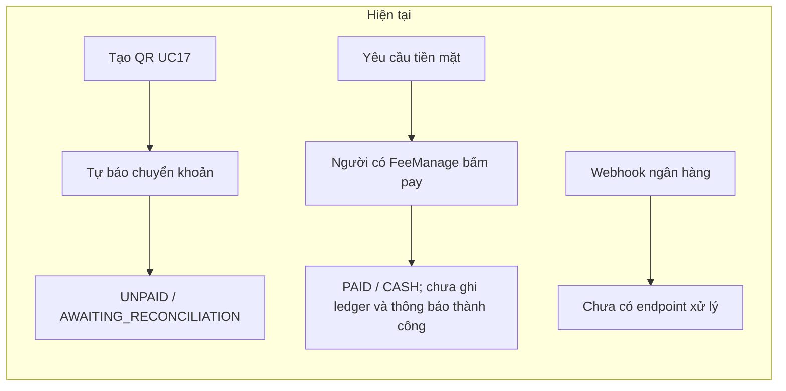
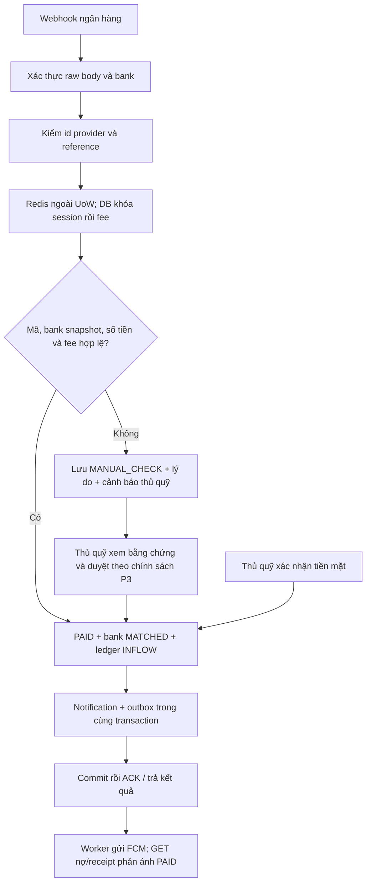
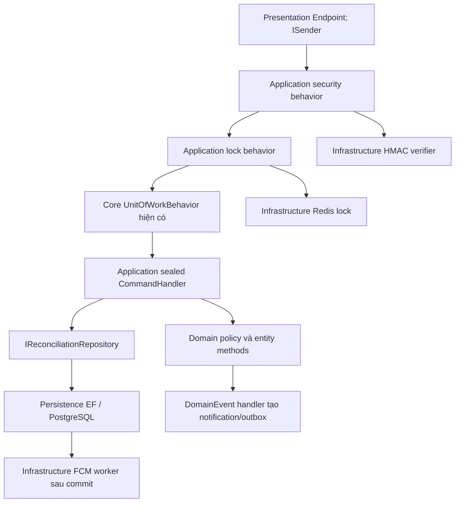

# Kế hoạch UC18 — Kiểm tra khớp tiền và xác nhận thanh toán

Ngày rà soát: 02/11/2026, GMT+7. Phạm vi: Backend FR21/F4.4 trong `LegendsTeamVN.BadmintonClub`.

**Trạng thái: ĐÃ DUYỆT KIẾN TRÚC B VÀ CÁC QUYẾT ĐỊNH A1/A2/P1/P2/P3-A/P4. Theo chỉ dẫn mới nhất: CHỈ CẬP NHẬT PLAN, CHƯA TRIỂN KHAI CODE. D1/D2 chưa được duyệt.**

> **Ràng buộc thực thi mới nhất:** Tuyệt đối không sử dụng các subagent được định nghĩa trong `.agents/agents` của repo, bao gồm system-spec-inspector, architecture-evaluator, feature-engineer và code-integrity-auditor. Không giao việc qua các vai trò này trực tiếp, gián tiếp hoặc đổi tên để sử dụng lại. Agent chính trực tiếp thực hiện rà soát, triển khai và kiểm chứng khi người dùng cho tiếp tục. Chỉ dẫn này của người dùng ưu tiên hơn quy trình ủy thác trong AGENTS.md, rules và skill feature-lifecycle. Các đoạn nhắc việc đã rà soát bằng subagent trước đây là lịch sử, không phải hướng dẫn được phép tiếp tục sử dụng.

**Lượt cập nhật hiện tại:** chỉ sửa file kế hoạch. Subagent triển khai vừa khởi tạo đã bị dừng; chưa có thay đổi mã nguồn trong Git status được kiểm tra sau khi dừng. Không commit, deploy, chạy migration trên DB dùng chung, dùng SePay Live/secret thật, gửi FCM thật hoặc chuyển tiền thật.

Các đường dẫn `src/`, `tests/`, `docs/`, `.agents/` dưới đây tính từ thư mục repo `LegendsTeamVN.BadmintonClub`. File kế hoạch nằm ngoài repo, tại thư mục `PLan_agent` của workspace. Git status đọc bằng `git -c safe.directory=... status --short` trả về sạch; không thay đổi cấu hình Git toàn cục.

## 1. Phạm vi, bằng chứng và các điểm cần thống nhất

- Đọc và đối chiếu luồng UC16/UC17, entity, mapping, transaction pipeline, repository, endpoint, permission, outbox và các test thanh toán liên quan. File sửa trực tiếp được liệt kê riêng ở mục 2. Các tài liệu dài và file tham chiếu được rà phần liên quan, không coi toàn bộ nội dung là hợp đồng đã được xác nhận.
- `[THAY ĐỔI KIẾN TRÚC HỆ THỐNG]`: thêm tích hợp webhook và command cập nhật nhiều bảng, thêm liên kết/constraint tài chính. Có rà soát chỉ đọc theo vai trò `architecture-evaluator` mà `.agents/rules/system-architecture.md` yêu cầu. Không giao viết code.
- Chỉ BE: webhook; xác nhận tiền mặt; danh sách/chi tiết và xác nhận đối soát thủ công; ledger phát sinh từ UC18; thông báo; API/tests/tài liệu bàn giao. UC19 chỉ nhận đầu ra ledger, chưa xây toàn bộ API báo cáo/sửa phiếu quỹ. Không làm Flutter, màn hình hay thay encoder VietQR.
- Bước 3 và 4 của nhánh tiền mặt trong yêu cầu bị lặp: hiểu là **một lần** gạch nợ, một lần ghi sổ.
- Trạng thái thực tế là `UNPAID/PAID/EXEMPT`; chờ đối soát ngân hàng dùng `MANUAL_CHECK` trên giao dịch. Không thêm alias `PENDING/UNMATCHED` theo mô tả cũ.
- Sổ quỹ thực tế dùng `TransactionType.INFLOW` và `LedgerCategory.SESSION_FEE`, không thêm enum `INCOME`.
- PaymentCode hiện tại là `CLB {12 ký tự hex session} {12 ký tự hex user}`, dài 29 ký tự. Giữ nguyên mã đã phát hành; không dùng ví dụ rút còn 4 ký tự trong rule cũ để sửa dữ liệu UC17.
- Đặc tả trong chat bổ sung tiền mặt và đối soát thủ công so với mục UC18 cũ trong docs; kế hoạch lấy yêu cầu trong chat làm phạm vi cần đáp ứng.

### Xác minh nhà cung cấp

SePay công bố `id` ổn định qua retry/replay, `referenceCode` có thể rỗng; response tiếp nhận phải là HTTP 200/201 với JSON `success: true` trong 30 giây. Do đó chỉ dựa vào unique reference hiện tại là chưa đủ. Đây là căn cứ cho quyết định P2, không phải lý do tự ý đổi schema. [Hợp đồng webhook SePay](https://developer.sepay.vn/vi/sepay-webhooks/tich-hop-webhook).

Đề xuất một cơ chế xác thực HMAC-SHA256: ký timestamp và raw body; so sánh constant-time, cửa sổ thời gian 5 phút. Không tự suy rằng API Key cũng là chữ ký HMAC. Cần kiểm chứng chế độ HMAC trên tài khoản SePay dùng khi tích hợp. [Hợp đồng xác thực SePay](https://developer.sepay.vn/vi/sepay-webhooks/xac-thuc).

## 2. Danh mục file và phạm vi ảnh hưởng

### 2.1. File hiện hữu dự kiến sửa — đã đọc

Ký hiệu `[PAYMENTS]` bao gồm code, test và tài liệu thay đổi hành vi tiền; `[AUTH]` bao gồm xác thực webhook/quyền người đối soát; `[PROD DATA]` chỉ ra khả năng tác động schema/dữ liệu nếu được áp lên DB dùng chung/thật. Viết migration source không đồng nghĩa được phép chạy migration.

| File | Đang làm gì | Dự kiến đổi | Nhãn |
|---|---|---|---|
| `src/LegendsTeamVN.BadmintonClub.Domain/Entities/SessionFee.cs` | Giữ nghĩa vụ, snapshot QR và trạng thái; MarkAsPaid hiện chỉ đổi metadata | Thêm hành vi xác nhận ngân hàng có điều kiện, thời điểm chuẩn hóa, phát event đúng một lần; bảo toàn Amount/PaymentCode và retry | [PAYMENTS] |
| `src/LegendsTeamVN.BadmintonClub.Domain/Entities/BankTransaction.cs` | Giữ tiền/nội dung/reference, FeeId nullable; có mutator đối soát lỏng | Lưu định danh provider, bank đã xác thực, lý do bất thường và audit manual; mặc định giao dịch mới chưa được kết luận khớp | [AUTH / PAYMENTS] |
| `src/LegendsTeamVN.BadmintonClub.Domain/Entities/GroupLedger.cs` | Dòng thu/chi theo nhóm; chưa liên kết fee hoặc bank transaction | Thêm nguồn FeeId/BankTransactionId, factory thu phí có điều kiện và metadata truy vết | [PAYMENTS] |
| `src/LegendsTeamVN.BadmintonClub.Persistence/Configurations/BankTransactionConfiguration.cs` | Mapping bank_transaction; unique ReferenceCode toàn cục | Thêm mapping/FK/index; đổi cách chống trùng theo P2; giữ dữ liệu cũ nguyên vẹn | [PAYMENTS / PROD DATA] |
| `src/LegendsTeamVN.BadmintonClub.Persistence/Configurations/GroupLedgerConfiguration.cs` | Mapping ledger, actor FK bắt buộc | Mapping nguồn và unique fee/source, ràng buộc giá trị/quan hệ mới | [PAYMENTS / PROD DATA] |
| `src/LegendsTeamVN.BadmintonClub.Application/Features/Settlement/MarkMemberPaid/MarkMemberPaidCommandHandler.cs` | Kiểm FeeManage thật, khóa qua session repository, xác nhận CASH; chưa ghi ledger | Dùng hành vi xác nhận chung, thêm ledger/event cùng transaction; giữ response UC16, chặn ghi khi cờ UC18 tắt | [AUTH / PAYMENTS] |
| `src/LegendsTeamVN.BadmintonClub.Application/DependencyInjection/Extensions/ServiceCollectionExtensions.cs` | Đăng ký MediatR và đặt settlement lock trước UoW | Đăng ký webhook security/lock behavior đúng thứ tự trước UoW | [AUTH / PAYMENTS] |
| `src/LegendsTeamVN.BadmintonClub.Persistence/DependencyInjection/Extensions/ServiceCollectionExtensions.cs` | Đăng ký repository hiện hữu | Đăng ký repository đối soát mới | [PAYMENTS] |
| `src/LegendsTeamVN.BadmintonClub.Infrastructure/DependencyInjection/Extensions/ServiceCollectionExtensions.cs` | Options, Redis, QR và worker FCM hiện hữu | Đăng ký options riêng UC18, verifier, lock, worker riêng loại message | [AUTH / PAYMENTS] |
| `src/Hosts/LegendsTeamVN.BadmintonClub.Migrator/Migrations/BadmintonDbContextModelSnapshot.cs` | Snapshot schema hiện tại, có UC16/UC17 | EF sinh lại phần model được duyệt; không sửa migration đã áp | [PAYMENTS / PROD DATA] |

Không cần sửa `BadmintonDbContext.cs` nếu dùng lại các entity/DbSet hiện hữu và cấu hình tự khám phá. Không sửa `.csproj` nếu SDK tự bao gồm file mới và các dependency đang có đáp ứng. Nếu thực thi phát hiện cần thêm file ngoài danh mục, phải nêu delta trước khi mở rộng phạm vi.

### 2.2. File đã đọc để xác định hành vi và bảo toàn hợp đồng — dự kiến không sửa

| File | Vai trò hiện tại |
|---|---|
| `AGENTS.md` | Quy định kiến trúc, tiếng Việt, an toàn tài chính và phân loại tác vụ chỉ lập kế hoạch |
| `.agents/rules/system-architecture.md` | Impact Gate và ranh giới tầng |
| `.agents/rules/financial-and-concurrency.md` | decimal, Redis, kiểm reference và transaction tài chính |
| `.agents/rules/system-spec-reference.md` | Bản đồ SSOT; một số tên trạng thái cũ phải đối chiếu code |
| `.agents/agents/architecture-evaluator.md` | Hợp đồng rà thiết kế trước khi viết code |
| `docs/02_KHAO_SAT_VA_YEU_CAU.md` | FR21 nhận biến động và tự xác nhận |
| `docs/03_PHAN_TICH_HE_THONG_UC.md` | Luồng UC18 mục tiêu và trạng thái chưa triển khai |
| `docs/04_THIET_KE_CO_SO_DU_LIEU_3NF.md` | Schema bank/fee/ledger, bổ sung UC16/UC17 và nghĩa actor |
| `docs/05_KIEN_TRUC_HE_THONG_VA_MA_NGUON.md` | Phân biệt UC17 hoàn thành và đối soát/ledger chưa khép kín |
| `docs/06_QUY_TRINH_KIEM_THU_VMODEL.md` | Yêu cầu kiểm webhook và giới hạn bằng chứng UAT |
| `docs/DANH_SACH_VA_TIEN_DO_CAC_FR.md` | FR21 chưa có API |
| `docs/API_DOCUMENTATION.md` | Hợp đồng UC17 và xác nhận CASH hiện hữu |
| `docs/Detail Design/UC17-BE.md` | PaymentCode, snapshot bank cũ, route tiền mặt, feature flags và DB local dùng chung |
| `src/LegendsTeamVN.BadmintonClub.Persistence/BadmintonDbContext.cs` | DbSet có sẵn và dịch lỗi unique PaymentCode |
| `src/LegendsTeamVN.BadmintonClub.Persistence/Configurations/SessionFeeConfiguration.cs` | Unique PaymentCode, FK QR bank và CHECK progress |
| `src/LegendsTeamVN.BadmintonClub.Persistence/Configurations/GroupBankAccountConfiguration.cs` | Một bank active/nhóm và cột secret cũ |
| `src/LegendsTeamVN.BadmintonClub.Domain/Entities/GroupBankAccount.cs` | Bank thay mới giữ lịch sử, không sao chép secret |
| `src/LegendsTeamVN.BadmintonClub.Domain/Constants/GroupPermissions.cs` | FeeManage/FeeView/BankManage đã tồn tại |
| `src/LegendsTeamVN.BadmintonClub.Domain/Enums/ReconciliationStatus.cs` | MATCHED và MANUAL_CHECK |
| `src/LegendsTeamVN.BadmintonClub.Domain/Enums/NotificationType.cs` | Có loại PAYMENT dùng lại |
| `src/LegendsTeamVN.BadmintonClub.Domain/Entities/Notification.cs` | Thông báo bền vững cho người dùng |
| `src/LegendsTeamVN.BadmintonClub.Domain/Entities/OutboxMessage.cs` | Lease/retry cho giao nhận sau commit |
| `src/LegendsTeamVN.BadmintonClub.Domain/Repositories/IOutboxRepository.cs` | Hợp đồng claim theo loại message |
| `src/LegendsTeamVN.BadmintonClub.Persistence/Repositories/OutboxRepository.cs` | SKIP LOCKED, lease owner và tối đa 10 lỗi |
| `src/LegendsTeamVN.BadmintonClub.Domain/Repositories/IPaymentRepository.cs` | Truy vấn phí cá nhân/bank và người nhận yêu cầu tiền mặt |
| `src/LegendsTeamVN.BadmintonClub.Persistence/Repositories/PaymentRepository.cs` | Khóa group → session → fee cho ghi UC17 |
| `src/LegendsTeamVN.BadmintonClub.Domain/Repositories/ISessionRepository.cs` | Hợp đồng lấy settlement và kiểm quyền tài chính |
| `src/LegendsTeamVN.BadmintonClub.Persistence/Repositories/SessionRepository.cs` | Cash hiện khóa session trước khi tải fee; kiểm quyền theo DB |
| `src/BuildingBlocks/LegendsTeamVN.Core.Application/Behaviors/UnitOfWorkBehavior.cs` | Command thành công mới Save/Commit; Result.Failure rollback |
| `src/BuildingBlocks/LegendsTeamVN.Core.Persistence/DbContexts/DbContextUnitOfWork.cs` | Publish domain event trước SaveChanges, trong transaction |
| `src/BuildingBlocks/LegendsTeamVN.Core.Presentation/Abstractions/EndpointGroupBase.cs` | Route có prefix/version chuẩn |
| `src/LegendsTeamVN.BadmintonClub.Presentation/Security/GroupPermissionHandler.cs` | Guard nhóm hiện hữu; header có thể ưu tiên route nhóm nên cần tái kiểm trong handler mới |
| `src/LegendsTeamVN.BadmintonClub.Presentation/Security/GroupAuthorizationExtensions.cs` | Gắn RequireGroupPermission |
| `src/LegendsTeamVN.BadmintonClub.Presentation/Exceptions/PaymentOperationExceptionHandler.cs` | Map PaymentOperationConflictException thành 409 |
| `src/LegendsTeamVN.BadmintonClub.Presentation/DependencyInjection/Extensions/ServiceCollectionExtensions.cs` | Auto-discover EndpointGroupBase và exception handler |
| `src/LegendsTeamVN.BadmintonClub.Presentation/Endpoints/SessionEndpoint.cs` | Route xác nhận CASH được bảo vệ FeeManage |
| `src/LegendsTeamVN.BadmintonClub.Application/Features/Settlement/MarkMemberPaid/MarkMemberPaidCommand.cs` | Command CASH trả SessionSettlementResponse |
| `src/LegendsTeamVN.BadmintonClub.Application/Features/Payments/PersonalFeeMapper.cs` | Receipt đọc từ trạng thái fee; PAID không còn QR/action |
| `src/LegendsTeamVN.BadmintonClub.Application/DependencyInjection/Options/PaymentsOptions.cs` | Ba cờ UC17, chưa có cờ đối soát độc lập |
| `src/LegendsTeamVN.BadmintonClub.Application/Features/Payments/BankTransfer/PrepareBankTransferCommandHandler.cs` | Tạo QR và giữ snapshot, chưa thu tiền |
| `src/LegendsTeamVN.BadmintonClub.Application/Features/Payments/TransferNotice/ReportBankTransferCommandHandler.cs` | Tự báo vẫn UNPAID |
| `src/LegendsTeamVN.BadmintonClub.Application/Features/Payments/CashRequest/RequestCashPaymentCommandHandler.cs` | Người chơi yêu cầu thu tiền mặt, chưa xác nhận đã thu |
| `src/LegendsTeamVN.BadmintonClub.Application/Features/Payments/Events/CashPaymentRequestedDomainEventHandler.cs` | Tạo notification/outbox yêu cầu tiền mặt trong UoW |
| `src/LegendsTeamVN.BadmintonClub.Infrastructure/Payments/CashPaymentNotificationWorker.cs` | Gửi FCM sau commit và tái kiểm người nhận |
| `src/LegendsTeamVN.BadmintonClub.Infrastructure/Services/RedisSettlementLock.cs` | Mẫu lease 5 giây, chờ 3 giây, xóa theo owner token |
| `src/LegendsTeamVN.BadmintonClub.Application/Features/Settlement/Approve/SettlementLockBehavior.cs` | Mẫu lock bao ngoài transaction |
| `tests/LegendsTeamVN.BadmintonClub.Application.Tests/Features/Payments/PaymentTestDatabase.cs` | Fixture UC17 cấm DB ứng dụng; migrate tới mốc UC17 cố định |
| `tests/LegendsTeamVN.BadmintonClub.Application.Tests/Features/Payments/PersonalFeeTransactionTests.cs` | Bảo toàn bank secret, ownership, quyền và outbox UC17 |
| `tests/LegendsTeamVN.BadmintonClub.UnitTests/Domain/Payments/PersonalFeePaymentTests.cs` | Bất biến mã/tiền/snapshot, khóa phương thức và retry |

Tab IDE `UserEndpointRouteTests.cs` không thuộc phạm vi sửa dự kiến. Chạy hồi quy bộ test hiện hữu sau triển khai; không sửa test đó chỉ vì đang mở trong IDE.

### 2.3. File sẽ tạo mới nếu kế hoạch được duyệt

Đây là danh mục đề xuất, chưa có các file triển khai. Tên migration có tiền tố timestamp do EF sinh lúc thực thi, không bịa timestamp đã tồn tại.

| File mới | Mục đích | Nhãn |
|---|---|---|
| `src/LegendsTeamVN.BadmintonClub.Domain/Services/PaymentReconciliationPolicy.cs` | Quy tắc mã, số tiền, snapshot và kết quả cần manual | [PAYMENTS] |
| `src/LegendsTeamVN.BadmintonClub.Domain/Repositories/IReconciliationRepository.cs` | Hợp đồng đọc/khóa bank, transaction, fee, kiểm quyền, thêm ledger và cảnh báo | [AUTH / PAYMENTS] |
| `src/LegendsTeamVN.BadmintonClub.Domain/Events/PaymentConfirmedDomainEvent.cs` | Sự kiện xác nhận đúng một lần cho cash/bank/manual | [PAYMENTS] |
| `src/LegendsTeamVN.BadmintonClub.Application/Abstractions/ISepayWebhookVerifier.cs` | Kiểm chứng raw payload theo bank credential | [AUTH / PAYMENTS] |
| `src/LegendsTeamVN.BadmintonClub.Application/Abstractions/IReconciliationLock.cs` | Lock giao dịch provider, không phụ thuộc Redis ở Application | [PAYMENTS] |
| `src/LegendsTeamVN.BadmintonClub.Application/DependencyInjection/Options/ReconciliationOptions.cs` | Cờ UC18 mặc định false, credential mapping theo BankAccountId từ secret provider | [AUTH / PAYMENTS] |
| `src/LegendsTeamVN.BadmintonClub.Application/DTOs/Payments/Requests/SepayWebhookRequest.cs` | DTO payload provider, không nhận amount/fee từ người chơi | [PAYMENTS] |
| `src/LegendsTeamVN.BadmintonClub.Application/DTOs/Payments/Requests/ConfirmReconciliationRequest.cs` | FeeId và lý do manual; không cho sửa tiền ngân hàng | [AUTH / PAYMENTS] |
| `src/LegendsTeamVN.BadmintonClub.Application/DTOs/Payments/Responses/ReconciliationResponse.cs` | DTO giao dịch, trạng thái, lý do và audit; không có secret | [PAYMENTS] |
| `src/LegendsTeamVN.BadmintonClub.Application/DTOs/Payments/Responses/SepayWebhookResponse.cs` | Đúng JSON ACK của provider | [PAYMENTS] |
| `src/LegendsTeamVN.BadmintonClub.Application/DTOs/Payments/Notifications/PaymentConfirmedPush.cs` | Envelope FCM có EventId và FeeId | [PAYMENTS] |
| `src/LegendsTeamVN.BadmintonClub.Application/DTOs/Payments/Notifications/ReconciliationAlertPush.cs` | Envelope cảnh báo cho người có FeeManage đúng nhóm | [AUTH / PAYMENTS] |
| `src/LegendsTeamVN.BadmintonClub.Application/Features/Payments/Reconciliation/Webhook/ProcessSepayWebhookCommand.cs` | Lệnh tiếp nhận raw body và headers transport | [AUTH / PAYMENTS] |
| `src/LegendsTeamVN.BadmintonClub.Application/Features/Payments/Reconciliation/Webhook/ProcessSepayWebhookCommandValidator.cs` | Giới hạn payload và dữ liệu bắt buộc | [PAYMENTS] |
| `src/LegendsTeamVN.BadmintonClub.Application/Features/Payments/Reconciliation/Webhook/ProcessSepayWebhookCommandHandler.cs` | Điều phối nhận bằng chứng, domain match và ghi nguyên tử | [PAYMENTS] |
| `src/LegendsTeamVN.BadmintonClub.Application/Features/Payments/Reconciliation/Webhook/SepayWebhookSecurityBehavior.cs` | Xác thực trước lock/UoW; DTO phải được parse từ đúng raw bytes đã kiểm chứng | [AUTH / PAYMENTS] |
| `src/LegendsTeamVN.BadmintonClub.Application/Features/Payments/Reconciliation/Webhook/SepayWebhookLockBehavior.cs` | Bao lease ngoài commit và map lỗi retryable cho provider | [PAYMENTS] |
| `src/LegendsTeamVN.BadmintonClub.Application/Features/Payments/Reconciliation/List/ListReconciliationsQuery.cs` | Query phân trang theo nhóm/trạng thái | [AUTH / PAYMENTS] |
| `src/LegendsTeamVN.BadmintonClub.Application/Features/Payments/Reconciliation/List/ListReconciliationsQueryValidator.cs` | Kiểm page/filter, giới hạn pageSize | [PAYMENTS] |
| `src/LegendsTeamVN.BadmintonClub.Application/Features/Payments/Reconciliation/List/ListReconciliationsQueryHandler.cs` | Tái kiểm FeeManage đúng nhóm trước tải dữ liệu | [AUTH / PAYMENTS] |
| `src/LegendsTeamVN.BadmintonClub.Application/Features/Payments/Reconciliation/Get/GetReconciliationQuery.cs` | Query chi tiết bằng chứng/audit | [AUTH / PAYMENTS] |
| `src/LegendsTeamVN.BadmintonClub.Application/Features/Payments/Reconciliation/Get/GetReconciliationQueryHandler.cs` | Chỉ đọc transaction thuộc nhóm được cấp quyền | [AUTH / PAYMENTS] |
| `src/LegendsTeamVN.BadmintonClub.Application/Features/Payments/Reconciliation/Confirm/ConfirmReconciliationCommand.cs` | Lệnh thủ quỹ gắn giao dịch vào khoản thu | [AUTH / PAYMENTS] |
| `src/LegendsTeamVN.BadmintonClub.Application/Features/Payments/Reconciliation/Confirm/ConfirmReconciliationCommandValidator.cs` | Bắt buộc lý do và ID hợp lệ | [PAYMENTS] |
| `src/LegendsTeamVN.BadmintonClub.Application/Features/Payments/Reconciliation/Confirm/ConfirmReconciliationCommandHandler.cs` | Khóa/tái kiểm quyền và trạng thái rồi gọi domain xác nhận | [AUTH / PAYMENTS] |
| `src/LegendsTeamVN.BadmintonClub.Application/Features/Payments/Reconciliation/Events/PaymentConfirmedDomainEventHandler.cs` | Lưu notification/outbox thành công trong transaction | [PAYMENTS] |
| `src/LegendsTeamVN.BadmintonClub.Persistence/Repositories/ReconciliationRepository.cs` | EF/SQL tham số hóa, khóa có timeout, truy vết nguồn và phát hiện trùng | [AUTH / PAYMENTS] |
| `src/LegendsTeamVN.BadmintonClub.Infrastructure/Payments/SepayWebhookVerifier.cs` | HMAC đúng bytes/timestamp và so sánh constant-time | [AUTH / PAYMENTS] |
| `src/LegendsTeamVN.BadmintonClub.Infrastructure/Payments/RedisReconciliationLock.cs` | Lease 5 giây, chờ tối đa 3 giây, release theo owner | [PAYMENTS] |
| `src/LegendsTeamVN.BadmintonClub.Infrastructure/Payments/ReconciliationNotificationWorker.cs` | Claim hai kind UC18, gửi sau commit, retry/dead-letter và tái kiểm quyền cảnh báo | [AUTH / PAYMENTS] |
| `src/LegendsTeamVN.BadmintonClub.Presentation/Endpoints/SepayWebhookEndpoint.cs` | Route provider; nhận raw HTTP, chỉ inject ISender | [AUTH / PAYMENTS] |
| `src/LegendsTeamVN.BadmintonClub.Presentation/Endpoints/ReconciliationEndpoint.cs` | Route đọc/duyệt của thủ quỹ với guard nhóm | [AUTH / PAYMENTS] |
| `src/Hosts/LegendsTeamVN.BadmintonClub.Migrator/Migrations/<timestamp>_AddPaymentReconciliation.cs` | DDL mở rộng + preflight + Down có điều kiện | [PAYMENTS / PROD DATA] |
| `src/Hosts/LegendsTeamVN.BadmintonClub.Migrator/Migrations/<timestamp>_AddPaymentReconciliation.Designer.cs` | Metadata migration EF sinh | [PAYMENTS / PROD DATA] |
| `tests/LegendsTeamVN.BadmintonClub.UnitTests/Domain/Payments/PaymentReconciliationTests.cs` | Quy tắc đúng/thiếu/thừa/mã sai/trạng thái và bất biến | [PAYMENTS] |
| `tests/LegendsTeamVN.BadmintonClub.Application.Tests/Features/Payments/ReconciliationTestDatabase.cs` | Fixture UC18 riêng, không đổi mốc migration fixture UC17 | [PAYMENTS] |
| `tests/LegendsTeamVN.BadmintonClub.Application.Tests/Features/Payments/PaymentReconciliationHttpTests.cs` | Webhook ACK, HMAC, quyền, CASH và manual qua pipeline thật | [AUTH / PAYMENTS] |
| `tests/LegendsTeamVN.BadmintonClub.Application.Tests/Features/Payments/PaymentReconciliationTransactionTests.cs` | Atomicity, race, retry, ledger unique và thông báo | [PAYMENTS] |
| `tests/LegendsTeamVN.BadmintonClub.Application.Tests/Features/Payments/PaymentReconciliationMigrationTests.cs` | Up/Down/preflight và bảo toàn UC17 trên PostgreSQL riêng | [PAYMENTS / PROD DATA] |
| `tests/LegendsTeamVN.BadmintonClub.Infrastructure.Tests/SepayWebhookSecurityTests.cs` | Raw body, timestamp, key sai, bank sai và lease | [AUTH / PAYMENTS] |
| `tests/LegendsTeamVN.BadmintonClub.Infrastructure.Tests/ReconciliationNotificationDeliveryTests.cs` | Claim riêng kind, retry và quyền người nhận sau thay đổi | [AUTH / PAYMENTS] |
| `docs/Detail Design/UC18-BE.md` | Hợp đồng BE, schema delta, giới hạn nghiệm thu, cấu hình và runbook rollout/rollback | [AUTH / PAYMENTS / PROD DATA] |

**Điều chỉnh sau rà soát bổ sung 02/11/2026:** Wave 3 cần cập nhật đồng bộ tài liệu tổng hợp FR/API/schema/kiến trúc và kiểm thử, không chỉ tạo UC18-BE.md. Danh mục và phạm vi thay đổi tài liệu ở mục 10.4; chỉ ghi trạng thái đã kiểm chứng, không đánh dấu FR21 hoàn thành trước bằng chứng. Hiện tại vẫn chỉ sửa file kế hoạch này.

## 3. Hành vi hiện tại so với mong muốn

Nhánh manual ở sơ đồ chỉ đi tới PAID khi đạt chính sách được duyệt, không phải nút cho phép bỏ mọi kiểm tra.

| Tình huống | Hiện tại | Kết quả đề xuất |
|---|---|---|
| QR_READY, đã nhận đúng tiền nhưng người chơi chưa tự báo | Chưa có xử lý | Vẫn auto khớp, không bắt buộc transfer-notice |
| Khớp một mã đầy đủ và đúng bank/tiền | UNPAID | PAID, 1 bank transaction MATCHED, 1 ledger thu, notification/outbox |
| Nội dung có mã sai/không có/đa mã | Chưa lưu | MANUAL_CHECK trong đúng nhóm nhận, không trả thông tin phí người khác |
| Thiếu hoặc thừa tiền | Chưa xử lý | MANUAL_CHECK; chính sách manual tại P3 |
| Đã PAID, cùng provider id và cùng bằng chứng | Chưa có webhook | ACK kết quả đã lưu, không thêm ledger/thông báo |
| Đã PAID nhưng giao dịch ngân hàng khác | Chưa xử lý | Lưu bất thường chờ xử lý tiền nhận thêm, không gạch nợ lần hai |
| Cùng provider id nhưng payload nghiệp vụ khác | Chưa xử lý | Giữ bằng chứng gốc, báo xung đột; không ghi đè hoặc ACK như retry hợp lệ |
| Xác nhận CASH | Chỉ đổi PAID | Một transaction cho PAID + ledger + notification/outbox |
| FCM lỗi | Chưa có thông báo thành công UC18 | PAID vẫn bền vững; retry push, có thông báo DB |
| Ngân hàng cũ inactive nhưng QR đã cấp | Snapshot được giữ | Vẫn đối soát đúng snapshot nếu credential chưa thu hồi |
| Trạng thái nợ/receipt | GET từ fee | Đọc cùng fee vừa commit; chưa cần bảng công nợ nhân bản hay event SignalR mới |

## 4. Ba hướng và tradeoff

| Hướng | Độ phức tạp | Rủi ro thực | Phạm vi ảnh hưởng |
|---|---|---|---|
| A. Chỉ thêm handler webhook, dùng nguyên schema | Thấp lúc viết | Ledger thiếu liên kết/unique nguồn; reference rỗng hoặc collision khó xử lý; không có audit manual đủ tin cậy | Ít file nhưng không khép kín FR21 và khó rollback dữ liệu |
| **B. Đối soát đồng bộ ngắn, schema mở rộng có kiểm soát, chung bất biến thu tiền** | Trung bình | DB chậm khiến provider retry; phải kiểm atomicity/khóa tới commit. Chấp nhận vì không gọi FCM/network trong transaction | Entity/mapping, CQRS mới, cash handler hiện hữu và worker thông báo; không đổi Core UoW/RBAC/QR |
| C. Durable webhook inbox + worker đối soát bất đồng bộ | Cao hơn B | Thêm trạng thái inbox, lease/recovery/dead-letter và độ trễ; vẫn cần toàn bộ bất biến tài chính của B | Thêm bảng/worker/monitoring; nhận nhanh và phục hồi backlog tốt khi tải lớn |

### Chọn B — giải thích trong ba dòng

1. Tận dụng UoW, PostgreSQL locks và outbox đã có để khép kín ba kênh xác nhận mà không thêm một hệ thống hàng đợi nghiệp vụ.
2. Bổ sung khóa DB/unique nguồn và audit cần thiết, giữ QR/PaymentCode/receipt UC17; xử lý trong DB ngắn rồi ACK sau commit.
3. Đổi lại, phải đo thời gian xử lý dưới hạn provider; nếu thực nghiệm không đạt hoặc cần xử lý backlog lớn, chuyển C và trình delta trước khi code thêm inbox.

## 5. Blueprint được đề xuất để duyệt

### 5.1. Tầng và API

| API đề xuất | Quyền và hành vi | Nhãn |
|---|---|---|
| `POST /api/v1/webhooks/sepay/{bankAccountId}` | HMAC riêng bank; bỏ JWT người dùng riêng route provider, không bỏ xác thực webhook | [AUTH / PAYMENTS] |
| `GET /api/v1/clubs/{groupId}/reconciliations` | FeeManage; phân trang, lọc trạng thái | [AUTH / PAYMENTS] |
| `GET /api/v1/clubs/{groupId}/reconciliations/{transactionId}` | FeeManage và transaction đúng bank/group | [AUTH / PAYMENTS] |
| `POST /api/v1/clubs/{groupId}/reconciliations/{transactionId}/confirm` | FeeManage; body FeeId/Reason; kiểm lại DB và trạng thái trong transaction | [AUTH / PAYMENTS] |
| `POST /api/v1/sessions/{sessionId}/settlement/members/{userId}/pay` | Giữ route/response CASH hiện hữu; tăng bảo đảm ledger/thông báo | [AUTH / PAYMENTS] |

Không thêm API đổi PaymentCode, thay Amount, tự đặt PAID từ người chơi hoặc chuyển BANK_TRANSFER sang CASH. Handler manual kiểm group route = group của bank = group fee; header X-Group-Id sai không thể cấp quyền chéo nhóm. Không thay JWT đăng nhập hoặc hardcode role Thủ quỹ.

Credential HMAC đọc từ secret provider/config ngoài Git, map đúng bankAccountId. Không trả secret qua DTO, không log raw authorization/chữ ký/body tài chính. Chưa cần API cấu hình secret mới hoặc sửa cột WebhookSecretKey cũ; không có fallback âm thầm giữa các tên cấu hình hay cơ chế xác thực.

### 5.2. Quy tắc khớp và nguyên tử [PAYMENTS]

1. Giới hạn kích thước body, content type JSON, kiểm HMAC raw bytes/timestamp trước ghi nghiệp vụ. Parse amount vào decimal; parse transactionDate giờ Việt Nam rồi chuyển UTC. Không dùng accumulated làm tiền nhận của khoản thu.
2. Chỉ tiền vào `transferType=in` mới có thể xác nhận. Tiền ra không tạo bút toán thu; quy định phản hồi no-op để tránh retry không cần thiết khi provider cấu hình nhầm cả hai chiều.
3. Trích đúng một mã `CLB + 12 hex + 12 hex` có ranh giới token; cho phép normalize case/khoảng trắng trong dữ liệu nhận theo quy tắc được test, không sửa mã lưu và không bỏ khoảng trắng/ghép tùy tiện để đoán mã. Nội dung có nhiều mã chuyển manual. Dùng content gốc, không tin code đã tách của provider là đủ.
4. Auto chỉ khi fee đã phát hành, UNPAID, BANK_TRANSFER đã có QR snapshot, đúng bank đã xác thực, tiền dương nguyên VND và **AmountReceived == Amount**. Không cần người chơi tự báo. Khoản legacy/chưa cấp QR/EXEMPT/bank không khớp/chọn CASH chuyển manual.
5. Giao dịch không tìm được fee vẫn giữ BankAccountId đã xác thực và lý do; không tìm group bằng mỗi chuỗi số tài khoản. Không tự ghép với khoản có cùng số tiền.
6. Redis key `lock:sepay:transaction:{providerTransactionId}`, lease 5 giây, chờ tối đa 3 giây. Lease bao toàn bộ UoW đến sau commit. DB lock là lớp bảo đảm cuối khi lease hết.
7. Với reference không rỗng, repo lấy PostgreSQL transaction advisory lock theo reference trước khi kiểm trùng, rồi khóa session → fee → bank_transaction theo thứ tự thống nhất; cash hiện đã khóa session và không lấy advisory lock reference. Việc này ngăn hai provider ID khác nhau cùng reference chạy qua bước kiểm tra đồng thời sau khi bỏ unique reference. Hash collision chỉ làm tuần tự hóa thêm, không quyết định hai giao dịch bằng nhau. Kiểm cả reference legacy, gặp bằng chứng không rõ thì manual. Không khóa group sau session vì UC17 đi group → session → fee. Tra bank bằng đọc snapshot; nếu cần thêm group lock phải đổi thiết kế và đồng bộ cash writer trước. Set lock_timeout 3 giây, giữ transaction ngắn và không gọi dịch vụ ngoài DB trong khóa. Manual phải lấy cùng advisory lock reference trước session, không đảo thứ tự.
8. Trong UoW: tạo bằng chứng bank + PAID + ledger nguồn + notification + outbox. Kết quả MANUAL_CHECK phải là kết quả tiếp nhận thành công để UoW commit giao dịch/cảnh báo; không trả Result.Failure khiến mất bằng chứng.
9. ACK `200 {"success":true}` chỉ sau commit hoặc retry hợp lệ đã bền vững. Lỗi transient/DB/Redis trả 503 để provider retry; không ACK trước khi đã lưu. Lỗi auth 401, payload hỏng 400; xác định bằng test contract. Xung đột bằng chứng không ghi đè và cần log cảnh báo vận hành, không log dữ liệu nhạy cảm.
10. Unique violation xảy ra khi Save/Commit phải được bắt **ngoài** UoW đã rollback; dùng scope/context sạch để đọc kết quả đã commit và so sánh bằng chứng. Không tiếp tục query trong transaction PostgreSQL đã aborted.
11. Notification người chơi tạo đúng một lần khi chuyển UNPAID → PAID. Worker chỉ claim `PaymentConfirmedPush` và `ReconciliationAlertPush`; FCM có thể gửi lại, client dùng EventId khử trùng. Dead-letter từ lần lỗi thứ 10 phải có hướng dẫn kiểm tra/requeue có duyệt.
12. Ledger ActorId auto = SessionFee.UserId theo nghĩa người nộp được schema cho phép; cash/manual = người xác nhận. ReconciledBy/ReconciledAt/Reason riêng, không dùng Guid.Empty hay tài khoản hệ thống giả. Không gán người nộp thành người đã bấm duyệt.

### 5.3. Schema delta đề xuất [PAYMENTS / PROD DATA]

| Bảng | Đổi source migration | Bảo vệ dữ liệu |
|---|---|---|
| `bank_transaction` | Thêm nullable `provider_transaction_id` bigint, `bank_account_id` uuid, `reason_code`, `reconciled_by`, `reconciled_at`, `reconciliation_note`; ReferenceCode thành nullable cho reference rỗng | Legacy giữ null; writer UC18 bắt buộc provider ID/bank. Unique provider ID không lọc soft-delete, reference vẫn được kiểm trước xử lý |
| `bank_transaction` index | Thay unique reference toàn cục bằng index phục vụ tra reference/bank; provider ID trở thành unique cho giao dịch SePay | Duyệt P2 trước; reference trùng khác ID được lưu MANUAL_CHECK, không suy đã thanh toán. Không dùng reference giả tạo từ ID để lấp cột |
| `group_ledger` | Thêm nullable `fee_id`, `bank_transaction_id`; FK RESTRICT cho nguồn mới | Unique fee_id khi khác null và unique bank_transaction_id khi khác null; không bỏ bản ghi soft-delete khỏi unique, tránh ghi lại nguồn cũ |
| `group_ledger` | CHECK các dòng nguồn UC18: số tiền dương, INFLOW/SESSION_FEE và nguồn hợp lệ | Không thêm constraint quét lại toàn bộ dữ liệu cũ khi chưa có preflight; không suy liên kết từ description |

Không thay Amount/PaymentCode/QR snapshot, không hồi tố PAID cũ, không tự tạo ledger cho cash lịch sử. Fee PAID cũ retry vẫn no-op; trường hợp thiếu ledger lịch sử chỉ báo cáo đọc, cần kế hoạch sửa dữ liệu riêng.

Một provider SePay/company được cấu hình cho phiên bản này. Nếu nhiều company có namespace ID riêng, unique phải đổi thành `(providerCompanyId, providerTransactionId)` và credential phải xác định company; phải duyệt delta trước triển khai đa company.

**Giới hạn cần hiểu:** ledger UC18 ghi dòng thu khi khoản được xác nhận. Tiền đã vào nhưng còn MANUAL_CHECK nằm trong danh sách đối soát, chưa phải số dư quỹ đã xác nhận. UC19 muốn phản ánh mọi tiền chưa phân bổ ngay khi ngân hàng nhận phải bổ sung mô hình tiền chờ phân bổ, không âm thầm cộng vào khoản thu.

### 5.4. Điểm nghiệp vụ chưa thể suy diễn: tất toán thiếu/thừa [PAYMENTS]

Ví dụ khoản phải đóng 50.000đ, ngân hàng nhận 40.000đ. Bấm manual không làm phát sinh 10.000đ còn thiếu. Ghi ledger 50.000đ sẽ sai tiền thực nhận; ghi 40.000đ rồi PAID cần chính sách miễn/xóa chênh lệch.

**Khuyến nghị P3:** manual v1 sửa liên kết/mã sai, chỉ xác nhận khi giao dịch đủ và khớp số tiền. Thiếu/thừa giữ MANUAL_CHECK để thủ quỹ xử lý; chưa có tự cộng dồn nhiều lần chuyển, hoàn tiền hoặc miễn thiếu. Đây là **điều chỉnh phạm vi nhánh ngoại lệ** so với cách hiểu “thiếu tiền vẫn có thể PAID ngay” trong yêu cầu; phải được bạn duyệt riêng, không tự coi là đã đáp ứng đầy đủ nhánh đó.

Nếu bạn yêu cầu thực hiện đúng nghĩa “chấp nhận thiếu vẫn PAID”, cần chọn P3-B: thêm mô hình quyết định chênh lệch có số phải thu, thực nhận, miễn thiếu/tiền thừa, người duyệt và lý do; receipt phải hiển thị đúng cả thực nhận và chênh lệch. Ledger chỉ ghi tiền thực tế. Khi chọn P3-B, tôi phải bổ sung danh mục entity/config/migration/DTO/test cụ thể và trình lại delta trước code phần này. Không dùng việc duyệt kỹ thuật chung để tự cấp chính sách xóa nợ.

## 6. Ba wave thực thi sau khi duyệt

Các wave là nhóm kiểm soát thay đổi trong một phiên triển khai; không phải roadmap nhiều ngày. Chưa bắt đầu wave nào.

### Wave 1 — Bất biến tài chính và schema trên DB test riêng

- Chốt P1/P2/P3; đối chiếu fixture webhook HMAC thật ở chế độ test khi được cho phép, xác nhận namespace ID provider và bank snapshot cũ.
- Domain policy, hành vi SessionFee/BankTransaction/GroupLedger; audit/unique/FK nguồn.
- Repository mới, khóa DB/điều kiện ownership; migration source và snapshot, preflight/Down guard.
- Test domain + migration + transaction trên PostgreSQL riêng có allowlist; không gọi DB local BadmintonClub:5432. Fixture UC18 tạo database tên ngẫu nhiên có prefix uc18_test_, chỉ được xóa database do fixture tạo và đã kiểm đích.
- Đầu ra review: diff source + SQL Up/Down sinh từ EF + bằng chứng rollback trên DB disposable. Không chạy Migrator worker/seeder.

### Wave 2 — Khép kín webhook, tiền mặt và manual

- Endpoint/CQRS/validators/HMAC/Redis behavior; giữ khóa ngoài UoW đến commit.
- Bổ sung ledger/event vào cash pay hiện hữu; một đường xác nhận không đi vòng khóa phương thức.
- API list/detail/manual, tái kiểm FeeManage theo DB và giới hạn đúng nhóm; cảnh báo MANUAL_CHECK.
- Notification/outbox trong transaction, worker UC18 riêng, tất cả cờ mặc định false.
- Kiểm HTTP thực, race cash/manual/webhook, mất ACK sau commit, lỗi từng điểm ghi và retry sau lease hết.
- Đầu ra review: API contract, bộ test, diff không có FE/Core JWT/encoder QR thay đổi.

### Wave 3 — Hồi quy, tài liệu và gói vận hành để duyệt dữ liệu riêng

- Hồi quy UC16/UC17, kiểm kiến trúc bằng `python .agents/skills/verify-architecture/scripts/verify_architecture.py`, `dotnet build --no-restore` và test phù hợp. Báo số check thực tế, không ghi trước là 37/37 nếu chưa chạy.
- Test không có DB/Redis riêng phải báo skipped và chưa nghiệm thu cạnh tranh, không coi skip là pass.
- Hoàn thiện `docs/Detail Design/UC18-BE.md`: request/response/error, chính sách P3, credential ngoài Git, giới hạn ledger pending, feature flags, SQL preflight và runbook rollback.
- Đồng bộ các mục UC18/FR21 và schema delta trong sáu tài liệu tổng hợp tại mục 10.4; phân biệt thiết kế mục tiêu, source đã triển khai, test sandbox và vận hành thật. Đối chiếu lại helper/ma trận skill có mapping cũ, không lấy output registry tĩnh làm hợp đồng route.
- Chuẩn bị baseline migration hiện tại, backup/restore rehearsal riêng, checksum artifacts và kết quả UAT sandbox để bạn xem.
- **Dừng trước áp DB dùng chung, cấu hình webhook Live, bật FCM thật hoặc nhận tiền thật.** Các hành động đó chỉ thực hiện khi có duyệt D1/D2 cho đích cụ thể. Chưa đủ bằng chứng thì chưa đánh FR21/UAT toàn luồng hoàn thành.

## 7. Kiểm chứng bắt buộc [AUTH / PAYMENTS]

| Nhóm | Bằng chứng cần có |
|---|---|
| Khớp tiền | Đúng mã/bank/tiền; QR_READY không tự báo vẫn xử lý; lệch 1đ/thiếu/thừa/tiền lẻ/âm/zero không auto PAID |
| Parser | 12 hex, token boundary, case/khoảng trắng có quy định, tiền tố/hậu tố bank, không mã, đa mã, mã thuộc nhóm khác |
| Auth | HMAC đúng/sai, body đổi sau ký, timestamp hết hạn, bank route sai, credential thiếu/thu hồi; không chấp nhận JWT người chơi thay HMAC |
| RBAC | FeeManage thật đúng nhóm; FeeView/người chơi/role nhóm khác/user inactive/member banned bị từ chối; header giả không vượt route/source group |
| Atomicity | Fault injection sau bank/PAID/ledger/notification/outbox: toàn bộ rollback; DB không có PAID nửa chừng |
| Idempotency | Retry MATCHED và MANUAL_CHECK, cùng ID khác bằng chứng, ID mới cùng reference, mất ACK sau commit; không thêm thu/cảnh báo vô hạn |
| Concurrency | Nhiều webhook cùng ID; hai giao dịch cho một fee; manual đua webhook; CASH đua webhook; Redis mất kết nối/lease hết vẫn không ghi trùng |
| Dữ liệu cũ | Legacy PAID/UNPAID và ledger không liên kết giữ nguyên; retry PAID cũ không tự backfill; QR bank inactive vẫn được đối chiếu đúng |
| Thông báo | Chỉ sau commit, không gửi khi rollback, retry giữ EventId, worker không claim kind UC13/16/17; tái kiểm quyền thủ quỹ trước gửi |
| Migration | Up từ mốc UC17 trên DB riêng; lỗi DDL rollback; Down chỉ khi chưa có dữ liệu mới; không sửa migration lịch sử |
| Hợp đồng | ACK JSON đúng provider; transient không ACK giả; receipt UC17/cash response UC16 vẫn đọc đúng |

## 8. Rủi ro và rollback chính xác

Các cờ mới đề xuất: `Reconciliation:Enabled`, `Reconciliation:WritesEnabled`, `Reconciliation:DispatchEnabled`, mặc định false. Enabled kiểm soát nhận webhook; WritesEnabled chặn mọi ghi UC18 kể cả pay CASH hiện hữu sau khi tăng bảo đảm; DispatchEnabled chỉ điều khiển worker UC18. GET lịch sử vẫn cho đọc khi tắt cờ. Auto kill switch không chỉ tắt UI UC17 vì webhook có thể vẫn tới.

| Rủi ro / nhãn | Ngăn ngừa | Rollback hoặc phục hồi cụ thể |
|---|---|---|
| Giả mạo webhook [AUTH / PAYMENTS] | HMAC đúng raw body, bank binding, timestamp | Tắt Enabled/WritesEnabled, thu hồi credential ngoài Git và dừng webhook phía SePay; giữ log/audit, thay secret rồi test lại trước mở |
| Ghi trùng hoặc tranh chấp [PAYMENTS] | Unique provider/ledger nguồn, session→fee locks; retry ngoài UoW đã rollback | Tắt WritesEnabled và DispatchEnabled, đợi request đang chạy hoàn tất; xuất danh sách ID nguồn bị nghi. Giữ nguyên bằng chứng; bút toán điều chỉnh phải được duyệt riêng, không DELETE ledger/đặt PAID về UNPAID hàng loạt |
| Match sai mã/bank/số tiền [PAYMENTS] | Exact matching và snapshot | Tắt WritesEnabled; khoanh providerId/feeId/ledgerId/notificationId theo audit, lập phương án sửa từng nguồn để duyệt. Không giả định revert code sẽ hoàn tác tiền hoặc thông báo đã gửi |
| Mất bằng chứng khi trả lỗi nghiệp vụ [PAYMENTS] | MANUAL_CHECK trả success của UoW | Lỗi chưa commit: rollback tự động, trả non-2xx rồi dùng replay provider cùng ID sau sửa. Nếu provider đã ACK mà dữ liệu thiếu, phải đối chiếu lịch sử provider và replay có giám sát, không tạo giao dịch giả |
| Provider timeout/Redis/DB lỗi [PAYMENTS] | Không network trong transaction, timeout khóa ngắn, ACK sau commit | Tắt nhận có kiểm soát; phục hồi DB/Redis rồi replay theo provider ID. Kiểm hạn retry và log provider; không hứa nhà cung cấp retry vô hạn |
| Thiếu/thừa tiền bị tất toán sai [PAYMENTS] | P3 được duyệt; giữ số nhận bất biến | Tắt manual writes, giữ MANUAL_CHECK; không tự sửa Amount. Chấp nhận chênh lệch/hoàn tiền cần quyết định nghiệp vụ và bằng chứng riêng |
| Lộ dữ liệu chéo CLB [AUTH / PAYMENTS] | Recheck FeeManage thật, route/source bank/fee cùng group | Tắt endpoint ghi/đọc đối soát qua cấu hình hoặc rút bản release UC18; giữ DB schema, kiểm phạm vi truy cập qua trace; không sửa RBAC toàn hệ thống để chữa tạm |
| DDL lỗi/khóa lâu [PROD DATA] | Preflight, lock_timeout, SQL kiểm trên DB disposable | Khi transaction DDL thất bại: rollback transaction, xác minh __EFMigrationsHistory và schema ở baseline. Khi Up đã commit nhưng chưa có dữ liệu UC18: chạy SQL Down đã kiểm, chỉ đúng migration UC18 trên đích được duyệt |
| Đã có dữ liệu UC18 khi muốn hạ schema [PROD DATA] | Down guard chặn mất source/audit | Giữ schema mở rộng, tắt cờ và dùng bản sửa tiến. Không Down. Restore backup toàn DB chỉ sau duyệt riêng, dừng writer và thống kê mọi ghi sau backup vì có thể mất cả dữ liệu UC khác |
| Bỏ unique reference nhưng cần quay lại [PAYMENTS / PROD DATA] | Unique provider + reference check + unique ledger là thay thế có chủ đích | Down chỉ nếu chưa có dữ liệu UC18 và reference vẫn thỏa unique/non-null cũ. Nếu đã có reference rỗng/trùng hợp lệ, không ép xóa/đổi mã để tái tạo index; giữ schema và sửa tiến |
| CASH PAID cũ chưa có ledger [PAYMENTS / PROD DATA] | Không backfill qua retry | Nếu phát hiện cũ thiếu ledger, chỉ lập báo cáo; dữ liệu lịch sử cần kế hoạch phục hồi có bằng chứng ngân quỹ riêng. Không lấy Amount cũ làm bằng chứng đã nhận tiền |
| Push sai/trùng hoặc provider FCM lỗi [PAYMENTS] | EventId ổn định, claim riêng kind, kiểm quyền, retry | Tắt DispatchEnabled, đợi lease đang chạy xong, giữ backlog/dead-letter; không xóa outbox. Push đã đến thiết bị không thu hồi được; thông báo đính chính cần duyệt riêng |
| Bản cũ vẫn xác nhận CASH nhưng bỏ qua ledger [PAYMENTS] | Runbook không rollback mù về API cũ | Dừng writer và xác nhận không còn instance cũ trước deploy; khi rollback dùng release tương thích schema có chặn route pay, hoặc giữ bản mới tắt WritesEnabled. Bản UC17 cũ không hiểu cờ UC18 nên không an toàn chỉ bằng đổi flag |

Không dùng `git reset --hard`, `git clean`, database drop hoặc chạy demo seeder như cách rollback. Revert source chỉ áp dụng các commit UC18 đã được duyệt và không khôi phục tiền/dữ liệu bên ngoài. Chưa commit gì trong giai đoạn kế hoạch.

## 9. Các mục bạn duyệt riêng và hướng tối ưu

| Mã | Nội dung cần quyết định | Đề xuất tối ưu |
|---|---|---|
| A1 [AUTH] | Cơ chế xác thực và nguồn secret | HMAC-SHA256 một cơ chế duy nhất, per bankAccountId, secret ngoài Git; chưa sửa JWT/login hoặc tạo API secret |
| A2 [AUTH] | Quyền manual/list/detail | FeeManage thật trong đúng nhóm; không thêm role/permission mới; không dùng quyền Admin toàn cục để bỏ kiểm DB của nghiệp vụ thu |
| P1 [PAYMENTS] | Phạm vi xác nhận và khóa phương thức | Giữ QR/mã UC17, auto đúng số tiền và bank snapshot; pay CASH thêm ledger/thông báo; không đổi phương thức đã khóa |
| P2 [PAYMENTS / PROD DATA] | Định danh và schema delta | Unique provider ID, lưu reference gốc nullable và kiểm reference; bỏ unique reference toàn cục sau preflight; unique ledger nguồn không bị bỏ qua bởi soft-delete |
| P3 [PAYMENTS] | Khoản thiếu/thừa khi duyệt manual | **P3-A khuyến nghị:** chỉ PAID khi đủ/đúng tiền; lệch tiền giữ manual. **P3-B:** cho tất toán chênh lệch nhưng cần delta mô hình và receipt duyệt lại trước code |
| P4 [PAYMENTS] | Ledger và dữ liệu lịch sử | Ghi thu đúng một lần cho xác nhận mới, không backfill PAID cũ; tiền MANUAL_CHECK chưa tính vào quỹ xác nhận; không triển khai toàn UC19 |
| D1 [PROD DATA] | Áp migration/cấu hình lên DB dùng chung local | **Chưa duyệt trong lần này.** Sau Wave 3 xem SQL, backup/restore, baseline, target và kế hoạch rollback cụ thể rồi quyết định |
| D2 [AUTH / PAYMENTS / PROD DATA] | SePay Live, secret thật, FCM thật, deploy production và thử chuyển tiền | **Chưa duyệt trong lần này.** Nghiệm thu sandbox trước, mỗi đích thật có duyệt riêng; không cần gửi secret vào chat |

### Cách duyệt đề xuất

Bạn có thể trả lời nguyên mẫu sau nếu đồng ý với hướng tối ưu:

> Duyệt hướng B, 3 wave BE. Duyệt riêng A1, A2, P1, P2, P3-A, P4. Cho phép sửa source, sinh migration và chạy kiểm thử trên DB/Redis test riêng. Chưa duyệt D1/D2; chưa áp DB dùng chung, chưa bật webhook/FCM thật, chưa chuyển tiền thật, chưa commit/deploy.

Nếu muốn tất toán dù thiếu tiền theo nhánh ngoại lệ ban đầu, trả lời `P3-B` và nêu ai được chấp nhận phần thiếu. Khi đó cần trình lại thiết kế chênh lệch và danh mục file bổ sung trước khi triển khai phần đó; không tự hiểu phần thiếu là giảm trừ UC16.

## 10. Rà soát bổ sung rule, skill và docs theo yêu cầu 02/11/2026

**Kết quả:** Có rule tài chính riêng; có skill điều phối và kiểm kiến trúc dùng cho tính năng thanh toán, nhưng chưa tìm thấy SKILL riêng tên UC18/UC19 hoặc payment/finance trong `.agents/skills` của repo. Chưa có `docs/Detail Design/UC18-BE.md` hay `UC19-BE.md`; các hợp đồng chi tiết đã có liên quan trực tiếp là UC16-BE.md và UC17-BE.md. Không có thư mục `.codex`, `.claude`, `.cursor` trong repo ở các đường dẫn đã kiểm; không suy rằng quy tắc ở repo khác trong workspace áp dụng cho BE này.

### 10.1. Rule và skill thực sự liên quan

| Nguồn đã kiểm tra | Nội dung liên quan | Kế hoạch áp dụng |
|---|---|---|
| `.agents/rules/financial-and-concurrency.md` | decimal bắt buộc; webhook có Redis; key `lock:sepay:transaction:{transactionId}`; chờ tối đa 3 giây, lease tối đa 5 giây; kiểm reference; PAID và ledger cùng transaction | Giữ các bất biến này trong mục 5.2 và test cạnh tranh. Kiểm reference vẫn bắt buộc dù đề xuất thêm provider ID; P2 là thay đổi schema cần duyệt, không bỏ bước kiểm reference |
| `.agents/rules/core-architecture.md` | Nghiệp vụ/chuyển trạng thái ở Domain, handler sealed chỉ điều phối, SQL/EF ở Persistence, navigation mapping tường minh | Parser nghiệp vụ/khớp tiền và bất biến PAID ở Domain policy/entity; validator kiểm định dạng; không nhét tính tiền hay raw SQL vào handler |
| `.agents/rules/tenant-rbac-and-security.md` | Quyền theo cặp user/group, guard route CLB, không hardcode role, không global tenant query filter; invalidation cache khi đổi quyền | Giữ guard và tái kiểm quyền DB trước manual; thêm kiểm thử quyền bị thu hồi trong lúc đang chờ khóa. Không sửa cơ chế invalidation toàn hệ thống trong UC18 |
| `.agents/rules/system-spec-reference.md` | Đối chiếu FR/UC/schema/API với docs trước viết code | Bổ sung ma trận khác biệt mục 10.3, cập nhật docs theo kết quả thực tế khi triển khai được duyệt |
| `.agents/skills/feature-lifecycle/SKILL.md` | PLAN → duyệt blueprint → EXECUTE → VERIFY → đề xuất commit; có helper scaffold/tra FR/UC | Đây là workflow để dùng khi được duyệt triển khai xuyên tầng, không phải skill định nghĩa cách xử lý thiếu/thừa tiền. Hiện chỉ đọc và cập nhật plan; không scaffold hay bắt đầu code |
| `.agents/skills/feature-lifecycle/references/spec_cross_reference_matrix.md` | Ma trận FR/UC/bảng/quyền, có FR21 và FR22 | Chỉ dùng làm chỉ mục; mapping FR19/FR20 đã lệch so với docs UC16/UC17 hiện hành, xem 10.3 |
| `.agents/skills/feature-lifecycle/scripts/trace_system_spec.py` | Registry tra nhanh FR/UC và tìm văn bản docs | Registry chứa route/mapping tĩnh, không phải kết quả khám phá endpoint runtime. Không coi route in ra là endpoint đã có |
| `.agents/skills/verify-architecture/SKILL.md` | Kiểm phân tầng, private setters, protected constructors, sealed handler/validator, Presentation không phụ thuộc Persistence | Dùng ở Wave 3 sau thay đổi code; báo số check thực tế, không sao chép số 37/37 lịch sử. Không cần chạy build/test cho việc sửa plan |
| `.agents/agents/system-spec-inspector.md` | Vai trò chỉ đọc để đối chiếu FR/UC/schema/quyền | Dùng làm checklist truy vết; một đường dẫn tài liệu kiến trúc trong hướng dẫn đã cũ, phải tra file thật |

Các skill trên không định nghĩa chính sách miễn thiếu, hoàn tiền, ghi nhận tiền chưa phân bổ hoặc thay thế xác thực webhook bằng idempotency. Những quyết định này vẫn phải đi qua A1/P2/P3/P4, không lấy tên skill làm căn cứ tự phê duyệt.

### 10.2. Docs và tài liệu vận hành đã tìm thấy

| Nguồn | Kết luận cho UC18 |
|---|---|
| `docs/02_KHAO_SAT_VA_YEU_CAU.md`, `docs/03_PHAN_TICH_HE_THONG_UC.md` | UC18/FR21 là nhận biến động, khớp mã/tiền, PAID và ghi sổ. Yêu cầu chat hiện tại chi tiết hơn docs về cash/manual |
| `docs/04_THIET_KE_CO_SO_DU_LIEU_3NF.md` | Có ba bảng `session_fee`, `bank_transaction`, `group_ledger`; reference hiện UNIQUE, actor ledger bắt buộc. P2 và liên kết nguồn ledger là schema delta so với thiết kế này, cần ghi rõ khi duyệt |
| `docs/05_KIEN_TRUC_HE_THONG_VA_MA_NGUON.md`, mục 2.3 | Nêu rõ Amount/mã UC16 bất biến, snapshot UC17, self-report vẫn UNPAID và cash PAID chưa đồng nghĩa ledger hoàn tất |
| `docs/06_QUY_TRINH_KIEM_THU_VMODEL.md`, mục webhook/UAT-06 và bằng chứng UC17 | Cần kiểm thực PAID + MATCHED + ledger; UAT-06 chưa đạt toàn luồng. Test writer mô phỏng UC17 không thay bằng chứng UC18; FCM mock không chứng minh thiết bị nhận thật |
| `docs/DANH_SACH_VA_TIEN_DO_CAC_FR.md`, FR21/FR22 | FR21 và FR22 hiện ghi chưa có API; route webhook ở đây chỉ là dự kiến |
| `docs/API_DOCUMENTATION.md` và `docs/Detail Design/UC17-BE.md` | Hợp đồng cá nhân/QR/CASH và snapshot bank đã có; không đổi response/mã/tiền hoặc coi transfer-notice là nhận tiền |
| `docs/Detail Design/UC16-BE.md` | UC16 phát hành khoản và snapshot; route pay tiếp nối dành cho người thu có FeeManage. Không tính lại breakdown/công thức khi nhận webhook |
| `docs/08_DAC_TA_THIET_KE_GIAO_DIEN_UI_UX.md`, mục 3.4 | Có hành động xác nhận tiền mặt, danh sách đã/chưa thanh toán và cảnh báo lỗi đối soát. Chỉ dùng để kiểm nhu cầu API; không mở phạm vi làm FE |
| `../UC_and_FR.md`, UC16–UC19 | Tài liệu workspace cũng tách UC16 phân bổ, UC17 thanh toán cá nhân, UC18 đối soát và UC19 quỹ; UC18 có tác nhân Thủ quỹ. Không phải bằng chứng tính năng đã triển khai |
| `../Integration/UC17/UC17-shared-rollout.md`, `UC17-review-runbook.md` | Biên bản xác nhận UC17 đã áp DB chung local; giữ seeder/dispatch tắt, không chạy lại Up/Down trên DB chung để thử; backup có secret, không commit. Hạ binary cũ phải chặn cash-confirm nếu mất guard |
| `../postman/UC17/README.md` | Collection UAT dùng host/DB test riêng, không chuyển collection tạo dữ liệu sang API/DB dùng chung; không dùng collection UC17 làm bằng chứng webhook UC18 |

Các đường dẫn `../Integration`, `../postman`, `../UC_and_FR.md` tính từ thư mục repo. Chỉ đọc các hướng dẫn/tài liệu, không mở backup, lấy secret, khởi chạy host hoặc thực thi SQL vận hành.

### 10.3. Khác biệt cần tránh sao chép vào code

| Khác biệt tìm thấy | Cách giải quyết trong plan | Duyệt |
|---|---|---|
| Ma trận skill và registry tra cứu gán FR19 → UC17, FR20 → UC18 | Theo yêu cầu hiện tại và docs bàn giao: FR18/FR19 → UC16, FR20 → UC17, FR21 → UC18, FR22 → UC19. Không triển khai QR lần nữa dưới UC18 | Không đổi nghiệp vụ; sửa chỉ mục hỗ trợ nếu mở phạm vi bảo trì |
| Ba route khác nhau: registry `/api/v1/payments/sepay/webhook`, vai trò inspector `/api/v1/webhooks/sepay`, tiến độ FR `/api/v1/webhooks/bank-transfer` | Đều là chỉ dẫn/dự kiến. Plan chọn một route có bankAccountId ở mục 5.1 để gắn credential rõ ràng; cập nhật contract khi triển khai, không thêm ba alias | [AUTH / PAYMENTS] A1 và hợp đồng API |
| Rule mô tả `INCOME`, `session_fee.status`; code/schema dùng `INFLOW`, `payment_status` | Bảo toàn tên thực tế `INFLOW` và PaymentStatus, không thêm enum/cột song song vì ví dụ rule | [PAYMENTS] P1/P4 |
| Rule tham chiếu `PENDING → MATCHED/UNMATCHED`; entity/schema thực tế MATCHED/MANUAL_CHECK | Giữ MANUAL_CHECK cho bất thường, không tự thêm state machine khác | [PAYMENTS] P1 |
| Ví dụ mã 4 hex trong rule; G04 UC16/UC17 dùng hai đoạn 12 hex | Giữ mã 29 ký tự đã phát hành, parse theo hợp đồng G04; không rút ngắn/ghi lại mã cũ | [PAYMENTS] P1 |
| Rule kiểm reference và schema UNIQUE toàn cục; provider ID ổn định nhưng reference có thể rỗng | Không coi rule cũ là đủ bảo đảm. P2 đề xuất provider ID unique, vẫn kiểm reference và khóa DB theo reference, lưu collision để manual. Chưa được thực hiện khi chưa duyệt P2 | [PAYMENTS / PROD DATA] P2 |
| Trong rule Redis, đoạn mô tả thao tác trong khóa đang là count/CONFIRMED/WAITING của booking | Chỉ tái sử dụng key/timeout/lease và nguyên tắc lock; không áp logic booking vào webhook | [PAYMENTS] |
| Inspector trỏ `docs/06_KIEN_TRUC_HE_THONG_TONG_THE.md` không có trong danh sách docs hiện tại | Dùng `docs/05_KIEN_TRUC_HE_THONG_VA_MA_NGUON.md` đang tồn tại; không tự tạo tài liệu kiến trúc trùng chỉ để khớp đường dẫn cũ | Tài liệu tham chiếu |
| Một số đoạn docs05/tiến độ còn ghi chưa quét hai bank apps/chưa migrate DB chung, nhưng cùng bộ docs và runbook cập nhật 01/11 ghi đã thực hiện | Trích nguồn và ngày/bằng chứng cụ thể, không lấy một đoạn cũ để phủ định runbook mới. Rà soát này không kiểm lại DB đang chạy nên không khẳng định trạng thái live chỉ từ markdown | [PROD DATA] D1 vẫn chưa được duyệt |
| Tài liệu tổng quát chưa mô tả chính sách tất toán thiếu/thừa | Giữ P3 là quyết định nghiệp vụ đang chờ duyệt; không suy có quyền xóa nợ từ role Thủ quỹ hoặc skill tài chính | [PAYMENTS] P3 |

Thứ tự xử lý khác biệt: yêu cầu/phê duyệt của người dùng xác định phạm vi và chính sách; code + migration xác định hợp đồng đang tồn tại; docs bàn giao/runbook có bằng chứng và ngày cập nhật giúp giải thích trạng thái; rule đặt bất biến kỹ thuật. Khi những nguồn này lệch nhau thì ghi rõ delta và xin duyệt đúng mục, không tự tuyên bố mọi ví dụ cũ là chuẩn hay mọi dòng code cũ là nghiệp vụ mong muốn. Hợp đồng provider đã được dẫn nguồn ở mục 1; không suy diễn thuật toán chữ ký từ từ khóa “secret”.

### 10.4. Bổ sung danh mục tài liệu dự kiến sửa trong Wave 3

Đây là thay đổi **kế hoạch triển khai sau duyệt**, chưa chỉnh các tài liệu này trong lượt rà soát hiện tại. Đã đọc các phần UC18/FR21/schema và bằng chứng liên quan; trước khi sửa sẽ đọc trọn phạm vi mục bị ảnh hưởng và kiểm diff tránh ghi đè các cập nhật mới của người dùng.

| File hiện hữu | Đang làm gì | Phần sẽ cập nhật khi triển khai được duyệt | Nhãn |
|---|---|---|---|
| `docs/03_PHAN_TICH_HE_THONG_UC.md` | Mô tả UC18 mục tiêu còn thiên về auto bank | Bổ sung cash/manual, ngoại lệ theo P3 được duyệt, trạng thái triển khai/nghiệm thu thật | [AUTH / PAYMENTS] |
| `docs/04_THIET_KE_CO_SO_DU_LIEU_3NF.md` | Schema chuẩn và bổ sung UC16/UC17 | Cột/index/FK/audit UC18 đúng migration cuối, điều kiện Down và dữ liệu legacy; không ghi schema đề xuất như đã áp | [PAYMENTS / PROD DATA] |
| `docs/05_KIEN_TRUC_HE_THONG_VA_MA_NGUON.md` | Kiến trúc luồng thanh toán và phân tầng | Webhook security → lock → UoW → domain/repository → outbox, cập nhật giới hạn bằng chứng cũ có liên quan | [AUTH / PAYMENTS] |
| `docs/06_QUY_TRINH_KIEM_THU_VMODEL.md` | Ma trận kiểm thử và UAT | Bổ sung case UC18, số test/bằng chứng thực tế, phân biệt mock/sandbox/live; giữ UAT-06 chưa đạt nếu chưa đủ toàn luồng | [AUTH / PAYMENTS] |
| `docs/DANH_SACH_VA_TIEN_DO_CAC_FR.md` | Tiến độ FR và route dự kiến | Route FR21 cuối cùng, trạng thái thực, liên kết UC18-BE; FR22 chỉ ghi phần ledger được cung cấp, không đánh hoàn tất UC19 | [PAYMENTS] |
| `docs/API_DOCUMENTATION.md` | Hợp đồng API công khai cho BE/FE | Thêm route/request/response/error UC18, ACK provider, quyền thủ quỹ, cash ledger và feature flags; không lộ credential | [AUTH / PAYMENTS] |

Các helper `.agents/skills/feature-lifecycle/references/spec_cross_reference_matrix.md`, registry `trace_system_spec.py`, đường dẫn cũ trong `.agents/agents/system-spec-inspector.md` và ví dụ sai tên trong rules đã được ghi nhận. **Chưa mở rộng nhiệm vụ sang sửa các file rule/skill/helper này.** Khi triển khai dùng bảng đối chiếu trên; nếu muốn đồng bộ chính các nguồn hướng dẫn, có thể bổ sung một thay đổi bảo trì riêng với diff chỉ sửa các dòng lệch đã xác minh. Không cần sửa workflow chung hoặc cài skill mới để làm UC18.

### 10.5. Kiểm tra đã thực hiện trong lượt này

- Liệt kê/tìm kiếm rule, skill, docs và tài liệu vận hành; đọc các nguồn liên quan ở trên. Không tìm được skill riêng UC18/UC19 trong phạm vi repo đã kiểm tra.
- Thử hai lệnh tra cứu chỉ đọc `python .../trace_system_spec.py --fr FR21` và `--uc UC18`; cả hai không khởi chạy vì `python.exe` báo `The file cannot be accessed by the system`. Không có output tra cứu thành công và không dùng chúng làm bằng chứng đã xác minh. Đối chiếu registry và docs trực tiếp thay thế; không cài/sửa Python vì nằm ngoài nhiệm vụ.
- Không chạy script scaffold, architecture verification, build/test, SQL hoặc host. Không thay file source/rule/skill/docs của repo. Git status repo trước cập nhật plan vẫn sạch.
- Các mục duyệt A1/A2/P1–P4/D1/D2 và giới hạn chưa triển khai giữ nguyên. Việc yêu cầu đọc rule/skill và cập nhật kế hoạch không phải phê duyệt thực thi UC18.

## 11. Quyết định đã duyệt và checklist thực thi cập nhật

Mục này ghi nhận quyết định review của người dùng và thay thế trạng thái “chờ duyệt” ở các phần lịch sử phía trên. Tuy nhiên, yêu cầu mới nhất là cập nhật kế hoạch trước và chưa code; vì vậy tất cả checklist triển khai vẫn chưa bắt đầu. Không cần xin duyệt lại những quyết định đã chốt khi người dùng cho tiếp tục, trừ khi phát sinh thay đổi phạm vi/kiến trúc thực chất.

### 11.1. Quyết định được chốt

| Mục | Quyết định hiện hành |
|---|---|
| Kiến trúc | Duyệt B: xử lý đồng bộ ngắn với PostgreSQL transaction, Redis lock và transactional outbox hiện hữu; blueprint BE ba wave được duyệt |
| Conventions | Clean Architecture, CQRS/MediatR, Rich Domain và conventions hiện hữu; agent chính trực tiếp làm, không dùng subagent trong `.agents/agents` |
| A1 [AUTH] | HMAC-SHA256 đúng hợp đồng SePay, secret ngoài Git, xác thực raw body/timestamp và bankAccountId; JWT người chơi không xác thực webhook |
| A2 [AUTH] | FeeManage thực tế trong đúng CLB cho list/detail/manual; không suy quyền từ tên role |
| P1 [PAYMENTS] | Auto PAID chỉ khi đúng PaymentCode, tài khoản nhận, số tiền và trạng thái khoản thu; giữ nguyên UC16/UC17 |
| P2 [PAYMENTS / PROD DATA] | Chống trùng bằng SePay provider transaction ID; ReferenceCode nguyên bản cho phép null, vẫn kiểm collision. Chỉ thay unique reference sau preflight và xác minh namespace ID. Unique ledger theo nguồn, bảo toàn legacy |
| P3-A [PAYMENTS] | Chỉ PAID khi thực nhận đúng bằng phải đóng. Thiếu/thừa giữ MANUAL_CHECK; chưa cộng dồn, hoàn tiền hoặc xóa nợ. P3-B không được chọn |
| P4 [PAYMENTS] | Mỗi xác nhận hợp lệ có một INFLOW/SESSION_FEE; không backfill PAID/ledger cũ; MANUAL_CHECK chưa cộng vào quỹ đã xác nhận |
| D1 [PROD DATA] | Chưa duyệt migration trên DB dùng chung; chỉ chuẩn bị source/SQL và kiểm thử DB riêng khi được cho triển khai |
| D2 [AUTH / PAYMENTS / PROD DATA] | Chưa duyệt SePay Live, secret thật, FCM thật, deploy production hoặc chuyển tiền thật |
| Git/vận hành | Không tự commit, deploy hoặc thực hiện thanh toán thật |

### 11.2. Chín bổ sung bắt buộc trước và trong triển khai

1. **[AUTH / PAYMENTS] HMAC và ACK:** xác minh hợp đồng thực tế bằng fixture nhận từ SePay/Test Mode, gồm raw bytes, headers và expected signature; kiểm ACK JSON đúng chuẩn. Vector tự tạo chỉ chứng minh thuật toán nội bộ, không thay bằng chứng tương thích provider. Không lấy thời điểm giao dịch thay timestamp ký request.
2. **[PAYMENTS] Ngân sách thời gian:** đo xử lý đồng bộ qua HTTP thật, gồm auth, chờ khóa, transaction và commit; đối chiếu thời hạn SePay. Nếu không đạt, dừng phần phụ thuộc vào hướng B và đề xuất C; không tự thêm inbox hoặc ACK trước commit.
3. **[PAYMENTS] Khả năng phục hồi:** kiểm Redis lease hết hạn, concurrent webhook, retry, mất response sau commit; DB constraint/lock phải ngăn ghi trùng ngay cả khi Redis không còn lease.
4. **[PAYMENTS] Audit actor:** xác minh nghĩa ActorId trong GroupLedger; phân biệt người nộp, người xác nhận và nguồn tự động. Auto không được ghi giả là có thủ quỹ bấm xác nhận; không dùng UUID hệ thống giả để thỏa FK.
5. **[PAYMENTS] Nguyên tử:** BankTransaction, SessionFee, GroupLedger, Notification và Outbox cùng commit hoặc cùng rollback; cảnh báo MANUAL_CHECK cũng phải được lưu bền vững.
6. **[PAYMENTS] Đủ bằng chứng:** không PAID khi thiếu/thừa tiền, sai bank/mã/trạng thái hoặc chưa xác minh đủ bằng chứng; manual không được đi vòng các điều kiện này.
7. **[AUTH / PAYMENTS] Postman UC18:** bổ sung webhook mock, HMAC, retry, manual, cash, thiếu/thừa và quyền khác CLB; chỉ dùng dữ liệu test riêng, mặc định ngăn gửi sang đích dùng chung/Live.
8. **[AUTH / PAYMENTS / PROD DATA] Kiểm chứng:** unit, integration PostgreSQL/Redis riêng, migration và regression UC16/UC17; báo pass/fail/skip và blocker thực tế, không suy pass khi thiếu hạ tầng.
9. **[PAYMENTS / PROD DATA] Bảo toàn:** không sửa migration cũ; PaymentCode, Amount và QR snapshot đã phát hành không thay đổi; không backfill ledger lịch sử qua retry.

### 11.3. Wave 1 — Checklist bất biến, hợp đồng và schema

- [x] Ghi nhận duyệt B, A1/A2/P1/P2/P3-A/P4 và giới hạn D1/D2.
- [x] Ghi ràng buộc không sử dụng subagent trong `.agents/agents`; chỉ cập nhật plan trong lượt này.
- [ ] Đọc lại các file sắp sửa và Git diff mới nhất trước triển khai, bảo toàn thay đổi của người dùng.
- [ ] Thu thập/xác minh fixture HMAC SePay/Test Mode có nguồn rõ ràng; xác nhận thuật toán raw body/timestamp, bank binding và ACK JSON. Không yêu cầu gửi secret thật vào chat.
- [ ] Phân biệt test vector cục bộ với fixture provider; thiếu fixture thì ghi blocker tương thích, chưa tuyên bố đã xác minh HMAC thực tế.
- [ ] Xác minh namespace provider transaction ID theo tài khoản/company SePay mục tiêu trước chốt unique index; chưa rõ thì dừng thay unique reference và phần phụ thuộc schema đó.
- [ ] Đối chiếu ActorId, chốt audit của người nộp/người xác nhận/nguồn tự động; có test cho ba kênh cash/bank/manual.
- [ ] Triển khai domain exact-match và P3-A, metadata bằng chứng/audit, ledger nguồn duy nhất; không đổi Amount/PaymentCode/QR snapshot.
- [ ] Triển khai repository: quyền đúng nhóm, reference collision, thứ tự khóa và giới hạn chờ; không I/O ngoài DB trong transaction.
- [ ] Sinh migration mới/snapshot; preflight trước đổi unique reference, nullable cho legacy, Down guard và không backfill dữ liệu cũ.
- [ ] Kiểm unit/domain và migration Up/Down/fault trên PostgreSQL riêng có allowlist; không chạy Migrator/seeder trên DB chung.
- [ ] Lưu bằng chứng test và SQL review; báo mục chưa đủ điều kiện thay vì đánh wave hoàn tất.

**Điều kiện qua wave:** hợp đồng và namespace có bằng chứng đủ để chốt thiết kế; bất biến, audit, migration kiểm chứng được trên DB riêng. Thiếu quyền truy cập SePay Test Mode/fixture là blocker của xác minh provider, không được thay bằng fixture tự tạo rồi ghi đạt.

### 11.4. Wave 2 — Checklist webhook, cash, manual và outbox

- [ ] Triển khai security behavior HMAC raw bytes/timestamp/bankAccountId, không dùng JWT người chơi trên webhook.
- [ ] Triển khai Redis lock ngoài UoW đến sau commit; DB lock/constraint vẫn bảo vệ khi lease hết hạn.
- [ ] Hoàn tất webhook và ACK sau commit; MANUAL_CHECK lưu bền vững; lỗi transient có thể retry, không ACK thành công khi chưa lưu.
- [ ] Hoàn tất list/detail/manual với guard và FeeManage thực tế đúng CLB; kiểm route/header/bank/fee không thể chéo nhóm.
- [ ] Bổ sung ledger/audit/thông báo cho xác nhận CASH hiện hữu, giữ contract UC16/UC17 và khóa phương thức.
- [ ] Đảm bảo BankTransaction + SessionFee + GroupLedger + Notification + Outbox nguyên tử bằng fault injection tại các điểm ghi/commit.
- [ ] Thực hiện retry cùng ID/cùng bằng chứng, collision khác bằng chứng, concurrent webhook, hai giao dịch cùng fee, manual đua webhook và cash đua webhook.
- [ ] Cố ý cho Redis lease hết hạn trong khi xử lý; kiểm số dòng thu/metadata/notification không bị nhân đôi.
- [ ] Mô phỏng mất response sau commit; retry trả kết quả đã bền vững mà không tạo thu lần hai.
- [ ] Worker chỉ nhận kind UC18, gửi sau commit, kiểm lại người nhận; dùng FCM mock và cờ dispatch mặc định false.
- [ ] Thiếu/thừa tiền luôn MANUAL_CHECK ở cả auto/manual; không cộng dồn, hoàn tiền hoặc xóa nợ.
- [ ] Tạo Postman UC18 theo danh mục 11.6; HMAC ký đúng body thực gửi, timestamp mới cho mỗi lần retry và giữ nguyên transaction ID.
- [ ] Đo end-to-end HTTP trên PostgreSQL/Redis riêng: số mẫu, tải/concurrency, p50/p95/max, timeout/error, thời gian chờ khóa và commit; lưu cấu hình đo và kết quả.
- [ ] Kiểm deadline phía server dưới thời hạn provider, gồm cả nhánh chờ khóa; không dùng số p95 duy nhất để bỏ qua request vượt hạn.
- [ ] Nếu không đạt ngân sách đồng bộ: dừng phần phụ thuộc, giữ cờ tắt và trình C với nguyên nhân/bằng chứng/delta; không tự chuyển kiến trúc.

**Điều kiện qua wave:** HTTP/transaction/concurrency/audit đạt trên hạ tầng riêng và khả năng xử lý đồng bộ có bằng chứng. Số đo local chỉ chứng minh môi trường đã đo, không được gọi là SLA production.

### 11.5. Wave 3 — Checklist hồi quy, tài liệu và bàn giao

- [ ] Chạy unit test, PostgreSQL integration, Redis integration và migration test UC18; tổng hợp pass/fail/skip theo suite.
- [ ] Chạy regression UC16/UC17, bao gồm QR snapshot, mã/tiền bất biến, self-report, guard phương thức CASH, receipt và outbox isolation.
- [ ] Agent chính rà diff độc lập theo checklist kiến trúc và bảo mật; không gọi code-integrity-auditor hoặc subagent khác trong `.agents/agents`.
- [ ] Chạy architecture verification/build bằng công cụ khả dụng; nếu Python alias lỗi thì báo lỗi thực tế và kiểm bằng đường chạy test .NET tương ứng khi có thể, không giả kết quả script thành công.
- [ ] Không sửa migration lịch sử; rà migration diff chỉ có schema UC18 đã duyệt.
- [ ] Hoàn thiện UC18-BE.md và đồng bộ sáu docs trong mục 10.4 theo kết quả thực; không đánh UC19/FR22 toàn bộ hoàn tất.
- [ ] Kiểm Postman collection JSON/scripts và chạy các scenario trên host/DB test riêng khi đủ điều kiện; liệt kê scenario chưa chạy.
- [ ] Cập nhật plan checklist từ bằng chứng: đánh dấu hoàn tất từng mục, đính kèm kết quả test, file đổi và blocker.
- [ ] Chuẩn bị SQL preflight/Up/Down, baseline, kế hoạch backup/restore và rollback để review; không thực thi trên DB chung.
- [ ] Bàn giao báo cáo: source đã làm, migration source, môi trường/test/latency, HMAC provider xác minh đến đâu, audit actor, giới hạn và blocker còn tồn tại.
- [ ] Xác nhận không commit/deploy, không áp migration DB chung, không Live/secret thật/FCM thật/chuyển tiền thật.

**Điều kiện bàn giao:** báo cáo đúng kết quả kiểm chứng; nếu fixture SePay hoặc hạ tầng test chưa có thì ghi rõ phần chưa nghiệm thu. D1/D2 tiếp tục chưa được duyệt dù code/test sandbox đã đạt.

### 11.6. Bổ sung artifact Postman vào danh mục file dự kiến tạo

Các đường dẫn sau tính từ workspace root, nằm cạnh thư mục repo. Đọc và tuân thủ hướng dẫn hiện hữu trong `postman`/`Integration` trước khi ghi file ở đó; không đưa token, secret, credential hoặc tài khoản ngân hàng thật vào artifact.

| File dự kiến mới | Mục đích | Nhãn |
|---|---|---|
| `postman/UC18/UC18.postman_collection.json` | Scenario webhook mock/HMAC đúng-sai, retry, collision, manual, CASH, thiếu/thừa và quyền khác CLB; pre-request ký raw body thực gửi bằng test secret | [AUTH / PAYMENTS] |
| `postman/UC18/UC18.local.postman_environment.json` | Template host test riêng, fixture IDs và placeholder secret/token; không có secret thật, kiểm chặn đích ngoài allowlist test | [AUTH / PAYMENTS] |
| `postman/UC18/README.md` | Thứ tự chạy, dữ liệu riêng cho cash/bank, cách cấp test credential, ACK, assertions, giới hạn mock/Test Mode và kết quả thực tế | [AUTH / PAYMENTS] |

Mặc định các artifact chưa chứa credential. Postman tự ký bằng test secret chỉ là webhook mock; chỉ đánh dấu xác minh Test Mode sau khi có fixture/request thực từ SePay và đối chiếu nguồn. Không sử dụng collection UC17 để tạo dữ liệu trên DB dùng chung.

**Dừng sau cập nhật kế hoạch theo chỉ dẫn mới nhất; chưa triển khai code.**
