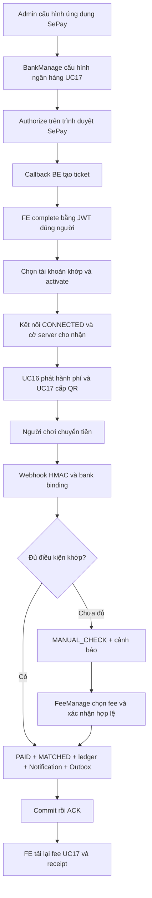

# UC18 — Bàn giao Backend và hợp đồng tích hợp

Cập nhật sau rà soát commit `e98dd44` ngày 05/11/2026. Phạm vi FR21/F4.4: SePay webhook, đối soát tự động/thủ công, xác nhận CASH, ledger, thông báo và luồng Admin cấu hình ứng dụng OAuth để chủ CLB tự kết nối SePay. Đây là hợp đồng để FE triển khai; lượt rà soát này không viết FE hoặc thay đổi mã nguồn Backend.

**Trạng thái bàn giao:** source và sandbox đủ để bắt đầu tích hợp FE; 220 test liên quan và 37 kiểm tra kiến trúc đạt trong lượt rà soát này. Chưa kết luận hoàn tất vận hành: còn khoảng hở dừng writer khi rollout ở mục 7.2, OAuth/request SePay thực và FCM thiết bị thật chưa nghiệm thu. Việc đã áp DB chung local đến `20261105004125_HardenClubSepayConnectionLifecycle`, API local cổng 54796 và profile CASH là bằng chứng được ghi ở máy trước, không được xác minh lại trên máy rà soát hiện tại. FE chưa triển khai. Tài khoản MBBank Test Mode không thay thế ứng dụng OAuth do SePay cấp.

## 0. Kết luận rà soát từ đầu luồng

| Chặng | Kết quả / giới hạn |
|---|---|
| Admin → OAuth → chọn bank → activate/disconnect | Source khép kín; tám integration test thiết lập dùng provider giả đạt. State/ticket một lần, complete đúng người khởi tạo; token/secret mã hóa, không trả về FE |
| QR UC17 → webhook → PAID/MATCHED → ledger | Kiểm HMAC/binding và tái kiểm kết nối trong transaction; Redis/DB locks, idempotency, nguồn thu duy nhất và rollback được kiểm trên PostgreSQL/Redis riêng |
| MANUAL_CHECK → manual / CASH | Giữ nguyên bằng chứng, không chấp nhận chênh lệch; ledger/Notification/Outbox nguyên tử; receipt người chơi qua UC17 |
| Outbox → FCM → FE tải lại | Worker/retry/quyền dùng mock; chưa kiểm thiết bị thật. Push không phải nguồn xác nhận PAID |
| Migration/deploy | Chưa bảo đảm đóng writer cũ trước migration; cần khắc phục trước rollout đầu từ UC17 lên UC18, xem mục 7 |
| BE đích cho FE | Đọc Swagger công khai từ môi trường rà soát nhận HTTP 403; chưa xác nhận server đã có UC18 hoặc cờ nào đang bật |



Sơ đồ mô tả nhánh chuyển khoản chính; sai chữ ký/binding, lỗi lưu và retry theo mục 2/6. Cấp QR vẫn là chức năng UC17, không suy ra CONNECTED đồng nghĩa tiền đã nhận hoặc webhook đang bật.

## 1. API và quyền

Base path thủ quỹ: `/api/v1/clubs/{groupId}/reconciliations`. Gửi `Authorization: Bearer <accessToken>`; body JSON dùng `Content-Type: application/json`. ID là UUID, thời gian UTC, tiền VND; response thành công là object trực tiếp, không bọc `data`.

| Method | Đường dẫn | Mục đích | Quyền |
|---|---|---|---|
| POST | `/api/v1/webhooks/sepay/{bankAccountId}` | Nhận bằng chứng provider | HMAC riêng bank, không dùng JWT người chơi |
| GET | Base path | Danh sách giao dịch ngân hàng | SessionOperations + FeeManage thực trong nhóm |
| GET | `/{transactionId}` sau base path | Chi tiết giao dịch | Cùng quyền, transaction thuộc bank của nhóm |
| POST | `/{transactionId}/confirm` sau base path | Chọn fee và xác nhận manual | Cùng quyền, tái kiểm sau chờ khóa |
| POST | `/api/v1/sessions/{sessionId}/settlement/members/{userId}/pay` | Xác nhận đã nhận CASH | FeeManage thực, response theo [UC16](UC16-BE.md) |

Thành công trả 200; webhook trả `{"success":true}`, API người dùng trả DTO trực tiếp. GET và webhook trả `Cache-Control: no-store`. GET lịch sử vẫn đọc khi tắt cờ nhưng luôn kiểm quyền. Không suy quyền từ tên role hoặc `X-Group-Id`; không cấp FeeManage toàn nhóm cho người chơi chỉ để xem biên lai.

`bankAccountId` là UUID record ngân hàng trong DB backend, không phải số tài khoản hoặc ID trên SePay. Mỗi kết nối CLB giữ company SePay lấy từ provider; hỗ trợ các CLB dùng company khác nhau. Provider transaction ID và reference được đối chiếu trong phạm vi company; bằng chứng legacy chưa biết company tiếp tục được bảo vệ, không tự gán namespace hoặc backfill tiền. Người chơi đọc nghĩa vụ/biên lai bằng API sở hữu UC17 tại `/api/v1/user/me/fees/{feeId}`.

### 1.1. Admin cấu hình ứng dụng, chủ CLB kết nối SePay

Admin hệ thống cần quyền `Integrations.SepayManage`. Chủ CLB hoặc thành viên được ủy quyền cần `FINANCE.BANK.MANAGE` thực trong đúng CLB; có role Admin hệ thống không tự vượt kiểm quyền ngân hàng trong handler. Tất cả API dưới đây, trừ callback, dùng JWT qua `SessionOperations`; response không chứa client secret, access/refresh token hoặc HMAC. Cấu hình và trạng thái trả `Cache-Control: no-store`.

| Method | Route | Tác dụng |
|---|---|---|
| GET / PUT | `/api/v1/sepay/application` | Admin đọc/lưu ứng dụng OAuth chung |
| GET / PUT | `/api/v1/clubs/{clubId}/payment-bank-account` | API UC17 hiện có: ngân hàng nhận tiền, BIN và chủ tài khoản |
| GET | `/api/v1/clubs/{groupId}/sepay` | Trạng thái kết nối của ngân hàng hiện tại |
| POST | `.../sepay/authorize` | Bắt đầu OAuth, trả `authorizationUrl` |
| GET | `/api/v1/sepay/oauth/callback` | SePay gửi code/state; callback không tự gắn kết nối |
| POST | `.../sepay/complete` | Xác nhận ticket bằng JWT của đúng người khởi tạo |
| GET | `.../sepay/accounts` | Danh sách tài khoản SePay trong phiên cấp quyền |
| POST | `.../sepay/account` | Chọn tài khoản và lưu PROVISIONING trước gọi provider |
| POST | `.../sepay/activate` | Tạo hoặc khôi phục webhook HMAC, chuyển CONNECTED |
| GET | `.../sepay/connections` | Các kết nối chưa ngắt xong, kể cả ngân hàng đã thay |
| DELETE | `.../sepay` | Ngắt kết nối ngân hàng hiện tại |
| DELETE | `.../sepay/connections/{connectionId}` | Ngắt kết nối cũ đúng CLB theo ID |

PUT ứng dụng nhận:

```json
{
  "clientId": "<Client ID SePay cấp>",
  "clientSecret": "<chỉ điền khi tạo hoặc thay khóa>",
  "publicApiBaseUrl": "https://api.example.com",
  "frontendBaseUrl": "https://app.example.com",
  "enabled": true,
  "revision": null
}
```

Lần đầu `revision=null` và cần secret; các lần sau lấy revision từ GET. `clientSecret=null` hoặc chuỗi rỗng giữ khóa đã lưu; GET chỉ trả `hasClientSecret`. URL là origin HTTPS công khai, không có path/query/fragment/IP/localhost. Không đổi Client ID hoặc backend origin khi vẫn còn kết nối chưa ngắt xong; ngắt các kết nối trước để tránh token/webhook thuộc ứng dụng cũ. Lưu thành công trả revision mới; stale revision trả 409. Sau migration cần refresh/login lại để JWT nhận quyền mới; migration cấp quyền cho các role hệ thống vốn đã có `Roles.AssignPermissions`.

Luồng FE/API được bàn giao, chưa có màn FE trong đợt này:

1. Lưu ngân hàng CLB qua UC17, bao gồm BIN sáu chữ số. Gọi authorize bằng JWT BankManage; mở `authorizationUrl` trong trình duyệt. OAuth yêu cầu các scope `bank-account:read webhook:read webhook:write webhook:delete company`.
2. SePay redirect về `{publicApiBaseUrl}/api/v1/sepay/oauth/callback`. State ngẫu nhiên 256 bit, gắn người khởi tạo/CLB/bank/revision, TTL 10 phút và tiêu thụ một lần. Từ chối cấp quyền trả về frontend với `sepay=denied`.
3. Callback hợp lệ đổi code lấy token ở BE và đọc company từ API SePay, lưu tạm dữ liệu đã mã hóa trong Redis. Redirect về `{frontendBaseUrl}/#/club/{groupId}/sepay?sepay=authorized&ticket=...`; ticket ở fragment, có hạn 10 phút, không phải access token. Callback chưa tạo kết nối trong DB. FE dùng JWT của đúng người đã authorize để POST complete body `{ "ticket": "<ticket>" }`; sai người/CLB bị 403, ticket đã dùng/hết hạn bị 400. Sau complete, xóa ticket khỏi URL/lịch sử hiển thị và không ghi vào log.
4. GET accounts trong trạng thái AUTHORIZED; chỉ người khởi tạo được xem, tối đa 15 phút. Chọn `providerBankId` qua POST account body `{ "providerBankId": 19 }`. BE lấy dữ liệu từ SePay và kiểm active, số tài khoản, BIN với ngân hàng CLB; không nhận các giá trị này từ FE để kết luận sở hữu. Mỗi company/provider bank chỉ có một cấu hình kết nối chưa ngắt xong.
5. POST activate tạo webhook `In_only`, HMAC-SHA256, JSON, nhận tài khoản chính, retry non-2xx và không bỏ giao dịch thiếu mã. Khóa webhook được lưu mã hóa trước lời gọi provider. Nếu request tạo webhook timeout sau khi provider đã tạo, retry tìm đúng URL có connectionId và kiểm bank/HMAC trước khi nhận lại; không nhận webhook của cấu hình khác. Chưa chứng minh provider thành công thì giữ PROVISIONING.
6. DELETE đánh dấu DISCONNECTING và ngừng chấp nhận webhook ở BE trước khi dọn provider. Nếu SePay lỗi, giữ trạng thái này cùng bằng chứng để retry; chưa trả thành công giả. Xóa provider thành công mới DISCONNECTED, xóa token/khóa trong record và giữ audit/lịch sử thu. Dùng GET connections và DELETE theo ID để dọn tài khoản ngân hàng cũ. Manual trên bằng chứng ngân hàng đã lưu vẫn dùng gateway đã xác thực của giao dịch, không cần bật lại webhook.

Trạng thái phản hồi: `BANK_REQUIRED`, `DISCONNECTED`, `AUTHORIZED`, `PROVISIONING`, `CONNECTED`, `DISCONNECTING`; `applicationReady` cho biết Admin đã bật ứng dụng, `webhookEnabled` là cờ vận hành tổng. **CONNECTED không tự bật SePay Live hoặc dispatch.** Callback và API không nhận URL token/API provider tùy ý: BE chỉ gọi `https://my.sepay.vn`.

Khi timeout hoặc lỗi lưu, đọc lại trạng thái trước retry; bảng mã lỗi đầy đủ ở mục 6. Quyền bị thu hồi được tái kiểm từ DB, không chỉ dựa JWT hoặc header.

SePay yêu cầu ứng dụng OAuth được phê duyệt/cấp client credentials; đăng ký tài khoản Test Mode không tự cấp quyền này. Xem [đăng ký ứng dụng](https://developer.sepay.vn/vi/sepay-oauth2/dang-ky-ung-dung), [OAuth](https://developer.sepay.vn/vi/sepay-oauth2/luong-xac-thuc), [company](https://developer.sepay.vn/vi/sepay-oauth2/cong-ty), [ngân hàng](https://developer.sepay.vn/vi/sepay-oauth2/tai-khoan-ngan-hang), [webhook](https://developer.sepay.vn/vi/sepay-oauth2/api-webhook). Việc OAuth dùng được trực tiếp với tài khoản Test Mode cụ thể chưa được nghiệm thu; không gán kết quả mock cho provider thật.

### 1.2. Quyền, response và màn hình FE

| Màn hình / thao tác | Quyền canonical |
|---|---|
| Admin đọc/lưu ứng dụng | Quyền hệ thống `Integrations.SepayManage` |
| Cấu hình bank và kết nối SePay trong CLB | Quyền CLB `FINANCE.BANK.MANAGE` |
| Danh sách/chi tiết/xác nhận đối soát, xác nhận CASH | Quyền CLB `FINANCE.FEE.MANAGE` |
| Đọc danh sách phí UC16 để chọn fee manual | Quyền CLB `FINANCE.FEE.VIEW`; quyền này được kiểm riêng, FeeManage không ngầm cấp FeeView |
| Người chơi xem fee/receipt UC17 | JWT và ownership; không cấp quyền quản lý toàn CLB |

Ẩn/hiện UI theo quyền tương ứng, đồng thời xử lý 403 từ BE khi quyền thay đổi. Không dùng tên role “Admin/Host/Thủ quỹ” để suy quyền. Người thực hiện OAuth phải là Admin hoặc SuperAdmin của company trên SePay vì BE gọi API company; đây là quyền ở SePay, khác quyền Admin của ứng dụng.

GET/PUT `/api/v1/sepay/application` trả `SepayApplicationResponse`:

```json
{
  "clientId": "client-do-sepay-cap",
  "hasClientSecret": true,
  "publicApiBaseUrl": "https://api.example.com",
  "frontendBaseUrl": "https://app.example.com",
  "callbackUrl": "https://api.example.com/api/v1/sepay/oauth/callback",
  "enabled": true,
  "revision": "44444444-4444-4444-4444-444444444444",
  "webhookEnabled": false
}
```

Chưa cấu hình vẫn trả 200 với các chuỗi rỗng, enabled/hasClientSecret=false và revision=null; webhookEnabled luôn phản ánh cờ vận hành server. Ô Client Secret luôn để trống khi mở form, hiển thị hasClientSecret riêng; gửi null/rỗng để giữ khóa. Không điền chuỗi che khóa rồi gửi lại như một secret mới. Khi lưu thành công, xóa giá trị đã nhập khỏi form và dùng revision mới; không lưu client secret vào localStorage, URL hoặc log FE.

POST authorize trả object `{ "authorizationUrl": "https://my.sepay.vn/oauth/authorize?..." }`. Các API status/complete/account/activate/disconnect trả `SepayConnectionResponse`, ví dụ sau activate:

```json
{
  "connectionId": "55555555-5555-5555-5555-555555555555",
  "bankAccountId": "33333333-3333-3333-3333-333333333333",
  "status": "CONNECTED",
  "companyId": 123,
  "gateway": "MBBank",
  "connectedAt": "2026-11-05T01:00:00Z",
  "applicationReady": true,
  "webhookEnabled": false
}
```

connectionId/bankAccountId/companyId/gateway/connectedAt có thể null khi chưa có kết nối; gateway có thể rỗng ở AUTHORIZED. applicationReady phản ánh Admin đã bật cấu hình, không phải health check provider. webhookEnabled bằng Enabled AND WritesEnabled của Reconciliation, không phản ánh quyền dispatch hoặc việc đã nhận webhook thật. Không tự đổi CONNECTED thành DISCONNECTED khi webhookEnabled=false.

GET accounts trả mảng trực tiếp, không bọc items/data:

```json
[
  {
    "id": 19,
    "accountNumber": "0123456789",
    "accountHolder": "CHU TAI KHOAN TEST",
    "bankBin": "970422",
    "gateway": "MBBank",
    "active": true,
    "matchesClubBank": true
  }
]
```

Chỉ cho chọn dòng active=true và matchesClubBank=true. Gửi id của dòng này dưới tên providerBankId; không gửi bankAccountId UUID thay thế. GET connections cũng trả mảng trực tiếp các SepayConnectionResponse chưa DISCONNECTED, kể cả bank cũ. Không có token/HMAC secret trong các DTO trên. ID company/provider là số nguyên JSON từ long; không chuyển qua số thực hoặc rút gọn làm mất định danh.

| Status | Hiển thị / hành động |
|---|---|
| BANK_REQUIRED | Yêu cầu cấu hình đúng một bank active qua UC17. Trường hợp bank có nhưng thiếu BIN còn có thể hiện DISCONNECTED; authorize sẽ trả Sepay.BankRequired |
| DISCONNECTED | Cho bắt đầu authorize khi applicationReady=true; nếu false, hướng người dùng liên hệ Admin |
| AUTHORIZED | Người khởi tạo đọc accounts/chọn tài khoản trong phiên 15 phút; hết phiên thì kết nối lại. DTO chưa có authorizedBy/authorizedAt để FE tự tính thời hạn |
| PROVISIONING | Cho activate hoặc retry activate sau khi đọc lại trạng thái; chưa hiển thị đã kết nối thành công |
| CONNECTED | Hiện company/bank/thời điểm; cho ngắt bằng quyền BankManage. Hiển thị riêng trạng thái webhookEnabled |
| DISCONNECTING | Hiển thị đang ngắt/chưa dọn provider xong; cho retry DELETE theo connectionId, không cấp quyền lại hoặc giả đã ngắt |

FE web phải có route hash `/club/{groupId}/sepay` theo URL callback. Đọc tham số sau dấu `?` trong fragment, không chỉ query của origin. Với sepay=authorized, giữ ticket tạm trong bộ nhớ, xóa ticket khỏi URL bằng replace trước khi gọi API/log analytics, rồi POST complete bằng JWT đúng tài khoản đã bắt đầu. Nếu cần đăng nhập lại, giữ cùng tài khoản; không chuyển ticket sang tài khoản khác hoặc tự lặp complete vô hạn. Thành công thì tải lại status/accounts. Với sepay=denied, hiển thị từ chối và cho bắt đầu lại, không gọi complete.

Tắt nút khi request đang chạy. Sau timeout của complete, đọc status trước: ticket có thể đã tiêu thụ và DB đã lưu. Không phát authorize mới chỉ vì response bị mất; AUTHORIZED/PROVISIONING/CONNECTED đã lưu có thể tiếp tục đúng bước. Lỗi callback có thể là Problem Details ở BE thay vì redirect FE; bắt đầu lại OAuth nếu state đã hết hạn/đã dùng.

Model chuẩn: [SepaySetupResponse](../../src/LegendsTeamVN.BadmintonClub.Application/DTOs/Payments/Responses/SepaySetupResponse.cs), [ConfigureSepayApplicationRequest](../../src/LegendsTeamVN.BadmintonClub.Application/DTOs/Payments/Requests/ConfigureSepayApplicationRequest.cs), [SepaySetupEndpoint](../../src/LegendsTeamVN.BadmintonClub.Presentation/Endpoints/SepaySetupEndpoint.cs).

## 2. Luồng thanh toán theo BE

### 2.1. Luồng chính — đối soát tự động

1. UC16 phát hành khoản thu; người chơi lấy QR qua UC17, fee giữ UNPAID/BANK_TRANSFER và snapshot ngân hàng đã cấp.
2. SePay gửi bằng chứng tiền nhận; không bắt buộc người chơi đã bấm “Tôi đã chuyển khoản”.
3. BE xác thực raw body/timestamp/HMAC, bind credential → URL → payload → QR snapshot, lấy Redis lock rồi mở UoW và khóa DB.
4. Đúng một PaymentCode đầy đủ, đúng nhóm/bank, fee đã phát hành và thực nhận bằng Amount dương nguyên VND thì fee thành PAID, transaction thành MATCHED.
5. BankTransaction, fee, ledger INFLOW/SESSION_FEE, Notification và Outbox cùng commit. Chỉ sau đó BE ACK thành công.
6. FE tải lại detail UC17 để hiện receipt. Push là tín hiệu tải lại dữ liệu, không tự gán PAID từ thông báo.

### 2.2. Luồng phụ / Ngoại lệ

#### Thiếu, sai hoặc nhiều mã thanh toán

1. Lưu MANUAL_CHECK cùng reasonCode trong đúng nhóm nhận, chưa ghi thu vào quỹ.
2. Người có FeeManage mở list/detail, đối chiếu bằng chứng, chọn feeId và nhập lý do.
3. BE tái kiểm quyền cùng điều kiện tiền/nhóm/bank/UNPAID/BANK_TRANSFER/QR snapshot. Manual chỉ sửa liên kết fee, không sửa bằng chứng ngân hàng.
4. Thành công lưu MATCHED với người xác nhận/thời điểm/lý do; fee PAID và ledger/Notification/Outbox commit cùng nhau. Retry cùng transaction/fee không ghi thêm.

#### Thiếu hoặc thừa tiền

1. Giữ bằng chứng MANUAL_CHECK, fee UNPAID; manual vẫn từ chối chênh lệch.
2. V1 không cộng dồn, xóa chênh lệch, miễn nợ, hoàn tiền hoặc đổi phương thức để ép match.
3. UI hiển thị AmountReceived/lý do và chuyển xử lý vận hành, không tạo nút “bỏ qua chênh lệch”.

#### PAID, retry hoặc collision

1. Cùng provider ID/cùng bằng chứng là retry: ACK nhưng không thêm ledger/thông báo, kể cả transaction đang MANUAL_CHECK.
2. Cùng ID/khác bằng chứng trả 409 và giữ bản gốc. So sánh trường nghiệp vụ đã parse; đổi thứ tự JSON/khoảng trắng transport/timestamp ký không tạo giao dịch mới.
3. ID mới trỏ fee PAID là tiền nhận thêm: lưu MANUAL_CHECK, không backfill hoặc tất toán lần nữa.
4. Reference collision, kể cả legacy/soft-delete, không được vượt qua bằng lý do manual.

#### Tiền mặt

1. Người chơi yêu cầu CASH qua UC17, vẫn UNPAID. Người thu xác nhận qua POST pay UC16 khi đã nhận tiền.
2. BE lưu PAID/CASH, PaidAt/CashCollectedBy, một ledger và Notification/Outbox cùng transaction; không tạo BankTransaction giả.
3. Fee đã chọn BANK_TRANSFER có PaymentRequestId không được xác nhận CASH. Retry PAID giữ kết quả cũ, không backfill ledger lịch sử.
4. CASH/manual hoạt động khi webhook tắt nếu WritesEnabled=true; giữ các guard Payments UC17.

#### Tranh chấp hoặc lỗi hệ thống

1. Manual timeout/deadlock PostgreSQL trả `409 Payments.Busy` sau rollback, kể cả exception bị EF bọc. Tải lại list/detail rồi retry cùng transaction/fee.
2. Redis/DB/archive/deadline hoặc lỗi commit làm webhook trả 503, không ACK dữ liệu chưa lưu.
3. Tiền ra sau xác thực là no-op. Bằng chứng đã xác thực nhưng sai bank binding được cô lập ngoài danh sách CLB và trả non-success.

## 3. Request

```http
GET /api/v1/clubs/{groupId}/reconciliations?status=MANUAL_CHECK&page=1&pageSize=20
```

`status` tùy chọn, chỉ MATCHED/MANUAL_CHECK; page mặc định 1, pageSize mặc định 20 và tối đa 100. Không gửi chuỗi `null`. Filter chỉ thu hẹp giao dịch của nhóm đã cấp quyền.

Manual:

```json
{
  "feeId": "11111111-1111-1111-1111-111111111111",
  "reason": "Đã đối chiếu người nộp và bằng chứng ngân hàng"
}
```

Lý do bắt buộc, tối đa 2.000 ký tự. Không nhận Amount, bank, trạng thái hoặc người xác nhận từ FE. POST CASH không có body.

**Chọn fee cho manual:** UC18 chưa có endpoint tìm “các fee hợp lệ để đối soát”. FE chọn buổi chơi trong cùng CLB rồi gọi GET `/api/v1/sessions/{sessionId}/settlement`, dùng `memberFees[].feeId` để POST confirm. Response UC16 có userId/fullName/finalFee/paymentStatus/paymentMethod/paymentCode/qrCodePayload; không dùng userId thay feeId. Luồng này cần FeeView ngoài FeeManage. Chỉ gợi ý fee UNPAID/BANK_TRANSFER, đã phát hành, có QR và finalFee bằng amountReceived; BE vẫn là nơi quyết định bank/snapshot/quyền và tính hợp lệ cuối cùng. Nếu cần tìm toàn bộ fee theo thành viên/số tiền xuyên các buổi, đó là API bổ sung, chưa có trong hợp đồng hiện tại.

Sau confirm thành công, dùng DTO trả về để cập nhật detail, rồi tải lại list và settlement vì bản ghi có thể rời filter MANUAL_CHECK. Khi dùng CASH, response là toàn bộ SessionSettlementResponse UC16, không phải ReconciliationResponse. Người nộp xem GET `/api/v1/user/me/fees/{feeId}`, lấy receipt trong object; không có route receipt riêng của UC18. Không gọi API `me` bằng JWT thủ quỹ để đọc fee của người khác.

FE tải lại khi mở màn hình, sau thao tác thành công và khi nhận push. Khi chờ chuyển khoản có thể polling có giới hạn lúc màn hình đang mở, dừng khi PAID/EXEMPT, mất quyền hoặc rời màn hình; không suy timeout là đã nhận tiền. UC18 hiện không phát event thanh toán qua SessionHub, không phụ thuộc SignalR để cập nhật receipt.

Webhook JSON UTF-8 tối đa 65.536 byte; ví dụ minh họa, không phải request SePay đã ký:

```json
{
  "id": 92704,
  "gateway": "MBBank",
  "transactionDate": "2026-11-04 13:00:00",
  "accountNumber": "0123456789",
  "subAccount": "",
  "transferType": "in",
  "transferAmount": 50000,
  "referenceCode": null,
  "content": "CLB ABCDEF123456 012345ABCDEF"
}
```

ID bigint dương. accountNumber là chuỗi giữ số 0 đầu. transactionDate theo giờ Việt Nam đổi UTC; timestamp ký HTTP không thay thời điểm giao dịch. Reference rỗng/null chuẩn hóa null, content giữ nguyên. Từ chối JSON key trùng. Không dùng `code` đã trích hoặc `accumulated` để kết luận đã thu.

HMAC-SHA256 ký đúng bytes `timestamp.raw_body`, header `X-SePay-Signature: sha256=<hex>` và `X-SePay-Timestamp`, cửa sổ ±300 giây, so constant-time. Không parse/serialize lại trước kiểm chữ ký, không dùng API Key/JWT thay HMAC. Tham chiếu [payload/ACK SePay](https://developer.sepay.vn/vi/sepay-webhooks/tich-hop-webhook), [HMAC SePay](https://developer.sepay.vn/vi/sepay-webhooks/xac-thuc).

## 4. Dữ liệu cần hiển thị

List trả `{ items: ReconciliationResponse[], total, page, pageSize }`. Detail và manual thành công trả cùng ReconciliationResponse:

| Nhóm dữ liệu | Trường |
|---|---|
| Định danh | transactionId, providerTransactionId, bankAccountId, feeId |
| Bằng chứng | referenceCode, amountReceived, transferContent, transactionTime |
| Đối soát | status, reasonCode |
| Audit manual | reconciledBy, reconciledAt, note |

```json
{
  "transactionId": "22222222-2222-2222-2222-222222222222",
  "providerTransactionId": 92704,
  "bankAccountId": "33333333-3333-3333-3333-333333333333",
  "feeId": null,
  "referenceCode": null,
  "amountReceived": 50000,
  "transferContent": "Người chơi chuyển khoản",
  "transactionTime": "2026-11-04T06:00:00Z",
  "status": "MANUAL_CHECK",
  "reasonCode": "MISSING_CODE",
  "reconciledBy": null,
  "reconciledAt": null,
  "note": null
}
```

Không có secret trong DTO. reconciledBy là UUID người xác nhận; auto có thể null, không bịa thủ quỹ. Receipt UC17 gồm receiptId/amount/paymentCode/paidAt/method/cashCollectedBy/metadataIncomplete. Biên lai là JSON để FE trình bày, không phải PDF/hóa đơn thuế; ReceiptId ổn định theo FeeId.

Model: [ReconciliationResponse](../../src/LegendsTeamVN.BadmintonClub.Application/DTOs/Payments/Responses/ReconciliationResponse.cs), [ConfirmReconciliationRequest](../../src/LegendsTeamVN.BadmintonClub.Application/DTOs/Payments/Requests/ConfirmReconciliationRequest.cs), [PersonalFeeResponse](../../src/LegendsTeamVN.BadmintonClub.Application/DTOs/Payments/Responses/PersonalFeeResponse.cs).

## 5. Quy tắc tiền và trạng thái hiện tại

| Trạng thái | Ý nghĩa FE |
|---|---|
| Fee UNPAID / transaction MANUAL_CHECK | Có bằng chứng, chưa ghi thu xác nhận |
| Fee PAID / transaction MATCHED | Tất toán ngân hàng, có nguồn ledger |
| Fee PAID / CASH | Tiền mặt đã xác nhận, có người thu/ledger |
| Fee EXEMPT hoặc chưa có QR snapshot | Không xác nhận bằng ngân hàng/manual v1 |
| Fee PAID / ID provider mới MANUAL_CHECK | Tiền nhận thêm chờ xử lý, không ghi thu lần hai |

| reasonCode thường gặp | Hành vi FE |
|---|---|
| MISSING_CODE, MULTIPLE_CODES, FEE_NOT_FOUND | Cho người có FeeManage đối chiếu và chọn fee; lý do này không bảo đảm fee bất kỳ sẽ hợp lệ |
| AMOUNT_MISMATCH | Hiển thị thiếu/thừa tiền, không có thao tác bỏ qua chênh lệch v1 |
| ALREADY_PAID | Hiển thị khoản tiền nhận thêm, không tất toán lại fee đã PAID |
| QR_NOT_PREPARED, INVALID_FEE, GROUP_MISMATCH, BANK_MISMATCH, UNSUPPORTED_SUB_ACCOUNT | Kiểm nguồn/khoản thu, không sửa fee hoặc chuyển CASH để ép match |
| REFERENCE_COLLISION | Chuyển xử lý vận hành; manual không bỏ qua collision |
| FEE_UNAVAILABLE, AWAITING_RECONCILIATION hoặc giá trị mới | Hiển thị cần kiểm tra và cho tải lại; không tự kết luận PAID từ reasonCode |

- PaymentProgress QR_READY/AWAITING_RECONCILIATION/CASH_CONFIRMATION_REQUESTED không phải đã thu. PAID ưu tiên receipt và ngừng nút thanh toán.
- PaymentCode giữ `CLB + 12 hex session + 12 hex user`, dài 29 ký tự. Parser chấp nhận hoa/thường và khoảng trắng ngang hợp lệ, không sửa content hoặc mã đã phát hành.
- Auto/manual chỉ nhận đúng Amount dương nguyên VND; không sửa Amount/snapshot/PaymentCode để ép match.
- `subAccount` khác rỗng chưa hỗ trợ, cả auto lẫn manual. Không nghiệm thu Vietcombank/nhánh bắt buộc VA từ mock không có VA. Có thể test tài khoản chính bằng MBBank; xác minh gateway từ payload thực trước khi bật.
- Bank inactive vẫn xử lý QR lịch sử nếu credential hợp lệ. Đổi bank cần giữ mapping cũ để đối soát trễ.
- Unique provider ID và unique FeeId/BankTransactionId của ledger vẫn bảo vệ soft-delete. Ledger mới INFLOW/SESSION_FEE; ActorId auto là người nộp, manual/CASH là người xác nhận. MANUAL_CHECK chưa cộng vào quỹ xác nhận.
- UC18 cung cấp nguồn thu cho UC19, chưa xây toàn bộ API thu/chi/báo cáo UC19.

## 6. Xử lý lỗi

API người dùng trả Problem Details, FE dùng HTTP status và code, không so chuỗi thông báo. 401/403/JSON sai có thể không có code.

Ví dụ lỗi manual; code nằm ở root, không nằm trong object error:

```json
{
  "type": "https://tools.ietf.org/html/rfc7231#section-6.5.8",
  "title": "Conflict",
  "status": 409,
  "detail": "Bằng chứng chưa đủ điều kiện xác nhận khoản thu.",
  "code": "Reconciliation.AMOUNT_MISMATCH"
}
```

Validation có thể thêm errors; luôn có nhánh xử lý theo HTTP status khi thiếu code. HTTP 200 của list/detail chỉ chứng minh đọc thành công; phải đọc status/receipt để kết luận thanh toán. Chỉ webhook dùng body success=true/false, FE không gọi webhook để xác nhận tiền.

| HTTP / code | Xử lý |
|---|---|
| 400 | Kiểm filter, UUID, lý do hoặc payload |
| 401 | Người dùng refresh/login; provider kiểm HMAC/timestamp/bank binding |
| 403: Reconciliation.Forbidden | Thiếu hoặc mất FeeManage trong nhóm |
| 404: Reconciliation.NotFound | Fee/transaction không thuộc nhóm hoặc không tồn tại |
| 409: Payments.Busy | Tải lại rồi retry cùng thao tác sau tranh chấp |
| 409: Reconciliation.EvidenceCollision | Giữ bản gốc, đối chiếu provider ID/bằng chứng |
| 409: Reconciliation.ReferenceCollision | Manual không vượt reference collision |
| 409: Reconciliation.AMOUNT_MISMATCH | Giữ UNPAID/MANUAL_CHECK, xử lý ngoài v1 |
| 409: Reconciliation.BankUnavailable, BANK_MISMATCH, QR_NOT_PREPARED | Kiểm bank/credential/snapshot, không đổi fee để đi vòng |
| 409: Reconciliation.WritesDisabled | Dừng ghi, vẫn đọc lịch sử |
| 409: Reconciliation.AlreadyMatched, ALREADY_PAID | Tải lại giao dịch/receipt, không tạo thu mới |
| 409: Payments.PaymentMethodLocked | CASH không ghi đè BANK_TRANSFER |
| 413 / 415 | Webhook quá lớn / content type sai |
| 503 `{"success":false}` | Webhook chưa lưu được; theo dõi delivery logs, retry/replay cùng ID |
| 500 | Lỗi khác; tải lại trạng thái trước retry, không coi đã thanh toán |

Deadline toàn webhook 25 giây, dưới timeout provider 30 giây. Provider retry hữu hạn; sự cố kéo dài cần theo dõi delivery logs/replay. Không trả success để che lỗi DB/archive.

Lỗi thiết lập SePay cần xử lý riêng:

| HTTP / code | Hành vi FE |
|---|---|
| 400 Sepay.ClientSecretRequired, InvalidInput, InvalidCode | Sửa form; secret chỉ bắt buộc khi chưa có khóa lưu |
| 400 Sepay.InvalidState, InvalidTicket | Phiên hết hạn/đã dùng; đọc lại status rồi bắt đầu lại nếu chưa có kết nối |
| 403 Sepay.Forbidden, AuthorizationOwner | Mất quyền hoặc sai người khởi tạo; không đổi tài khoản để tiếp tục ticket cũ |
| 409 Sepay.BankRequired, BankAlreadyConnected | Cấu hình bank/BIN hoặc ngắt kết nối bank cũ trước khi chọn lại |
| 409 Sepay.AuthorizationRequired | Chưa có phiên kết nối; authorize lại. Cùng code ở 503 có nghĩa provider yêu cầu cấp lại quyền |
| 409 Sepay.Busy, ConfigurationChanged, AlreadyConnected, InvalidState, SelectBankRequired | Tải lại status/cấu hình; tiếp tục đúng bước, không tự gửi lại toàn chuỗi OAuth |
| 409 Sepay.ActiveConnections, WebhookConflict | Yêu cầu ngắt/kiểm kết nối hiện có; không tự ghi đè webhook hoặc client ID |
| 409 Sepay.ApplicationUnavailable | Admin chưa bật cấu hình ứng dụng |
| 503 Sepay.ProviderUnavailable, ProviderResponse, ProviderTimeout, AuthorizationRequired, SecretUnavailable | Giữ trạng thái chưa hoàn tất; đọc lại status trước retry, không suy 503 là provider chắc chắn chưa xử lý |

Các hậu tố sau dấu phẩy trong bảng đều có prefix Sepay. Thông báo provider đã được BE làm sạch; FE không cần và không được thu thập body provider/token để hiển thị lỗi.

## 7. Thông báo, cấu hình và triển khai

UNPAID → PAID tạo Notification PAYMENT và PaymentConfirmedPush cho người nộp. MANUAL_CHECK tạo ReconciliationAlertPush cho người có FeeManage hợp lệ. Outbox cùng transaction nguồn tài chính, worker chỉ gửi sau commit.

Push data có eventId/groupId và feeId hoặc transactionId. FE khử trùng eventId, kiểm quyền rồi tải lại API. Worker tái kiểm nguồn/quyền trước mỗi batch tối đa 500 thiết bị; partial delivery có thể gửi lại. Không có thiết bị thì hoàn tất không gọi FCM. Từ 10 lỗi outbox không tự claim; vận hành review trước requeue, không đổi PAID/xóa ledger để ép gửi lại.

Các giá trị data của FCM là chuỗi. Thanh toán gửi `{ "eventId": "<uuid>", "groupId": "<uuid>", "feeId": "<uuid>" }`; cảnh báo gửi `{ "eventId": "<uuid>", "groupId": "<uuid>", "transactionId": "<uuid>" }`. Không dựa vào title/body, không kỳ vọng type/sessionId/recipientId trong data FCM; các trường có ở DTO outbox nội bộ không đồng nghĩa được gửi cho FE. Receipt vẫn đọc được qua API khi dispatch tắt hoặc push bị mất.

| Cờ server | Ý nghĩa |
|---|---|
| Reconciliation:Enabled | Tiếp nhận webhook |
| Reconciliation:WritesEnabled | Ghi ngân hàng/manual/CASH |
| Reconciliation:DispatchEnabled | Gửi push UC18, không chặn lưu Notification/Outbox |

Ba cờ mặc định false. Profile CASH: Enabled=false, WritesEnabled=true, DispatchEnabled=false; giữ guard Payments UC17. Chỉ mở webhook khi đã chuẩn bị company/bank/HMAC/archive và fixture riêng; chỉ mở dispatch sau UAT thiết bị/duyệt đích.

**Cấu hình source Development:** profile CASH ở trên, Payments.Enabled/WritesEnabled=true, Seeding.Enabled=true; dispatch Payments/Settlement/SessionRotation/Reconciliation tắt. Đây là cấu hình trong Git, không phải xác nhận trạng thái process/DB ở máy khác. Sandbox rà soát dùng PostgreSQL16:55438/Redis7:56388 riêng, không đổi fixture/Postman sang DB chung.

Đích người dùng cung cấp: BE `https://dev.l7ungdz.id.vn`, web FE `https://sportclub.l7ungdz.id.vn`. Lượt rà soát commit e98dd44 đọc `/swagger/v1/swagger.json` nhận HTTP 403; chưa xác nhận được các route/cờ/baseline DB server. Nhận định “Swagger chưa có UC18” ở phiên trước không được dùng làm trạng thái server hiện tại. FE cần kiểm đúng base URL và route ở đích sau triển khai trước khi UAT.

### 7.1. Cấu hình server

**Cập nhật theo yêu cầu bật lại:** Seeding.Enabled=true cho API Development, API/Migrator Compose và bước Migrator trong workflow. Khi khởi động/deploy, toàn bộ seeder đã đăng ký chạy theo Order, gồm đồng bộ Identity/quyền, tài khoản và dữ liệu demo. Seeder hiện có thể reset mật khẩu tài khoản seed, bổ sung role/claim và tạo dữ liệu demo tài chính; API và Migrator cùng bật nên có thể chạy hai lượt trong một đợt deploy. Bước Migrations.VerifyOnly=true vẫn chỉ kiểm history, không chạy seeder. Lượt sửa cấu hình này không khởi động host, chạy seeder hoặc deploy; số kiểm thử trước đó không chứng minh các seeder đã chạy trên DB đích.

Các kiểm soát deployment hiện có vẫn bật: API/Migrator cùng SHA, staging .env, migration rồi kiểm history trước recreate API, tuần tự hóa deploy và smoke Swagger. Điểm dừng/drain writer ở mục 7.2 vẫn chưa được triển khai.

Client credentials và kết nối theo CLB được quản lý qua API tại mục 1.1, lưu trong DB và mã hóa bằng ASP.NET Core Data Protection. Bỏ các key cũ `Reconciliation:CompanyId/Banks`; không dùng cột `WebhookSecretKey` legacy làm credential.

Ba cờ vận hành tổng đi qua GitHub Secrets → `.env` deployment → Compose, mặc định false khi thiếu:

| GitHub Secret / biến Compose | Cấu hình API |
|---|---|
| `RECONCILIATION_ENABLED` | `Reconciliation__Enabled` |
| `RECONCILIATION_WRITES_ENABLED` | `Reconciliation__WritesEnabled` |
| `RECONCILIATION_DISPATCH_ENABLED` | `Reconciliation__DispatchEnabled` |

Profile CASH chỉ đặt WritesEnabled=true. Chỉnh cờ cần recreate API; việc chủ CLB kết nối không vượt các cờ này. Không in secret vào log; dùng `docker compose config --quiet` để kiểm cú pháp. Giữ ignore thư mục bằng chứng để dữ liệu tài chính không được đưa vào Git.

Key ring Data Protection được giữ bền vững ở `$HOME/.local/share/badmintonclub/sepay-keys`, bind vào `/var/lib/badmintonclub/sepay-keys`; Compose dùng `SEPAY_KEY_DIRECTORY`, API dùng `Sepay:KeyDirectory`. Workflow tạo thư mục host quyền 0700, ngoài image. Cần backup và bảo vệ key ring cùng DB: mất key thì không giải mã được client secret/token/HMAC; restore DB riêng mà thiếu key ring không khôi phục được kết nối. Nếu đổi UID container cần cấp đúng ownership trước khởi động; không dùng key ring tạm trong production. Trên local, mặc định key ring nằm ở `sepay-keys` bên cạnh binary, trong thư mục bin bị Git ignore.

UC16 còn cần GitHub Secrets `SETTLEMENT_WRITES_ENABLED`, `SETTLEMENT_DISPATCH_ENABLED`, `SETTLEMENT_PREVIEW_SIGNING_KEY` khi deploy; workflow đã truyền ba khóa này sang Compose. Hai cờ thiếu mặc định false; giữ preview signing key ổn định, ngoài Git. Bật CASH UC18 không tự bật quyền ghi/phát hành settlement UC16. Nếu trước đây chỉ cấu hình UC16 trực tiếp trong `.env` server thì cần đưa giá trị đã duyệt vào GitHub Secrets trước deploy vì pipeline tạo lại `.env`.

Archive được bind từ `$HOME/.local/share/badmintonclub/reconciliation-evidence` trên host vào `/var/lib/badmintonclub/reconciliation-evidence` trong container, ngoài `/app`, quyền 0700 trên Linux. Tài khoản container phải có quyền ghi; đổi UID cần cập nhật ownership. Chạy Compose thủ công phải đặt cả `RECONCILIATION_EVIDENCE_DIRECTORY` và `SEPAY_KEY_DIRECTORY`.

### 7.2. Trước merge và triển khai

**Điểm chưa đạt khi rà soát [P1]:** workflow hiện migrate rồi mới recreate API, không dừng/drain writer cũ. Với đích còn binary UC17, request pay trong cửa sổ này vẫn có thể ghi PAID/CASH theo logic cũ không tạo ledger; retry trên UC18 lại không backfill PAID lịch sử. Đặt các cờ Reconciliation=false của binary mới không chặn được writer UC17. Cần bổ sung bước maintenance/dừng writer có kiểm chứng trước migration và chỉ mở lại sau khi toàn bộ instance chạy binary mới; dừng delivery và worker theo phạm vi. Chưa coi luồng deploy hiện tại đủ an toàn cho rollout đầu UC18 khi còn writer hoạt động.

1. Xác minh host/DB/Redis đích, `__EFMigrationsHistory`, schema/index/FK/CHECK, dữ liệu legacy và cờ hiện có. Sau lõi UC18 `20261104074142_AddPaymentReconciliation`, luồng OAuth cần `20261104155653_AddClubSepayOAuth` và `20261105004125_HardenClubSepayConnectionLifecycle`. Migration sau siết trạng thái DISCONNECTING, unique company/provider bank và rollback guard; không sửa migration đã commit trước đó hoặc suy baseline server từ source.
2. Sinh/review SQL từ baseline thật, chuẩn bị backup và restore rehearsal vào DB riêng, ghi cutoff và phương án rollback cho đúng đích. Ví dụ sinh SQL chỉ để review từ repo BE:

```bash
dotnet ef migrations script "${UC18_BASELINE:?Cần baseline đích đã xác minh}" 20261105004125_HardenClubSepayConnectionLifecycle --context BadmintonDbContext --project src/Hosts/LegendsTeamVN.BadmintonClub.Migrator --output "${UC18_SQL_UP:?Cần file SQL review}"
```

3. Trước deploy cần backup bằng client PostgreSQL tương thích server và dừng/drain writer cũ và xác minh không còn request ghi trước migration; migration UC18 đặt lock_timeout=3s. Pipeline không tự backup hoặc dừng writer của API cũ. Giữ credential qua secret/PGPASSFILE, không chép vào chat/artifact công khai. Không chạy Migrator ngoài cấu hình deployment để thử trên DB chung: host này migrate cả Identity/Badminton và mặc định vẫn chạy seeders khi không đặt Seeding.Enabled=false.
4. Theo yêu cầu người dùng, pipeline [deploy.yml](../../.github/workflows/deploy.yml) **tự áp mọi migration còn thiếu trước thay API**, dùng API/Migrator cùng SHA: `docker compose --env-file .env.next run --rm --no-deps -e Seeding__Enabled=true -e Migrations__VerifyOnly=false migrator`. Sau đó chạy thêm `Migrations__VerifyOnly=true` để đối chiếu migration history cả hai context; không thay preflight/postflight FK/CHECK/index thực tế. Migration hoặc kiểm schema lỗi trả mã khác 0, job dừng, API và `.env` cũ chưa được thay; sửa nguyên nhân rồi chạy lại. EF chỉ áp migration chưa có trong history; không phụ thuộc diff của commit cuối. Deployment được tuần tự hóa trong workflow.
5. Migration và kiểm schema pass mới giữ `.env.before-<SHA>`, cập nhật `.env`, recreate riêng API với Seeding=true và kiểm Swagger có route webhook/reconciliations. Theo yêu cầu hiện hành, Migrator và API đều chạy toàn bộ seeder đã đăng ký khi khởi động; không prune image rollback. Migration đã commit vẫn tồn tại nếu bước sau lỗi; không tự chạy Down/restore. Client secret và HMAC được quản lý qua API, key ring phải được giữ qua các lần deploy; cờ vận hành vẫn qua GitHub Secrets.
6. Mở CASH trước: Enabled=false, WritesEnabled=true, DispatchEnabled=false. Chỉ bật webhook với fixture/DB UAT riêng và HMAC đã cấu hình; nếu dev đang dùng DB chung cho nhóm thì cần instance/DB UAT riêng để gửi Test Mode. Không đưa giao dịch mô phỏng vào nợ thật hoặc trộn credential/payload Test Mode với Live.

SePay Test Mode: tạo webhook JSON/tiền vào, chọn bank test và tài khoản chính, HMAC-SHA256, bật retry; để kiểm cả thiếu mã thì tắt bộ lọc chỉ gửi khi có mã. URL là `https://<uat-host>/api/v1/webhooks/sepay/<bankAccountId>`. Mô phỏng đúng Amount/PaymentCode, kiểm delivery ACK, PAID/MATCHED, ledger/receipt và retry không thêm thu; tiếp tục manual/thiếu-thừa/CASH/quyền chéo nhóm. VA khác rỗng chưa thuộc v1. FCM cần kiểm thiết bị thật và duyệt dispatch riêng.

### 7.3. Dừng và rollback

Dừng cờ theo phạm vi, dừng delivery và drain writer; giữ bằng chứng/PAID/ledger, theo dõi hạn retry rồi replay cùng ID và company có kiểm soát. DDL chưa commit thì xác minh rollback/schema/history. Chỉ review Down khi đúng baseline và chưa có dữ liệu UC18. Migration Harden chặn ngay trước thay schema/history nếu đã có cấu hình/kết nối SePay, provider evidence hoặc ledger nguồn mới; không hạ dở một chuỗi rồi mới phát hiện dữ liệu. Đã phát sinh cấu hình hoặc tài chính thì giữ schema và sửa tiến.

Không tự quay về binary UC17 xác nhận CASH thiếu ledger, không reset PAID/xóa ledger để chạy lại. `.env.before-<SHA>` không tự chứng minh binary cũ tương thích. Restore toàn DB cần duyệt riêng và thống kê mọi ghi sau cutoff, kể cả UC khác; không thu hồi push hoặc hoàn tác tiền ngoài ngân hàng. Archive sai binding chỉ cho vận hành; outbox quá 10 lỗi chỉ requeue đúng message đã review, giữ EventId.

## 8. Kiểm chứng và bàn giao

### 8.0. Kiểm chứng lại commit e98dd44 ngày 05/11/2026

| Phạm vi chạy tại môi trường rà soát | Kết quả |
|---|---|
| Application filter FullyQualifiedName~PaymentReconciliation, PostgreSQL16/Redis7 riêng, Postman CLI 1.85.0 | 69 passed, 0 failed, 0 skipped; gồm 8 test OAuth setup với provider giả, 17 request collection tài chính, backup/restore, migration và Migrator thật trên DB fixture |
| Infrastructure filter Sepay / Reconciliation / RedisReconciliation / WebhookEvidence | 32 passed, 0 failed, 0 skipped; HMAC, Redis lease, OAuth HTTP adapter, archive và outbox worker với FCM mock |
| Domain filter Payments / Settlement | 119 passed, 0 failed, 0 skipped |
| Script verify_architecture.py | 37/37 passed, chạy bằng python3 |
| Build solution --no-restore | 0 lỗi, 7 cảnh báo hiện hữu: NU1510 dependency; CS8604 RabbitMQ; CS0618 Firebase; CS9113 seeder |
| EF has-pending-model-changes | Không có thay đổi model chưa nằm trong migration |
| Server/DB dùng chung/provider thật | Không migrate/deploy hoặc ghi thử; Swagger công khai nhận 403; không kiểm OAuth/FCM thật |

Tổng 220 test liên quan thuộc ba suite đầu, kiến trúc 37 riêng; không phải toàn bộ solution, không cộng với số liệu lịch sử. Collection tài chính chỉ dùng chữ ký/test credential tự tạo. Kết luận source/sandbox đạt không thay điểm P1 triển khai hoặc nghiệm thu provider thật.

Theo yêu cầu dọn cấu hình, đã bỏ script kiểm thử deployment riêng và lệnh chạy tương ứng. Các kiểm thử deployment .NET về migration, history và Migrator vẫn được giữ trong suite Application; không coi kết quả kiểm tra workflow lịch sử là một bước đang còn chạy trong repo. Kiểm lại sau dọn: kiến trúc 37/37, incremental build --no-restore không lỗi, còn một cảnh báo NU1510; YAML workflow/cú pháp SSH shell và diff whitespace hợp lệ. Không thay logic C#, không chạy lại toàn bộ suite tài chính chỉ vì dọn tài liệu/script.

### 8.1. Bằng chứng đã ghi từ máy trước ngày 05/11/2026

Nội dung bên dưới được giữ làm lịch sử từ tài liệu trong commit, không phải kết quả chạy lại hoặc xác nhận DB/process hiện tại. Số kiểm thử 41/46, build một cảnh báo và smoke DB local thuộc lượt đó; số liệu của lần rà soát này ở mục 8.0.

Luồng BE Admin/BankManage đã hoàn thiện, gồm callback chỉ tạo ticket mã hóa trong Redis và POST complete bằng JWT của đúng người khởi tạo; state/ticket một lần, kiểm phiên bản cấu hình và quyền thực tế. Đã kiểm provider timeout/malformed response, refresh token, retry khi tạo webhook mất response, DISCONNECTING khi xóa provider thất bại, ngân hàng cũ và namespace company. Lỗi provider trả 503 với thông báo đã làm sạch; không trả body/secret từ provider.

| Kiểm chứng | Kết quả |
|---|---|
| Integration PaymentReconciliation, PostgreSQL16/Redis7 riêng | 69/69 passed, 0 failed/skipped; gồm 8 test luồng thiết lập SePay và hồi quy tài chính/deployment |
| Infrastructure HMAC/Redis/worker/OAuth client | 41/41 passed, 0 failed/skipped |
| Domain filter Payments/Settlement | 46/46 passed, 0 failed/skipped; đây là filter của lượt kiểm mới, không cộng với số lịch sử |
| Clean Architecture | 37/37 passed |
| Build solution `dotnet build --no-restore` | 0 lỗi; còn 1 cảnh báo NU1510 dependency hiện hữu |
| EF model/snapshot | Không có pending model changes |
| Workflow deployment và Postman | Verifier workflow đạt; collection tài chính 17 request chạy trong integration; collection thiết lập 13 request sinh/kiểm đồng bộ |
| Shared-local smoke | 18/18 kiểm tra HTTP đọc/guard UC14–UC18 và SePay; không tạo giao dịch thử |

**Rollout OAuth DB local:** baseline thực `20261104074142_AddPaymentReconciliation`, PostgreSQL 18.6. Đã backup bằng client major 18, restore trên container PostgreSQL18 không mạng, diễn tập Up → Down → Up rồi áp hai migration tại mục 7.2 trong một transaction. Đối chiếu toàn bộ dữ liệu cũ của 53 bảng public/Identity trước và sau migration/smoke giữ nguyên; chỉ thêm permission `Integrations.SepayManage` và cấp cho đúng 1 role vốn có `Roles.AssignPermissions`. Hai bảng cấu hình/kết nối mới rỗng; vẫn 0 bank transaction. Không chạy seeder, không tạo ngân hàng/fee/ledger hoặc nhập credential SePay thử vào DB chung.

Backup OAuth riêng tại `artifacts/uc18/shared-local/oauth-20261105/backups/BadmintonClub-before-SePay-OAuth.dump`, SHA256 `96d7bea4b413b65b43a040f02476203cea2f0606d66aaffda9bcc15f5c88764e`. Thư mục backup có ACL riêng và bị Git ignore; SQL review, rehearsal, postflight và smoke cùng thư mục đợt này. Không đưa dump vào gói bàn giao công khai. Sáu constraint nguồn UC18, ba unique index nguồn thu và hai unique index namespace company/provider bank được kiểm sau migration.

Lượt ở máy trước ghi nhận FE thử viết đã hoàn tác và còn `pubspec.lock` vốn đã sửa. Các thay đổi BE hiện đã nằm trong commit người dùng push; không dùng mô tả “source còn chưa commit” của phiên trước để xác định trạng thái checkout này. Postman ngoài repo vẫn cần bàn giao riêng. Provider giả/FCM mock không chứng minh nghiệm thu SePay thật.

### 8.2. Bằng chứng lịch sử ngày 04/11/2026

**Rollout DB chung local ngày 04/11/2026 đã hoàn tất:** baseline thực `20261031155325_AddPersonalFeePayment`, PostgreSQL 18.6. Đã backup bằng client cùng major 18, restore vào PostgreSQL 18 riêng và kiểm Up → Down → Up trước khi áp một transaction cho `20261103010523_AddSessionAddressAndCoordinates` và `20261104074142_AddPaymentReconciliation`. Không chạy seeder, không tạo fee/bank/PAID/ledger thử trên DB chung. Đối chiếu toàn bộ cột cũ của 53 bảng public/Identity trước và sau migration/API smoke trùng nhau; sáu CHECK và ba unique index nguồn thu hiện diện.

Backup local tại `artifacts/uc18/shared-local/backups/BadmintonClub-before-UC18.dump`, SHA256 `3cc92cf9f354e6d403531e758fa22c325943070a9b4343f3a7b815b96da87d35`; thư mục bị giới hạn ACL, nằm ngoài Git. SQL review và bằng chứng local cũng ở `artifacts/uc18/shared-local/`. Backup không phải file bàn giao công khai, không tự restore lên DB đang có ghi mới.

API chính qua 14 kiểm tra HTTP: login, CLB, list/detail UC17, detail session, attendance UC14, rotation UC15, settlement UC16, reconciliation list và guard 401/404/503. Manual/CASH với ID không tồn tại trả 404 thay vì WritesDisabled; webhook đang tắt trả 503. Đây là smoke đọc/guard, không thay thế UAT ghi tài chính thật. DB giữ 48 fee (6 PAID, 18 UNPAID, 24 EXEMPT), 4 ledger cũ và 0 bank transaction. Cả hai bank record hiện có thiếu BIN: người có BankManage phải cập nhật đúng ngân hàng/tài khoản trước cấp QR; không tự sao chép bank SePay Test Mode vào DB chung.

Sau khi bỏ gói file vận hành riêng, chạy lại đạt 59/59 integration, 29/29 Infrastructure, 115/115 Domain và skill kiến trúc 37/37, không failed/skipped. Đã bỏ một ca đọc SQL đóng gói, giữ test migration EF và ba ca schema chỉ đọc. Verifier deployment đọc script SSH trực tiếp từ workflow: shell/Compose/YAML hợp lệ, schema lỗi chặn thay API, image đúng SHA/cờ tắt và literal secret giữ đúng trong container. Build không lỗi, còn NU1510 hiện hữu. Đây không phải toàn bộ test solution; không coi skip là pass hoặc số liệu sandbox là SLA production.

**Cập nhật tự động migration:** sau yêu cầu mới đã chạy riêng bộ deployment 5/5 và Infrastructure 29/29, không failed/skipped; không coi đây là chạy lại toàn bộ integration 59 ca trước đó. Hai ca bổ sung khởi chạy Migrator thật trên PostgreSQL riêng: DB mới được migrate cả Identity/Badminton, không sinh dữ liệu seeder, chạy lại không thêm migration; DDL bị lỗi trả mã khác 0, giữ migration UC18 chưa áp và retry thành công sau sửa nguyên nhân. Verifier workflow kiểm ba nhánh migration lỗi/kiểm schema lỗi/thành công, giữ API và `.env` cũ khi lỗi, migration trước kiểm schema trước recreate API. Cấu hình Compose tắt seeder cho cả API và Migrator.

Postman CLI 1.75.0 chạy đủ 17 request trên Kestrel/PostgreSQL16/Redis7 riêng: 3 PAID, 3 ledger, 4 bank transaction, 6 Notification, 6 Outbox; thiếu/thừa giữ UNPAID. Năm ca kiểm timeout reference/session/fee/transaction và deadlock thật: lỗi không ghi dở, retry hai lần chỉ một khoản thu. Backup/restore sang DB fixture khác đạt. FCM dùng mock; request tự ký chưa phải request SePay thực.

### 8.3. Artifact và chạy lại ở máy nhận bàn giao

Postman nằm ngoài Git của repo BE. Ở workspace rà soát có `postman/UC18/UC18.postman_collection.json` gồm 17 request tài chính, `UC18.local.postman_environment.json` và README. Các đường dẫn này tính từ workspace cha của repo; muốn gửi cho FE phải gửi kèm riêng hoặc đóng gói vào kho artifact đã thống nhất. Không coi push BE đã mang theo collection.

Tài liệu máy trước có nhắc `UC18-SePay-Setup.postman_collection.json`, `UC18.sandbox.postman_environment.json` và `Run-Integration.ps1`, nhưng ba file này không có trong checkout/workspace rà soát. Chưa bàn giao đủ bộ 13 request thiết lập/runner; không dùng liên kết hoặc lệnh tới các file thiếu như tài nguyên đã sẵn sàng. FE có thể tích hợp theo route/DTO ở mục 1; tám integration test setup trong repo dùng provider giả, không thay file Postman thiết lập hoặc nghiệm thu OAuth thật.

Chạy lại từ repo BE với .NET 10, Node.js, Docker Linux containers và Postman CLI hỗ trợ Web Crypto. Chuẩn bị sandbox riêng đúng allowlist trước khi chạy:

| Biến môi trường | Điều kiện |
|---|---|
| UC18_TEST_POSTGRES | Chỉ localhost/127.0.0.1:55438, admin DB uc18_test; fixture tự tạo/xóa DB uc18_test_<guid>, không dùng DB ứng dụng |
| UC18_TEST_REDIS | 127.0.0.1:56388 riêng cho test |
| UC18_TEST_DOCKER | true để chạy rehearsal pg_dump/restore trong container uc18-postgres-sandbox |
| UC18_POSTMAN_CLI | Đường dẫn local tới Postman CLI |
| UC18_POSTMAN_COLLECTION | Đường dẫn local tới collection 17 request đã nhận kèm |

```bash
dotnet build --no-restore
dotnet test tests/LegendsTeamVN.BadmintonClub.Application.Tests --no-build --no-restore --filter 'FullyQualifiedName~PaymentReconciliation'
dotnet test tests/LegendsTeamVN.BadmintonClub.Infrastructure.Tests --no-build --no-restore --filter 'FullyQualifiedName~Sepay|FullyQualifiedName~Reconciliation|FullyQualifiedName~RedisReconciliation|FullyQualifiedName~WebhookEvidence'
dotnet test tests/LegendsTeamVN.BadmintonClub.UnitTests --no-build --no-restore --filter 'FullyQualifiedName~Payments|FullyQualifiedName~Settlement'
python3 .agents/skills/verify-architecture/scripts/verify_architecture.py
```

Thiếu biến/hạ tầng/collection thì một số test sẽ skip hoặc fail; không coi skipped là passed. Postman test tạo JWT/secret/environment ở thư mục tạm hạn chế quyền rồi xóa, dùng --no-report-events; không gửi dữ liệu vận hành lên Postman. CI solution thường có thể skip integration khi thiếu sandbox/Postman; không dùng tổng số CI để tuyên bố các ca đó đã chạy. Credential test chỉ đặt trong môi trường local, không gửi kèm credential thật.

## 9. Việc còn lại trước nghiệm thu vận hành

1. Khắc phục và kiểm thử điểm P1 dừng/drain writer khi rollout đầu UC18 ở mục 7.2; không chỉ dựa lock DDL hoặc cờ của binary mới. Xác minh DB/host/baseline/SQL/backup đúng đích, rồi rollout theo quyền đã duyệt. DB local từng áp ở máy trước không chứng minh DB server đã sẵn sàng; lượt rà soát này không commit/push, migrate hoặc deploy.
2. Đăng ký/phê duyệt ứng dụng OAuth với SePay, nhập client credentials qua API Admin; nghiệm thu authorize/callback/ticket/complete/select/activate/disconnect với company/ngân hàng thật trên đích UAT. Tạo fixture riêng và nhận request SePay Test Mode thực để kiểm ACK/retry/collision/manual/CASH/PAID/ledger/receipt; không coi provider giả lập là đã nghiệm thu.
3. FE triển khai theo mục 1–6 và ma trận UAT mục 10: màn Admin, route callback hash/complete đúng người, danh sách kết nối bank cũ, list/detail/manual, receipt UC17 và khử trùng push. Cấp FeeView cho luồng chọn fee UC16 theo đúng quyền; bổ sung/gửi lại bộ Postman thiết lập nếu dùng làm artifact bàn giao.
4. Ghi biên bản UAT rồi duyệt riêng SePay Live/dispatch; theo dõi lỗi, MANUAL_CHECK, replay. VA và thu/chi đầy đủ UC19 chưa thuộc phiên bản này.

## 10. Checklist nghiệm thu tích hợp FE

| Kịch bản | Kết quả bắt buộc |
|---|---|
| Admin chưa có cấu hình, sửa cấu hình, stale revision | Form không hiện secret; giữ khóa khi bỏ trống; 409 thì tải lại, không ghi đè revision |
| BankManage khác FeeManage, mất quyền hoặc đổi CLB | UI đúng quyền, 403 không giữ dữ liệu của nhóm cũ; không suy quyền từ tên role/header |
| Đồng ý/từ chối OAuth, sai người dùng, state/ticket hết hạn hoặc lặp | Parser đọc fragment; complete bằng đúng JWT; xóa ticket khỏi URL/log; từ chối không tạo kết nối |
| Accounts rỗng, bank không khớp, thiếu BIN, phiên 15 phút hết hạn | Không chọn nhầm tài khoản; hiển thị cách cấu hình/kết nối lại, không nhận accountNumber/BIN do FE tự nhập thay dữ liệu provider |
| Select/activate timeout, mất response, ngắt kết nối lỗi | Đọc lại status, retry đúng bước; PROVISIONING/DISCONNECTING không hiện thành công giả; dọn được bank cũ theo connectionId |
| CONNECTED nhưng webhookEnabled=false | Hiện đã kết nối và tiếp nhận đang tạm dừng riêng; không báo đã bật Live hoặc đã nhận tiền |
| Auto exact-match sau quét QR, transfer-notice chưa bấm hoặc đã bấm | Fee chỉ PAID theo dữ liệu BE, receipt xuất hiện sau commit; không tự PAID từ thao tác tự báo |
| Manual thiếu/sai/đa mã, chọn fee từ UC16 | Dùng feeId đúng CLB và FeeView; lý do bắt buộc; thành công tải lại list/detail/settlement; 409 không sửa bằng chứng để ép match |
| Thiếu/thừa tiền, fee PAID nhận thêm, reference collision, VA | Giữ MANUAL_CHECK/UNPAID hoặc receipt PAID cũ; không có nút bỏ chênh lệch/cộng dồn/hoàn tiền trong v1 |
| CASH, BANK_TRANSFER, PAID retry | CASH trả DTO settlement; không chuyển fee BANK_TRANSFER sang CASH; retry không tạo thu/đổi metadata |
| FCM trùng/mất/dispatch tắt, tải lại khi chờ thanh toán | Khử trùng eventId; tải lại đúng API theo quyền; receipt không phụ thuộc push hoặc SignalR; dừng polling khi rời màn hình/mất quyền |
| Deploy đích và provider thật | Đúng SHA/migrations/cờ/key ring; xử lý P1 writer; nghiệm thu OAuth/Test Mode/thiết bị thật tách khỏi kết quả mock |

Ma trận này là tiêu chí cần thực hiện khi FE sẵn sàng, chưa được đánh đạt bằng kiểm thử Backend. Không dùng phí/nợ thật làm fixture mô phỏng SePay.
