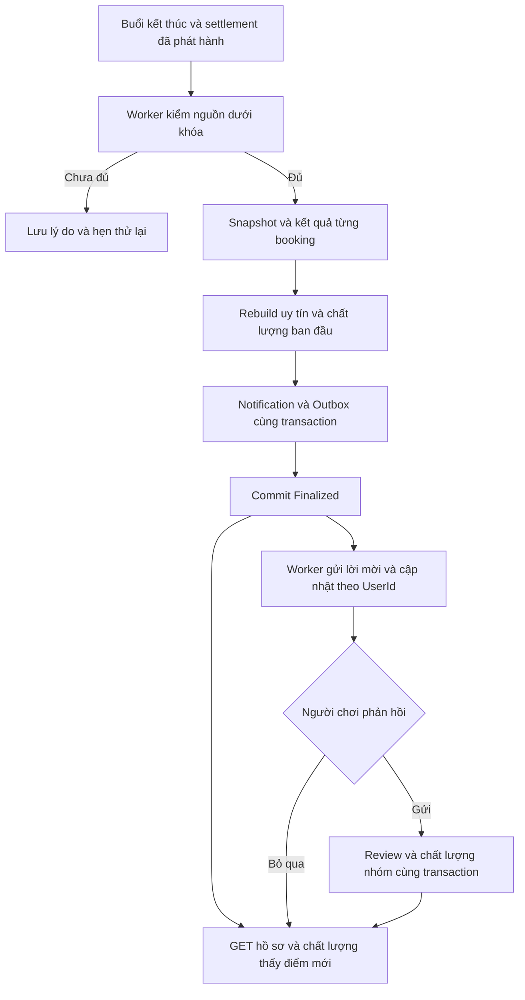

# UC20 — Bàn giao Backend và hợp đồng tích hợp

Cập nhật ngày 06/11/2026. Phạm vi FR23/F5: đối soát buổi, tính uy tín người chơi, lời mời đánh giá, review 1–5 sao, chất lượng nhóm và truy vấn công khai/cá nhân/audit. Tài liệu tổ chức cùng cấu trúc bàn giao UC19, đối chiếu mã nguồn hiện tại sau quyết định bỏ cờ tính năng.

**Trạng thái bàn giao:** source ba wave đã có, gồm 5 GET và 1 POST; UC20 luôn hoạt động khi ứng dụng chạy. API và worker dùng BadmintonDbContext/ConnectionStrings:Database chung của ứng dụng, không dùng connection sandbox. Đã kiểm thử BE trên sandbox; lượt cập nhật này chỉ cấu hình code, không tạo DB chung hoặc áp migration theo yêu cầu người dùng. FE/FCM/SignalR trên thiết bị thật chưa nghiệm thu.

## 0. Kết luận rà soát từ đầu luồng

| Chặng | Kết quả / giới hạn |
|---|---|
| Buổi hoàn tất → đối soát | Worker kiểm COMPLETED, hết giờ, settlement, attendance và nguồn thu đầy đủ; không suy đối soát xong từ trạng thái buổi đơn lẻ |
| Đối soát → uy tín | Domain ghi kết quả booking, rebuild từ baseline xuyên nhóm theo thứ tự chuẩn; retry không chấm lặp |
| Đối soát → mời review | Notification/Outbox ghi cùng transaction; không chờ người chơi đánh giá để công khai điểm |
| Review → chất lượng | CHECKED_IN đủ điều kiện, gồm guest; một review/người/buổi trong 7 ngày; review đến sau chỉ đổi chất lượng nhóm |
| Bỏ qua review | Không sinh sao 0, không trừ uy tín và không chặn xử lý |
| Card/nhật ký/audit | Tách DTO công khai, lịch sử cá nhân và nguồn quản trị đúng nhóm; không công khai PII/comment qua card |
| Delivery | Chỉ claim kind UC20, kiểm nguồn/người nhận/hạn trước từng kênh; đã test dịch vụ thay thế, chưa thử thiết bị thật |
| DB dùng chung | Code dùng connection ứng dụng; kiểm thử dùng DB riêng. Chỉ cấu hình code, chưa áp migration lên DB chung trong lượt này |



## 1. API và quyền

Prefix `/api/v1`. Gửi `Authorization: Bearer <accessToken>`. Thành công trả object trực tiếp, không bọc `data`. ID là UUID; timestamp UTC; điểm dùng decimal. API không nhận delta/score/UserId để thay mặt người khác ghi kết quả.

| Method | Route | Mục đích | Quyền |
|---|---|---|---|
| GET | `/user/me/reviews/invitations` | Lời mời còn hạn, kèm review của chính mình | JWT và ownership, gồm guest tham gia |
| POST | `/user/me/reviews` | Gửi hoặc replay review | JWT, booking và eligibility đã chốt |
| GET | `/reputation/players/{userId}` | Card uy tín tối thiểu | Người đăng nhập, tài khoản hợp lệ |
| GET | `/reputation/me/entries` | Kết quả uy tín của chính mình | UserId từ JWT |
| GET | `/reputation/group-quality?groupId=...` | Điểm và coverage chất lượng nhóm | Người đăng nhập, nhóm hợp lệ |
| GET | `/clubs/{clubId}/sessions/{sessionId}/reputation-audit` | Nguồn đối soát và phản hồi trong buổi | GroupPermissions.Operations.SessionUpdate trong đúng nhóm |

### 1.1. Quyền, ngữ cảnh nhóm và màn hình FE

Guest CHECKED_IN được gửi review mà không cần LedgerView hoặc còn membership hiện tại. Người không tham gia không được gửi; NO_SHOW/WAITING không được cấp eligibility. Host tham gia chịu cùng quy tắc một review và hạn gửi.

Audit dùng RequireGroupPermission và kiểm lại quyền thực từ DB trong Application; global Admin không vượt kiểm quyền nhóm tại Handler. SessionId phải thuộc clubId. Comment chỉ tác giả qua response của mình và ban điều hành đủ quyền qua audit xem; không có API công khai liệt kê comment.

FE không suy quyền từ tên role. Khi đổi tài khoản/nhóm cần bỏ dữ liệu riêng của ngữ cảnh cũ; xử lý 401/403 theo response server.

### 1.2. Bộ lọc, phân trang và cách tải dữ liệu

Invitations, entries và audit nhận page mặc định 1, pageSize mặc định 20; page từ 1 đến 1.000.000, pageSize từ 1 đến 100. Response trang gồm items/page/pageSize/total.

Invitations chỉ lấy buổi còn trong cửa sổ 7 ngày, kể cả đã gửi review thì trả review của chính mình. Entries gồm nguồn lịch sử đã soft-delete để không làm mất kết quả đã chốt; thứ tự hiển thị theo ReputationComputedAt giảm dần rồi BookingId, khác với thứ tự tính điểm theo EndTime snapshot. Audit phân trang kết quả booking; snapshot buổi là phần chung. Card và group-quality không phân trang.

### 1.3. Tổ chức mã nguồn

| Tầng | Thành phần |
|---|---|
| Domain | ReputationPolicy, GroupQualityPolicy; partial entity AppUser/ClubGroup/BadmintonSession/SessionBooking; GroupReview; DomainEvent |
| Application | Features/Reputation, DTOs/Reputation; IReputationRepository/IReputationReadRepository/IReputationRealtimePublisher; ReputationOptions |
| Persistence | ReputationRepository/ReputationReadRepository; ReputationModelConfiguration; ReputationWriteGuard |
| Infrastructure | ReputationAssessmentWorker, ReputationNotificationWorker, SignalRReputationRealtimePublisher |
| Presentation | UserEndpoint (review), ReputationEndpoint, SessionEndpoint (audit); ReputationConflictExceptionHandler |
| Migrator | 20261105162124_AddSessionReputation và Designer/snapshot |

Các đường dẫn tính từ `src/LegendsTeamVN.BadmintonClub.<Tầng>`; migration nằm trong `src/Hosts/LegendsTeamVN.BadmintonClub.Migrator/Migrations`. Không thêm entity/table/DbSet riêng cho assessment, entry hoặc snapshot.

## 2. Luồng nghiệp vụ theo BE

### 2.1. Luồng chính — đối soát và đọc điểm

Worker quét buổi bắt đầu từ EffectiveFromUtc, hết EndTime, COMPLETED và chưa Finalized. Repository khóa nhóm → buổi bằng NO KEY UPDATE; user khóa theo thứ tự UUID. Domain kiểm settlement đã publish, không còn PLAYING hoặc CONFIRMED chưa xử lý, tập fee đúng người CHECKED_IN, mọi khoản phải thu PAID/EXEMPT và nguồn ledger/bank/CASH khớp.

Pending/DataInsufficient lưu lý do và NextAttemptAt, không ghi điểm/mời sớm. MANUAL_CHECK không liên quan fee buổi không làm treo cả nhóm. Toàn EXEMPT hợp lệ vẫn xử lý; tập phí rỗng thiếu căn cứ không được coi là đối soát xong.

Khi đủ, Domain ghi evidence/delta cho CHECKED_IN, NO_SHOW và hủy suất chính thức có nguồn; rebuild projection user/nhóm. Snapshot, booking, projection, Notification, Outbox và Finalized commit nguyên tử. UC20 không tham gia transaction nhận tiền UC18. GET đọc projection đã commit, không tự tính lại điểm.

### 2.2. Luồng phụ và ngoại lệ

- Gửi review: server lấy UserId từ JWT, xác định booking và nhóm từ SessionId, kiểm Finalized/eligibility/hạn; ghi GroupReview và chất lượng trong cùng transaction dưới khóa nhóm.
- Bỏ qua: không cần endpoint skip; không tạo dữ liệu hoặc thay uy tín. Còn hạn thì vẫn gửi sau được.
- Replay: cùng rating/comment chuẩn hóa trả 200 với cùng review; khác nội dung trả 409. Replay bản đã gửi không tạo review mới dù cửa sổ gửi mới đã hết.
- Thiếu nguồn/thu chưa xong: để Pending/DataInsufficient và thử lại, không sửa tiền hoặc tự miễn thu để ép engine chạy.
- Lỗi kỹ thuật: rollback UC20, scope/transaction mới khi retry; không hoàn tác khoản thu UC18 đã commit.
- Buổi cũ đối soát muộn: rebuild từ baseline và mọi kết quả đã có, dùng EndTime snapshot và SessionId chuẩn, không theo thứ tự worker commit.
- Đã Finalized: trả kết quả cũ, không phát thêm lời mời hoặc tính lại điểm.

## 3. Request

### 3.1. Đọc dữ liệu

```http
GET /api/v1/user/me/reviews/invitations?page=1&pageSize=20
GET /api/v1/reputation/players/{userId}
GET /api/v1/reputation/me/entries?page=1&pageSize=20
GET /api/v1/reputation/group-quality?groupId={groupId}
GET /api/v1/clubs/{clubId}/sessions/{sessionId}/reputation-audit?page=1&pageSize=20
Authorization: Bearer <accessToken>
```

### 3.2. Gửi review

```http
POST /api/v1/user/me/reviews
Content-Type: application/json
Authorization: Bearer <accessToken>

{
  "sessionId": "<uuid>",
  "rating": 5,
  "comment": "Buổi chơi tốt"
}
```

Rating nguyên 1–5; comment tùy chọn, tối đa 2.000 ký tự, trim và chuyển chuỗi trắng thành null. Không có API sửa/xóa review UC20, set điểm hoặc gọi worker qua HTTP.

## 4. Dữ liệu cần hiển thị

### 4.1. Card uy tín

| Field | Ý nghĩa |
|---|---|
| userId | Người chơi được xem |
| score | Điểm hiện hành 0–100 |
| riskLabel | “Rủi ro bùng kèo” nếu dưới 80, còn lại null |
| policyVersion/computedAt | Policy và mốc projection, có thể null khi chưa tính UC20 |
| sampleCount | Số booking đã có kết quả, gồm lịch sử soft-delete |

Không có email/điện thoại/công nợ/comment trong card. FE không suy sampleCount=0 thành điểm vừa được tính.

### 4.2. Lời mời và kết quả gửi

Invitation gồm sessionId/groupId/expiresAt/review. Review gồm reviewId/sessionId/rating/comment/createdAt; null nếu chưa gửi. createdAt chuẩn hóa microsecond để response tạo mới/replay khớp độ chính xác PostgreSQL.

### 4.3. Nhật ký cá nhân và audit

Entry gồm bookingId/sessionId/rawDelta/computedAt/policyVersion/evidence. BookingId là định danh entry; không có bảng entry. Evidence chứa attendance, giờ bắt đầu/check-in, mốc phát hành/nhận tiền, loại nguồn thanh toán, ID nguồn và dữ kiện hủy nếu có. Không dùng rawDelta để FE tự cộng vào score vì clamp và thứ tự rebuild ảnh hưởng kết quả.

Audit gồm sessionId/status/pendingReason/snapshot/bookings. Mỗi booking có bookingId/userId/rawDelta/evidence/review; chỉ hiển thị trong màn hình quản trị đúng nhóm. Snapshot lưu nguồn đối soát và I/O/D bất biến.

### 4.4. Chất lượng nhóm

Response gồm groupId/score/policyVersion/computedAt/summary. Summary chứa schemaVersion/score/reviews/transparency/density/reviewCount/sessionCount/coverage, tử/mẫu số invoice/expense/ledgerViewer/member và densitySampleCount.

Summary.Score null nghĩa là chưa có component đủ dữ liệu; score hiện hành vẫn giữ giá trị trước. Coverage là tổng trọng số các component có dữ liệu, không phải tỷ lệ người trả lời. Không gán component thiếu thành 0 hoặc 5.

## 5. Quy tắc điểm và trạng thái hiện tại

Policy UC20-V1, JSON schemaVersion=1. Uy tín baseline là điểm hiện hữu chụp một lần dưới khóa. Đúng giờ trong 15 phút +1; đến trễ -3; NO_SHOW -20; hủy suất chính thức từ DeadlineBooking đến trước StartTime -10. Hủy rồi quay lại CHECKED_IN dùng attendance cuối, không phạt kép. WAITING không phạt vắng; nguồn thiếu trung lập.

Trả trong 24 giờ từ PublishedAt +1. Ngân hàng trả muộn -3, lấy TransactionTime của nguồn MATCHED đúng fee để không phạt webhook trễ. CASH xác nhận muộn không chứng minh giờ đưa tiền nên trung lập; EXEMPT không thưởng thanh toán. Buổi có vi phạm chỉ cộng phạt, không cộng thưởng của thành phần khác. Bỏ qua review/số sao không thay uy tín.

Rebuild theo EndTime UTC snapshot rồi SessionId UUID N ordinal; clamp 0–100 sau từng entry, bỏ thưởng vượt trần. Dưới 80 gắn nhãn, từ 80 gỡ nhãn, không tự ban/chặn booking. Làm tròn decimal hai số lẻ AwayFromZero.

Chất lượng Q = 0,60 R + 0,25 T + 0,15 D. R trung bình sao review UC20, không tính người bỏ qua hoặc review cũ SessionId null. T = 1 + 4 × trung bình I/O; I là tỷ lệ khoản chi gắn buổi có hóa đơn, O là tỷ lệ hội viên ACTIVE MONTHLY/DAILY có LedgerView thực từ DB, loại guest. D từ CHECKED_IN/sân thực có trận FINISHED và thời gian hợp lệ: ≤6 đạt 5, ≥12 đạt 1, khoảng giữa tuyến tính. Thiếu component thì chuẩn hóa trọng số còn lại; review mới chỉ đổi R, không chụp lại I/O/D.

Một review/người/buổi; cửa sổ [FinancialReconciledAt, FinancialReconciledAt+7 ngày). Review UC20 bất biến cả qua writer cũ. Nguồn điểm đã chốt và lịch sử hủy được bảo toàn; v1 chưa có public workflow correction.

## 6. Xử lý lỗi

| HTTP | Trường hợp |
|---|---|
| 400 | UUID/input/pagination không hợp lệ, rating ngoài 1–5 hoặc comment quá dài |
| 401 | Chưa đăng nhập |
| 403 | Reputation.Forbidden: ngoài ownership, user bất hoạt hoặc thiếu quyền audit |
| 404 | Reputation.NotFound: nguồn không tồn tại hoặc session khác nhóm trong phạm vi truy vấn |
| 409 | Reputation.Conflict: chưa sẵn sàng/hết hạn/khác nội dung hoặc xung đột phiên bản/unique/khóa UC20 |

Không còn Reputation.Disabled/503 do cờ UC20. Audit có thể trả 403 trước 404 do kiểm quyền nhóm trước nguồn. FE giữ nội dung khi lỗi mạng và retry cùng SessionId/rating/comment; không tự đổi nội dung rồi coi là replay. Xung đột UC20 không ánh xạ thành Ledger.Busy.

## 7. Thông báo, cấu hình và triển khai

Notification type REPUTATION, ReferenceType SessionReputation. Outbox kind ReviewInvitationPush/ReputationUpdatedPush; EventId xác định từ kind/buổi/booking/người nhận, giữ nguyên khi retry. Payload chỉ có định danh điều hướng và hạn lời mời, không tiền/điểm/nội dung phạt.

FCM data gồm eventId/sessionId/bookingId/kind. SignalR SessionHub gửi ReviewInvitation/ReputationUpdated qua Clients.User(RecipientId). Client dedupe EventId và GET lại; không tự cộng điểm từ thông báo. Delivery ít nhất một lần: FCM thành công rồi SignalR lỗi có thể gửi lại FCM cùng EventId.

Worker kiểm account, nhóm, booking ownership, Finalized và nguồn chưa xóa trước từng kênh/batch token. Lời mời cần đúng hạn snapshot, chưa hết hạn và chưa có review kể cả soft-delete; không yêu cầu guest có LedgerView. Nguồn không hợp lệ được hoàn tất không gửi; lỗi kỹ thuật retry theo lease/backoff, timeout lượt gửi 20 giây.

### 7.1. Cấu hình server

API `appsettings.json` khai báo:

```json
{
  "Reputation": {
    "EffectiveFromUtc": "2026-11-06T00:00:00Z",
    "BatchSize": 32,
    "IntervalSeconds": 30
  }
}
```

UC20 luôn hoạt động, không có Enabled/ProcessingEnabled/ReviewsEnabled/DispatchEnabled. EffectiveFromUtc cố định tương ứng 07:00 ngày 06/11/2026 giờ Việt Nam; chỉ buổi bắt đầu từ mốc này được engine xử lý. Không lấy giờ restart. BatchSize 1–100, IntervalSeconds 5–300; mốc cần UTC. Có thể override bằng Reputation__EffectiveFromUtc/Reputation__BatchSize/Reputation__IntervalSeconds theo cấu hình host.

**DB chung:** API đọc ConnectionStrings:Database (override môi trường ConnectionStrings__Database), đăng ký BadmintonDbContext dùng chung cho UC01–UC20. Cấu hình local hiện là localhost:5432/BadmintonClub. Docker lấy DB_CONNECTION_STRING ánh xạ vào cùng key canonical. UC20 không có connection riêng và không dùng UC20_TEST_POSTGRES ở runtime. Không đưa mật khẩu/connection triển khai vào tài liệu hoặc DTO.

**DB test:** UC20_TEST_POSTGRES chỉ được fixture test đọc, allowlist localhost:55440/uc20_test và tạo/xóa DB ngẫu nhiên uc20_test_<guid>. Giữ kiểm thử ngoài DB chung; không đổi fixture sang DB vận hành.

### 7.2. Schema và điều kiện trước triển khai

Migration 20261105162124_AddSessionReputation, baseline 20261105065216_TrackMonthlyMembershipPeriod. Chỉ mở rộng năm bảng hiện có; không tạo bảng mới. JSONB cùng hàng có converter/ValueComparer, CHECK kiểu JSON và invariant Domain; không có FK/unique tự động trong phần tử JSON. Trường lọc/unique nằm ngoài JSONB.

Review có partial unique SessionId/UserId kể cả soft-delete, FK đúng nhóm/buổi/booking. Version trên user/nhóm/buổi/booking chặn graph cũ ghi đè. FK RESTRICT bảo vệ nguồn; mapping này cũng siết hard-delete dữ liệu cũ có booking/review. Up preflight chặn điểm cũ ngoài miền, không tự sửa dữ liệu.

Trước chạy môi trường thật: xác định đúng DB/connection, backup, kiểm history/baseline và dữ liệu preflight, áp migration bằng Migrator/tooling đã cấu hình, kiểm schema rồi mới chạy API/worker. Không chạy seeder chỉ để hoàn thành UC20. Lượt cập nhật bàn giao này chỉ cấu hình code, không tạo DB hoặc áp migration. Việc code dùng DB chung không có nghĩa schema DB đã sẵn sàng.

### 7.3. Dừng và rollback

Không còn cờ riêng để tắt UC20; muốn bảo trì cần dừng/drain host API chứa hai worker trước thao tác schema. Tắt host không tự đảo điểm. Down chặn khi có dữ liệu UC20 để tránh mất baseline/evidence/review/thông báo; ưu tiên sửa tiến. Binary cũ không hiểu version có thể ghi đè projection, không coi quay binary cũ là rollback an toàn.

## 8. Kiểm chứng và bàn giao

### 8.0. Kết quả mới nhất sau bỏ cờ và kiểm thử lại BE

| Bộ kiểm tra | Kết quả |
|---|---|
| UC20 | 36 passed, 0 failed/skipped; gồm HTTP với repository/DB thật, migration/concurrency và delivery |
| Domain toàn bộ | 360 passed, 0 failed/skipped |
| Infrastructure với Redis sandbox | 89 passed, 0 failed/skipped |
| Application hồi quy rộng | 244 passed, 139 skipped, 0 failed; skip của các phân hệ khác không coi là đạt |
| Architecture script | 37/37 passed |
| Build | 0 lỗi; 1 cảnh báo package NU1510 hiện hữu tại lần build cuối của lượt kiểm thử |

Đã sửa sai khác createdAt do .NET/PostgreSQL khác precision; test HTTP giữ assertion response tạo/replay giống nhau. Đã kiểm worker xử lý Outbox thật nhưng không claim thông báo sổ quỹ và không rebuild khi gửi. Xem [báo cáo kiểm thử](UC20-BE-test-report.md) và [plan/nhật ký](UC20-BE-plan.md).

### 8.1. Cấu hình và DB của máy nhận bàn giao

Runtime đã nối chung BadmintonDbContext/ConnectionStrings:Database từ đầu; lượt này bổ sung section Reputation tường minh trong API appsettings. Người dùng xác nhận chỉ cấu hình code. Khi kiểm tra local không có DB BadmintonClub; không áp migration hoặc tạo DB thay thế. Container PostgreSQL khởi động tạm để kiểm tra đã được dừng, volume giữ nguyên. Không có backup DB chung hợp lệ được tạo trong lượt này.

### 8.2. Artifact và chạy lại

Postman tại `../postman/UC20`: collection/environment/README, token trống, runWrites=false bảo vệ thao tác chạy thử (đây không phải cờ server). Chưa chạy collection bằng tài khoản thật.

```sh
python3 .agents/skills/verify-architecture/scripts/verify_architecture.py
dotnet build --no-restore
dotnet test tests/LegendsTeamVN.BadmintonClub.Application.Tests --no-restore --filter 'FullyQualifiedName~Features.Reputation'
```

Ca PostgreSQL cần UC20_TEST_POSTGRES đúng sandbox; nếu không có thì fixture skip và không được coi là đạt. Các phép thử phá dữ liệu/migration rollback không chạy trên DB chung.

## 9. Việc còn lại trước nghiệm thu vận hành

1. Người vận hành cung cấp/thiết lập DB chung đúng đích, backup và áp migrations còn thiếu; kiểm schema trước khi chạy API.
2. Nghiệm thu FE với JWT/membership thật; Postman và HTTP server đích.
3. Nghiệm thu FCM và transport SignalR trên thiết bị thật, reconnect/retry/dedupe; bằng chứng mock không thay cho nhà cung cấp thật.
4. Các ca hạ tầng phân hệ khác đang skipped cần nghiệm thu riêng; không dùng tổng test UC20 để tuyên bố toàn dự án đã đạt.

## 10. Checklist nghiệm thu tích hợp FE

- [ ] Card hiển thị score/nhãn/sampleCount và trạng thái chưa tính, không lộ PII.
- [ ] Nhật ký chỉ của chính user, có trạng thái nguồn thiếu/trung lập; không tự cộng rawDelta.
- [ ] Guest CHECKED_IN xem lời mời và gửi review hợp lệ; NO_SHOW/WAITING/người ngoài bị chặn.
- [ ] Rating 1–5, comment/hạn 7 ngày, replay và 409 khác nội dung xử lý đúng.
- [ ] Bỏ qua không sinh sao 0 hoặc thay uy tín; review mới chỉ đổi điểm nhóm.
- [ ] Quality hiển thị component/coverage và dữ liệu thiếu rõ ràng.
- [ ] Audit chỉ đúng nhóm có SessionUpdate, không mở từ quyền Admin toàn cục.
- [ ] SignalR/FCM đúng người, dedupe EventId, GET lại và xử lý reconnect.
- [ ] Không mất dữ liệu khi đổi nhóm/tài khoản hoặc quyền bị thu hồi.
- [ ] Xác minh server đích đã có migration UC20 trước chạy toàn luồng.
