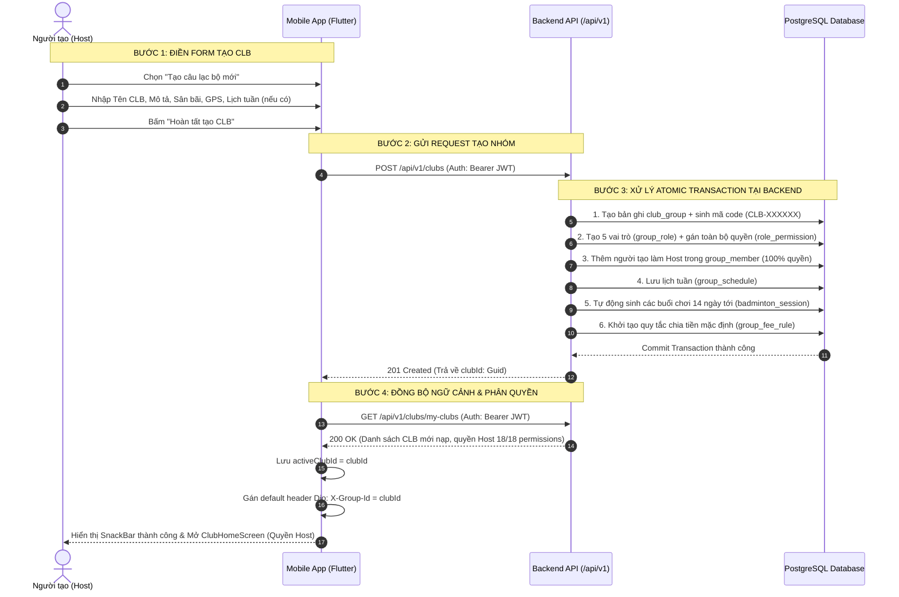

# HƯỚNG DẪN TÍCH HỢP FRONTEND: LUỒNG TẠO MỚI CÂU LẠC BỘ (UC04 / FR03 & FR13)

> [!NOTE]
> Tài liệu quy chuẩn chính thức dành cho lập trình viên Frontend (Flutter Mobile / Web) khi tích hợp luồng **Khởi tạo & Cấu hình hội nhóm mới (Create Club Flow)** với Backend **LegendsTeamVN.BadmintonClub** (.NET 10 Clean Architecture).

---

## 1. TỔNG QUAN LUỒNG NGHIỆP VỤ (OVERVIEW)

Khi người dùng khởi tạo một câu lạc bộ mới trên ứng dụng:
1. **Một Request duy nhất**: Toàn bộ thông tin CLB, sân bãi, định vị GPS và lịch sinh hoạt cố định hàng tuần được gửi lên trong một request `POST /api/v1/clubs`.
2. **Xử lý nguyên khối phía Backend (Atomic Transaction)**:
   - Hệ thống lưu thông tin câu lạc bộ (`club_group`).
   - Tự động sinh mã mời nhóm ngắn (ví dụ: `CLB-A1B2C3`).
   - Tự động sinh 5 vai trò nội bộ chuẩn: **Host (Quản trị tối cao)**, **Phó nhóm**, **Thủ quỹ**, **Thành viên (mặc định)**, và **Khách vãng lai**.
   - Bổ nhiệm ngay người tạo tài khoản làm **Host** với 100% quyền hạn (18/18 quyền), loại hội viên `MONTHLY`, trạng thái `ACTIVE`.
   - Nếu có gửi kèm lịch sinh hoạt tuần: Tự động lưu lịch (`group_schedule`) và **tự động mở trước toàn bộ các buổi chơi (`badminton_session`) trong 14 ngày tới**.
   - Tự động áp dụng quy tắc phân bổ chi phí mặc định (`group_fee_rule`: Dynamic mode, làm tròn 1.000 VNĐ).
3. **Đồng bộ ngữ cảnh tức thì (Clean Context Architecture)**:
   - Backend trả về `201 Created` kèm `clubId` (Guid).
   - FE không cần gọi API `switch-context` cũ; FE chỉ cần nạp lại danh sách `GET /api/v1/clubs/my-clubs` và gán header HTTP `X-Group-Id: <clubId>` cho các màn hình tiếp theo.

---

## 2. SƠ ĐỒ LUỒNG TOÀN TRÌNH (SEQUENCE DIAGRAM)



---

## 3. CHI TIẾT ENDPOINT `POST /api/v1/clubs`

### 3.1. Thông tin HTTP
- **URL**: `/api/v1/clubs`
- **Method**: `POST`
- **Headers**:
  ```http
  Authorization: Bearer <ACCESS_TOKEN>
  Content-Type: application/json
  ```

---

### 3.2. Request Payload (Hỗ trợ 2 chế độ)

#### Chế độ A: Tạo nhanh (Quick Mode - Chỉ thông tin cơ bản)
Dùng cho màn hình Pop-up/BottomSheet tạo nhanh:
```json
{
  "name": "CLB Cầu Lông Legends Quận 7",
  "description": "Sinh hoạt tối thứ 3 - 5 - 7 hàng tuần sân Kim Cương",
  "avatarUrl": "https://example.com/club_avatar.png"
}
```

#### Chế độ B: Tạo đầy đủ (Full Mode - Kèm sân bãi, GPS & Lịch tuần)
Dùng cho màn hình Wizard tạo câu lạc bộ hoàn chỉnh:
```json
{
  "name": "CLB Cầu Lông Legends Quận 7",
  "description": "Sinh hoạt tối thứ 3 - 5 - 7 hàng tuần sân Kim Cương",
  "avatarUrl": "https://example.com/club_avatar.png",
  "fixedVenueName": "Sân Cầu Lông Kim Cương",
  "fixedAddress": "123 Nguyễn Thị Thập, Phường Tân Phú, Quận 7, TP. Hồ Chí Minh",
  "lat": 10.7328,
  "lng": 106.7154,
  "minSkillLevel": "NB",
  "maxSkillLevel": "K",
  "schedules": [
    {
      "dayOfWeek": 2,
      "startTime": "18:00:00",
      "endTime": "20:00:00"
    },
    {
      "dayOfWeek": 4,
      "startTime": "18:00:00",
      "endTime": "20:00:00"
    },
    {
      "dayOfWeek": 6,
      "startTime": "18:00:00",
      "endTime": "20:00:00"
    }
  ]
}
```

---

### 3.3. Bảng đặc tả các trường dữ liệu (Field Specifications)

| Tên trường | Kiểu dữ liệu | Bắt buộc | Ràng buộc validation | Mô tả chi tiết |
| :--- | :--- | :--- | :--- | :--- |
| `name` | `string` | **Bắt buộc** | Tối đa 255 ký tự, không được rỗng | Tên chính thức của câu lạc bộ. |
| `description` | `string?` | Tùy chọn | Tối đa 500 ký tự | Tôn chỉ, mô tả giới thiệu nhóm. |
| `avatarUrl` | `string?` | Tùy chọn | URL hợp lệ | Ảnh đại diện của CLB. |
| `fixedVenueName`| `string?` | Tùy chọn | Tối đa 255 ký tự | Tên sân cố định nơi nhóm thường thuê sân. |
| `fixedAddress` | `string?` | Tùy chọn | Tối đa 500 ký tự | Địa chỉ cụ thể cụm sân. |
| `lat` | `decimal?` | Tùy chọn | Precision (10,7) | Vĩ độ GPS phục vụ tính năng tìm kiếm quanh đây (FR06). |
| `lng` | `decimal?` | Tùy chọn | Precision (10,7) | Kinh độ GPS phục vụ tính năng tìm kiếm quanh đây (FR06). |
| `minSkillLevel` | `string` | Tùy chọn | Mặc định `"NB"` | Trình độ tối thiểu yêu cầu (NB, Y, TBY, TB, TBK, K). |
| `maxSkillLevel` | `string` | Tùy chọn | Mặc định `"K"` | Trình độ tối đa chấp nhận (`maxSkillLevel >= minSkillLevel`). |
| `schedules` | `array` | Tùy chọn | Mảng các khung giờ | Danh sách lịch sinh hoạt định kỳ hàng tuần. |
| `schedules[].dayOfWeek` | `int` | **Bắt buộc** nếu có schedule | `0..6` | **Quy ước chuẩn**: `0` = Chủ nhật, `1` = Thứ 2, `2` = Thứ 3, `3` = Thứ 4, `4` = Thứ 5, `5` = Thứ 6, `6` = Thứ 7. |
| `schedules[].startTime` | `string` | **Bắt buộc** nếu có schedule | Format `"HH:mm:ss"` hoặc `"HH:mm"` | Giờ bắt đầu buổi chơi. |
| `schedules[].endTime` | `string` | **Bắt buộc** nếu có schedule | Format `"HH:mm:ss"` hoặc `"HH:mm"` | Giờ kết thúc buổi chơi. Bắt buộc `startTime < endTime`. |

> [!WARNING]
> **Lưu ý đặc biệt về `dayOfWeek`**:
> Hệ thống Backend sử dụng chuẩn `DayOfWeek` chuẩn của .NET (`0 = Sunday`, `1 = Monday` ... `6 = Saturday`). Tuyệt đối KHÔNG gửi dải `1..7` (kiểu ISO); nếu gửi `7` sẽ bị lỗi validation `400 Bad Request`.

---

### 3.4. Bảng tra cứu mã trình độ (`SkillLevel`)

| Mã chuỗi (String) | Giá trị số (Int) | Tên cấp độ | Diễn giải |
| :--- | :--- | :--- | :--- |
| `"NB"` | 1 | Mới tập chơi (Newbie) | Người mới bắt đầu làm quen bộ môn cầu lông |
| `"Y"` | 2 | Yếu | Đã biết luật, đánh qua lại cơ bản |
| `"TBY"` | 3 | Trung bình yếu | Phông cầu, đập cầu cơ bản nhưng thể lực/bộ pháp chưa ổn định |
| `"TB"` | 4 | Trung bình | Đánh đôi phong trào ổn định |
| `"TBK"` | 5 | Trung bình khá | Chiến thuật đôi tốt, điều cầu nhanh, phản xạ ổn định |
| `"K"` | 6 | Khá | Tấn công uy lực, thi đấu các giải phong trào |

---

## 4. PHẢN HỒI TỪ SERVER (RESPONSE)

### 4.1. Thành công (`201 Created`)
Server trả về mã HTTP `201 Created` kèm `Header: Location: /api/v1/clubs/{clubId}` và body là chuỗi `Guid` ID của câu lạc bộ vừa tạo:

```json
"b86fa2e7-03b6-4299-923c-a93108ce8968"
```

---

### 4.2. Thất bại (RFC 7807 ProblemDetails)

#### Lỗi 400 Bad Request (Sai validation dữ liệu):
```json
{
  "type": "https://tools.ietf.org/html/rfc7231#section-6.5.1",
  "title": "One or more validation errors occurred.",
  "status": 400,
  "errors": {
    "Name": [
      "Tên câu lạc bộ không được để trống."
    ],
    "Schedules[0].DayOfWeek": [
      "Thứ trong tuần không hợp lệ (0 = Chủ Nhật, 1..6 = Thứ 2 đến Thứ 7)."
    ],
    "Schedules[0].StartTime": [
      "Giờ bắt đầu phải nhỏ hơn giờ kết thúc."
    ]
  }
}
```

#### Lỗi 401 Unauthorized (Chưa đăng nhập hoặc Token hết hạn):
```json
{
  "type": "https://tools.ietf.org/html/rfc7235#section-3.1",
  "title": "Unauthorized",
  "status": 401,
  "detail": "Vui lòng đăng nhập để tạo câu lạc bộ."
}
```

---

## 5. HƯỚNG DẪN XỬ LÝ MOBILE KẾ TIẾP (FRONTEND WORKFLOW)

Sau khi nhận được `clubId` từ `POST /api/v1/clubs`, Frontend cần thực hiện đúng **4 bước tiêu chuẩn** sau:

```
[1. Nhận clubId]
       │
       ▼
[2. Gọi GET /api/v1/clubs/my-clubs] 
       │ ──> Đồng bộ lại danh sách CLB của tôi
       │ ──> Nạp 18/18 permissions của vai trò Host
       ▼
[3. Thiết lập Header HTTP toàn cục]
       │ ──> dio.options.headers['X-Group-Id'] = newClubId
       │ ──> activeClubId = newClubId
       ▼
[4. Điều hướng vào ClubHomeScreen]
       │ ──> Giao diện tự động mở các tính năng Host (Quản lý sân, Duyệt thành viên, Thu chi)
```

> [!IMPORTANT]
> **Không cần gọi API `switch-context`**: 
> Theo kiến trúc `X-Group-Id`, Token đăng nhập giữ nguyên. Chỉ cần đổi giá trị `X-Group-Id` trong HTTP header của Dio client, toàn bộ các request sau đó sẽ tự động chạy trong ngữ cảnh CLB vừa tạo!

---

## 6. MẪU TRIỂN KHAI FLUTTER (DART CODE SNIPPETS)

### 6.1. Dart Models (`create_club_request.dart`)

```dart
class CreateClubScheduleItemRequest {
  final int dayOfWeek; // 0 = Chủ nhật, 1 = T2, ..., 6 = T7
  final String startTime; // "18:00:00"
  final String endTime; // "20:00:00"

  CreateClubScheduleItemRequest({
    required this.dayOfWeek,
    required this.startTime,
    required this.endTime,
  });

  Map<String, dynamic> toJson() => {
    'dayOfWeek': dayOfWeek,
    'startTime': startTime,
    'endTime': endTime,
  };
}

class CreateClubRequest {
  final String name;
  final String? description;
  final String? avatarUrl;
  final String? fixedVenueName;
  final String? fixedAddress;
  final double? lat;
  final double? lng;
  final String minSkillLevel;
  final String maxSkillLevel;
  final List<CreateClubScheduleItemRequest>? schedules;

  CreateClubRequest({
    required this.name,
    this.description,
    this.avatarUrl,
    this.fixedVenueName,
    this.fixedAddress,
    this.lat,
    this.lng,
    this.minSkillLevel = 'NB',
    this.maxSkillLevel = 'K',
    this.schedules,
  });

  Map<String, dynamic> toJson() => {
    'name': name,
    if (description != null) 'description': description,
    if (avatarUrl != null) 'avatarUrl': avatarUrl,
    if (fixedVenueName != null) 'fixedVenueName': fixedVenueName,
    if (fixedAddress != null) 'fixedAddress': fixedAddress,
    if (lat != null) 'lat': lat,
    if (lng != null) 'lng': lng,
    'minSkillLevel': minSkillLevel,
    'maxSkillLevel': maxSkillLevel,
    if (schedules != null && schedules!.isNotEmpty)
      'schedules': schedules!.map((s) => s.toJson()).toList(),
  };
}
```

---

### 6.2. Datasource / Repository Method (`club_repository.dart`)

```dart
import 'package:dio/dio.dart';

class ClubRepository {
  final Dio _dio;

  ClubRepository(this._dio);

  Future<String> createClub(CreateClubRequest request) async {
    try {
      final response = await _dio.post(
        '/api/v1/clubs',
        data: request.toJson(),
      );

      if (response.statusCode == 201) {
        // Response trả về GUID string của club vừa tạo
        return response.data as String;
      }
      throw Exception('Không thể tạo câu lạc bộ.');
    } on DioException catch (e) {
      if (e.response?.statusCode == 400) {
        final errors = e.response?.data['errors'] as Map<String, dynamic>?;
        final firstError = errors?.values.firstOrNull;
        if (firstError is List && firstError.isNotEmpty) {
          throw Exception(firstError.first.toString());
        }
      }
      throw Exception(e.response?.data['detail'] ?? 'Lỗi khi tạo câu lạc bộ.');
    }
  }
}
```

---

### 6.3. Riverpod ViewModel / Controller (`create_club_controller.dart`)

```dart
import 'package:flutter_riverpod/flutter_riverpod.dart';

final createClubControllerProvider = AsyncNotifierProvider<CreateClubController, void>(() {
  return CreateClubController();
});

class CreateClubController extends AsyncNotifier<void> {
  @override
  Future<void> build() async {}

  Future<bool> handleCreateClub(CreateClubRequest request) async {
    state = const AsyncValue.loading();
    try {
      final clubRepo = ref.read(clubRepositoryProvider);
      final newClubId = await clubRepo.createClub(request);

      // 1. Nạp lại danh sách CLB của tôi (sẽ chứa CLB mới tạo kèm full quyền Host)
      await ref.read(myClubsViewModelProvider.notifier).loadMyClubs();

      // 2. Chuyển context sang CLB mới (Gán X-Group-Id cho Dio Client)
      ref.read(clubContextProvider.notifier).setActiveClub(newClubId);

      state = const AsyncValue.data(null);
      return true;
    } catch (e, st) {
      state = AsyncValue.error(e, st);
      return false;
    }
  }
}
```

---

## 7. CHECKLIST KIỂM THỬ TÍCH HỢP (FE INTEGRATION CHECKLIST)

- [ ] Form tạo CLB kiểm tra không cho để trống tên nhóm (độ dài 3-255 ký tự).
- [ ] Chọn thứ trong tuần gửi đúng giá trị `0..6` (`0 = Chủ nhật`).
- [ ] Kiểm tra giờ bắt đầu phải trước giờ kết thúc (`startTime < endTime`).
- [ ] Bắt được lỗi `400 Bad Request` và hiển thị message chi tiết từ mảng `errors`.
- [ ] Sau khi tạo thành công `201 Created`:
  - [ ] Gọi nạp lại `my-clubs`.
  - [ ] Thiết lập Header `X-Group-Id = <newClubId>`.
  - [ ] Điều hướng vào `ClubHomeScreen`.
  - [ ] Kiểm tra thấy ngay vai trò của mình là **Host** với biểu tượng quản trị.
  - [ ] Nếu đã gửi `schedules`, vào tab "Lịch sinh hoạt" kiểm tra các buổi chơi 14 ngày tới đã được tự động khởi tạo sẵn.
