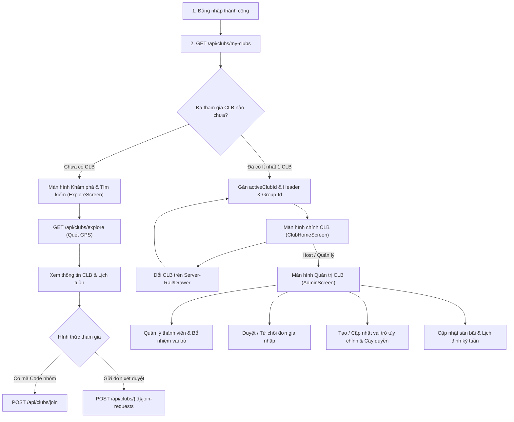

# HƯỚNG DẪN TÍCH HỢP FRONTEND: PHÂN HỆ QUẢN LÝ NHÓM & CÂU LẠC BỘ (CLB)

Tài liệu quy chuẩn kỹ thuật chính thức dành cho đội ngũ phát triển Frontend (Flutter Mobile & Web) tích hợp toàn bộ Phân hệ Quản lý Nhóm & Câu lạc bộ (FR03, FR04, FR06, FR07; UC03, UC04, UC05, UC06) với Backend LegendsTeamVN.BadmintonClub (.NET 10 Clean Architecture).

---

## 1. TỔNG QUAN KIẾN TRÚC & QUY ƯỚC KẾT NỐI

### 1.1. Base URL & Môi Trường
- **Development (Localhost / Android Emulator):** `http://10.0.2.2:5000` (hoặc `http://localhost:5000`)
- **Staging / Testing Server:** `https://api.badminton.legendsteam.vn`
- **Tiêu chuẩn Header toàn cục:**
  - `Content-Type: application/json`
  - `Authorization: Bearer <ACCESS_TOKEN>` (Giữ nguyên 1 JWT duy nhất sau khi login)
  - `X-Group-Id: <CLUB_ID_GUID>` (Bắt buộc cho mọi request thao tác trong ngữ cảnh CLB)

### 1.2. Cơ Chế Xác Thực & Phân Quyền Theo Ngữ Cảnh (Clean Context Architecture)
- **Zero Multiple Tokens:** Ứng dụng **không** cần xin cấp lại JWT Token khi chuyển đổi giữa các CLB.
- **X-Group-Id Header:** Khi người dùng chọn sinh hoạt tại CLB nào, Client tự động gán header `X-Group-Id = selectedClubId`.
- **Dynamic Authorization Gate:** Backend kiểm tra quyền động qua Redis Cache (`group:perm:{userId}:{groupId}`, TTL 10 phút). Nếu thành viên bị thay đổi vai trò hoặc bị xóa khỏi nhóm, lệnh kế tiếp sẽ bị chặn ngay lập tức với mã lỗi `403 Forbidden`.

---

## 2. BẢN ĐỒ MÀN HÌNH & 5 LUỒNG TƯƠNG TÁC NGHIỆP VỤ (USER JOURNEYS)



---

## 3. CHI TIẾT HỢP ĐỒNG 19 API PHÂN HỆ QUẢN LÝ NHÓM

### PHẦN A: KHỞI TẠO, CHI TIẾT & TÌM KIẾM CLB

#### 1. Tạo Câu Lạc Bộ Mới
- **Method & Route:** `POST /api/clubs`
- **Headers:** `Authorization: Bearer <TOKEN>`
- **Mô tả:** Khởi tạo CLB mới. Người tạo tự động trở thành **Host** với toàn bộ quyền hạn. Hỗ trợ 2 chế độ:
  - *Quick Mode:* Chỉ cần tên và mô tả.
  - *Full Mode:* Kèm thông tin sân cố định, GPS và lịch định kỳ tuần.
- **Request Body JSON:**
```json
{
  "name": "CLB Cầu Lông Kỳ Hòa",
  "description": "Nhóm phong trào sinh hoạt tối 3-5-7",
  "avatarUrl": "https://cdn.example.com/club-avatar.png",
  "fixedVenueName": "Sân Cầu Lông Kỳ Hòa",
  "fixedAddress": "238 Đường 3/2, Phường 12, Quận 10, TP.HCM",
  "lat": 10.7712,
  "lng": 106.6734,
  "minSkillLevel": "TB",
  "maxSkillLevel": "K",
  "schedules": [
    {
      "dayOfWeek": 2,
      "startTime": "18:00:00",
      "endTime": "20:00:00"
    },
    {
      "dayOfWeek": 4,
      "startTime": "18:00:00",
      "endTime": "20:00:00"
    }
  ]
}
```
- **Response `200 OK`:**
```json
"3fa85f64-5717-4562-b3fc-2c963f66afa6"
```

#### 2. Lấy Danh Sách CLB Đang Tham Gia Của Tôi
- **Method & Route:** `GET /api/clubs/my-clubs`
- **Headers:** `Authorization: Bearer <TOKEN>`
- **Mô tả:** Lấy danh sách toàn bộ các CLB user tham gia, kèm vai trò độc lập và mảng quyền hạn tương ứng từng nhóm. Dùng làm dữ liệu nguồn hiển thị thanh Server-Rail / Drawer.
- **Response `200 OK`:**
```json
[
  {
    "clubId": "3fa85f64-5717-4562-b3fc-2c963f66afa6",
    "clubName": "CLB Cầu Lông Kỳ Hòa",
    "roleId": "4a713b18-0916-4351-8ec3-eb2a42b10a90",
    "roleName": "Host",
    "permissions": [
      "MEMBER_VIEW",
      "MEMBER_ROLE_MANAGE",
      "MEMBER_JOIN_REQUEST_MANAGE",
      "MEMBER_INFO_UPDATE",
      "OPERATIONS_SCHEDULE_MANAGE",
      "OPERATIONS_SESSION_CREATE"
    ]
  }
]
```

#### 3. Tìm Kiếm & Khám Phá CLB Quanh Vị Trí GPS
- **Method & Route:** `GET /api/clubs/explore?lat=10.7712&lng=106.6734&radiusKm=5`
- **Headers:** `Authorization: Bearer <TOKEN>`
- **Query Params:**
  - `lat` (double): Vĩ độ GPS người dùng.
  - `lng` (double): Kinh độ GPS người dùng.
  - `radiusKm` (double, mặc định 10): Bán kính tìm kiếm (km).
- **Response `200 OK`:**
```json
[
  {
    "id": "3fa85f64-5717-4562-b3fc-2c963f66afa6",
    "groupName": "CLB Cầu Lông Kỳ Hòa",
    "description": "Nhóm phong trào sinh hoạt tối 3-5-7",
    "avatarUrl": "https://cdn.example.com/club-avatar.png",
    "fixedVenueName": "Sân Cầu Lông Kỳ Hòa",
    "fixedAddress": "238 Đường 3/2, Quận 10",
    "lat": 10.7712,
    "lng": 106.6734,
    "distanceKm": 1.25,
    "minSkillLevel": "TB",
    "maxSkillLevel": "K",
    "memberCount": 18
  }
]
```

#### 4. Xem Thông Tin Chi Tiết CLB & Lịch Định Kỳ Tuần
- **Method & Route:** `GET /api/clubs/{id}`
- **Headers:** `Authorization: Bearer <TOKEN>`
- **Response `200 OK`:**
```json
{
  "id": "3fa85f64-5717-4562-b3fc-2c963f66afa6",
  "groupName": "CLB Cầu Lông Kỳ Hòa",
  "description": "Nhóm phong trào sinh hoạt tối 3-5-7",
  "avatarUrl": "https://cdn.example.com/club-avatar.png",
  "fixedVenueName": "Sân Cầu Lông Kỳ Hòa",
  "fixedAddress": "238 Đường 3/2, Phường 12, Quận 10",
  "lat": 10.7712,
  "lng": 106.6734,
  "minSkillLevel": "TB",
  "maxSkillLevel": "K",
  "isRecruiting": true,
  "code": "KYHOA_2026",
  "memberCount": 18,
  "schedules": [
    {
      "id": "c1f8d423-8687-4318-a687-73d76e737248",
      "dayOfWeek": 2,
      "startTime": "18:00:00",
      "endTime": "20:00:00",
      "isActive": true
    }
  ],
  "currentUserRole": "Host",
  "isJoined": true
}
```

#### 5. Cập Nhật Thông Tin Sân Bãi & Tiêu Chuẩn Tuyển Chọn
- **Method & Route:** `PUT /api/clubs/{id}/info`
- **Headers:** `Authorization: Bearer <TOKEN>`, `X-Group-Id: <id>`
- **Quyền yêu cầu:** `MEMBER.INFO.UPDATE`
- **Request Body JSON:**
```json
{
  "groupName": "CLB Cầu Lông Kỳ Hòa (Cập nhật)",
  "description": "Giao lưu vui vẻ, rèn luyện sức khỏe",
  "avatarUrl": "https://cdn.example.com/new-avatar.png",
  "fixedVenueName": "Sân Kỳ Hòa - Nhà tập đa năng",
  "fixedAddress": "238 Đường 3/2, Quận 10",
  "lat": 10.7712,
  "lng": 106.6734,
  "minSkillLevel": "TB",
  "maxSkillLevel": "K",
  "isRecruiting": true
}
```
- **Response `200 OK`:** `{ "success": true }`

#### 6. Cập Nhật Lịch Sinh Hoạt Định Kỳ Tuần
- **Method & Route:** `PUT /api/clubs/{id}/schedules`
- **Headers:** `Authorization: Bearer <TOKEN>`, `X-Group-Id: <id>`
- **Quyền yêu cầu:** `OPERATIONS.SCHEDULE.MANAGE`
- **Request Body JSON:**
```json
{
  "schedules": [
    {
      "dayOfWeek": 2,
      "startTime": "18:00:00",
      "endTime": "20:00:00"
    },
    {
      "dayOfWeek": 6,
      "startTime": "14:00:00",
      "endTime": "17:00:00"
    }
  ]
}
```
- **Response `200 OK`:** `{ "success": true }`

---

### PHẦN B: GIA NHẬP CLB & XÉT DUYỆT ĐƠN

#### 7. Gia Nhập Trực Tiếp Qua Mã Code Nhóm
- **Method & Route:** `POST /api/clubs/join`
- **Headers:** `Authorization: Bearer <TOKEN>`
- **Request Body JSON:**
```json
{
  "code": "KYHOA_2026"
}
```
- **Response `200 OK`:**
```json
{
  "clubId": "3fa85f64-5717-4562-b3fc-2c963f66afa6",
  "clubName": "CLB Cầu Lông Kỳ Hòa",
  "roleName": "Thành viên"
}
```

#### 8. Gửi Đơn Xin Gia Nhập CLB
- **Method & Route:** `POST /api/clubs/{id}/join-requests`
- **Headers:** `Authorization: Bearer <TOKEN>`
- **Request Body JSON:**
```json
{
  "introduction": "Em chơi cầu lông được 2 năm, trình độ trung bình khá, muốn tham gia nhóm sinh hoạt lâu dài."
}
```
- **Response `200 OK`:** `"b7d8e6c1-45a2-4a7b-891c-7b3b72381290"` (requestId)

#### 9. Danh Sách Đơn Xin Gia Nhập Đang Chờ Duyệt
- **Method & Route:** `GET /api/clubs/{id}/join-requests`
- **Headers:** `Authorization: Bearer <TOKEN>`, `X-Group-Id: <id>`
- **Quyền yêu cầu:** `MEMBER.JOIN_REQUEST.MANAGE`
- **Response `200 OK`:**
```json
[
  {
    "id": "b7d8e6c1-45a2-4a7b-891c-7b3b72381290",
    "userId": "9a12c456-1111-2222-3333-444455556666",
    "fullName": "Trần Văn B",
    "avatarUrl": "https://cdn.example.com/avatar-b.png",
    "skillLevel": "TB",
    "introduction": "Em chơi cầu lông được 2 năm...",
    "status": "PENDING",
    "createdAt": "2026-10-22T08:30:00Z"
  }
]
```

#### 10. Duyệt Đơn Xin Gia Nhập
- **Method & Route:** `PUT /api/clubs/{id}/join-requests/{requestId}/approve`
- **Headers:** `Authorization: Bearer <TOKEN>`, `X-Group-Id: <id>`
- **Quyền yêu cầu:** `MEMBER.JOIN_REQUEST.MANAGE`
- **Response `200 OK`:**
```json
{
  "success": true
}
```

#### 11. Từ Chối Đơn Xin Gia Nhập
- **Method & Route:** `PUT /api/clubs/{id}/join-requests/{requestId}/reject`
- **Headers:** `Authorization: Bearer <TOKEN>`, `X-Group-Id: <id>`
- **Quyền yêu cầu:** `MEMBER.JOIN_REQUEST.MANAGE`
- **Response `200 OK`:**
```json
{
  "success": true
}
```

---

### PHẦN C: QUẢN TRỊ THÀNH VIÊN & VAI TRÒ CLB

#### 12. Danh Sách Thành Viên CLB
- **Method & Route:** `GET /api/clubs/{id}/members`
- **Headers:** `Authorization: Bearer <TOKEN>`, `X-Group-Id: <id>`
- **Quyền yêu cầu:** `MEMBER.VIEW`
- **Response `200 OK`:**
```json
[
  {
    "userId": "9a12c456-1111-2222-3333-444455556666",
    "fullName": "Nguyễn Văn Host",
    "avatarUrl": "https://cdn.example.com/host.png",
    "skillLevel": "K",
    "roleId": "4a713b18-0916-4351-8ec3-eb2a42b10a90",
    "roleName": "Host",
    "joinedAt": "2026-09-01T10:00:00Z",
    "status": "ACTIVE"
  }
]
```

#### 13. Bổ Nhiệm / Thay Đổi Vai Trò Thành Viên
- **Method & Route:** `PUT /api/clubs/{id}/members/{userId}/role`
- **Headers:** `Authorization: Bearer <TOKEN>`, `X-Group-Id: <id>`
- **Quyền yêu cầu:** `MEMBER.ROLE.MANAGE`
- **Request Body JSON:**
```json
{
  "roleId": "5b824c29-1a27-5462-9fd4-fc3b53c21b01"
}
```
- **Response `200 OK`:** `{ "success": true }`

#### 14. Rời Nhóm Hoặc Xóa Thành Viên Khỏi CLB
- **Method & Route:** `DELETE /api/clubs/{id}/members/{userId}`
- **Headers:** `Authorization: Bearer <TOKEN>`, `X-Group-Id: <id>`
- **Quy tắc:**
  - Thành viên tự rời nhóm: `userId == currentUserId`.
  - Host xóa thành viên: yêu cầu quyền `MEMBER.ROLE.MANAGE`. Host không thể tự xóa chính mình nếu chưa chuyển giao quyền Host.
- **Response `200 OK`:** `{ "success": true }`

#### 15. Lấy Danh Mục Toàn Bộ Quyền Hạn Hệ Thống Của CLB
- **Method & Route:** `GET /api/clubs/permissions`
- **Headers:** `Authorization: Bearer <TOKEN>`
- **Mô tả:** Trả về cây danh mục toàn bộ các quyền hạn mà CLB có thể phân công cho các vai trò. Dùng khi cấu hình Checkbox phân quyền trên UI.
- **Response `200 OK`:**
```json
[
  {
    "id": "11111111-1111-1111-1111-111111111111",
    "permissionCode": "OPERATIONS_SESSION_CREATE",
    "permissionName": "Tạo buổi sinh hoạt",
    "moduleGroup": "OPERATIONS"
  },
  {
    "id": "22222222-2222-2222-2222-222222222222",
    "permissionCode": "FINANCE_LEDGER_VIEW",
    "permissionName": "Xem sổ quỹ mở",
    "moduleGroup": "FINANCE"
  },
  {
    "id": "33333333-3333-3333-3333-333333333333",
    "permissionCode": "MEMBER_ROLE_MANAGE",
    "permissionName": "Quản lý vai trò & thành viên",
    "moduleGroup": "MEMBER"
  }
]
```

#### 16. Danh Sách Vai Trò Của CLB
- **Method & Route:** `GET /api/clubs/{id}/roles`
- **Headers:** `Authorization: Bearer <TOKEN>`, `X-Group-Id: <id>`
- **Quyền yêu cầu:** `MEMBER.VIEW`
- **Response `200 OK`:**
```json
[
  {
    "roleId": "4a713b18-0916-4351-8ec3-eb2a42b10a90",
    "roleName": "Host",
    "description": "Trưởng câu lạc bộ",
    "isDefault": false,
    "permissions": ["MEMBER_VIEW", "MEMBER_ROLE_MANAGE", "OPERATIONS_SCHEDULE_MANAGE"]
  },
  {
    "roleId": "5b824c29-1a27-5462-9fd4-fc3b53c21b01",
    "roleName": "Thủ quỹ",
    "description": "Quản lý thu chi và quỹ nhóm",
    "isDefault": false,
    "permissions": ["MEMBER_VIEW", "FINANCE_LEDGER_VIEW"]
  }
]
```

#### 17. Tạo Vai Trò Tùy Chỉnh Mới
- **Method & Route:** `POST /api/clubs/{id}/roles`
- **Headers:** `Authorization: Bearer <TOKEN>`, `X-Group-Id: <id>`
- **Quyền yêu cầu:** `MEMBER.ROLE.MANAGE`
- **Request Body JSON:**
```json
{
  "name": "Ban Vận Hành Sân",
  "description": "Chịu trách nhiệm tạo buổi chơi và xếp kèo",
  "permissionIds": [
    "11111111-1111-1111-1111-111111111111"
  ]
}
```
- **Response `200 OK`:** `"6c935d3a-2b38-6573-afe5-0d4c64d32c12"` (roleId)

#### 18. Cập Nhật Cây Quyền Cho Vai Trò
- **Method & Route:** `PUT /api/clubs/{id}/roles/{roleId}/permissions`
- **Headers:** `Authorization: Bearer <TOKEN>`, `X-Group-Id: <id>`
- **Quyền yêu cầu:** `MEMBER.ROLE.MANAGE`
- **Request Body JSON:**
```json
{
  "permissionIds": [
    "11111111-1111-1111-1111-111111111111",
    "22222222-2222-2222-2222-222222222222"
  ]
}
```
- **Response `200 OK`:** `{ "success": true }`

#### 19. Xóa Vai Trò Tùy Chỉnh
- **Method & Route:** `DELETE /api/clubs/{id}/roles/{roleId}`
- **Headers:** `Authorization: Bearer <TOKEN>`, `X-Group-Id: <id>`
- **Quyền yêu cầu:** `MEMBER.ROLE.MANAGE`
- **Lưu ý:** Không thể xóa vai trò mặc định (`isDefault = true`) hoặc vai trò đang có thành viên nắm giữ.
- **Response `200 OK`:** `{ "success": true }`

---

## 4. MẪU TRIỂN KHAI CHO FLUTTER (PRODUCTION-READY DART CODE)

### 4.1. Dio Client Interceptor Đính Kèm Header `X-Group-Id` Tự Động
```dart
import 'package:dio/dio.dart';
import 'package:flutter_secure_storage/flutter_secure_storage.dart';

class ClubApiInterceptor extends Interceptor {
  final FlutterSecureStorage _storage;
  String? activeClubId;

  ClubApiInterceptor(this._storage);

  void setActiveClubId(String? clubId) {
    activeClubId = clubId;
  }

  @override
  Future<void> onRequest(
    RequestOptions options,
    RequestInterceptorHandler handler,
  ) async {
    // 1. Gắn JWT Access Token
    final token = await _storage.read(key: 'accessToken');
    if (token != null) {
      options.headers['Authorization'] = 'Bearer $token';
    }

    // 2. Gắn Header ngữ cảnh nhóm X-Group-Id nếu có
    if (activeClubId != null) {
      options.headers['X-Group-Id'] = activeClubId;
    }

    return handler.next(options);
  }

  @override
  void onError(DioException err, ErrorInterceptorHandler handler) {
    if (err.response?.statusCode == 403) {
      // Bị từ chối quyền tại CLB hiện tại (do bị hạ quyền hoặc kick)
      // Điều hướng về màn hình báo lỗi hoặc làm mới lại danh sách CLB của tôi
    }
    return handler.next(err);
  }
}
```

### 4.2. Riverpod State Management: Quản Lý CLB Đang Chọn & Kiểm Tra Quyền
```dart
import 'package:flutter_riverpod/flutter_riverpod.dart';

class MyClubModel {
  final String clubId;
  final String clubName;
  final String roleName;
  final List<String> permissions;

  MyClubModel({
    required this.clubId,
    required this.clubName,
    required this.roleName,
    required this.permissions,
  });

  bool hasPermission(String permCode) =>
      roleName == 'Host' || permissions.contains(permCode);
}

class ActiveClubNotifier extends StateNotifier<MyClubModel?> {
  final ClubApiInterceptor _interceptor;

  ActiveClubNotifier(this._interceptor) : super(null);

  void selectClub(MyClubModel club) {
    state = club;
    _interceptor.setActiveClubId(club.clubId);
  }

  void clearClub() {
    state = null;
    _interceptor.setActiveClubId(null);
  }
}
```

### 4.3. Widget Kiểm Tra Quyền Hạn (Permission Gate Widget)
```dart
import 'package:flutter/material.dart';
import 'package:flutter_riverpod/flutter_riverpod.dart';

class ClubPermissionGate extends ConsumerWidget {
  final String requiredPermission;
  final Widget child;
  final Widget fallback;

  const ClubPermissionGate({
    super.key,
    required this.requiredPermission,
    required this.child,
    this.fallback = const SizedBox.shrink(),
  });

  @override
  Widget build(BuildContext context, WidgetRef ref) {
    final activeClub = ref.watch(activeClubProvider);
    if (activeClub != null && activeClub.hasPermission(requiredPermission)) {
      return child;
    }
    return fallback;
  }
}

// Cách dùng trong UI:
// ClubPermissionGate(
//   requiredPermission: 'MEMBER_JOIN_REQUEST_MANAGE',
//   child: ElevatedButton(
//     onPressed: () => Navigator.pushNamed(context, '/join-requests'),
//     child: Text('Duyệt đơn gia nhập'),
//   ),
// )
```

---

## 5. BẢNG MÃ LỖI RFC 7807 & HƯỚNG DẪN XỬ LÝ TRÊN GIAO DIỆN

| HTTP Status | Error Type / Code | Nguyên Nhân | Thông Điệp Hiển Thị Trên UI (SnackBar/Dialog) |
|---|---|---|---|
| `400 Bad Request` | `ValidationException` | Dữ liệu gửi lên sai định dạng (thiếu tên, sai GPS, lịch chơi không hợp lệ). | "Thông tin nhập không hợp lệ. Vui lòng kiểm tra lại." |
| `401 Unauthorized` | `AuthenticationError` | Token JWT hết hạn hoặc không tồn tại. | "Phiên đăng nhập đã hết hạn. Vui lòng đăng nhập lại." |
| `403 Forbidden` | `ForbiddenException` | Không có quyền thực hiện thao tác này tại CLB đang chọn (Header `X-Group-Id`). | "Bạn không có quyền quản trị cho chức năng này tại câu lạc bộ." |
| `404 Not Found` | `ClubNotFound` / `RequestNotFound` | CLB hoặc Đơn xin gia nhập không tồn tại. | "Không tìm thấy dữ liệu yêu cầu hoặc câu lạc bộ đã bị giải tán." |
| `409 Conflict` | `AlreadyJoined` / `PendingExists` | User đã là thành viên hoặc đã gửi đơn gia nhập trước đó. | "Bạn đã là thành viên hoặc đã gửi đơn xin gia nhập nhóm này rồi." |
