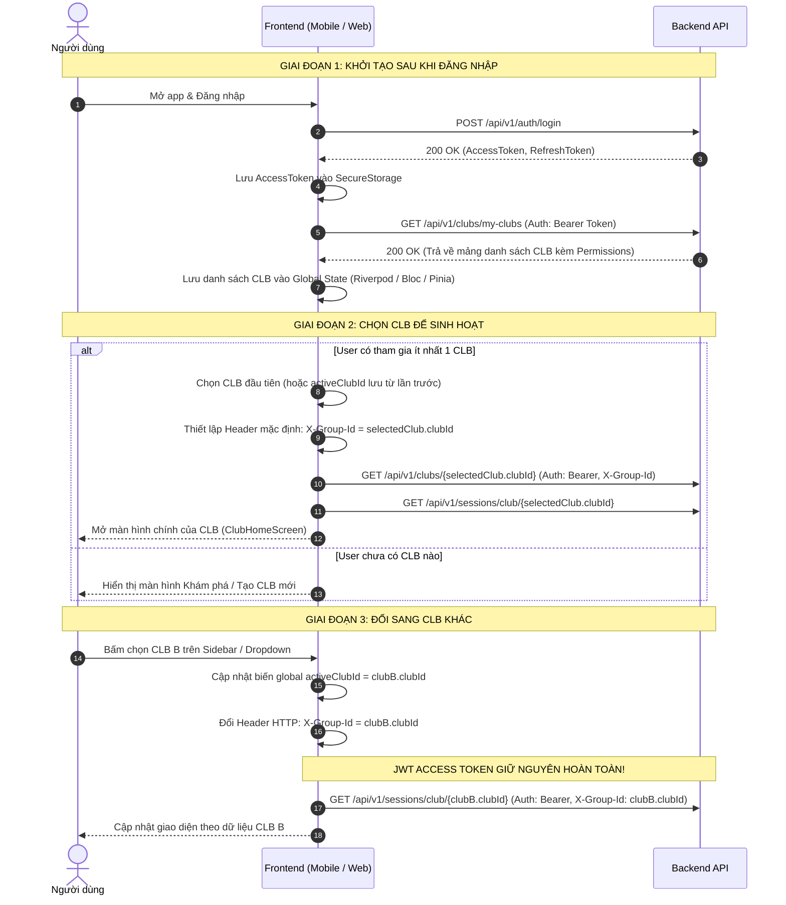

# HƯỚNG DẪN TÍCH HỢP FRONTEND: KIẾN TRÚC XÁC THỰC & PHÂN QUYỀN THEO NGỮ CẢNH (X-GROUP-ID)

Tài liệu này là quy chuẩn chính thức dành cho các lập trình viên Frontend (Flutter Mobile / Web) khi tích hợp với Backend LegendsTeamVN.BadmintonClub.

---

## 1. TỔNG QUAN KIẾN TRÚC (TẠI SAO BỎ SWITCH-CONTEXT?)

Hệ thống đã chuẩn hóa và tinh gọn cơ chế xác thực & phân quyền theo mô hình **Clean Context-Based Authorization**:

```
[1 ĐĂNG NHẬP (Login)] 
   └── Nhận 1 JWT Token duy nhất (Chỉ dùng cho AUTHENTICATION: định danh UserId, Email, UserName).
       Token này giữ nguyên xuyên suốt phiên làm việc, KHÔNG BAO GIỜ bị thay đổi khi đổi CLB.

[LẤY DỮ LIỆU NHÓM (GET /api/v1/clubs/my-clubs)]
   └── Nhận về danh sách CLB của tôi, kèm vai trò (Host, Thủ quỹ, Thành viên) và TOÀN BỘ mảng quyền hạn (permissions) của từng CLB.

[CHUYỂN ĐỔI NGỮ CẢNH (Context Switching)]
   └── BỎ HOÀN TOÀN API switch-context.
   └── Khi người dùng chọn CLB nào trên giao diện, FE chỉ cần gán Header HTTP:
       X-Group-Id: <CLUB_GUID>
```

### Lợi ích vượt trội cho đội ngũ FE:
- **Không còn bài toán quản lý đa Token**: FE không phải lưu trữ, đồng bộ hoặc tráo đổi Token khi người dùng lướt qua lại giữa nhiều CLB.
- **Refresh Token đơn giản**: Chỉ cần 1 cơ chế Refresh Token duy nhất của tài khoản.
- **Phân quyền Realtime**: Khi Host thay đổi quyền hoặc xóa người dùng khỏi nhóm, Backend lập tức cập nhật trong Redis Cache. Request tiếp theo mang `X-Group-Id` sẽ bị chặn ngay (`403 Forbidden`) mà không bị kẹt bởi Token cũ.

---

## 2. LUỒNG TOÀN TRÌNH TRÊN GIAO DIỆN (END-TO-END FLOW)



---

## 3. CHI TIẾT API `GET /api/v1/clubs/my-clubs`

* **Endpoint**: `GET /api/v1/clubs/my-clubs`
* **Headers**: `Authorization: Bearer <ACCESS_TOKEN>`
* **Mẫu Response `200 OK`**:
```json
[
  {
    "clubId": "b86fa2e7-03b6-4299-923c-a93108ce8968",
    "clubName": "CLB Cầu Lông Ba Đình",
    "clubCode": "CLB-BD01",
    "description": "Sân sinh hoạt 158 Hoàng Hoa Thám",
    "avatarUrl": "https://example.com/avatar1.png",
    "roleId": "e1586a65-1d02-4fc5-9118-28308bc25752",
    "roleName": "Host",
    "role": 0,
    "status": "ACTIVE",
    "joinedAt": "2026-10-12T07:00:00Z",
    "permissions": [
      "OPERATIONS.SESSION.VIEW",
      "OPERATIONS.SESSION.CREATE",
      "OPERATIONS.SESSION.UPDATE",
      "OPERATIONS.SESSION.DELETE",
      "OPERATIONS.BOOKING.MANAGE",
      "OPERATIONS.MATCH.MANAGE",
      "OPERATIONS.RECRUIT.MANAGE",
      "OPERATIONS.SCHEDULE.MANAGE",
      "FINANCE.LEDGER.VIEW",
      "FINANCE.LEDGER.MANAGE",
      "FINANCE.FEE.VIEW",
      "FINANCE.FEE.MANAGE",
      "FINANCE.BANK.MANAGE",
      "MEMBER.VIEW",
      "MEMBER.JOIN_REQUEST.MANAGE",
      "MEMBER.ROLE.MANAGE",
      "MEMBER.REMOVE",
      "MEMBER.INFO.UPDATE"
    ]
  },
  {
    "clubId": "9fa85f64-5717-4562-b3fc-2c963f66afa6",
    "clubName": "CLB Cầu Lông Tân Bình",
    "clubCode": "CLB-TB02",
    "description": "Sân Viettel Tân Bình",
    "avatarUrl": "https://example.com/avatar2.png",
    "roleId": "a2586a65-1d02-4fc5-9118-28308bc25799",
    "roleName": "Thành viên",
    "role": 1,
    "status": "ACTIVE",
    "joinedAt": "2026-10-15T10:00:00Z",
    "permissions": [
      "OPERATIONS.SESSION.VIEW",
      "MEMBER.VIEW"
    ]
  }
]
```

---

## 4. CODE MẪU CẤU HÌNH HTTP INTERCEPTOR

### 4.1. Dành cho Flutter (Dio)

```dart
import 'package:dio/dio.dart';

class ApiClient {
  static final Dio dio = Dio(BaseOptions(
    baseUrl: 'http://10.0.2.2:54796/api/v1', // Hoặc IP máy chủ
    connectTimeout: const Duration(seconds: 10),
    receiveTimeout: const Duration(seconds: 10),
  ));

  // Biến lưu ngữ cảnh CLB đang chọn trên toàn App
  static String? activeClubId;
  static String? accessToken;

  static void initialize() {
    dio.interceptors.add(InterceptorsWrapper(
      onRequest: (options, handler) {
        // 1. Luôn đính kèm Access Token nếu đã đăng nhập
        if (accessToken != null && accessToken!.isNotEmpty) {
          options.headers['Authorization'] = 'Bearer $accessToken';
        }

        // 2. Tự động đính kèm X-Group-Id nếu đang đứng trong ngữ cảnh của 1 CLB
        if (activeClubId != null && activeClubId!.isNotEmpty) {
          options.headers['X-Group-Id'] = activeClubId;
        }

        return handler.next(options);
      },
      onError: (DioException error, handler) {
        // Xử lý 401 (Refresh Token) hoặc 403 (Không có quyền trong nhóm này)
        if (error.response?.statusCode == 403) {
          // Thông báo: "Bạn không có quyền thực hiện thao tác này trong nhóm"
        }
        return handler.next(error);
      },
    ));
  }

  // Hàm chuyển đổi CLB: Chỉ cần gán lại biến, mọi API sau đó tự mang Header mới!
  static void switchClub(String newClubId) {
    activeClubId = newClubId;
  }
}
```

### 4.2. Dành cho Web / React Native (Axios)

```typescript
import axios from 'axios';

let currentClubId: string | null = null;
let currentToken: string | null = null;

export const api = axios.create({
  baseURL: 'http://localhost:54796/api/v1',
});

api.interceptors.request.use((config) => {
  if (currentToken) {
    config.headers.Authorization = `Bearer ${currentToken}`;
  }
  if (currentClubId) {
    config.headers['X-Group-Id'] = currentClubId;
  }
  return config;
});

// Hàm đổi nhóm cực kỳ tinh gọn:
export const switchClub = (clubId: string) => {
  currentClubId = clubId;
};
```

---

## 5. PHÂN QUYỀN GIAO DIỆN (UI CONDITIONAL RENDERING)

FE không cần tự tính toán logic vai trò (`isHost`, `isTreasurer`) bằng code if/else thủ công, mà dựa trực tiếp vào mảng `permissions` trả về từ `GET /api/v1/clubs/my-clubs`:

```dart
// Helper kiểm tra quyền trong CLB hiện tại
bool hasPermission(ClubModel currentClub, String permissionCode) {
  return currentClub.permissions.contains(permissionCode);
}

// 1. Nút "Chỉnh sửa lịch cố định tuần"
if (hasPermission(currentClub, 'OPERATIONS.SCHEDULE.MANAGE'))
  ElevatedButton(
    onPressed: () => openEditScheduleDialog(),
    child: Text('Cài đặt lịch tuần'),
  );

// 2. Nút "Tạo buổi tập đột xuất"
if (hasPermission(currentClub, 'OPERATIONS.SESSION.CREATE'))
  FloatingActionButton(
    onPressed: () => openCreateSessionSheet(),
    child: Icon(Icons.add),
  );

// 3. Tab "Sổ quỹ & Thu chi"
if (hasPermission(currentClub, 'FINANCE.LEDGER.VIEW'))
  Tab(text: 'Sổ quỹ CLB');
```

---

## 6. DANH SÁCH CÁC ENDPOINT VÀ YÊU CẦU HEADER

| Nhóm Chức Năng | Method | Endpoint | Yêu cầu `Authorization` | Yêu cầu `X-Group-Id` | Ghi Chú |
| :--- | :--- | :--- | :--- | :--- | :--- |
| **Đăng nhập** | `POST` | `/api/v1/auth/login` | Không | Không | Cấp Token toàn cục |
| **CLB của tôi** | `GET` | `/api/v1/clubs/my-clubs` | **Có** | Không | Lấy danh sách CLB & quyền |
| **Tạo CLB mới** | `POST` | `/api/v1/clubs` | **Có** | Không | Tự động gán Host |
| **Cập nhật thông tin CLB** | `PUT` | `/api/v1/clubs/{id}` | **Có** | **Có** (`X-Group-Id`) | Yêu cầu quyền `MEMBER.INFO.UPDATE` |
| **Cập nhật lịch tuần** | `PUT` | `/api/v1/clubs/{id}/schedules` | **Có** | **Có** (`X-Group-Id`) | Tự sinh buổi tập 14 ngày tới |
| **Xem danh sách buổi tập** | `GET` | `/api/v1/sessions/club/{clubId}` | **Có** | Khuyến nghị có | Lấy danh sách kèo đấu |
| **Xem chi tiết 1 buổi tập** | `GET` | `/api/v1/sessions/{sessionId}` | **Có** | Không bắt buộc | Nhận diện qua `sessionId` |
| **Đăng ký giữ chỗ (Vote)** | `POST` | `/api/v1/sessions/{sessionId}/bookings` | **Có** | Không bắt buộc | Nhận diện qua `sessionId` |
| **Cập nhật thông số buổi** | `PUT` | `/api/v1/sessions/{sessionId}` | **Có** | **Có** (`X-Group-Id`) | Yêu cầu quyền Host/Quản lý |
| **Điểm danh người chơi** | `POST` | `/api/v1/sessions/{sessionId}/attendance` | **Có** | **Có** (`X-Group-Id`) | Quyền `OPERATIONS.BOOKING.MANAGE` |
| **Điều phối xoay tua sân** | `POST` | `/api/v1/sessions/{sessionId}/rotation/next` | **Có** | **Có** (`X-Group-Id`) | Quyền `OPERATIONS.MATCH.MANAGE` |
