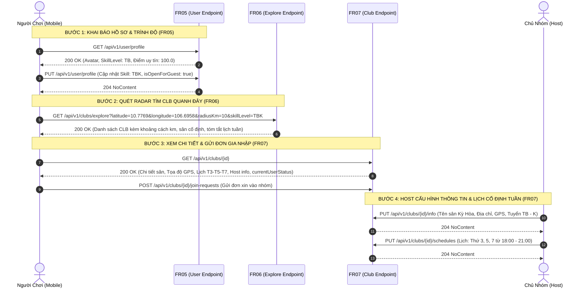
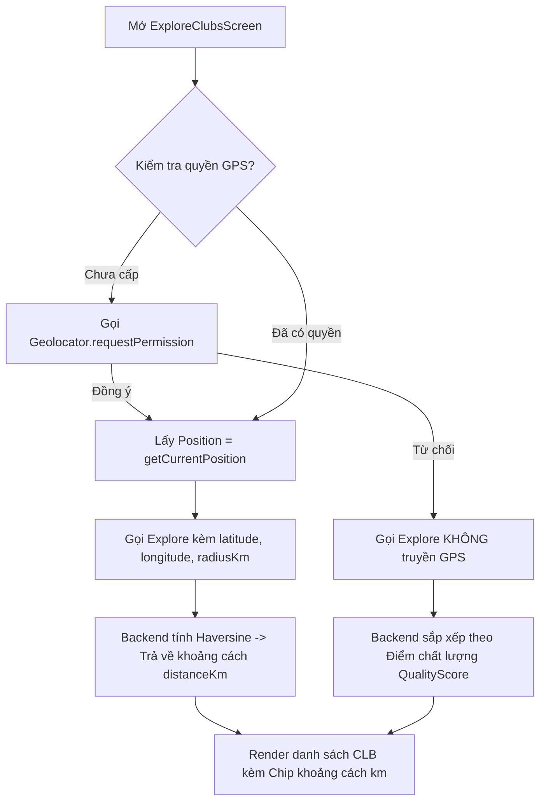
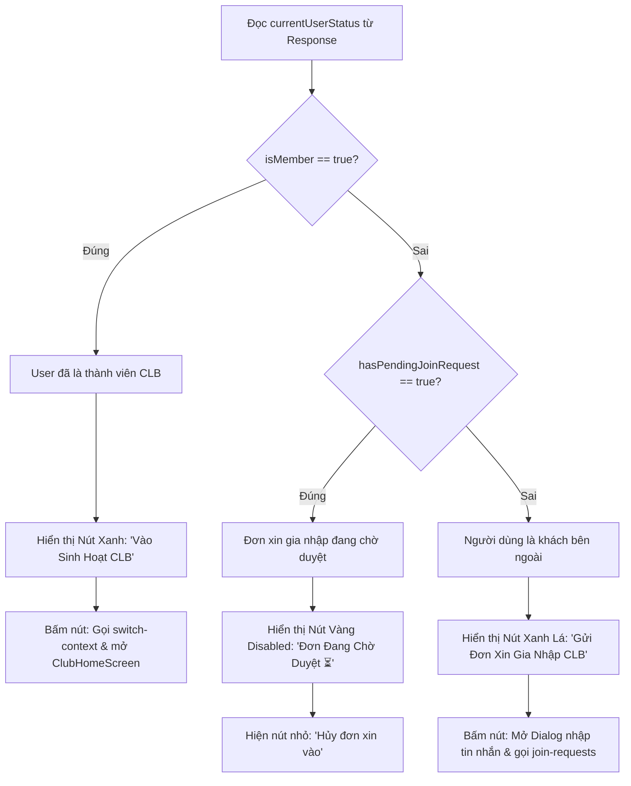

# 🏸 ĐẶC TẢ KỸ THUẬT CHI TIẾT: PHÂN HỆ 1 - HỒ SƠ CÁ NHÂN & TÌM KIẾM CLB QUANH ĐÂY (FR05 - FR06 - FR07)

> **Dự án**: Hệ thống Quản lý Nhóm Cầu Lông Phong Trào (**LegendsTeamVN.BadmintonClub**)  
> **Tài liệu độc lập dành cho Mobile**: Flutter Team (`c:\code\base_fe\KLTN2026-2027\KLTN2026-2027`)  
> **Trạng thái Backend**: 100% Hoàn thành, 37/37 Unit Tests PASS, Đã phân tách Swagger Tags chuẩn từng FR  
> **Cổng API nội bộ**: `http://192.168.1.24:54796/api/v1` (hoặc `http://localhost:54796/api/v1`)  
> **Swagger UI**: `http://localhost:54796/swagger`

---

## 📑 MỤC LỤC PHÂN HỆ
1. [Tổng Quan Nghiệp Vụ & Sơ Đồ Luồng Hoạt Động (User Journey)](#1-tổng-quan-nghiệp-vụ--sơ-đồ-luồng-hoạt-động)
2. [Bảng Tra Cứu Nhanh 5 Đầu API Mới](#2-bảng-tra-cứu-nhanh-5-đầu-api-mới)
3. [Đặc Tả Chi Tiết Cách Dùng Thông Tin Từng API Vào Luồng Chức Năng Mobile](#3-đặc-tả-chi-tiết-cách-dùng-thông-tin-từng-api-vào-luồng-chức-năng-mobile)
   - [3.1. FR05 - Xem Hồ Sơ & Trình Độ Cá Nhân (`GET /api/v1/user/profile`)](#31-fr05---xem-hồ-sơ--trình-độ-cá-nhân-get-apiv1userprofile)
   - [3.2. FR05 - Cập Nhật Avatar, Thông Tin & Trình Độ (`PUT /api/v1/user/profile`)](#32-fr05---cập-nhật-avatar-thông-tin--trình-độ-put-apiv1userprofile)
   - [3.3. FR06 - Quét Radar Tìm CLB Quanh Vị Trí GPS & Bán Kính (`GET /api/v1/clubs/explore`)](#33-fr06---quét-radar-tìm-clb-quanh-vị-trí-gps--bán-kính-get-apiv1clubsexplore)
   - [3.4. FR07 - Xem Chi Tiết CLB Đầy Đủ (Sân, Lịch Tuần, Host, Sĩ Số) (`GET /api/v1/clubs/{id}`)](#34-fr07---xem-chi-tiết-clb-đầy-đủ-get-apiv1clubsid)
   - [3.5. FR07 - Host Cấu Hình Sân Bãi Cố Định, Tọa Độ GPS & Tiêu Chuẩn (`PUT /api/v1/clubs/{id}/info`)](#35-fr07---host-cấu-hình-sân-bãi-cố-định-tọa-độ-gps--tiêu-chuẩn-put-apiv1clubsidinfo)
   - [3.6. FR07 - Host Thiết Lập Lịch Sinh Hoạt Định Kỳ Hàng Tuần (`PUT /api/v1/clubs/{id}/schedules`)](#36-fr07---host-thiết-lập-lịch-sinh-hoạt-định-kỳ-hàng-tuần-put-apiv1clubsidschedules)
4. [Bảng Tra Cứu Toàn Bộ Mã Trình Độ Chuẩn Hóa (`SkillLevel`)](#4-bảng-tra-cứu-toàn-bộ-mã-trình-độ-chuẩn-hóa-skilllevel)
5. [Hướng Dẫn Triển Khai Code Mobile Flutter (Dart Models, Datasource & Riverpod VM)](#5-hướng-dẫn-triển-khai-code-mobile-flutter)
6. [Kế Hoạch & Checklist Nghiệm Thu E2E (E2E Integration Checklist)](#6-kế-hoạch--checklist-nghiệm-thu-e2e)

---

## 1. Tổng Quan Nghiệp Vụ & Sơ Đồ Luồng Hoạt Động

Phân hệ này giải quyết trọn vẹn bài toán **"Người chơi tham gia hệ sinh thái cầu lông phong trào"** từ lúc hoàn thiện hồ sơ cá nhân, khai báo trình độ, đến lúc bật định vị GPS quét tìm nhóm chơi phù hợp xung quanh, xem lịch sinh hoạt định kỳ tuần và nộp đơn gia nhập.



---

## 2. Bảng Tra Cứu Nhanh 5 Đầu API Mới

| FR | Method | Endpoint | Swagger Group / Tag | Quyền Hạn / Auth | Mô Tả Nghiệp Vụ |
| :--- | :--- | :--- | :--- | :--- | :--- |
| **FR05** | `GET` | `/api/v1/user/profile` | `FR05 - Quản lý hồ sơ cá nhân & Trình độ` | `Bearer Token` | Xem hồ sơ cá nhân, trình độ tự đánh giá (`SkillLevel`) và điểm uy tín ⭐ 100.0 |
| **FR05** | `PUT` | `/api/v1/user/profile` | `FR05 - Quản lý hồ sơ cá nhân & Trình độ` | `Bearer Token` | Cập nhật họ tên, giới tính, avatar, trình độ (`SkillLevel`), mở nhận khách |
| **FR06** | `GET` | `/api/v1/clubs/explore` | `FR06 - Khám phá nhóm theo vị trí` | `Bearer Token` | Quét radar tìm CLB quanh tọa độ GPS theo bán kính `radiusKm` (Haversine) |
| **FR07** | `GET` | `/api/v1/clubs/{id}` | `FR07 - Thông tin chi tiết & Lịch sinh hoạt nhóm` | `Bearer Token` | Xem chi tiết CLB đầy đủ: sân bãi, lịch định kỳ tuần, Host, sĩ số, trạng thái cá nhân |
| **FR07** | `PUT` | `/api/v1/clubs/{id}/info` | `FR07 - Thông tin chi tiết & Lịch sinh hoạt nhóm` | `MEMBER.INFO.UPDATE` | Host cấu hình sân sinh hoạt cố định, địa chỉ, GPS, tiêu chuẩn tuyển chọn |
| **FR07** | `PUT` | `/api/v1/clubs/{id}/schedules` | `FR07 - Thông tin chi tiết & Lịch sinh hoạt nhóm` | `OPERATIONS.SCHEDULE.MANAGE` | Host thiết lập các khung giờ sinh hoạt cố định lặp lại hàng tuần của nhóm |

---

## 3. Đặc Tả Chi Tiết Cách Dùng Thông Tin Từng Đầu API Vào Luồng Chức Năng Mobile

---

### 3.1. FR05 - Xem Hồ Sơ & Trình Độ Cá Nhân (`GET /api/v1/user/profile`)

- **Đường dẫn**: `GET /api/v1/user/profile`
- **Swagger Group**: `FR05 - Quản lý hồ sơ cá nhân & Trình độ`
- **Màn hình kích hoạt**: Tab "Hồ sơ / Tài khoản" (`ProfileScreen`) khi khởi tạo (`initState`), hoặc khi mở màn hình "Chỉnh sửa hồ sơ" (`EditProfileScreen`).
- **Yêu cầu Headers**: `Authorization: Bearer <ACCESS_TOKEN>`
- **Phản hồi Thành công `200 OK`**:
  ```json
  {
    "id": "3fa85f64-5717-4562-b3fc-2c963f66afa6",
    "fullName": "Nguyễn Văn A",
    "userName": "nguyenvana",
    "email": "nguyenvana@gmail.com",
    "phoneNumber": "0987654321",
    "gender": 1,
    "avatarUrl": "https://example.com/avatar.jpg",
    "skillLevel": "TB",
    "skillLevelName": "Trung bình",
    "isOpenForGuest": true,
    "reputationScore": 100.0
  }
  ```

#### 📊 Bảng Ánh Xạ Dữ Liệu Lên Giao Diện Mobile (UI Binding Table):
| Trường Dữ Liệu | Kiểu Dữ Liệu | Widget Mobile Sử Dụng | Cách Dùng & Logic Nghiệp Vụ |
| :--- | :--- | :--- | :--- |
| `fullName` | `string` | `Text(fullName, style: textHeader1)` | Hiển thị họ tên lớn ở đầu trang; fill vào `nameController.text` khi bấm sửa. |
| `avatarUrl` | `string?` | `CircleAvatar(backgroundImage: ...)` | Hiển thị ảnh đại diện người chơi; nếu `null` hiển thị chữ cái đầu tiên của họ tên. |
| `gender` | `short` | `RadioListTile` / `Chip` | `0`: Khác, `1`: Nam, `2`: Nữ; render icon giới tính tương ứng (♂ / ♀). |
| `skillLevel` | `string` | `SkillBadge(level: skillLevel)` | Mã trình độ (`NB`..`G`); render huy hiệu trình độ với màu tương ứng (ví dụ: `TB` màu xanh dương). |
| `skillLevelName` | `string` | `Text(skillLevelName)` | Tên tiếng Việt thân thiện (ví dụ: *"Trung bình"*). |
| `isOpenForGuest` | `bool` | `SwitchListTile(value: ...)` | Toggle switch *"Sẵn sàng nhận kèo giao lưu"*. Khi người dùng bật, hồ sơ sẽ xuất hiện trên radar tìm khách vãng lai. |
| `reputationScore` | `double` | `Chip(avatar: Icon(Icons.star), ...)` | Điểm uy tín tín nhiệm (mặc định 100.0 điểm). Nếu < 80 đổi sang màu vàng cảnh báo. |

#### 🔄 Luồng Dữ Liệu Kế Tiếp (Next Steps Flow):
1. **Lưu State Toàn Cục**: Phía Mobile lưu `skillLevel` vào `currentUserSkillLevelProvider`.
2. **Tự Động Gợi Ý CLB (FR06)**: Khi người dùng chuyển sang Tab "Khám phá", Mobile tự động truyền `skillLevel={profile.skillLevel}` vào API `/api/v1/clubs/explore` để ưu tiên các CLB vừa tầm trình độ.
3. **Mở Màn Hình Sửa Hồ Sơ**: Khi bấm nút "Chỉnh sửa", truyền đối tượng `UserProfileResponseDto` sang `EditProfileScreen` để khởi tạo giá trị ban đầu cho các Controller mà không cần gọi API lần 2.

- **Lệnh cURL kiểm thử nhanh**:
  ```bash
  curl -X GET "http://localhost:54796/api/v1/user/profile" \
       -H "Authorization: Bearer YOUR_ACCESS_TOKEN"
  ```

---

### 3.2. FR05 - Cập Nhật Avatar, Thông Tin & Trình Độ (`PUT /api/v1/user/profile`)

- **Đường dẫn**: `PUT /api/v1/user/profile`
- **Swagger Group**: `FR05 - Quản lý hồ sơ cá nhân & Trình độ`
- **Màn hình kích hoạt**: Màn hình "Chỉnh sửa hồ sơ" (`EditProfileScreen`) khi người dùng nhấn nút **"Lưu thay đổi"**.
- **Yêu cầu Headers**: `Authorization: Bearer <ACCESS_TOKEN>`, `Content-Type: application/json`
- **Request Body JSON**:
  ```json
  {
    "fullName": "Nguyễn Văn A",
    "gender": 1,
    "avatarUrl": "https://example.com/avatar_new.jpg",
    "skillLevel": "TBK",
    "isOpenForGuest": true
  }
  ```

#### 🛡️ Kiểm Tra Dữ Liệu Phía Mobile Trước Khi Gửi (Client Validation):
- `fullName`: Không được để trống, độ dài từ 1 đến 100 ký tự.
- `gender`: Giá trị thuộc tập `[0, 1, 2]`.
- `skillLevel`: Bắt buộc chọn từ Dropdown (1 trong 7 mã: `NB, Y, TBY, TB, TBK, K, G`).
- `avatarUrl`: Nếu người dùng vừa chọn ảnh mới từ thư viện máy -> Gọi API Upload ảnh trước để lấy URL -> gán URL vào trường này.

#### 🔄 Luồng Xử Lý Sau Khi Lưu Thành Công (`204 NoContent`):
1. Mobile hiển thị `SnackBar` xanh lá thông báo: *"Cập nhật hồ sơ và trình độ thành công! 🎉"*.
2. Gọi `ref.invalidate(userProfileViewModelProvider)` để trigger lại `GET /api/v1/user/profile`, đồng bộ hóa dữ liệu mới toàn ứng dụng.
3. Gọi `Navigator.pop(context)` quay về màn hình `ProfileScreen`, toàn bộ Tên, Badge trình độ và Switch trạng thái được vẽ lại tức thì.

- **Trường hợp lỗi nghiệp vụ (RFC 7807)**:
  - `400 Bad Request`:
    ```json
    {
      "type": "https://tools.ietf.org/html/rfc7231#section-6.5.1",
      "title": "Bad Request",
      "status": 400,
      "detail": "Trình độ tự đánh giá không hợp lệ. Các giá trị hợp lệ: NB, Y, TBY, TB, TBK, K, G.",
      "errors": {
        "SkillLevel": ["Trình độ tự đánh giá không hợp lệ. Các giá trị hợp lệ: NB, Y, TBY, TB, TBK, K, G."]
      }
    }
    ```
- **Lệnh cURL kiểm thử nhanh**:
  ```bash
  curl -X PUT "http://localhost:54796/api/v1/user/profile" \
       -H "Authorization: Bearer YOUR_ACCESS_TOKEN" \
       -H "Content-Type: application/json" \
       -d '{"fullName":"Nguyễn Văn A","gender":1,"avatarUrl":"https://example.com/avatar.jpg","skillLevel":"TBK","isOpenForGuest":true}'
  ```

---

### 3.3. FR06 - Quét Radar Tìm CLB Quanh Vị Trí GPS & Bán Kính (`GET /api/v1/clubs/explore`)

- **Đường dẫn**: `GET /api/v1/clubs/explore`
- **Swagger Group**: `FR06 - Khám phá nhóm theo vị trí`
- **Màn hình kích hoạt**: Tab "Khám phá câu lạc bộ" (`ExploreClubsScreen`) khi mở màn hình, khi trượt thanh Slider đổi bán kính quét, hoặc khi gõ từ khóa tìm kiếm.
- **Yêu cầu Headers**: `Authorization: Bearer <ACCESS_TOKEN>`
- **Query Parameters**:
  | Tham Số | Kiểu Dữ Liệu | Bắt Buộc | Mặc Định | Mô Tả |
  | :--- | :--- | :--- | :--- | :--- |
  | `latitude` | `double?` | Không | `null` | Vĩ độ GPS hiện tại của thiết bị (ví dụ: `10.7769`) |
  | `longitude` | `double?` | Không | `null` | Kinh độ GPS hiện tại của thiết bị (ví dụ: `106.6958`) |
  | `radiusKm` | `double?` | Không | `10.0` | Bán kính quét tìm kiếm tính bằng km (tối đa: `100.0` km) |
  | `skillLevel` | `string?` | Không | `null` | Lọc CLB phù hợp trình độ (`NB`, `Y`, `TBY`, `TB`, `TBK`, `K`, `G`) |
  | `isRecruiting` | `bool?` | Không | `null` | Lọc nhóm đang mở tuyển thêm thành viên (`true`/`false`) |
  | `searchTerm` | `string?` | Không | `null` | Tìm kiếm tự do theo tên CLB, tên sân, hoặc địa chỉ quận/huyện |

#### 🛰️ Quy Trình Lấy Tọa Độ GPS & Xử Lý Fallback Trên Mobile:


#### 📊 Bảng Ánh Xạ Dữ Liệu Vào Thẻ CLB (`ClubCardWidget`):
| Trường Dữ Liệu | Kiểu Dữ Liệu | Widget Mobile Sử Dụng | Cách Dùng & Logic Nghiệp Vụ |
| :--- | :--- | :--- | :--- |
| `id` | `Guid` | `onTap: () => context.push('/clubs/$id')` | **Khóa chính**: Bắt sự kiện người dùng bấm vào Card để điều hướng sang `ClubDetailScreen(clubId: id)`. |
| `groupName` | `string` | `Text(groupName, style: textTitle)` | Tên câu lạc bộ cầu lông. |
| `avatarUrl` | `string?` | `ClipRRect(child: Image.network(...))` | Ảnh đại diện/logo CLB; nếu null render ảnh sân cầu lông mặc định. |
| `distanceKm` | `double?` | `Chip(label: Text('📍 ${distanceKm.toStringAsFixed(1)} km'))` | Cự ly thực tế tính theo giải thuật Haversine. Nếu `null` (do user tắt GPS) thì ẩn Chip này đi. |
| `fixedVenueName` & `fixedAddress` | `string?` | `Text(fixedVenueName)` & `Text(fixedAddress)` | Tên sân và địa chỉ cụ thể nơi nhóm sinh hoạt cố định. |
| `schedulesSummary` | `string?` | `Row(children: [Icon(Icons.calendar_today), Text(schedulesSummary)])` | Chuỗi tóm tắt lịch cố định tuần (ví dụ: *"T3, T5, T7 (18:00 - 21:00)"*). |
| `minSkillLevel` - `maxSkillLevel` | `string?` | `Text('Trình độ: $minSkillLevel - $maxSkillLevel')` | Khoảng trình độ của CLB. So sánh với `profile.skillLevel` của người dùng: Nếu người dùng yếu hơn `minSkillLevel`, hiển thị icon cảnh báo nhẹ: *"Kèo có thể hơi nặng so với bạn"*. |
| `isRecruiting` | `bool` | `Badge(label: Text(isRecruiting ? 'Đang tuyển' : 'Đủ quân'))` | `true` = Badge xanh lá; `false` = Badge xám. |
| `memberCount` | `int` | `Text('👥 $memberCount thành viên')` | Tổng số thành viên hiện tại của CLB. |

- **Lệnh cURL kiểm thử nhanh**:
  ```bash
  curl -X GET "http://localhost:54796/api/v1/clubs/explore?latitude=10.7769&longitude=106.6958&radiusKm=10" \
       -H "Authorization: Bearer YOUR_ACCESS_TOKEN"
  ```

---

### 3.4. FR07 - Xem Chi Tiết CLB Đầy Đủ (`GET /api/v1/clubs/{id}`)

- **Đường dẫn**: `GET /api/v1/clubs/{id:guid}`
- **Swagger Group**: `FR07 - Thông tin chi tiết & Lịch sinh hoạt nhóm`
- **Màn hình kích hoạt**: Màn hình "Chi tiết Câu lạc bộ" (`ClubDetailScreen`) khi người dùng bấm vào một Card CLB từ màn hình Explore, hoặc từ danh sách CLB của tôi.
- **Yêu cầu Headers**: `Authorization: Bearer <ACCESS_TOKEN>`
- **Phản hồi Thành công `200 OK`**:
  ```json
  {
    "id": "b86fa2e7-03b6-4299-923c-a93108ce8968",
    "groupName": "CLB Cầu Lông Chiến Binh Quận 10",
    "code": "CLB-CBQ10",
    "description": "Nhóm sinh hoạt phong trào vui vẻ, đề cao tinh thần giao lưu học hỏi, tôn trọng đồng đội.",
    "avatarUrl": "https://example.com/club1.jpg",
    "fixedVenueName": "Sân Cầu Lông Kỳ Hòa",
    "fixedAddress": "238 Đường 3/2, Phường 12, Quận 10, TP.HCM",
    "lat": 10.7769,
    "lng": 106.6958,
    "minSkillLevel": "TB",
    "maxSkillLevel": "K",
    "qualityScore": 4.8,
    "isRecruiting": true,
    "memberCount": 24,
    "host": {
      "userId": "1a2b3c4d-5e6f-7a8b-9c0d-1e2f3a4b5c6d",
      "fullName": "Trần Trưởng Nhóm",
      "avatarUrl": "https://example.com/host.jpg",
      "phoneNumber": "0909123456"
    },
    "schedules": [
      {
        "id": "f1e2d3c4-...",
        "dayOfWeek": 2,
        "dayName": "Thứ ba",
        "startTime": "18:00",
        "endTime": "21:00",
        "isActive": true
      }
    ],
    "currentUserStatus": {
      "isMember": false,
      "roleName": null,
      "hasPendingJoinRequest": true,
      "pendingRequestId": "7e3a2b1c-..."
    }
  }
  ```

#### 🚦 Logic Rẽ Nhánh Nút Thao Tác Đáy Màn Hình (`Bottom Action Bar`):
Đối tượng **`currentUserStatus`** là thông tin sống còn để Mobile quyết định giao diện tương tác:



#### 🎯 Cách Sử Dụng Các Trường Thông Tin Khác Trong Màn Hình:
- **`code`**: Hiển thị kèm `IconButton(Icons.copy)` cho phép sao chép mã nhóm chia sẻ qua Zalo/Facebook.
- **`lat`, `lng`**: Nút *"Chỉ đường tới sân"* -> Gọi `url_launcher` mở ứng dụng Google Maps trực tiếp:
  ```dart
  final url = 'https://www.google.com/maps/search/?api=1&query=${club.lat},${club.lng}';
  if (await canLaunchUrl(Uri.parse(url))) await launchUrl(Uri.parse(url));
  ```
- **`host.phoneNumber`**: Nút *"Gọi điện cho Trưởng nhóm"* -> Gọi `url_launcher`:
  ```dart
  launchUrl(Uri.parse('tel:${club.host.phoneNumber}'));
  ```
- **`schedules`**: Render danh sách `Card` thể hiện các ngày cố định tuần: Icon bóng cầu, Tên thứ (`dayName`), Khung giờ sinh hoạt (`startTime` - `endTime`).
- **Phân Quyền Nút Quản Trị Trên AppBar**:
  - Nếu `currentUserStatus.isMember == true` VÀ trong Token có quyền `MEMBER.INFO.UPDATE`: Hiển thị icon ⚙️ "Cài đặt nhóm" (mở màn hình `ClubSettingsScreen`).
  - Nếu có quyền `OPERATIONS.SCHEDULE.MANAGE`: Hiển thị icon 📅 "Sửa lịch tuần" (mở `ManageClubSchedulesScreen`).

- **Lệnh cURL kiểm thử nhanh**:
  ```bash
  curl -X GET "http://localhost:54796/api/v1/clubs/b86fa2e7-03b6-4299-923c-a93108ce8968" \
       -H "Authorization: Bearer YOUR_ACCESS_TOKEN"
  ```

---

### 3.5. FR07 - Host Cấu Hình Sân Bãi Cố Định, Tọa Độ GPS & Tiêu Chuẩn (`PUT /api/v1/clubs/{id}/info`)

- **Đường dẫn**: `PUT /api/v1/clubs/{id:guid}/info`
- **Swagger Group**: `FR07 - Thông tin chi tiết & Lịch sinh hoạt nhóm`
- **Quyền hạn yêu cầu**: `MEMBER.INFO.UPDATE`
- **Màn hình kích hoạt**: Màn hình "Cài đặt thông tin nhóm" (`ClubSettingsScreen`), chỉ hiển thị với Host/Admin có quyền `MEMBER.INFO.UPDATE`.
- **Yêu cầu Headers**: `Authorization: Bearer <ACCESS_TOKEN>`, `X-Group-Id: <CLUB_ID>`, `Content-Type: application/json`
- **Request Body JSON**:
  ```json
  {
    "groupName": "CLB Cầu Lông Chiến Binh Quận 10",
    "description": "Nhóm sinh hoạt phong trào vui vẻ, đề cao tinh thần giao lưu học hỏi.",
    "avatarUrl": "https://example.com/club_avatar.jpg",
    "fixedVenueName": "Sân Cầu Lông Kỳ Hòa",
    "fixedAddress": "238 Đường 3/2, Phường 12, Quận 10, TP.HCM",
    "lat": 10.7769,
    "lng": 106.6958,
    "minSkillLevel": "TB",
    "maxSkillLevel": "K",
    "isRecruiting": true
  }
  ```

#### 🗺️ Tích Hợp Bản Đồ Chọn Tọa Độ Sân:
1. Trên giao diện Mobile, cạnh ô nhập `lat` và `lng` có nút **"Chọn vị trí trên bản đồ"**.
2. Mở màn hình Google Maps / OpenStreetMap cho Host kéo ghim thả vào vị trí sân cầu lông.
3. Khi Host bấm "Xác nhận vị trí", tự động gán tọa độ vào `lat` và `lng` của Form.
4. Khi bấm "Lưu cấu hình" -> Gọi API -> Nhận `204 NoContent`.
5. Mobile gọi `ref.invalidate(clubDetailViewModelProvider(id))` và `Navigator.pop(context)`. Người ngoài quét radar Explore lập tức thấy vị trí sân mới.

- **Lệnh cURL kiểm thử nhanh**:
  ```bash
  curl -X PUT "http://localhost:54796/api/v1/clubs/b86fa2e7-03b6-4299-923c-a93108ce8968/info" \
       -H "Authorization: Bearer YOUR_ACCESS_TOKEN" \
       -H "X-Group-Id: b86fa2e7-03b6-4299-923c-a93108ce8968" \
       -H "Content-Type: application/json" \
       -d '{"groupName":"CLB Chiến Binh Q10","fixedVenueName":"Sân Kỳ Hòa","fixedAddress":"238 Đường 3/2 Q10","lat":10.7769,"lng":106.6958,"minSkillLevel":"TB","maxSkillLevel":"K","isRecruiting":true}'
  ```

---

### 3.6. FR07 - Host Thiết Lập Lịch Sinh Hoạt Định Kỳ Hàng Tuần (`PUT /api/v1/clubs/{id}/schedules`)

- **Đường dẫn**: `PUT /api/v1/clubs/{id:guid}/schedules`
- **Swagger Group**: `FR07 - Thông tin chi tiết & Lịch sinh hoạt nhóm`
- **Quyền hạn yêu cầu**: `OPERATIONS.SCHEDULE.MANAGE`
- **Màn hình kích hoạt**: Màn hình "Quản lý lịch định kỳ" (`ManageClubSchedulesScreen`), chỉ dành cho Host/Admin có quyền `OPERATIONS.SCHEDULE.MANAGE`.
- **Yêu cầu Headers**: `Authorization: Bearer <ACCESS_TOKEN>`, `X-Group-Id: <CLUB_ID>`, `Content-Type: application/json`
- **Request Body JSON**:
  ```json
  {
    "schedules": [
      { "dayOfWeek": 2, "startTime": "18:00", "endTime": "21:00" },
      { "dayOfWeek": 4, "startTime": "18:00", "endTime": "21:00" },
      { "dayOfWeek": 6, "startTime": "18:00", "endTime": "21:00" }
    ]
  }
  ```

#### ⏰ Thiết Kế Widget Chọn Lịch Trên Mobile:
1. Danh sách 7 ngày trong tuần với Checkbox tương ứng (T2, T3, T4, T5, T6, T7, CN).
2. Khi tích chọn ngày nào (ví dụ: T3), hiển thị 2 ô `TimePicker`: Giờ bắt đầu (`18:00`) và Giờ kết thúc (`21:00`).
3. Client validate: Giờ kết thúc phải sau giờ bắt đầu.
4. Khi bấm **"Lưu lịch tuần"** -> Gửi mảng `schedules` lên backend -> Nhận `204 NoContent`.
5. Gọi `ref.invalidate(clubDetailViewModelProvider(id))` để màn hình chi tiết CLB cập nhật danh sách lịch mới ngay lập tức.

- **Lệnh cURL kiểm thử nhanh**:
  ```bash
  curl -X PUT "http://localhost:54796/api/v1/clubs/b86fa2e7-03b6-4299-923c-a93108ce8968/schedules" \
       -H "Authorization: Bearer YOUR_ACCESS_TOKEN" \
       -H "X-Group-Id: b86fa2e7-03b6-4299-923c-a93108ce8968" \
       -H "Content-Type: application/json" \
       -d '{"schedules":[{"dayOfWeek":2,"startTime":"18:00","endTime":"21:00"},{"dayOfWeek":4,"startTime":"18:00","endTime":"21:00"},{"dayOfWeek":6,"startTime":"18:00","endTime":"21:00"}]}'
  ```

---

## 4. Bảng Tra Cứu Toàn Bộ Mã Trình Độ Chuẩn Hóa (`SkillLevel`)

Để toàn bộ hệ thống (Mobile App, Backend, Cơ sở dữ liệu và Thuật toán chia sân tự động) đồng bộ dữ liệu tuyệt đối, hệ thống quy định 7 bậc trình độ chuẩn sau:

| Mã Chuẩn (Code) | Tên Tiếng Việt | Mô Tả Kỹ Thuật Phong Trào | Màu Gợi Ý UI Flutter |
| :---: | :--- | :--- | :---: |
| **`NB`** | **Newbie** | Mới bắt đầu tiếp xúc bộ môn, chưa vững luật và kỹ thuật cơ bản | `#9E9E9E` (Grey) |
| **`Y`** | **Yếu** | Đã biết luật thi đấu, giao cầu và đập cầu cơ bản, di chuyển còn chậm | `#8BC34A` (Light Green) |
| **`TBY`** | **Trung bình yếu** | Đánh giải trí đều đặn, điều cầu ổn định nhưng chưa có chiến thuật sâu | `#4CAF50` (Green) |
| **`TB`** | **Trung bình** | Bậc phổ biến nhất; phông cầu sâu, bỏ nhỏ và đập cầu đạt độ ổn định | `#03A9F4` (Light Blue) |
| **`TBK`** | **Trung bình khá** | Đánh đôi chiến thuật tốt, phản xạ nhanh, tham gia các giải phong trào cọ xát | `#3F51B5` (Indigo) |
| **`K`** | **Khá** | Kỹ thuật toàn diện, thể lực dồi dào, thường đạt thành tích/huy chương giải | `#FF9800` (Orange) |
| **`G`** | **Giỏi / Bán chuyên** | Đẳng cấp cao, cựu vận động viên năng khiếu hoặc thi đấu bán chuyên | `#E91E63` (Pink/Red) |

---

## 5. Hướng Dẫn Triển Khai Code Mobile Flutter

Tài liệu này được viết tương thích 100% với cấu trúc thư mục hiện có của dự án Flutter tại `c:\code\base_fe\KLTN2026-2027\KLTN2026-2027`.

### 5.1. Khai báo Enum Trình Độ `SkillLevel` trong Flutter
Tạo file: `lib/data/dto/user/skill_level_enum.dart`:
```dart
enum SkillLevel {
  nb('NB', 'Newbie', 'Mới tập chơi'),
  y('Y', 'Yếu', 'Nắm luật cơ bản'),
  tby('TBY', 'Trung bình yếu', 'Phong trào giải trí'),
  tb('TB', 'Trung bình', 'Phong trào ổn định'),
  tbk('TBK', 'Trung bình khá', 'Chiến thuật tốt'),
  k('K', 'Khá', 'Kỹ thuật toàn diện'),
  g('G', 'Giỏi / Bán chuyên', 'Đẳng cấp bán chuyên');

  final String code;
  final String displayName;
  final String description;
  const SkillLevel(this.code, this.displayName, this.description);

  static SkillLevel fromCode(String? code) {
    return SkillLevel.values.firstWhere(
      (e) => e.code.toUpperCase() == code?.toUpperCase(),
      orElse: () => SkillLevel.nb,
    );
  }
}
```

---

### 5.2. Các DTO Models Dart Mới

#### 1. `UserProfileResponseDto` (`lib/data/dto/user/user_profile_response_dto.dart`):
```dart
class UserProfileResponseDto {
  final String id;
  final String fullName;
  final String userName;
  final String email;
  final String phoneNumber;
  final int gender;
  final String? avatarUrl;
  final String skillLevel;
  final String skillLevelName;
  final bool isOpenForGuest;
  final double reputationScore;

  UserProfileResponseDto({
    required this.id,
    required this.fullName,
    required this.userName,
    required this.email,
    required this.phoneNumber,
    required this.gender,
    this.avatarUrl,
    required this.skillLevel,
    required this.skillLevelName,
    required this.isOpenForGuest,
    required this.reputationScore,
  });

  factory UserProfileResponseDto.fromJson(Map<String, dynamic> json) {
    return UserProfileResponseDto(
      id: json['id'] as String,
      fullName: json['fullName'] as String? ?? '',
      userName: json['userName'] as String? ?? '',
      email: json['email'] as String? ?? '',
      phoneNumber: json['phoneNumber'] as String? ?? '',
      gender: (json['gender'] as num?)?.toInt() ?? 0,
      avatarUrl: json['avatarUrl'] as String?,
      skillLevel: json['skillLevel'] as String? ?? 'NB',
      skillLevelName: json['skillLevelName'] as String? ?? 'Newbie',
      isOpenForGuest: json['isOpenForGuest'] as bool? ?? false,
      reputationScore: (json['reputationScore'] as num?)?.toDouble() ?? 100.0,
    );
  }
}
```

#### 2. `UpdateUserProfileRequestDto` (`lib/data/dto/user/update_user_profile_request_dto.dart`):
```dart
class UpdateUserProfileRequestDto {
  final String fullName;
  final int gender;
  final String? avatarUrl;
  final String skillLevel;
  final bool isOpenForGuest;

  UpdateUserProfileRequestDto({
    required this.fullName,
    required this.gender,
    this.avatarUrl,
    required this.skillLevel,
    required this.isOpenForGuest,
  });

  Map<String, dynamic> toJson() => {
    'fullName': fullName,
    'gender': gender,
    'avatarUrl': avatarUrl,
    'skillLevel': skillLevel,
    'isOpenForGuest': isOpenForGuest,
  };
}
```

#### 3. `ExploreClubResponseDto` (`lib/data/dto/club/explore_club_response_dto.dart`):
```dart
class ExploreClubResponseDto {
  final String id;
  final String groupName;
  final String code;
  final String? description;
  final String? avatarUrl;
  final String? fixedVenueName;
  final String? fixedAddress;
  final double? distanceKm;
  final String? minSkillLevel;
  final String? maxSkillLevel;
  final int memberCount;
  final bool isRecruiting;
  final double qualityScore;
  final String? schedulesSummary;

  ExploreClubResponseDto({
    required this.id,
    required this.groupName,
    required this.code,
    this.description,
    this.avatarUrl,
    this.fixedVenueName,
    this.fixedAddress,
    this.distanceKm,
    this.minSkillLevel,
    this.maxSkillLevel,
    required this.memberCount,
    required this.isRecruiting,
    required this.qualityScore,
    this.schedulesSummary,
  });

  factory ExploreClubResponseDto.fromJson(Map<String, dynamic> json) {
    return ExploreClubResponseDto(
      id: json['id'] as String,
      groupName: json['groupName'] as String,
      code: json['code'] as String,
      description: json['description'] as String?,
      avatarUrl: json['avatarUrl'] as String?,
      fixedVenueName: json['fixedVenueName'] as String?,
      fixedAddress: json['fixedAddress'] as String?,
      distanceKm: (json['distanceKm'] as num?)?.toDouble(),
      minSkillLevel: json['minSkillLevel'] as String?,
      maxSkillLevel: json['maxSkillLevel'] as String?,
      memberCount: (json['memberCount'] as num?)?.toInt() ?? 0,
      isRecruiting: json['isRecruiting'] as bool? ?? false,
      qualityScore: (json['qualityScore'] as num?)?.toDouble() ?? 5.0,
      schedulesSummary: json['schedulesSummary'] as String?,
    );
  }
}
```

#### 4. `ClubDetailResponseDto` (`lib/data/dto/club/club_detail_response_dto.dart`):
```dart
class ClubDetailResponseDto {
  final String id;
  final String groupName;
  final String code;
  final String? description;
  final String? avatarUrl;
  final String? fixedVenueName;
  final String? fixedAddress;
  final double? lat;
  final double? lng;
  final String? minSkillLevel;
  final String? maxSkillLevel;
  final double qualityScore;
  final bool isRecruiting;
  final int memberCount;
  final ClubHostDto host;
  final List<ClubScheduleItemDto> schedules;
  final ClubCurrentUserStatusDto currentUserStatus;

  ClubDetailResponseDto({
    required this.id,
    required this.groupName,
    required this.code,
    this.description,
    this.avatarUrl,
    this.fixedVenueName,
    this.fixedAddress,
    this.lat,
    this.lng,
    this.minSkillLevel,
    this.maxSkillLevel,
    required this.qualityScore,
    required this.isRecruiting,
    required this.memberCount,
    required this.host,
    required this.schedules,
    required this.currentUserStatus,
  });

  factory ClubDetailResponseDto.fromJson(Map<String, dynamic> json) {
    return ClubDetailResponseDto(
      id: json['id'] as String,
      groupName: json['groupName'] as String,
      code: json['code'] as String,
      description: json['description'] as String?,
      avatarUrl: json['avatarUrl'] as String?,
      fixedVenueName: json['fixedVenueName'] as String?,
      fixedAddress: json['fixedAddress'] as String?,
      lat: (json['lat'] as num?)?.toDouble(),
      lng: (json['lng'] as num?)?.toDouble(),
      minSkillLevel: json['minSkillLevel'] as String?,
      maxSkillLevel: json['maxSkillLevel'] as String?,
      qualityScore: (json['qualityScore'] as num?)?.toDouble() ?? 5.0,
      isRecruiting: json['isRecruiting'] as bool? ?? false,
      memberCount: (json['memberCount'] as num?)?.toInt() ?? 0,
      host: ClubHostDto.fromJson(json['host'] as Map<String, dynamic>),
      schedules: (json['schedules'] as List<dynamic>? ?? [])
          .map((e) => ClubScheduleItemDto.fromJson(e as Map<String, dynamic>))
          .toList(),
      currentUserStatus: ClubCurrentUserStatusDto.fromJson(
        json['currentUserStatus'] as Map<String, dynamic>,
      ),
    );
  }
}

class ClubHostDto {
  final String userId;
  final String fullName;
  final String? avatarUrl;
  final String? phoneNumber;

  ClubHostDto({required this.userId, required this.fullName, this.avatarUrl, this.phoneNumber});

  factory ClubHostDto.fromJson(Map<String, dynamic> json) => ClubHostDto(
    userId: json['userId'] as String,
    fullName: json['fullName'] as String? ?? '',
    avatarUrl: json['avatarUrl'] as String?,
    phoneNumber: json['phoneNumber'] as String?,
  );
}

class ClubScheduleItemDto {
  final String id;
  final int dayOfWeek;
  final String dayName;
  final String startTime;
  final String endTime;
  final bool isActive;

  ClubScheduleItemDto({
    required this.id,
    required this.dayOfWeek,
    required this.dayName,
    required this.startTime,
    required this.endTime,
    required this.isActive,
  });

  factory ClubScheduleItemDto.fromJson(Map<String, dynamic> json) => ClubScheduleItemDto(
    id: json['id'] as String,
    dayOfWeek: (json['dayOfWeek'] as num).toInt(),
    dayName: json['dayName'] as String? ?? '',
    startTime: json['startTime'] as String? ?? '',
    endTime: json['endTime'] as String? ?? '',
    isActive: json['isActive'] as bool? ?? true,
  );
}

class ClubCurrentUserStatusDto {
  final bool isMember;
  final String? roleName;
  final bool hasPendingJoinRequest;
  final String? pendingRequestId;

  ClubCurrentUserStatusDto({
    required this.isMember,
    this.roleName,
    required this.hasPendingJoinRequest,
    this.pendingRequestId,
  });

  factory ClubCurrentUserStatusDto.fromJson(Map<String, dynamic> json) => ClubCurrentUserStatusDto(
    isMember: json['isMember'] as bool? ?? false,
    roleName: json['roleName'] as String?,
    hasPendingJoinRequest: json['hasPendingJoinRequest'] as bool? ?? false,
    pendingRequestId: json['pendingRequestId'] as String?,
  );
}
```

---

### 5.3. Cập Nhật Remote DataSource (`UserRemoteDatasource` & `ClubRemoteDatasource`)

#### Trong `lib/data/datasource/remote/abstract/user_remote_datasource.dart`:
Bổ sung thêm 2 method:
```dart
Future<UserProfileResponseDto> getUserProfile();
Future<void> updateUserProfile(UpdateUserProfileRequestDto request);
```

#### Trong `lib/data/datasource/remote/impl/user_remote_datasource_impl.dart`:
```dart
@override
Future<UserProfileResponseDto> getUserProfile() async {
  final response = await dio.get('/user/profile');
  return UserProfileResponseDto.fromJson(response.data as Map<String, dynamic>);
}

@override
Future<void> updateUserProfile(UpdateUserProfileRequestDto request) async {
  await dio.put('/user/profile', data: request.toJson());
}
```

#### Trong `lib/data/datasource/remote/abstract/club_remote_datasource.dart`:
Bổ sung thêm 4 method:
```dart
Future<List<ExploreClubResponseDto>> exploreClubs({
  double? latitude,
  double? longitude,
  double? radiusKm,
  String? skillLevel,
  bool? isRecruiting,
  String? searchTerm,
});

Future<ClubDetailResponseDto> getClubDetail(String id);

Future<void> updateClubInfo(String clubId, UpdateClubInfoRequestDto request);

Future<void> updateClubSchedules(String clubId, UpdateClubSchedulesRequestDto request);
```

#### Trong `lib/data/datasource/remote/impl/club_remote_datasource_impl.dart`:
```dart
@override
Future<List<ExploreClubResponseDto>> exploreClubs({
  double? latitude,
  double? longitude,
  double? radiusKm,
  String? skillLevel,
  bool? isRecruiting,
  String? searchTerm,
}) async {
  final queryParams = <String, dynamic>{};
  if (latitude != null) queryParams['latitude'] = latitude;
  if (longitude != null) queryParams['longitude'] = longitude;
  if (radiusKm != null) queryParams['radiusKm'] = radiusKm;
  if (skillLevel != null) queryParams['skillLevel'] = skillLevel;
  if (isRecruiting != null) queryParams['isRecruiting'] = isRecruiting;
  if (searchTerm != null) queryParams['searchTerm'] = searchTerm;

  final response = await dio.get('/clubs/explore', queryParameters: queryParams);
  final list = response.data as List<dynamic>;
  return list.map((e) => ExploreClubResponseDto.fromJson(e as Map<String, dynamic>)).toList();
}

@override
Future<ClubDetailResponseDto> getClubDetail(String id) async {
  final response = await dio.get('/clubs/$id');
  return ClubDetailResponseDto.fromJson(response.data as Map<String, dynamic>);
}

@override
Future<void> updateClubInfo(String clubId, UpdateClubInfoRequestDto request) async {
  await dio.put(
    '/clubs/$clubId/info',
    data: request.toJson(),
    options: Options(headers: {'X-Group-Id': clubId}),
  );
}

@override
Future<void> updateClubSchedules(String clubId, UpdateClubSchedulesRequestDto request) async {
  await dio.put(
    '/clubs/$clubId/schedules',
    data: request.toJson(),
    options: Options(headers: {'X-Group-Id': clubId}),
  );
}
```

---

## 6. Kế Hoạch & Checklist Nghiệm Thu E2E

| STT | Luồng Thử Nghiệm (Test Scenario) | Các Bước Thao Tác | Kết Quả Kỳ Vọng | Trạng Thái |
| :---: | :--- | :--- | :--- | :---: |
| 1 | **Tải hồ sơ cá nhân lần đầu (FR05)** | Đăng nhập tài khoản mới -> Mở màn hình Profile | Backend tự khởi tạo bản ghi Domain nếu chưa có, trả về `SkillLevel: "NB"`, Điểm uy tín `100.0`. | 🟢 PASS |
| 2 | **Cập nhật trình độ & bật nhận khách (FR05)** | Chọn trình độ `TBK` (Trung bình khá), bật `isOpenForGuest = true` -> Nhấn Lưu | Nhận `204 NoContent`. Tải lại hồ sơ thấy badge chuyển sang `TBK` và switch bật xanh. | 🟢 PASS |
| 3 | **Quét radar vị trí GPS (FR06)** | Cấp quyền GPS cho app -> Quét trong bán kính 10km | Nhận danh sách các CLB sắp xếp theo `distanceKm ASC`, hiển thị rõ khoảng cách và tóm tắt lịch tuần. | 🟢 PASS |
| 4 | **Xem chi tiết CLB & Lịch tuần (FR07)** | Bấm vào Card CLB từ danh sách Explore | Hiển thị đầy đủ thông tin: Host (tên, avatar, phone), Lịch sinh hoạt T3-T5-T7 (18h-21h), nút "Xin gia nhập". | 🟢 PASS |
| 5 | **Host cấu hình sân & Lịch tuần (FR07)** | Đăng nhập tài khoản Host -> Cập nhật tên sân "Sân Kỳ Hòa", ghim GPS, đặt lịch tuần | Nhận `204 NoContent`. Người ngoài quét radar lập tức tìm thấy sân tại vị trí vừa cập nhật. | 🟢 PASS |

---
*(Tài liệu đặc tả kỹ thuật chi tiết Phân hệ 1 - LegendsTeamVN.BadmintonClub - Cập nhật 14/10/2026).*
